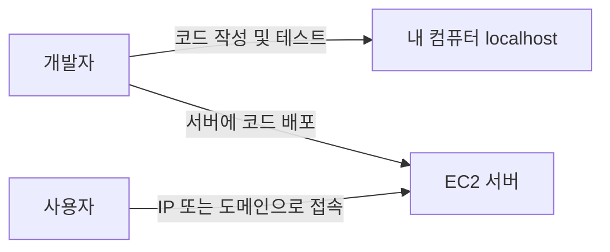

# 📖배포(Deployment)란?

개발한 웹 서비스나 백엔드 서버를 다른 사용자도 인터넷을 통해 사용할 수 있도록 만드는 작업을 배포라고 한다.

## 배포란 무엇일까?

개발 중인 서버는 보통 내 컴퓨터에서 실행한다.

이때 사용하는 `localhost` 주소는 내 컴퓨터에서만 접근할 수 있다. 다른 사용자는 내 컴퓨터의 `localhost` 주소로 서비스에 접속할 수 없다.

배포를 하면 서버에 IP 주소나 도메인 주소가 생기고, 사용자는 그 주소를 통해 서비스에 접속할 수 있다.

## 개발 환경과 배포 환경의 차이

### 1) 개발 환경

개발 환경은 기능을 만들고 테스트하는 공간이다.

보통 내 컴퓨터에서 서버를 실행하고, `localhost` 주소를 사용한다.

### 2) 배포 환경

배포 환경은 실제 사용자가 서비스에 접속하는 공간이다.

EC2 같은 외부 서버에 애플리케이션을 실행하고, 공인 IP 주소 또는 도메인 주소를 통해 사용자의 요청을 받는다.

| 구분 | 개발 환경 | 배포 환경 |
| --- | --- | --- |
| 실행 위치 | 내 컴퓨터 | 외부 서버 |
| 접속 주소 | `localhost` | IP 주소 또는 도메인 |
| 접근 가능한 사람 | 개발자 | 인터넷 사용자 |
| 목적 | 개발과 테스트 | 실제 서비스 제공 |

## 배포 흐름

## AWS에서의 배포

이 학습에서는 AWS EC2에 백엔드 API 서버를 배포한다.

EC2는 인터넷에 연결된 가상 컴퓨터다. EC2에서 백엔드 서버를 실행하면 내 컴퓨터를 계속 켜 두지 않아도 되고, 다른 사용자가 인터넷을 통해 API에 접근할 수 있다.

이후 Route 53으로 도메인을 연결하고, ELB와 ACM을 이용해 HTTPS를 적용한다.

## 정리

- 배포는 서비스를 인터넷에서 사용할 수 있도록 만드는 작업이다.
- `localhost`는 내 컴퓨터에서만 접근할 수 있다.
- 배포된 서버는 IP 주소 또는 도메인 주소로 접근할 수 있다.
- 이 학습에서는 EC2에 백엔드 API 서버를 배포한다.
