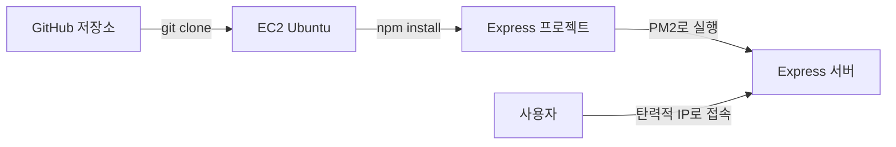

# 🚀Express 서버를 EC2에 배포하기

EC2의 Ubuntu 환경에 Node.js와 Express 프로젝트를 준비하고, PM2로 서버를 실행하는 과정을 정리한다.

## 이 글에서 배우는 것

- Ubuntu에 Node.js 설치하기
- GitHub 프로젝트를 EC2로 가져오기
- `.env` 파일을 서버에서 직접 만들기
- PM2로 Express 서버 실행하기
- 퍼블릭 IP 주소로 서버 동작 확인하기

## 배포 흐름



## 1. Node.js 설치하기

Express 서버를 실행하려면 EC2에 Node.js가 설치되어 있어야 한다.

강의에서는 Node.js 20 버전을 기준으로 진행한다.

```bash
curl -fsSL https://deb.nodesource.com/setup_20.x | sudo -E bash -
sudo apt-get install -y nodejs
```

설치가 완료되면 버전을 확인한다.

```bash
node -v
npm -v
```

## 2. Express 프로젝트 가져오기

GitHub에 있는 Express 프로젝트를 EC2로 가져온다.

```bash
git clone https://github.com/JSCODE-EDU/ec2-express-sample.git
cd ec2-express-sample
npm install
```

- `git clone`: GitHub 저장소를 EC2로 복사한다.
- `cd`: 프로젝트 폴더로 이동한다.
- `npm install`: 프로젝트에 필요한 패키지를 설치한다.

## 3. `.env` 파일 만들기

`.env` 파일에는 데이터베이스 정보, API 키처럼 민감한 환경 변수를 저장한다.

민감한 정보가 담긴 `.env` 파일은 GitHub에 올리지 않는 것이 일반적이다. 따라서 EC2 서버에서 직접 만든다.

```bash
nano .env
```

예시:

```text
DATABASE_NAME=my_database
```

프로젝트에서 필요한 환경 변수 이름과 값은 각 프로젝트의 `.env.example` 또는 설정 파일을 기준으로 작성한다.

실제 비밀번호, 액세스 키, API 키는 GitHub에 커밋하지 않는다.

## 4. PM2로 서버 실행하기

PM2는 Node.js 서버 프로세스를 관리하는 도구다.

서버가 실행 중인지 확인하거나, 서버가 비정상 종료되었을 때 다시 실행하는 데 도움을 준다.

```bash
sudo npm install -g pm2
sudo pm2 start app.js
```

실행 상태는 다음 명령어로 확인할 수 있다.

```bash
sudo pm2 status
```

## 5. 서버 동작 확인하기

Express 서버가 `80`번 Port에서 실행 중이라면 브라우저에서 탄력적 IP 주소로 접속한다.

```text
http://<탄력적-IP-주소>
```

서버가 `3000`번처럼 기본 Port가 아닌 곳에서 실행 중이라면 Port 번호까지 입력한다.

```text
http://<탄력적-IP-주소>:3000
```

접속이 되지 않는다면 아래 항목을 확인한다.

- EC2 인스턴스가 실행 중인지 확인한다.
- 보안 그룹에서 서버 Port가 열려 있는지 확인한다.
- PM2에서 서버가 정상 실행 중인지 확인한다.
- 서버가 실제로 어떤 Port에서 실행 중인지 확인한다.
