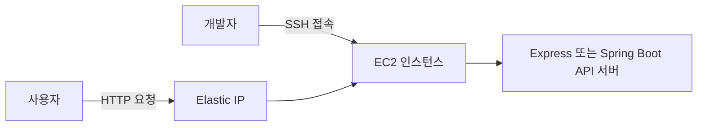

# EC2로 백엔드 API 서버 배포하기

로컬 환경에서 개발한 백엔드 API 서버를 AWS EC2에 배포하고, 인터넷을 통해 접근할 수 있게 만드는 과정을 정리한다.

## 이 섹션에서 배우는 것

- 배포가 무엇인지 이해하기
- AWS EC2 인스턴스 생성하기
- 보안 그룹으로 서버 접근 제어하기
- SSH로 EC2에 접속하기
- Elastic IP로 서버 주소 고정하기
- Express 또는 Spring Boot 서버 배포하기
- 실습이 끝난 뒤 AWS 비용이 발생하지 않도록 리소스 정리하기

## 배포란 무엇일까?

개발 중인 서버는 보통 내 컴퓨터의 `localhost`에서 실행된다.  
하지만 `localhost`는 내 컴퓨터에서만 접근할 수 있다.

배포는 다른 사용자도 인터넷을 통해 서비스를 이용할 수 있도록 서버를 외부 환경에 올리는 작업이다.

EC2에 서버를 배포하면 사용자는 서버의 IP 주소나 도메인을 통해 API에 접근할 수 있다.

## EC2란 무엇일까?

EC2(Elastic Compute Cloud)는 AWS에서 빌려 사용하는 가상 컴퓨터다.

직접 사용하는 컴퓨터에 서버를 배포하면 컴퓨터를 계속 켜 두어야 하고, 네트워크와 보안 설정도 직접 관리해야 한다. EC2를 사용하면 AWS의 서버 환경에서 백엔드 애플리케이션을 실행할 수 있다.

EC2는 주로 다음과 같은 경우에 사용한다.

- 백엔드 API 서버 배포
- 개발·테스트 서버 운영
- 배치 작업이나 자동화 프로그램 실행

## 구성도

## 학습 순서

1. [배포란](./01-배포란.md)
2. [EC2란](./02-EC2란.md)
3. [리전 선택](./03-리전-선택.md)
4. [EC2 기본 설정](./04-EC2-기본-설정.md)
5. [보안 그룹 설정](./05-보안-그룹-설정.md)
6. [IP와 Port](./06-IP와-Port.md)
7. [스토리지 구성](./07-스토리지-구성.md)
8. [EC2 접속](./08-EC2-접속.md)
9. [탄력적 IP 연결](./09-탄력적-IP-연결.md)
10. [Express 서버 배포](./10-Express-서버-배포.md)
11. [Spring Boot 서버 배포](./11-Spring-Boot-서버-배포.md)
12. [퀴즈](./12-퀴즈.md)
13. [실습 후 리소스 정리](./99-리소스-정리.md)

## 학습 후 할 수 있는 것

- EC2 인스턴스를 생성하고 SSH로 접속할 수 있다.
- 보안 그룹을 이용해 필요한 포트만 외부에 열 수 있다.
- 백엔드 API 서버를 EC2에서 실행할 수 있다.
- Elastic IP를 연결해 서버의 공인 IP 주소를 고정할 수 있다.
- 사용하지 않는 EC2 리소스를 정리해 불필요한 비용 발생을 막을 수 있다.

## 주의 사항

- 키 페어 파일(`.pem`)은 절대 GitHub에 올리지 않는다.
- AWS 액세스 키와 비밀번호는 문서나 코드에 작성하지 않는다.
- 실습이 끝나면 EC2 인스턴스와 Elastic IP를 정리한다.
