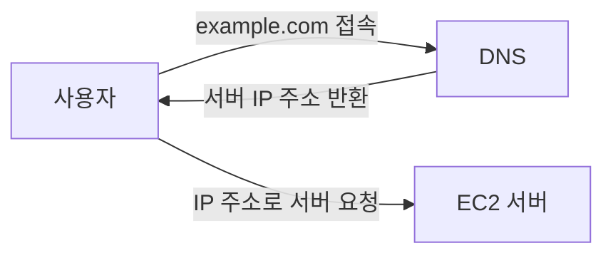

# 🌐Route 53과 DNS

Route 53은 도메인을 구매하고 DNS 설정을 관리할 수 있는 AWS 서비스다.

## 이 글에서 배우는 것

- 도메인이 무엇인지 이해하기
- DNS가 동작하는 방식 알아보기
- Route 53의 역할 이해하기
- 도메인과 HTTPS의 관계 알아보기
- Route 53 외의 DNS 서비스 알아보기

## 도메인이란?

도메인은 IP 주소를 사람이 기억하기 쉬운 문자 형태로 표현한 인터넷 주소다.

예를 들어 `naver.com`, `youtube.com`, `example.com`이 도메인이다.

서버는 IP 주소를 통해 통신할 수 있지만, 숫자로 된 IP 주소는 외우기 어렵다.

```text
13.250.15.132
```

도메인을 사용하면 사용자는 기억하기 쉬운 문자 주소로 서비스에 접속할 수 있다.

## DNS란?

DNS(Domain Name System)는 도메인 주소를 실제 IP 주소로 변환해 주는 시스템이다.

사용자가 `example.com`에 접속하면 DNS가 연결된 서버의 IP 주소를 찾아 준다.



즉, DNS는 사람이 사용하는 도메인 주소와 컴퓨터가 사용하는 IP 주소를 연결해 주는 역할을 한다.

## Route 53이란?

Route 53은 AWS에서 제공하는 DNS 서비스다.

Route 53을 사용하면 다음 작업을 할 수 있다.

- 도메인 구매하기
- 도메인과 EC2 서버 연결하기
- DNS 레코드 관리하기
- 도메인을 ELB, CloudFront 같은 AWS 서비스에 연결하기

이번 학습에서는 Route 53에서 구매한 도메인을 EC2의 탄력적 IP와 연결한다.

## 도메인과 HTTPS

실제 서비스는 보통 IP 주소가 아닌 도메인 주소를 사용한다.

일반적인 웹 서비스의 HTTPS 인증서는 도메인을 기준으로 발급하고 관리한다. 따라서 HTTPS를 적용하려면 도메인이 필요하다.

이후 ELB와 ACM을 사용해 HTTPS를 적용할 때도 도메인을 활용한다.

## Route 53만 사용할 수 있을까?

아니다. 도메인을 구매하고 DNS를 관리할 수 있는 서비스는 여러 가지가 있다.

- AWS Route 53
- 가비아
- 후이즈
- Cloudflare

원하는 도메인이 판매되는지, 가격이 어떤지, 기존에 사용하는 서비스가 있는지를 고려해 선택하면 된다.

다만 AWS 서비스를 주로 사용한다면 Route 53을 사용했을 때 DNS 설정을 한곳에서 관리하기 편하다.
