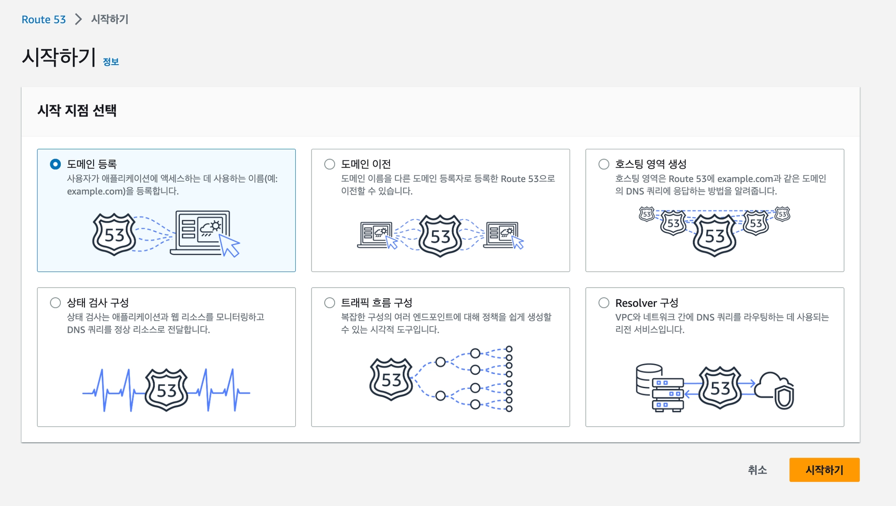
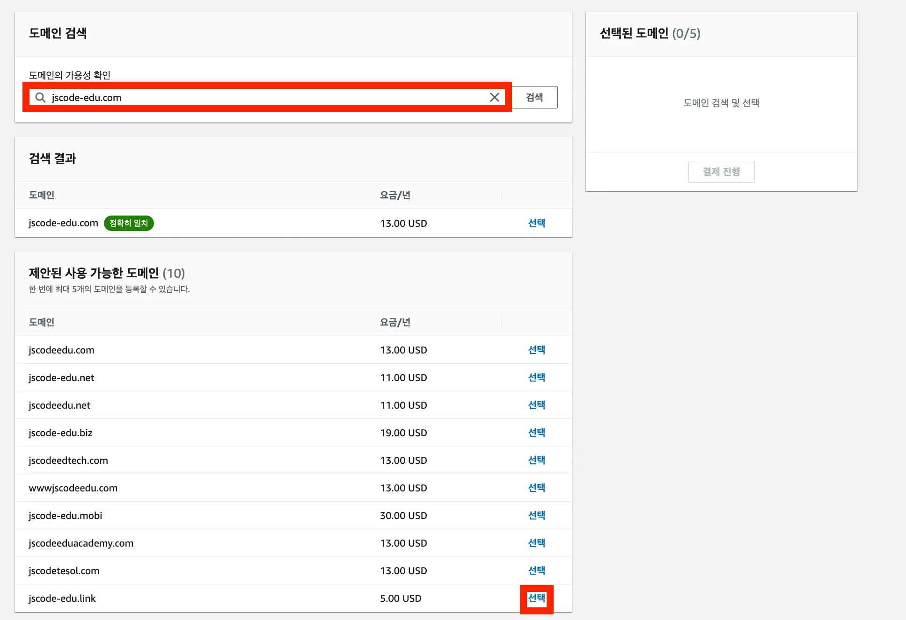
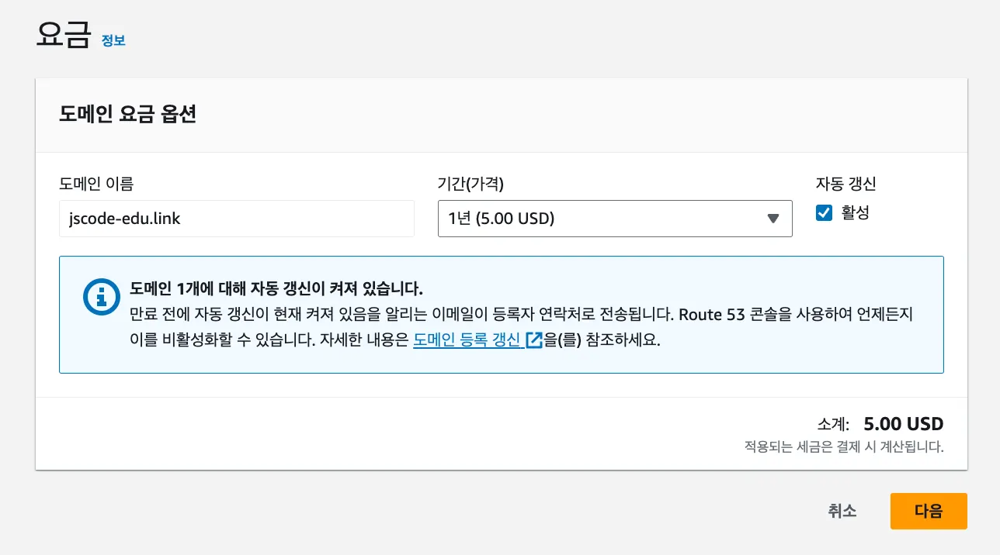
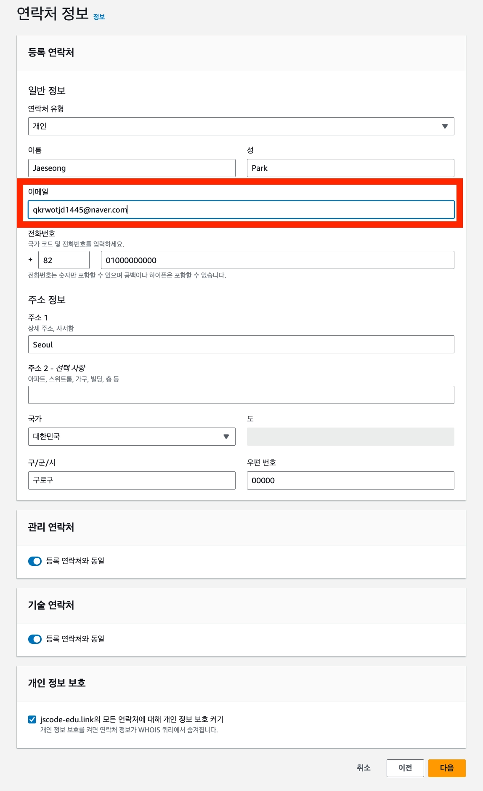
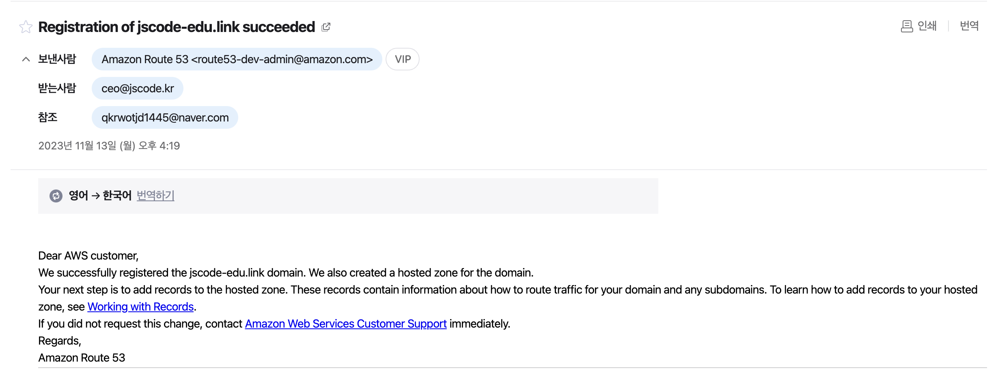
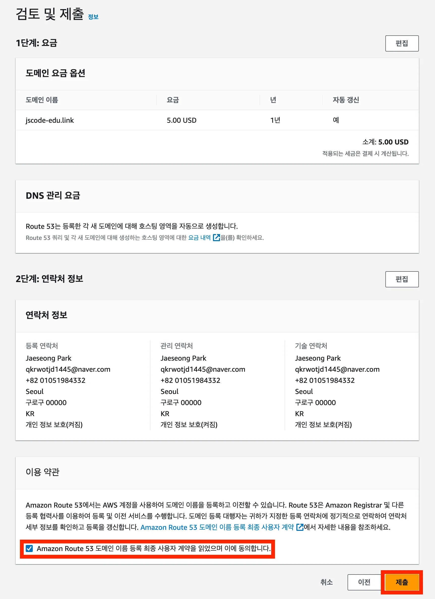
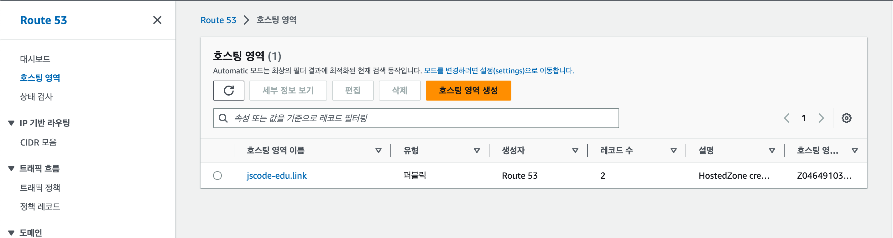
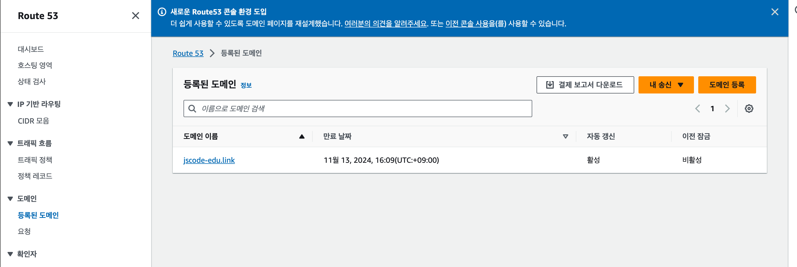

# 🛒Route 53에서 도메인 구매하기

Route 53에서 도메인을 검색하고 구매한 뒤, 정상적으로 등록되었는지 확인하는 과정을 정리한다.

> 이미지 파일은 `../assets/images/02-Route53-도메인-연결/02-도메인-구매/` 경로에 저장한다.

## 시작 전 확인

- 도메인 구매와 갱신에는 비용이 발생한다.
- 자동 갱신 여부를 확인한다.
- 도메인 등록 연락처에는 실제로 수신 가능한 이메일을 입력한다.
- `제출` 버튼을 누르면 실제 구매 요청이 생성된다.

## 1. 도메인 등록 시작하기

1. AWS 콘솔에서 `Route 53`을 검색해 접속한다.
2. 시작 화면에서 `도메인 등록`을 선택한다.
3. `시작하기`를 선택한다.

시작 화면이 보이지 않는다면 왼쪽 메뉴에서 `Domains > Registered domains > Register domains` 순서로 이동한다.



## 2. 구매할 도메인 검색하기

원하는 도메인 이름을 입력하고 검색한다.

```text
my-service-example.com
```

사용 가능한 도메인 중 원하는 항목의 `선택` 버튼을 누른다.



## 3. 도메인 요금 설정하기

도메인 등록 기간과 자동 갱신 여부를 확인한다.

| 항목 | 설명 |
| --- | --- |
| 등록 기간 | 도메인을 사용할 기간 |
| 자동 갱신 | 만료일 전에 자동으로 등록 기간을 연장하는 설정 |
| 요금 | 도메인 종류와 등록 기간에 따른 비용 |

자동 갱신을 사용하면 도메인이 만료되는 것을 막을 수 있다. 다만 갱신 비용이 발생하므로 필요 여부를 확인한다.



## 4. 연락처 정보 입력하기

도메인 등록에 사용할 연락처 정보를 입력한다.

이메일 주소는 반드시 정확하게 입력한다. 도메인 등록 과정에서 이메일 인증이 필요할 수 있다.



> 이미지에는 이름, 이메일, 전화번호, 주소 등 개인정보가 보이지 않도록 가린다.

## 이메일 인증 확인하기

도메인 구매 요청을 제출한 뒤 등록 이메일로 인증 메일이 올 수 있다.

강의 기준으로 등록까지 약 10~20분이 걸릴 수 있다. 이메일 인증을 완료해야 도메인이 정상적으로 등록된다.



## 5. 검토 후 제출하기

검토 화면에서 아래 내용을 확인한다.

- 도메인 이름
- 도메인 요금
- 등록 기간
- 자동 갱신 여부
- 연락처 정보
- 이용 약관

모든 내용을 확인한 뒤 이용 약관 동의란을 선택하고 `제출`을 누른다.



> `제출`은 실제 비용이 발생할 수 있는 단계다. 도메인 이름과 비용을 마지막으로 확인한다.

## 도메인 구매 확인하기

도메인이 등록되면 Route 53에서 호스팅 영역과 등록된 도메인을 확인할 수 있다.

### 호스팅 영역 확인

왼쪽 메뉴에서 `호스팅 영역`을 선택한다.

구매한 도메인 이름의 호스팅 영역이 생성되었는지 확인한다.



### 등록된 도메인 확인

왼쪽 메뉴에서 `등록된 도메인`을 선택한다.

구매한 도메인이 목록에 표시되는지 확인한다.



## 다음 단계

다음 문서에서는 구매한 도메인을 EC2의 탄력적 IP 주소와 연결한다.
