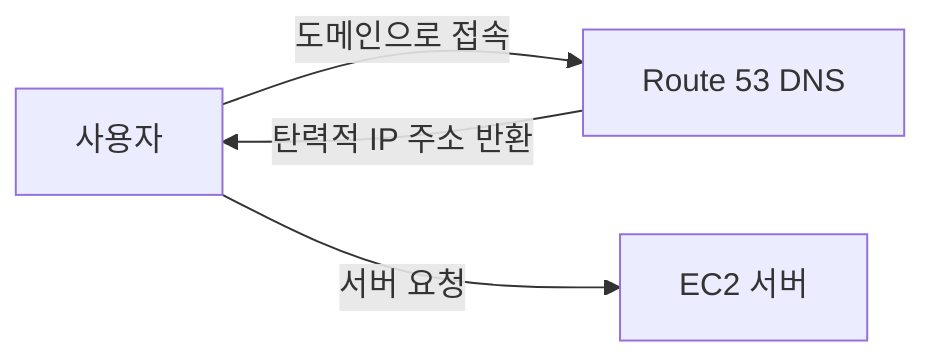
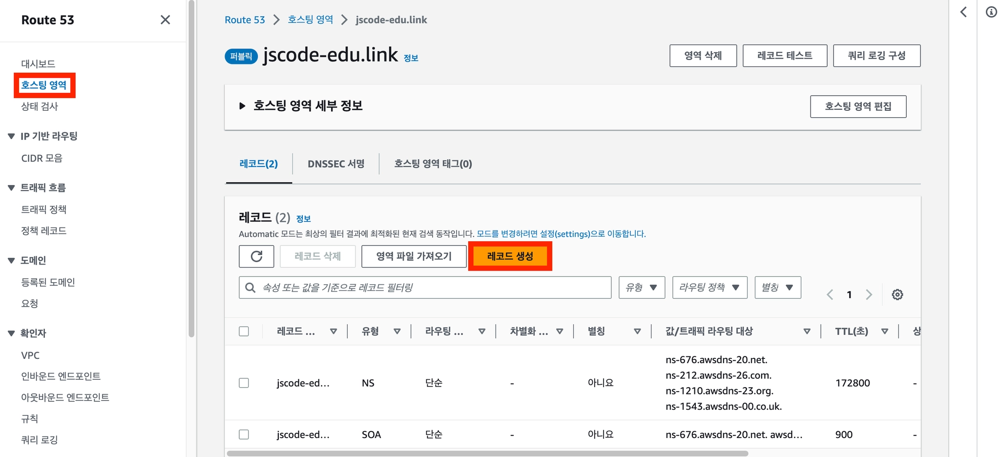
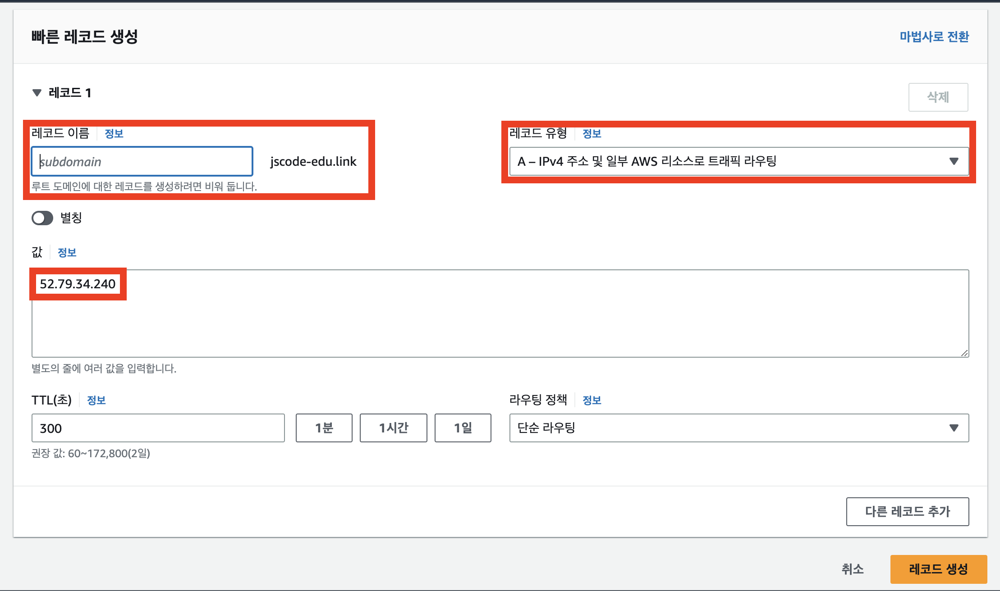
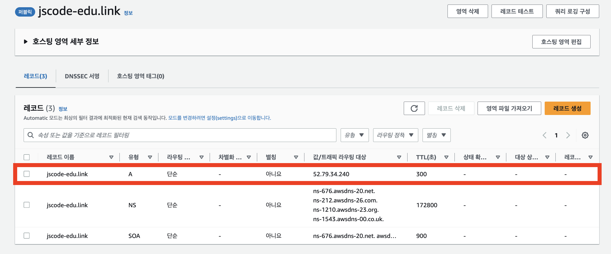
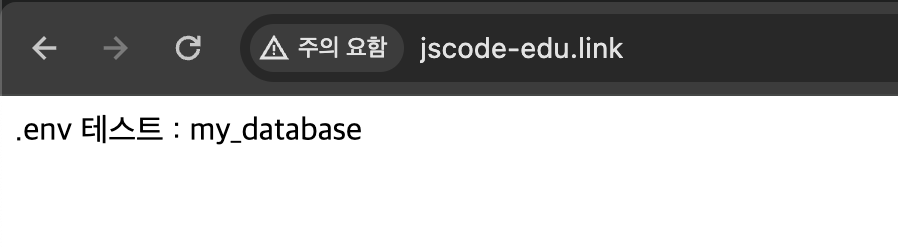
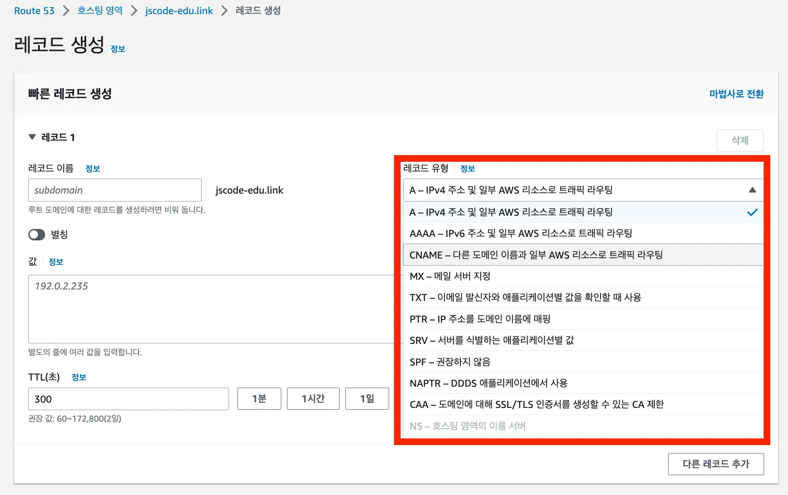

# 🔗EC2에 도메인 연결하기

Route 53에서 구매한 도메인을 EC2 서버의 탄력적 IP 주소와 연결하는 과정을 정리한다.

## 이 글에서 배우는 것

- Route 53에서 DNS 레코드를 생성하는 방법
- A 레코드로 도메인과 EC2의 탄력적 IP를 연결하는 방법
- 루트 도메인과 서브도메인의 차이
- A 레코드와 CNAME 레코드의 차이
- 도메인 연결 후 접속을 확인하는 방법

## 시작 전 확인

- EC2에 서버를 배포한 상태여야 한다.
- EC2 인스턴스에 탄력적 IP를 연결해 둔다.
- Route 53에서 도메인을 구매하고 호스팅 영역이 생성되어 있어야 한다.
- 서버가 사용하는 포트를 보안 그룹 인바운드 규칙에서 허용해야 한다.

> EC2의 일반 퍼블릭 IPv4 주소는 인스턴스를 중지했다가 시작하면 변경될 수 있다. 도메인 연결에는 변경되지 않는 탄력적 IP를 사용하는 것이 좋다.

## 도메인 연결 구조

Route 53의 A 레코드에 탄력적 IP 주소를 등록하면, 사용자가 도메인으로 접속했을 때 EC2 서버로 요청이 전달된다.



## 1. 호스팅 영역에서 레코드 생성하기

1. AWS 콘솔에서 `Route 53`을 검색해 접속한다.
2. 왼쪽 메뉴에서 `호스팅 영역`을 선택한다.
3. 연결할 도메인 이름을 선택한다.
4. 도메인 상세 화면에서 `레코드 생성`을 선택한다.



## 2. A 레코드 설정하기

레코드 생성 화면에서 도메인과 EC2의 탄력적 IP를 연결할 수 있다.



아래 항목을 설정한다.

| 항목 | 설정 값 | 설명 |
| --- | --- | --- |
| 레코드 이름 | 비워 둠 | 구매한 루트 도메인 자체를 연결할 때 사용 |
| 레코드 유형 | `A` | 도메인을 IPv4 주소에 연결하는 레코드 |
| 값 | EC2의 탄력적 IP | 연결할 EC2 서버의 고정 IP 주소 |
| TTL | 기본값 사용 | DNS 정보가 캐시되는 시간 |

`값`에는 EC2 인스턴스에 연결한 탄력적 IP 주소를 입력한다.

```text
예시
52.79.34.240
```



설정을 확인한 뒤 `레코드 생성`을 선택한다.

> A 레코드는 도메인을 IP 주소에 연결할 뿐, 포트를 연결하지는 않는다.

## 3. 서브도메인 연결하기

루트 도메인이 `example.com`이라면, 레코드 이름을 비워 둔 A 레코드는 `example.com`을 EC2에 연결한다.

`api.example.com`처럼 서브도메인을 만들고 싶다면 레코드 이름에 `api`를 입력한다.

| 연결할 주소 | 레코드 이름 |
| --- | --- |
| `example.com` | 비워 둠 |
| `api.example.com` | `api` |
| `www.example.com` | `www` |

하나의 도메인을 구매해도 목적에 따라 여러 개의 서브도메인을 만들 수 있다.

## 4. 도메인 접속 확인하기

A 레코드를 생성한 직후에는 DNS 정보가 전파되는 시간이 필요하다.

강의 기준으로 약 5~10분 뒤 도메인 주소로 접속해 동작을 확인한다.

```text
http://example.com
```

서버가 `3000` 포트에서 직접 실행 중이라면 포트 번호도 함께 입력해야 한다.

```text
http://example.com:3000
```



## 레코드 유형 알아보기

DNS에는 여러 레코드 유형이 있지만, 처음에는 A 레코드와 CNAME 레코드를 우선 이해하면 충분하다.



| 레코드 유형 | 연결 대상 | 사용 예시 |
| --- | --- | --- |
| A 레코드 | IPv4 주소 | 도메인 → EC2 탄력적 IP |
| CNAME 레코드 | 다른 도메인 주소 | `www.example.com` → `example.com` |

### A 레코드

A 레코드는 도메인을 특정 IPv4 주소에 연결할 때 사용한다.

이번 실습에서는 도메인을 EC2의 탄력적 IP에 연결하기 위해 A 레코드를 사용한다.

### CNAME 레코드

CNAME 레코드는 도메인을 다른 도메인 주소에 연결할 때 사용한다.

예를 들어 `www.example.com`을 `example.com`으로 연결할 때 사용할 수 있다.

## 연결되지 않을 때 확인할 것

- A 레코드의 값이 EC2 탄력적 IP 주소와 일치하는지 확인한다.
- EC2 인스턴스가 실행 중인지 확인한다.
- 보안 그룹에서 서버 포트를 허용했는지 확인한다.
- DNS 전파 시간을 기다린 뒤 다시 접속한다.
- 서버가 `80` 포트가 아닌 다른 포트에서 실행 중이라면 URL에 포트 번호를 입력한다.

## 다음 단계

다음 문서에서는 Route 53이 아닌 다른 서비스에서 무료 도메인을 사용하는 방법을 정리한다.
