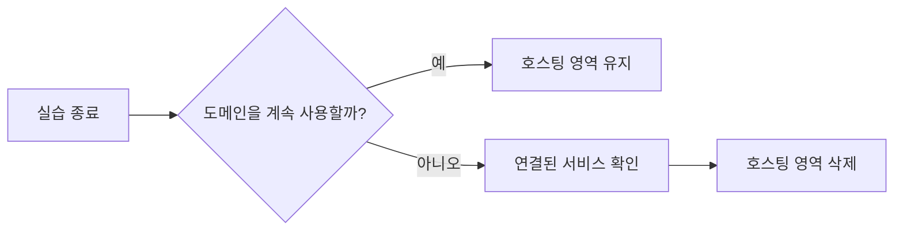

# 🧹Route 53 리소스 정리하기

도메인 연결 실습을 마친 뒤, 더 이상 사용하지 않는 Route 53 리소스를 정리해 불필요한 비용이 발생하지 않도록 한다.

## 왜 정리해야 할까?

Route 53에서 도메인을 구매하면 해당 도메인의 **호스팅 영역(Hosted Zone)** 이 자동으로 생성될 수 있다.

호스팅 영역을 계속 유지하면 매월 비용이 발생할 수 있다. 따라서 실습이 끝났고 도메인을 더 이상 사용하지 않는다면, 연결 정보를 확인한 뒤 호스팅 영역을 삭제한다.

> Route 53 호스팅 영역 비용과 도메인 갱신 비용은 AWS 정책에 따라 달라질 수 있으므로, 정리 전 AWS Billing 또는 Route 53 요금 정보를 한 번 확인한다.

## 정리 전에 확인할 것

다음 조건이라면 호스팅 영역을 삭제하지 않는다.

- 아직 도메인으로 서비스에 접속해야 하는 경우
- EC2, ELB, CloudFront 등 다른 AWS 리소스가 해당 도메인을 사용하는 경우
- DNS 레코드가 필요한 이메일 서비스 또는 외부 서비스가 연결된 경우

호스팅 영역을 삭제하면 그 안의 DNS 레코드도 함께 삭제된다. 따라서 도메인 연결이 끊길 수 있다.

## 정리할 대상

| 대상 | 설명 | 삭제 여부 |
| --- | --- | --- |
| DNS 레코드 | 도메인을 IP 주소 또는 다른 서비스와 연결하는 설정 | 호스팅 영역 삭제 시 함께 삭제됨 |
| 호스팅 영역 | 도메인의 DNS 레코드를 관리하는 공간 | 실습 종료 후 미사용 시 삭제 |
| 도메인 등록 | 도메인 자체의 소유 및 갱신 설정 | 필요에 따라 유지 또는 자동 갱신 해제 |

## 호스팅 영역 삭제하기

1. AWS 콘솔에서 `Route 53`으로 이동한다.
2. 왼쪽 메뉴에서 `호스팅 영역`을 선택한다.
3. 실습에 사용한 도메인의 호스팅 영역을 선택한다.
4. 연결된 서비스가 없는지 DNS 레코드를 확인한다.
5. `호스팅 영역 삭제`를 선택한다.
6. 안내 문구를 확인한 뒤 삭제를 완료한다.

## 도메인 등록과 호스팅 영역은 다르다

도메인 등록과 호스팅 영역은 서로 다른 항목이다.

- **도메인 등록**: `example.com` 같은 도메인을 소유하고 갱신하는 설정
- **호스팅 영역**: 도메인이 어느 서버로 연결될지 DNS 레코드를 관리하는 공간

호스팅 영역을 삭제해도 도메인 등록 자체가 바로 취소되지는 않는다. 도메인을 더 이상 유지할 계획이 없다면 자동 갱신 설정과 만료일도 함께 확인한다.

## 정리 후 확인

- Route 53의 호스팅 영역 목록에서 실습용 호스팅 영역이 삭제되었는지 확인한다.
- AWS Billing에서 예상하지 못한 Route 53 비용이 발생하지 않는지 확인한다.
- 도메인을 유지한다면 자동 갱신 여부와 만료일을 확인한다.

## 핵심 정리

- 사용하지 않는 호스팅 영역은 비용이 발생할 수 있으므로 정리한다.
- 호스팅 영역을 삭제하면 DNS 레코드도 함께 삭제된다.
- 도메인 등록과 호스팅 영역은 별도 항목이다.
- 실제 서비스에 연결된 도메인이라면 삭제 전에 연결 대상을 반드시 확인한다.
