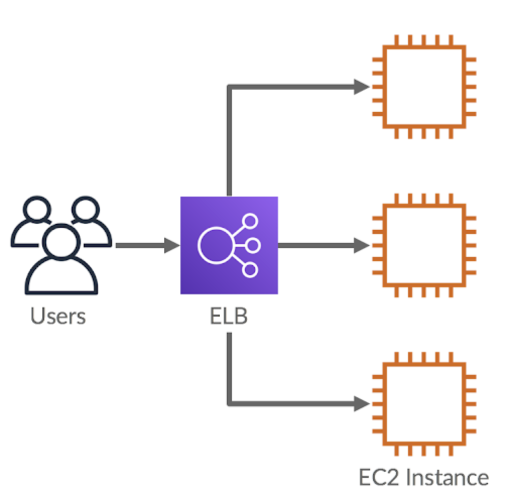
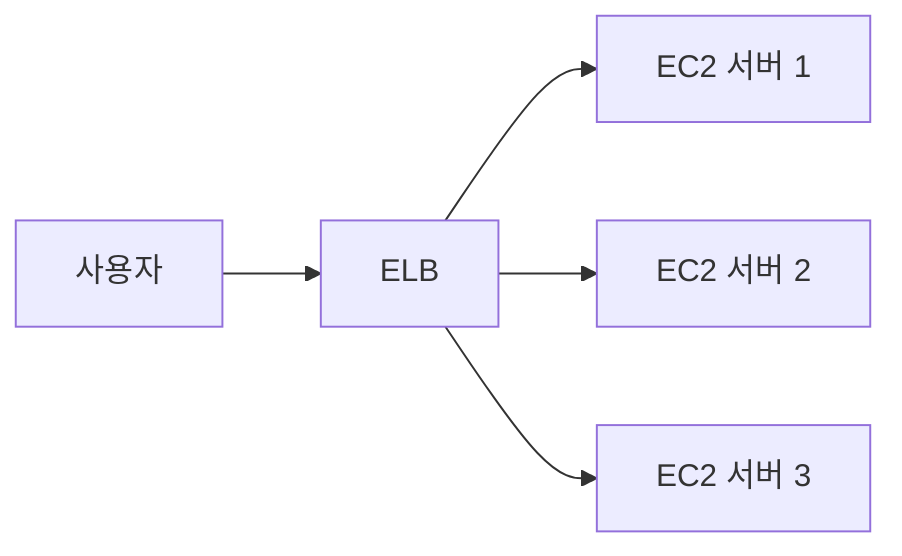
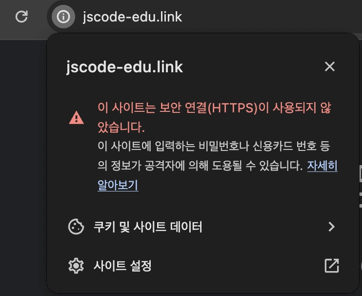
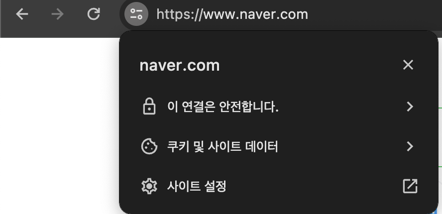

# ⚖️ELB와 TLS, SSL, HTTPS 이해하기

ELB를 사용하면 여러 서버에 트래픽을 분산할 수 있고, SSL/TLS 인증서를 연결해 HTTPS 통신을 구성할 수 있다.

이 문서에서는 ELB의 역할과 HTTPS가 필요한 이유를 먼저 정리한다.

## ELB란?

ELB(Elastic Load Balancing)는 사용자 요청을 여러 서버에 나누어 전달하는 AWS의 로드 밸런싱 서비스다.

서버가 한 대라면 모든 요청을 한 서버가 처리한다. 사용자가 많아지면 서버에 부하가 집중되고, 서버 장애가 발생했을 때 서비스 전체가 중단될 수 있다.

ELB는 앞단에서 요청을 받아 여러 서버로 분산한다.





## 이 강의에서 ELB를 사용하는 이유

ELB의 대표 기능은 트래픽 분산이다.

하지만 이번 학습에서는 여러 서버에 요청을 나누는 기능뿐 아니라, **ELB 앞단에 SSL/TLS 인증서를 연결해 HTTPS를 적용하는 방법**도 함께 다룬다.


ELB가 HTTPS 요청을 받은 뒤 EC2에 전달하는 구조를 만들 수 있다. 이를 통해 인증서 설정을 각 EC2 서버가 아니라 ELB에서 관리할 수 있다.

## SSL과 TLS란?

SSL과 TLS는 인터넷 통신을 암호화하는 보안 기술이다.

| 용어 | 설명 |
| --- | --- |
| SSL | 과거에 사용하던 보안 통신 규격 |
| TLS | SSL을 개선한 최신 보안 통신 규격 |
| SSL/TLS 인증서 | 서버가 신뢰할 수 있는 대상인지 확인하고, 암호화 통신에 사용하는 인증서 |

현재는 TLS가 실제 표준이지만, 일상적으로는 `SSL 인증서`라는 표현도 많이 사용한다.

## HTTPS란?

HTTPS는 HTTP 통신에 TLS를 적용한 방식이다.

```text
HTTP + TLS = HTTPS
```

HTTPS를 사용하면 사용자와 서버 사이에서 주고받는 데이터를 암호화할 수 있다.

| 구분 | HTTP | HTTPS |
| --- | --- | --- |
| 주소 예시 | `http://example.com` | `https://example.com` |
| 데이터 암호화 | 하지 않음 | 암호화함 |
| 브라우저 표시 | 안전하지 않음 경고가 나타날 수 있음 | 자물쇠 아이콘 등으로 안전한 연결 표시 |
| 사용 환경 | 단순 테스트 환경 | 실제 서비스 환경 |



## HTTPS가 필요한 이유

### 1. 데이터 보호

HTTP는 통신 내용이 암호화되지 않는다. 같은 네트워크 환경에서 악의적인 사용자가 통신 내용을 가로채면, 요청 데이터가 노출될 수 있다.

HTTPS는 통신 내용을 암호화해 이러한 위험을 줄인다.

특히 로그인 정보, 개인정보, 결제 정보처럼 민감한 데이터를 다루는 서비스에서는 HTTPS가 필수적이다.

### 2. 사용자 신뢰

브라우저는 HTTPS가 적용되지 않은 사이트에 보안 경고를 표시할 수 있다.

사용자는 경고가 보이는 사이트를 신뢰하기 어렵기 때문에 서비스 이탈로 이어질 수 있다.

### 3. 실제 서비스 환경

현재 대부분의 웹 서비스는 HTTPS를 기본으로 사용한다.

프론트엔드와 백엔드 API도 각각 HTTPS 주소로 구성하는 경우가 많다.



```text
웹 사이트: https://example.com
백엔드 API: https://api.example.com
```

## 도메인이 필요한 이유

HTTPS 인증서는 특정 도메인에 대해 발급된다.

따라서 백엔드 API 서버에도 HTTPS를 적용하려면 탄력적 IP 주소 대신 `api.example.com`과 같은 도메인 주소를 연결해야 한다.


## 핵심 정리

- ELB는 사용자 요청을 여러 서버에 분산하는 서비스다.
- SSL은 과거 규격이고, TLS는 현재 사용하는 보안 통신 규격이다.
- HTTPS는 HTTP 통신에 TLS를 적용한 방식이다.
- HTTPS는 통신 데이터를 암호화하고 사용자 신뢰를 높인다.
- HTTPS 인증서는 도메인과 연결해 사용한다.
- 다음 문서에서는 ELB를 구성할 때 필요한 아키텍처를 살펴본다.
