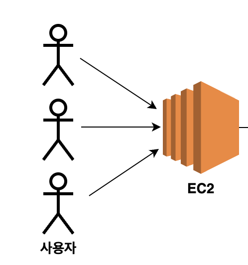
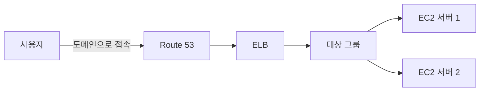
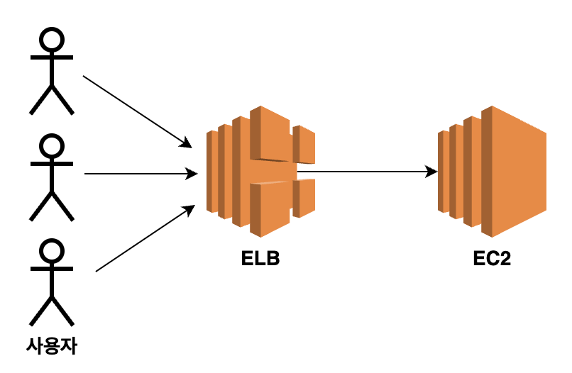
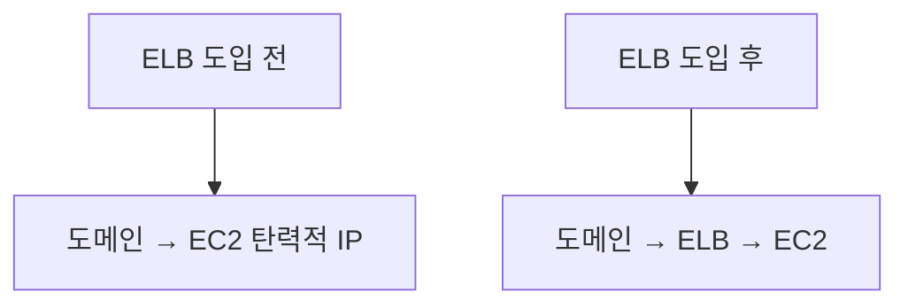
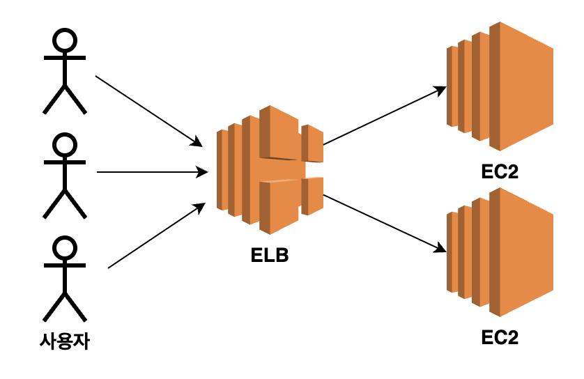

# 🏗️ELB를 활용한 아키텍처 구성

ELB를 도입하면 사용자가 EC2 서버에 직접 요청하지 않고, ELB를 거쳐 서버에 접근하도록 구성할 수 있다.

이 구조에서는 도메인과 HTTPS 인증서도 EC2가 아닌 ELB에 연결한다.

## ELB 도입 전 구조

ELB를 사용하기 전에는 사용자가 EC2의 탄력적 IP 주소 또는 EC2에 연결한 도메인으로 직접 요청한다.

이 구조는 서버 한 대를 빠르게 배포하기에는 단순하다. 하지만 서버를 여러 대로 늘리거나 HTTPS 인증서를 관리하려면 설정이 복잡해질 수 있다.

## ELB 도입 후 구조

ELB를 추가하면 사용자의 요청은 먼저 ELB로 들어온다.

ELB는 요청을 받은 뒤 대상 그룹(Target Group)에 등록된 EC2 서버로 전달한다.

현재 실습에서는 EC2 서버 한 대를 연결한다. 이후 EC2를 여러 대로 늘리면 ELB가 요청을 나누어 전달할 수 있다.

## 구성 요소별 역할

| 구성 요소 | 역할 |
| --- | --- |
| Route 53 | 도메인 주소를 ELB로 연결한다. |
| ELB | 사용자 요청을 받고 EC2 서버로 전달한다. |
| 리스너(Listener) | 특정 포트로 들어오는 요청을 처리하는 규칙이다. |
| 대상 그룹(Target Group) | ELB가 요청을 전달할 EC2 서버들의 묶음이다. |
| EC2 | 실제 백엔드 API 서버가 실행되는 곳이다. |
| ACM 인증서 | ELB에 HTTPS를 적용할 때 사용하는 인증서다. |

## 도메인 연결 대상이 바뀐다

ELB를 도입하기 전에는 도메인이 EC2의 탄력적 IP 주소를 가리킨다.

ELB를 도입한 뒤에는 도메인이 ELB를 가리키도록 Route 53 레코드를 변경한다.

ELB는 고정 IP 주소 대신 자체 DNS 이름을 제공한다. 따라서 ELB의 IP 주소를 직접 사용하거나 고정해서 연결하지 않고, Route 53에서 ELB를 대상으로 연결한다.

## HTTPS 인증서를 연결하는 위치

HTTPS 인증서는 EC2가 아니라 ELB에 연결한다.

이 방식의 장점은 인증서를 ELB 한 곳에서 관리할 수 있다는 점이다. 뒤에 연결된 EC2 서버가 여러 대여도 각 서버마다 인증서를 설정할 필요가 없다.

## 보안 그룹 흐름

사용자는 EC2가 아니라 ELB에 접근해야 한다.

따라서 보안 그룹도 아래처럼 구성한다.

- ELB 보안 그룹: 인터넷에서 들어오는 `HTTP(80)` 또는 `HTTPS(443)` 요청을 허용한다.
- EC2 보안 그룹: 모든 인터넷 요청을 허용하지 않고, **ELB 보안 그룹에서 오는 요청만** 애플리케이션 포트로 허용한다.

이렇게 구성하면 사용자가 EC2에 직접 접속하는 경로를 줄일 수 있다.

## 설정 순서

1. ELB를 생성한다.
2. ELB에 연결할 EC2 서버를 대상 그룹에 등록한다.
3. 헬스 체크로 EC2 서버가 정상인지 확인한다.
4. Route 53 레코드의 연결 대상을 EC2에서 ELB로 변경한다.
5. ACM 인증서를 발급하고 ELB의 HTTPS 리스너에 연결한다.

## 핵심 정리

- ELB 도입 전에는 사용자가 EC2에 직접 요청한다.
- ELB 도입 후에는 사용자가 ELB를 거쳐 EC2에 요청한다.
- 도메인은 EC2의 탄력적 IP가 아니라 ELB에 연결한다.
- HTTPS 인증서는 ELB에 연결해 관리한다.
- EC2 보안 그룹은 ELB 보안 그룹의 요청만 허용하도록 구성한다.
