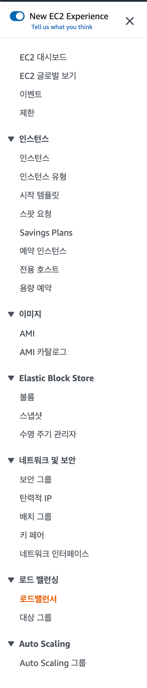
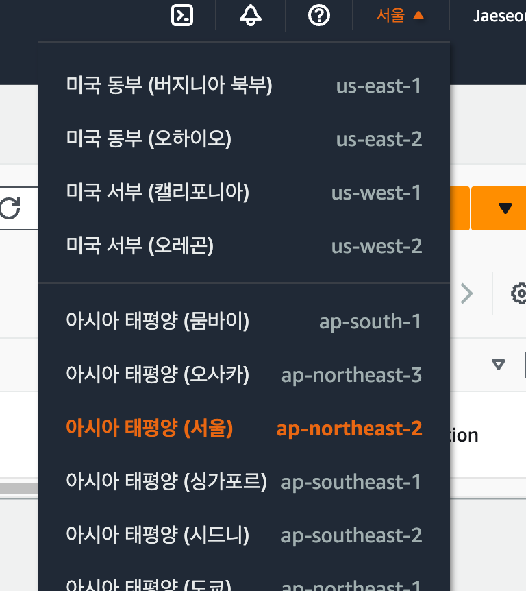
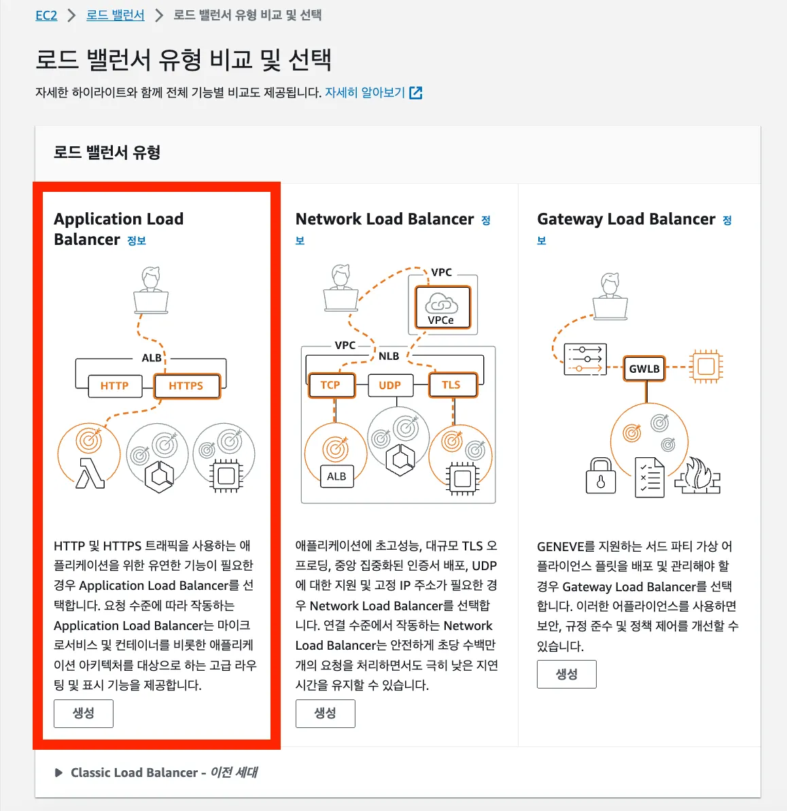
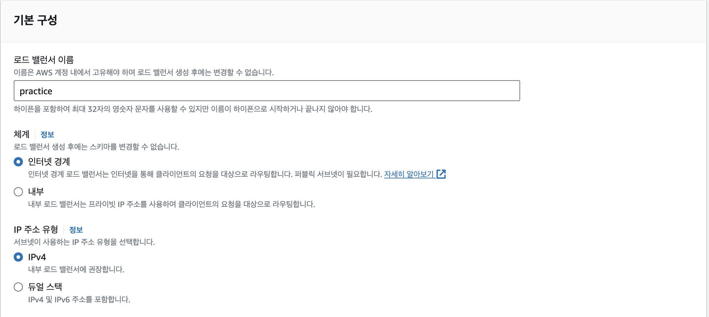
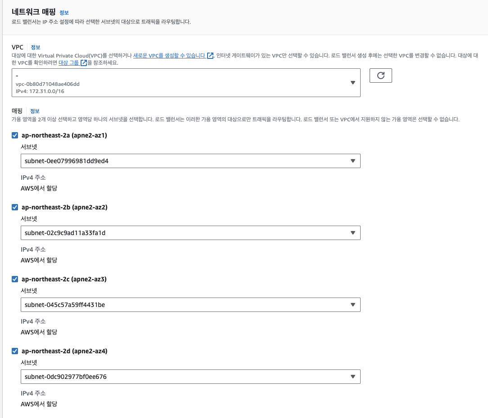
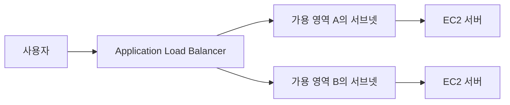

# ⚙️Application Load Balancer 기본 구성하기

이번 실습에서는 사용자의 HTTP와 HTTPS 요청을 받을 Application Load Balancer(ALB)를 생성한다.

보안 그룹, 리스너, 대상 그룹은 다음 문서에서 설정한다. 이 문서에서는 ALB 생성 전 기본 구성만 진행한다.

## 시작 전 확인

- ELB는 EC2와 같은 리전에 생성해야 한다.
- ELB와 연결할 EC2는 실행 중이어야 한다.
- ALB는 사용 시간과 처리량에 따라 비용이 발생할 수 있다.
- 실습을 마치면 사용하지 않는 ELB를 삭제한다.

## 1. 리전 선택하기

AWS 콘솔에서 EC2 서비스로 이동한 뒤, 왼쪽 메뉴의 `로드 밸런서`를 선택한다.



EC2 서버가 있는 리전과 같은 리전을 선택한다.

예를 들어 EC2를 서울 리전인 `ap-northeast-2`에 만들었다면, ELB도 서울 리전에 생성한다.



> 리전이 다르면 같은 VPC와 EC2를 연결할 수 없다.

## 2. 로드 밸런서 생성 시작하기

로드 밸런서 목록 화면에서 `로드 밸런서 생성`을 선택한다.



## 3. Application Load Balancer 선택하기

로드 밸런서 유형 중 `Application Load Balancer`를 선택한다.

| 유형 | 주로 사용하는 통신 | 사용 예시 |
| --- | --- | --- |
| Application Load Balancer | HTTP, HTTPS | 웹 사이트, REST API |
| Network Load Balancer | TCP, UDP, TLS | 매우 빠른 네트워크 처리 |
| Gateway Load Balancer | 네트워크 보안 장비 연결 | 방화벽, 침입 탐지 장비 |

이번 실습은 HTTP와 HTTPS 요청을 처리하고, ACM 인증서로 HTTPS를 적용하는 과정이므로 Application Load Balancer를 사용한다.

## 4. 기본 구성 설정하기

ALB의 기본 설정을 입력한다.



### 이름

로드 밸런서를 구분할 수 있는 이름을 입력한다.

```text
my-api-alb
```

프로젝트 이름과 역할을 함께 넣으면 나중에 리소스를 찾기 쉽다.

### 스키마

외부 사용자가 인터넷을 통해 접속할 서비스이므로 `인터넷 경계(Internet-facing)`를 선택한다.

| 옵션 | 의미 |
| --- | --- |
| 인터넷 경계 | 인터넷에서 ELB로 접근할 수 있다. |
| 내부 | VPC 내부에서만 ELB로 접근할 수 있다. |

### IP 주소 유형

EC2가 IPv4를 사용한다면 `IPv4`를 선택한다.

`듀얼 스택`은 IPv4와 IPv6를 모두 사용하는 환경에서 선택한다.

## 5. 네트워크 매핑 설정하기

ALB를 생성할 VPC와 가용 영역을 선택한다.



### VPC 선택

EC2 서버가 생성된 VPC와 같은 VPC를 선택한다.

입문 실습에서 기본 VPC를 사용했다면, 기본 VPC를 선택하면 된다.

### 가용 영역 선택

ALB는 여러 가용 영역에 배치할 수 있다. 각 가용 영역에서 사용할 서브넷을 선택한다.

가능하면 두 개 이상의 가용 영역을 선택한다. 하나의 가용 영역에 문제가 생겨도 ELB가 다른 가용 영역에서 요청을 처리할 수 있기 때문이다.



> 기본 VPC를 사용하는 실습이라면, 선택 가능한 가용 영역과 기본 서브넷을 모두 선택한다.

## 다음 단계

다음 문서에서는 ALB가 외부 요청을 받을 수 있도록 보안 그룹을 설정한다.

## 핵심 정리

- ELB는 EC2와 같은 리전에 생성한다.
- 웹 서비스와 API 서버에는 Application Load Balancer를 사용한다.
- 외부 공개 서비스라면 `인터넷 경계`를 선택한다.
- ALB와 EC2는 같은 VPC에 있어야 한다.
- 여러 가용 영역을 선택하면 가용성을 높일 수 있다.
