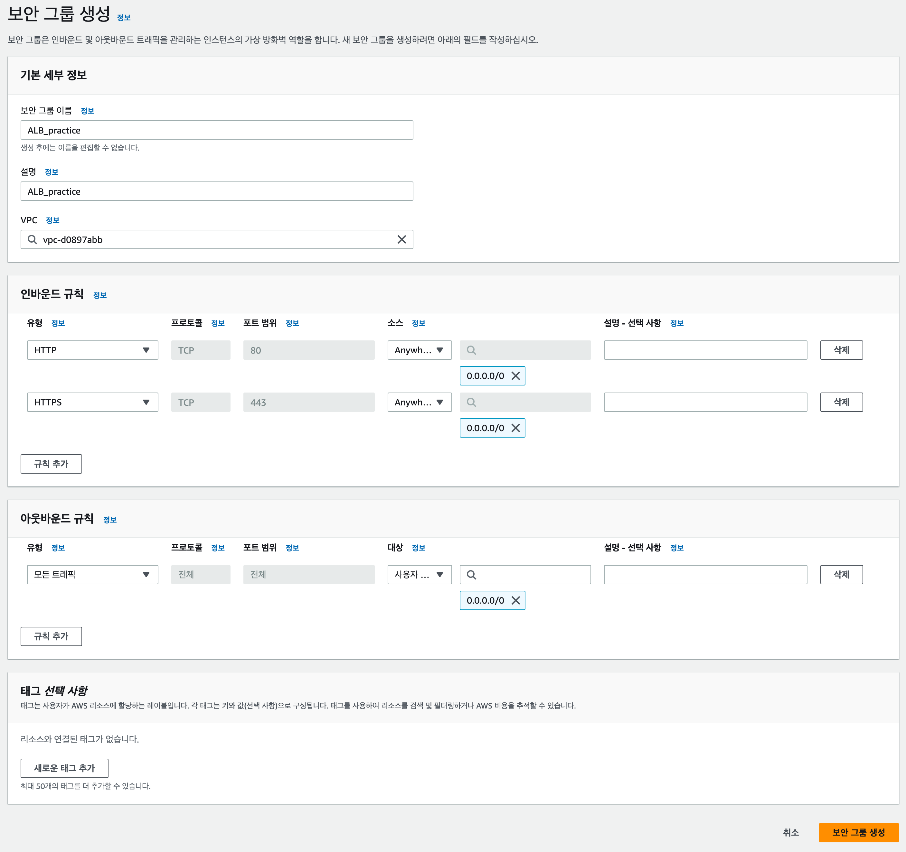
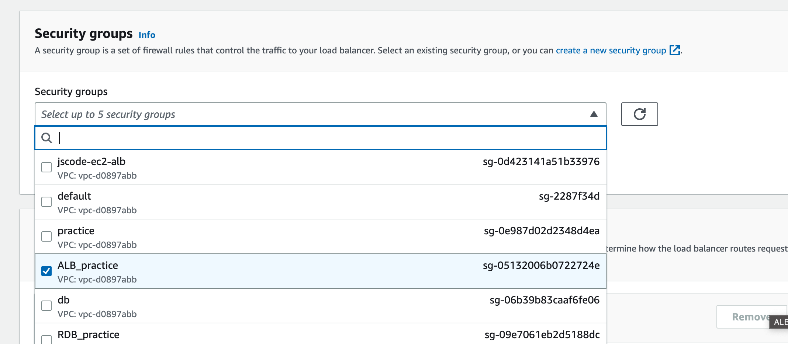

# 🔐ELB 보안 그룹 설정하기

인터넷 사용자가 ELB에 HTTP와 HTTPS로 접속할 수 있도록 ELB 전용 보안 그룹을 만든다.

보안 그룹은 AWS 리소스의 네트워크 접근을 제어하는 가상 방화벽이다.

## 이번 단계의 목표

- 외부 사용자가 ELB의 HTTP `80` 포트에 접근할 수 있게 한다.
- 이후 HTTPS를 적용할 수 있도록 HTTPS `443` 포트도 허용한다.
- 생성한 보안 그룹을 ALB에 연결한다.

## ELB와 EC2의 보안 그룹은 분리한다

ELB는 인터넷에서 요청을 받는 입구 역할을 한다.

반면 EC2는 ELB가 전달한 요청을 처리하는 서버다. 따라서 ELB와 EC2에 같은 보안 그룹을 사용하기보다 각각의 역할에 맞는 보안 그룹을 분리하는 것이 좋다.

| 대상 | 허용할 요청 |
| --- | --- |
| ELB 보안 그룹 | 인터넷 사용자의 HTTP `80`, HTTPS `443` 요청 |
| EC2 보안 그룹 | ELB 보안 그룹에서 들어오는 애플리케이션 포트 요청 |

> EC2 보안 그룹은 인터넷 전체가 아니라 ELB 보안 그룹만 허용하도록 설정하는 것이 안전하다.

## 1. ELB용 보안 그룹 만들기

AWS 콘솔에서 `EC2` 서비스로 이동한 뒤, 왼쪽 메뉴의 `보안 그룹`을 선택한다.

`보안 그룹 생성`을 선택하고 아래처럼 입력한다.

| 항목 | 예시 |
| --- | --- |
| 보안 그룹 이름 | `my-api-alb-sg` |
| 설명 | `ALB inbound rules` |
| VPC | ELB와 EC2가 있는 VPC |

보안 그룹은 ALB와 같은 VPC에서 생성해야 한다.

## 2. 인바운드 규칙 설정하기

ELB는 외부 사용자 요청을 받아야 하므로 아래 인바운드 규칙을 추가한다.

| 유형 | 프로토콜 | 포트 | 소스 | 용도 |
| --- | --- | --- | --- | --- |
| HTTP | TCP | `80` | `0.0.0.0/0` | HTTP 요청 수신 |
| HTTPS | TCP | `443` | `0.0.0.0/0` | HTTPS 요청 수신 |

`0.0.0.0/0`은 모든 IPv4 주소를 의미한다.

공개 웹 서비스의 ALB는 인터넷 사용자가 접근해야 하므로 `80`, `443` 포트에 대해 모든 IPv4 주소를 허용한다.

> 외부 공개가 필요 없는 내부 서비스라면 `0.0.0.0/0` 대신 VPC 내부 또는 특정 보안 그룹만 허용한다.

## 3. ALB에 보안 그룹 연결하기

ALB 생성 화면으로 돌아가서 `보안 그룹` 항목에 방금 만든 ELB용 보안 그룹을 선택한다.

기본 보안 그룹이 자동 선택되어 있다면, 실습용 ELB 보안 그룹으로 변경했는지 확인한다.

## 설정 후 확인

- ELB와 같은 VPC의 보안 그룹을 선택했는지 확인한다.
- 인바운드 규칙에 HTTP `80`, HTTPS `443`이 있는지 확인한다.
- 소스가 `0.0.0.0/0`인 규칙은 ELB에만 적용했는지 확인한다.
- EC2에 인터넷 전체 접근을 허용하는 규칙이 남아 있는지 다음 단계에서 점검한다.

## 다음 단계

다음 문서에서는 ELB로 들어온 요청을 EC2 서버에 전달할 수 있도록 리스너, 대상 그룹, 헬스 체크를 설정한다.

## 핵심 정리

- 보안 그룹은 AWS 리소스의 접근을 제어하는 방화벽이다.
- ELB는 외부 사용자 요청을 받으므로 `80`, `443` 포트를 허용한다.
- ELB와 EC2는 역할이 다르므로 보안 그룹을 분리한다.
- EC2는 가능하면 ELB 보안 그룹의 요청만 허용한다.
