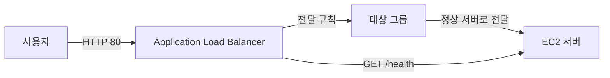
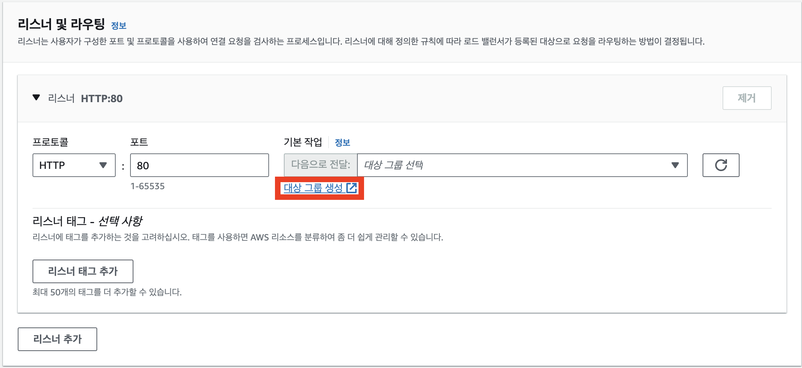
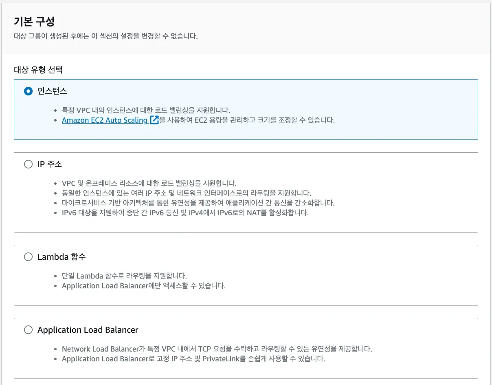
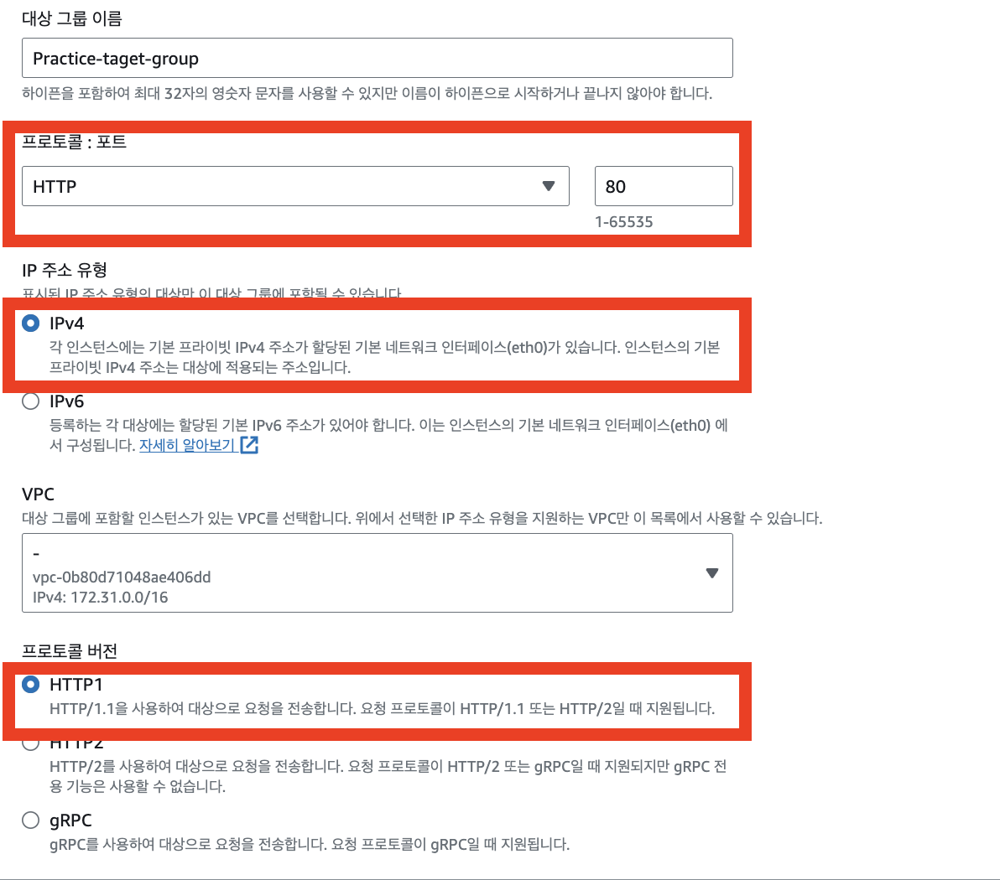
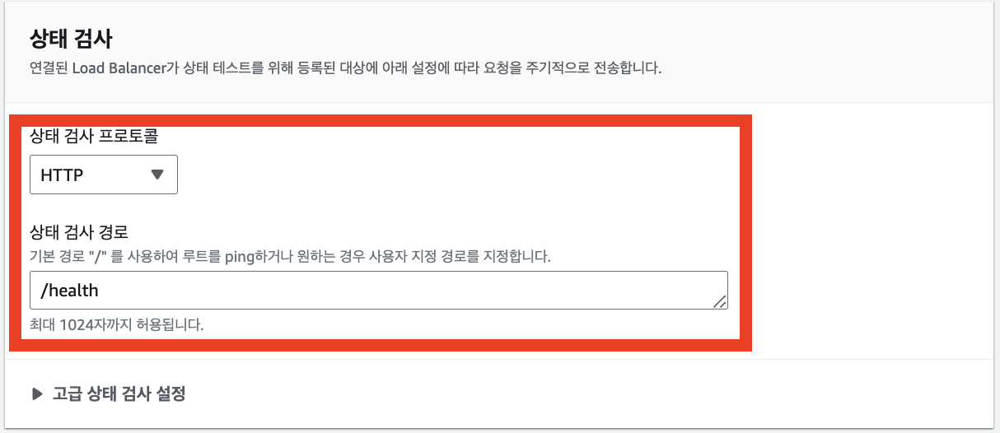
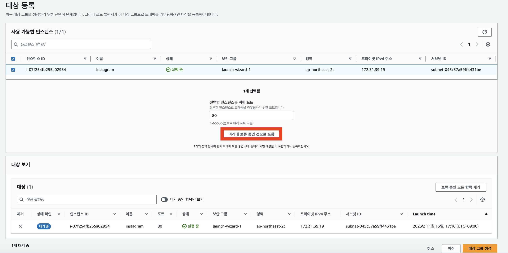
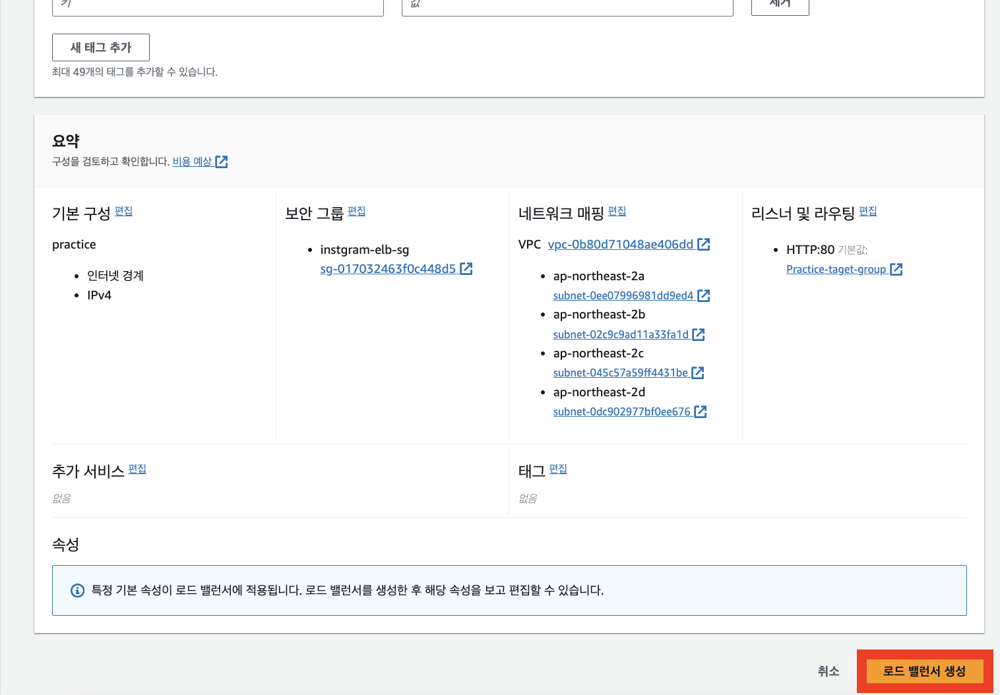
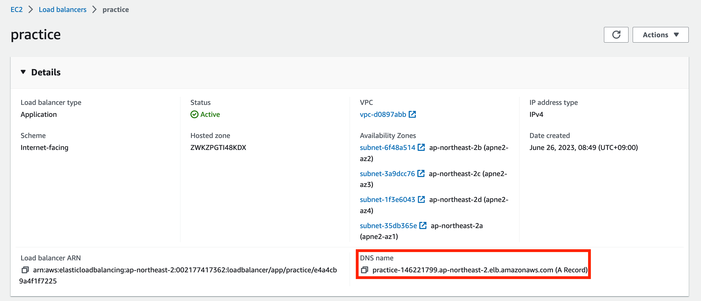
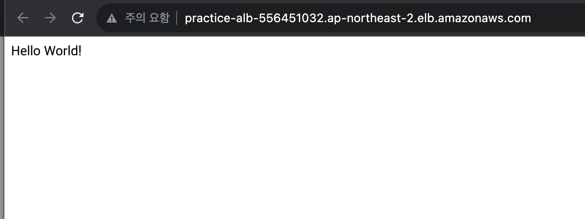

# 🔄리스너, 라우팅, 헬스 체크 설정하기

ALB가 받은 요청을 EC2 서버로 전달하려면 대상 그룹(Target Group), 리스너(Listener), 헬스 체크(Health Check)를 설정해야 한다.

## 요청이 전달되는 흐름



| 구성 요소 | 역할 |
| --- | --- |
| 리스너 | 특정 포트로 들어온 요청을 기다린다. |
| 라우팅 규칙 | 요청을 어느 대상 그룹으로 전달할지 결정한다. |
| 대상 그룹 | 요청을 전달할 EC2 서버의 묶음이다. |
| 헬스 체크 | EC2 서버가 정상인지 주기적으로 확인한다. |

## 1. 대상 그룹 만들기

대상 그룹은 ALB가 요청을 전달할 목적지를 의미한다.

AWS 콘솔에서 `EC2` → `대상 그룹`으로 이동한 뒤 `대상 그룹 생성`을 선택한다.



### 대상 유형 선택

EC2 서버를 연결할 것이므로 대상 유형으로 `인스턴스`를 선택한다.



### 프로토콜과 포트 설정

대상 그룹의 프로토콜과 포트는 **EC2에서 실행 중인 서버가 실제로 요청을 받는 값**과 같아야 한다.



| 항목 | 예시 | 의미 |
| --- | --- | --- |
| 프로토콜 | HTTP | ALB와 EC2 사이의 통신 방식 |
| 포트 | `80` 또는 `3000` | EC2 서버가 요청을 받는 포트 |
| IP 주소 유형 | IPv4 | EC2 인스턴스의 네트워크 환경 |

Express 서버가 `3000` 포트에서 실행 중이라면 대상 그룹 포트도 `3000`으로 설정한다.

Nginx 같은 웹 서버가 `80` 포트에서 요청을 받고 있다면 대상 그룹 포트는 `80`으로 설정한다.

> ALB 리스너 포트와 대상 그룹 포트는 같을 필요가 없다. 예를 들어 사용자는 ALB의 `80` 포트로 접속하고, ALB는 EC2의 `3000` 포트로 요청을 전달할 수 있다.

## 2. 헬스 체크 설정하기

헬스 체크는 ALB가 EC2 서버가 정상인지 주기적으로 확인하는 기능이다.

정상 응답을 받지 못한 EC2는 `unhealthy` 상태가 되며, ALB는 해당 서버로 사용자 요청을 전달하지 않는다.



헬스 체크 경로를 아래처럼 설정한다.

```text
/health
```

ALB는 EC2 서버에 다음과 같은 요청을 보낸다.

```text
GET /health
```

서버는 이 요청에 성공 상태 코드인 `200`으로 응답해야 한다.

### Express 헬스 체크 API 예시

```javascript
const express = require('express');

const app = express();
const port = 3000;

app.get('/', (req, res) => {
  res.send('Hello World!');
});

app.get('/health', (req, res) => {
  res.status(200).send('Health check success');
});

app.listen(port, () => {
  console.log(`Server is running on port ${port}`);
});
```

`/health` 경로는 데이터베이스 조회처럼 오래 걸리는 작업보다, 서버가 살아 있는지 빠르게 확인할 수 있는 가벼운 응답으로 만드는 것이 좋다.

## 3. EC2 인스턴스를 대상 그룹에 등록하기

대상 그룹에 연결할 EC2 인스턴스를 선택하고 `아래에 보류 중인 것으로 포함`을 선택한 뒤 대상 그룹을 생성한다.



대상 그룹 생성 후 대상 상태가 `healthy`가 되는지 확인한다.

`unhealthy` 상태라면 아래 항목을 확인한다.

- EC2에서 서버가 실행 중인지
- 대상 그룹 포트와 서버 포트가 같은지
- `/health` 경로가 `200`으로 응답하는지
- EC2 보안 그룹이 ELB 보안 그룹의 요청을 허용하는지

## 4. 리스너와 대상 그룹 연결하기

ALB의 리스너는 특정 포트로 들어온 요청을 대상 그룹으로 전달한다.

이번 실습에서는 아래와 같이 구성한다.

| 리스너 프로토콜 | 리스너 포트 | 기본 동작 |
| --- | --- | --- |
| HTTP | `80` | 생성한 대상 그룹으로 전달 |

즉, 사용자가 ALB의 `80` 포트로 HTTP 요청을 보내면 ALB가 대상 그룹에 등록된 EC2 서버로 요청을 전달한다.

대상 그룹을 선택한 뒤 로드 밸런서를 생성한다.



## 5. 로드 밸런서 주소로 접속 확인하기

ALB 생성이 완료되면 상세 화면에서 DNS 이름을 확인할 수 있다.



브라우저에서 아래처럼 ALB DNS 이름으로 접속한다.

```text
http://<ALB-DNS-이름>
```

서버의 응답이 보이면 ALB → 대상 그룹 → EC2 요청 전달이 정상적으로 설정된 것이다.



> 이 단계에서는 아직 HTTPS를 적용하지 않았으므로 반드시 `http://`로 접속한다.

## 핵심 정리

- 리스너는 ALB에 들어오는 요청을 받는다.
- 대상 그룹은 ALB가 요청을 전달할 EC2 서버의 묶음이다.
- 대상 그룹 포트는 EC2 서버의 실제 실행 포트와 일치해야 한다.
- 헬스 체크는 정상 응답을 주는 서버에만 요청을 전달하게 한다.
- ALB DNS 이름으로 접속해 요청 전달 여부를 확인할 수 있다.
