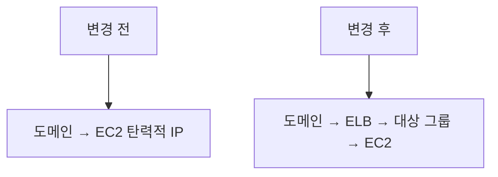
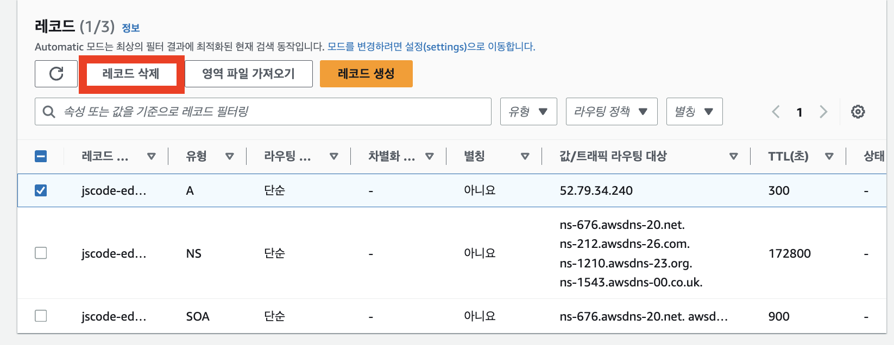
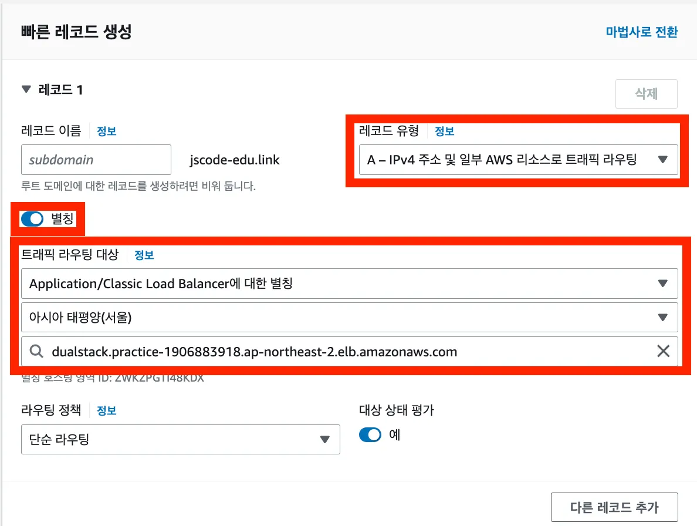
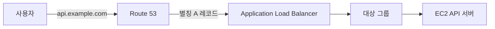

# 🌐ELB에 도메인 연결하기

기존에는 Route 53 도메인이 EC2의 탄력적 IP 주소를 가리켰다.

ELB를 도입한 뒤에는 도메인이 EC2가 아니라 ELB를 가리키도록 변경해야 한다.

## 변경 전과 후



ELB는 고정 IP 주소가 아닌 DNS 이름을 제공한다. 따라서 ELB의 IP 주소를 직접 등록하지 않고, Route 53에서 ELB를 대상으로 하는 별칭 레코드를 사용한다.

## 시작 전 확인

도메인 레코드를 변경하기 전에 아래 항목을 확인한다.

- ALB가 정상적으로 생성되었는지
- 대상 그룹의 EC2 상태가 `healthy`인지
- ALB DNS 이름으로 HTTP 접속이 되는지
- Route 53 호스팅 영역이 ALB와 같은 AWS 계정에 있는지

대상 그룹이 `unhealthy` 상태라면 도메인을 ELB로 연결해도 정상 응답을 받을 수 없다.

## 1. 기존 EC2 연결 레코드 확인하기

Route 53에서 `호스팅 영역`으로 이동한 뒤, 실습 도메인을 선택한다.

기존에 EC2 탄력적 IP 주소를 대상으로 만들었던 A 레코드를 확인한다.



같은 도메인 이름과 레코드 유형을 동시에 여러 개 만들 수 없으므로, 기존 레코드는 수정하거나 삭제해야 한다.

> 강의에서는 기존 레코드를 삭제한 뒤 새 레코드를 만든다. 실제 서비스라면 기존 레코드를 수정하는 방식이 연결이 끊기는 시간을 줄이는 데 더 안전하다.

## 2. ELB를 대상으로 하는 A 레코드 만들기

`레코드 생성`을 선택한 뒤 아래와 같이 설정한다.

| 항목 | 설정 |
| --- | --- |
| 레코드 이름 | 루트 도메인이면 비워 둠, 서브도메인이면 `api` 등 입력 |
| 레코드 유형 | `A` |
| 별칭 | 활성화 |
| 트래픽 라우팅 대상 | Application Load Balancer |
| 리전 | 생성한 ALB의 리전 |
| 로드 밸런서 | 생성한 ALB 선택 |



예를 들어 `api.example.com`을 연결한다면 레코드 이름에는 아래처럼 입력한다.

```text
api
```

Route 53은 호스팅 영역의 도메인 이름을 자동으로 붙여 `api.example.com`으로 만든다.

## 별칭 레코드를 사용하는 이유

ALB는 고정 IP 주소를 제공하지 않고 DNS 이름을 제공한다.

Route 53 별칭 레코드는 AWS 리소스를 직접 대상으로 선택할 수 있다. 따라서 ALB의 IP 주소 변화에 직접 대응할 필요 없이 도메인을 안정적으로 연결할 수 있다.



## 3. 도메인 연결 확인하기

레코드를 생성하거나 수정한 뒤, DNS 변경 사항이 반영될 때까지 잠시 기다린다.

브라우저에서 아래처럼 도메인으로 접속한다.

```text
http://api.example.com
```

서버 응답이 보이면 도메인 → ELB → EC2 연결이 완료된 것이다.

이 단계에서는 아직 HTTPS 인증서를 연결하지 않았으므로 `http://`로 접속한다.

## 연결이 안 될 때 확인할 것

| 확인 항목 | 점검 내용 |
| --- | --- |
| 레코드 대상 | 올바른 ALB를 선택했는지 확인 |
| 리전 | Route 53에서 선택한 ALB 리전이 맞는지 확인 |
| 대상 그룹 상태 | EC2가 `healthy` 상태인지 확인 |
| 보안 그룹 | ELB의 `80` 포트와 EC2 애플리케이션 포트가 열려 있는지 확인 |
| DNS 반영 시간 | 레코드 변경 후 잠시 기다린 뒤 다시 확인 |

## 핵심 정리

- ELB를 도입하면 도메인의 연결 대상도 EC2에서 ELB로 변경한다.
- 기존 EC2 탄력적 IP 레코드는 수정하거나 삭제한다.
- Route 53에서는 ALB를 대상으로 하는 별칭 A 레코드를 사용한다.
- 도메인 연결 전 대상 그룹의 EC2 상태가 `healthy`인지 확인한다.
- 다음 단계에서 ACM 인증서를 발급해 ELB에 HTTPS를 적용한다.
