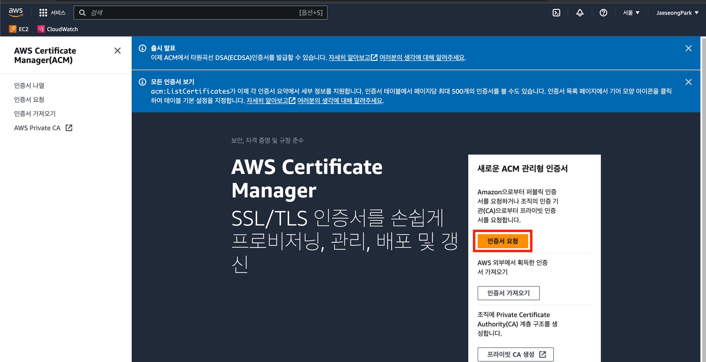
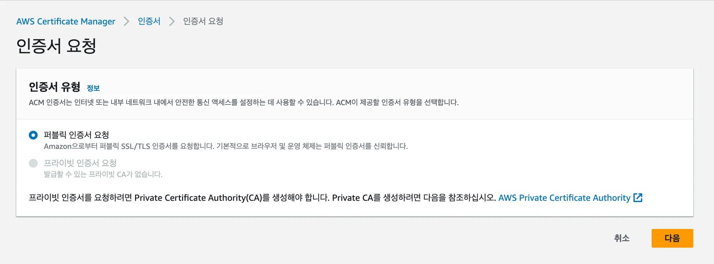
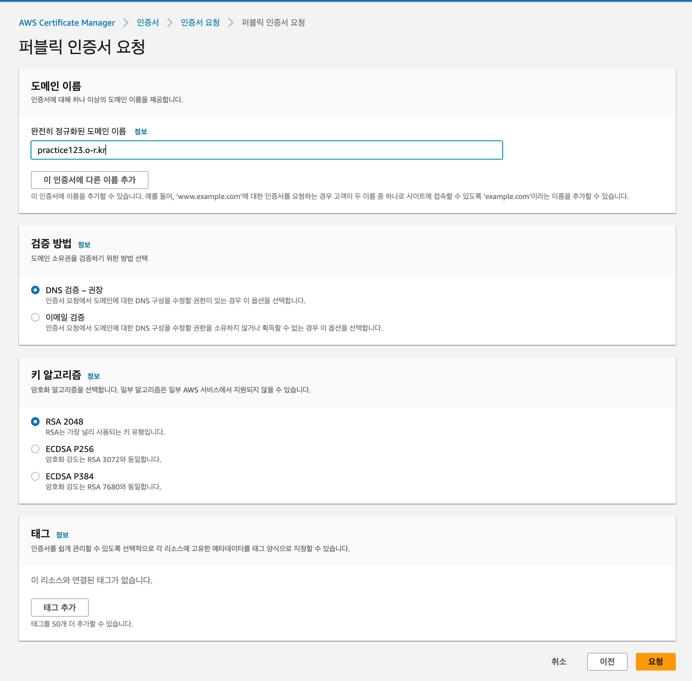
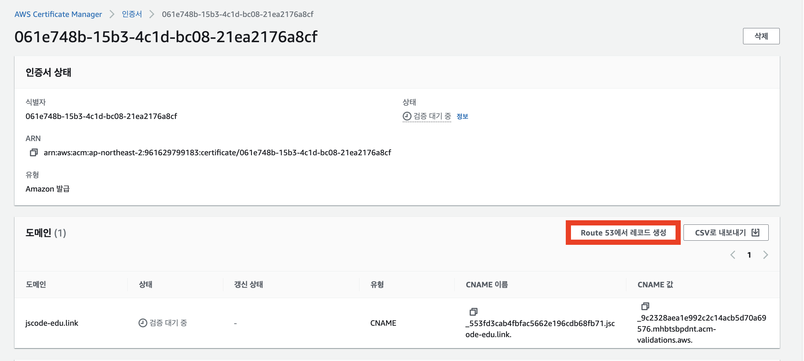
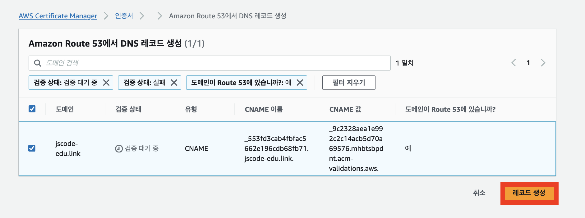
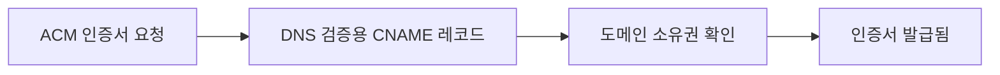
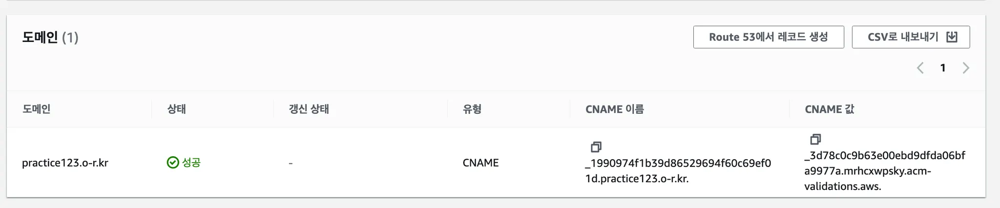

# 📜ACM 인증서 발급하기

HTTPS를 적용하려면 도메인에 대한 TLS 인증서가 필요하다.

이번 실습에서는 AWS Certificate Manager(ACM)에서 공개 인증서를 요청하고, Route 53 DNS 검증으로 발급받는다.

## ACM이란?

ACM(AWS Certificate Manager)은 AWS에서 TLS 인증서를 발급하고 관리하는 서비스다.

ALB에 ACM 인증서를 연결하면 HTTPS 통신을 구성할 수 있다.


공개 ACM 인증서는 ALB 같은 AWS 서비스에 연결해 사용할 때 별도 인증서 비용 없이 사용할 수 있다. 다만 ALB와 Route 53 같은 서비스 사용 비용은 별도로 발생할 수 있다.

## 시작 전 확인

- ALB에 연결할 도메인이 Route 53 호스팅 영역에 등록되어 있는지 확인한다.
- ACM은 **ALB와 같은 리전**에서 열어야 한다.
- 인증서에 입력한 도메인과 실제 HTTPS로 접속할 도메인이 일치해야 한다.
- Route 53에서 생성하는 DNS 검증 레코드는 인증서 발급과 갱신에 필요하므로 삭제하지 않는다.

> CloudFront에 ACM 인증서를 연결하는 경우에는 인증서를 미국 동부(버지니아 북부) 리전에 생성해야 한다. 이번 실습의 대상은 ALB이므로 ALB와 같은 리전을 사용한다.

## 1. ACM에서 인증서 요청 시작하기

AWS 콘솔에서 `Certificate Manager`를 검색해 이동한다.

`인증서 요청`을 선택한다.



## 2. 공개 인증서 요청하기

외부 사용자가 브라우저로 접속할 서비스이므로 `퍼블릭 인증서 요청`을 선택한다.



| 인증서 유형 | 사용 목적 |
| --- | --- |
| 퍼블릭 인증서 | 인터넷에서 접속하는 웹 사이트와 API |
| 프라이빗 인증서 | 조직 내부 서비스, 사설 네트워크 |

## 3. 도메인 이름 입력하기

HTTPS를 적용할 도메인 이름을 입력한다.



예를 들어 API 서버에 HTTPS를 적용한다면 아래처럼 입력한다.

```text
api.example.com
```

루트 도메인과 서브도메인을 모두 사용할 계획이라면 필요한 도메인을 각각 추가한다.

| 사용 목적 | 인증서 도메인 예시 |
| --- | --- |
| 웹 사이트 | `example.com` |
| API 서버 | `api.example.com` |
| 여러 서브도메인 | `*.example.com` |

> `*.example.com`은 `api.example.com` 같은 서브도메인을 포함하지만, 루트 도메인 `example.com` 자체는 포함하지 않는다.

## 4. DNS 검증 선택하기

도메인의 소유권을 확인하기 위해 `DNS 검증`을 선택한다.

Route 53 호스팅 영역을 사용하고 있다면 ACM에서 검증 레코드를 자동으로 생성할 수 있어 편리하다.



인증서 요청을 완료한 뒤, 인증서 상세 화면에서 `Route 53에서 레코드 생성`을 선택한다.

## 5. DNS 검증 레코드 확인하기

ACM은 도메인 소유권을 확인하기 위한 CNAME 레코드를 Route 53에 생성한다.



이 레코드가 유지되어야 ACM이 도메인 소유권을 확인하고, 이후 인증서를 자동 갱신할 수 있다.



## 6. 인증서 발급 상태 확인하기

DNS 검증 레코드가 반영되면 인증서 상태가 `검증 보류 중`에서 `발급됨(Issued)`으로 변경된다.



검증 완료까지 몇 분 정도 걸릴 수 있다. 오래 `검증 보류 중` 상태라면 다음을 확인한다.

- Route 53 호스팅 영역이 올바른 도메인인지
- DNS 검증 CNAME 레코드를 삭제하지 않았는지
- 인증서의 도메인 이름이 올바른지
- ACM과 ALB가 같은 리전에 있는지

## 다음 단계

다음 문서에서는 발급된 ACM 인증서를 ALB의 HTTPS `443` 리스너에 연결하고, HTTP 요청을 HTTPS로 리디렉션한다.

## 핵심 정리

- HTTPS를 적용하려면 도메인에 대한 TLS 인증서가 필요하다.
- ALB에 연결할 ACM 인증서는 ALB와 같은 리전에 생성한다.
- 공개 웹 서비스에는 퍼블릭 인증서를 요청한다.
- Route 53을 사용하면 DNS 검증 레코드를 자동으로 생성할 수 있다.
- 인증서가 발급된 뒤에도 DNS 검증 CNAME 레코드는 삭제하지 않는다.
