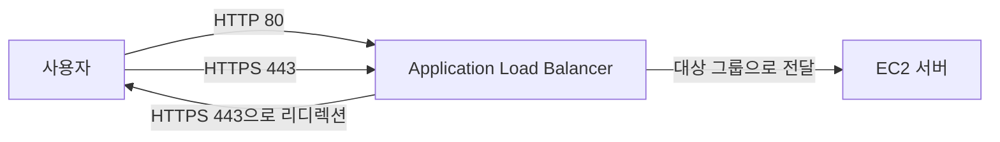
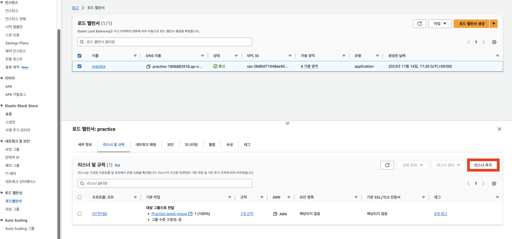
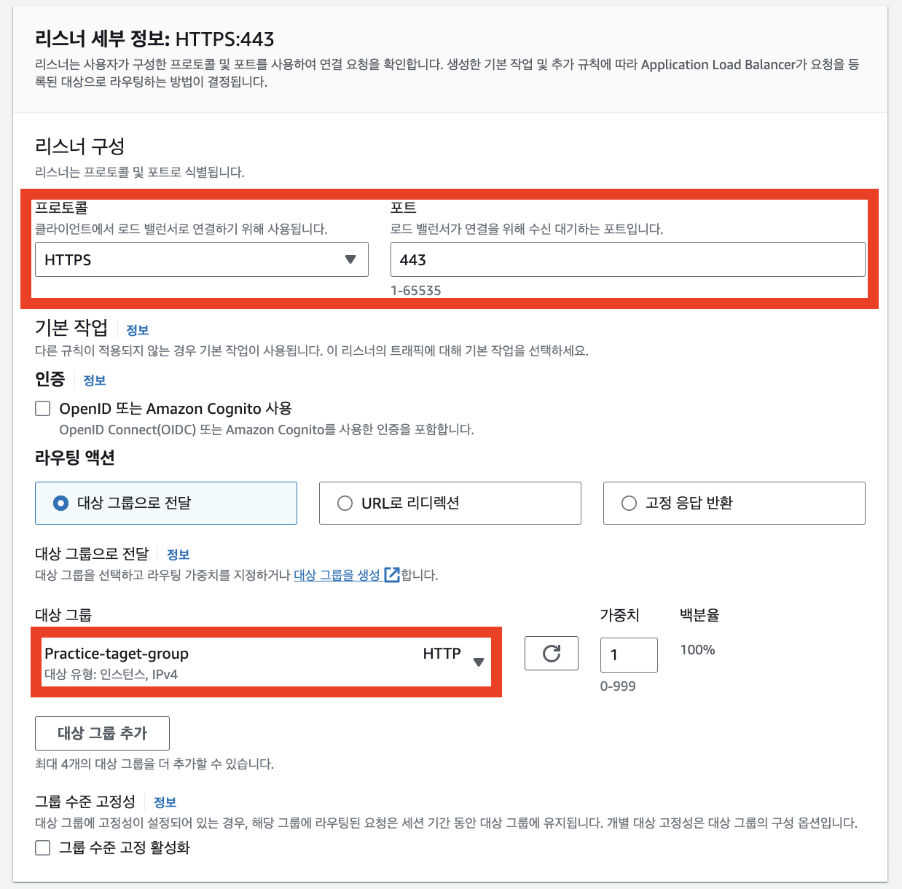
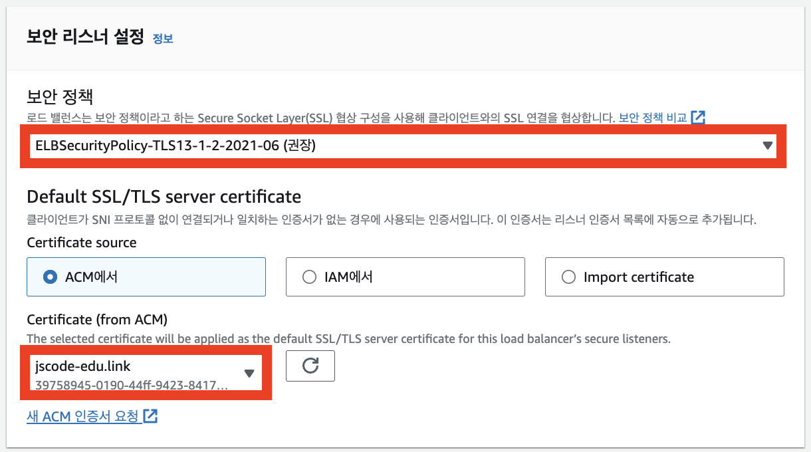
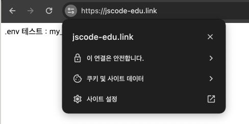
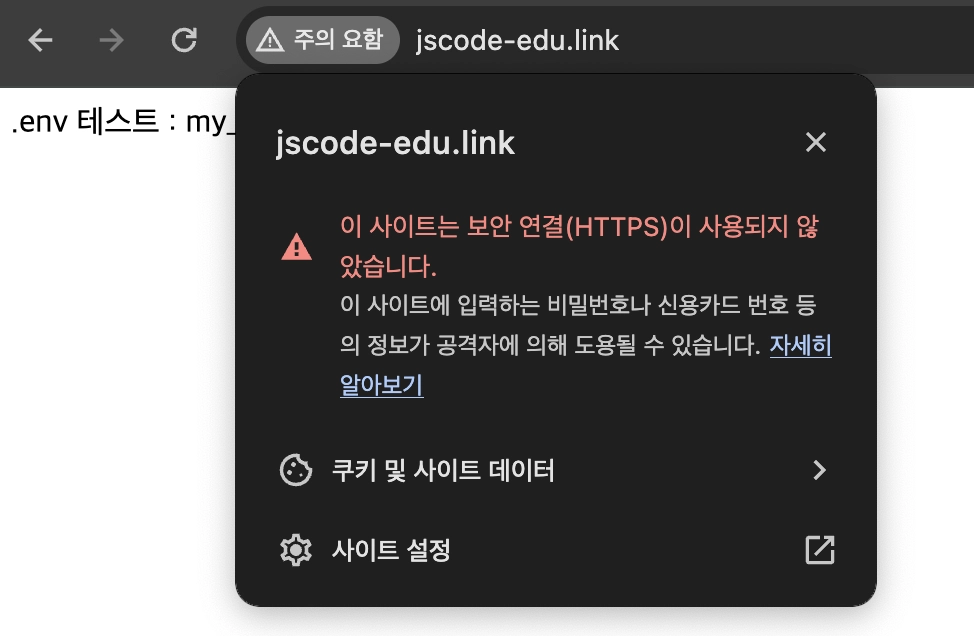
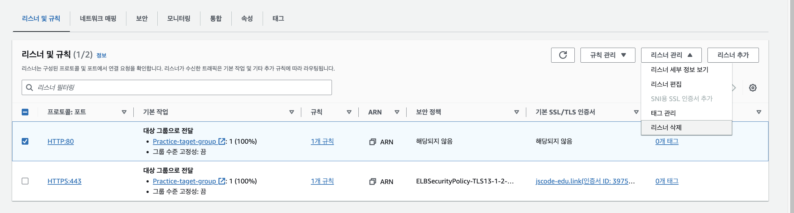
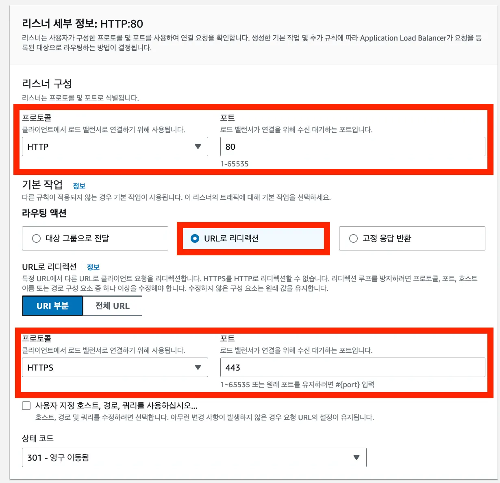
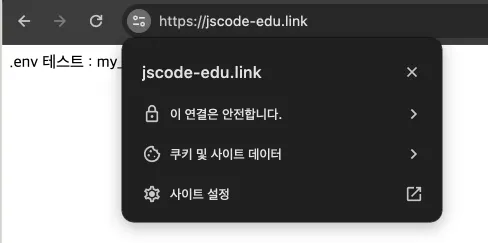

# 🔒ELB에 HTTPS 설정하기

ACM에서 발급한 인증서를 ALB의 HTTPS 리스너에 연결한다.

또한 HTTP로 접속한 사용자도 자동으로 HTTPS로 이동하도록 리디렉션을 설정한다.

## 최종 요청 흐름



## 시작 전 확인

- ACM 인증서 상태가 `발급됨(Issued)`인지 확인한다.
- 인증서와 ALB가 같은 리전에 있는지 확인한다.
- ALB 보안 그룹에서 HTTPS `443` 포트를 허용했는지 확인한다.
- Route 53 도메인이 ALB를 가리키는지 확인한다.
- 대상 그룹의 EC2 상태가 `healthy`인지 확인한다.

## 1. HTTPS 리스너 추가하기

ALB 상세 화면에서 `리스너 및 규칙` 탭으로 이동한 뒤 `리스너 추가`를 선택한다.



리스너를 아래처럼 설정한다.

| 항목 | 설정 |
| --- | --- |
| 프로토콜 | `HTTPS` |
| 포트 | `443` |
| 기본 동작 | 기존 대상 그룹으로 전달 |
| 보안 정책 | 기본 권장 정책 사용 |
| 인증서 | ACM에서 발급한 인증서 선택 |



ACM 인증서를 선택하고, HTTP 요청을 전달하던 대상 그룹을 기본 동작으로 선택한다.



이제 HTTPS `443` 포트로 들어온 요청은 ALB에서 인증서를 사용해 안전한 연결을 처리한 뒤 대상 그룹으로 전달된다.

## 2. HTTPS 접속 확인하기

브라우저에서 도메인 앞에 `https://`를 붙여 접속한다.

```text
https://api.example.com
```

브라우저 주소창에 자물쇠 아이콘이 표시되고 서버 응답이 보이면 HTTPS 적용이 완료된 것이다.



> 인증서가 적용된 도메인으로 접속해야 한다. 인증서에 없는 도메인이나 ALB DNS 이름으로 HTTPS 접속하면 브라우저 경고가 나타날 수 있다.

## 3. HTTP 요청을 HTTPS로 리디렉션하기

HTTPS 리스너를 추가해도 사용자가 `http://`로 접속하면 HTTP로 접근할 수 있다.

모든 사용자가 HTTPS를 사용하게 하려면 HTTP `80` 리스너의 기본 동작을 HTTPS `443`으로 리디렉션한다.



강의 화면처럼 기존 HTTP 리스너를 삭제한 뒤 다시 만들어도 된다.



다만 실제 서비스에서는 기존 HTTP 리스너의 기본 동작을 `리디렉션`으로 수정하는 방식이 더 안전하다.

HTTP 리스너의 동작을 아래처럼 설정한다.

| 항목 | 설정 |
| --- | --- |
| 리스너 프로토콜 | `HTTP` |
| 리스너 포트 | `80` |
| 동작 유형 | `URL로 리디렉션` |
| 리디렉션 프로토콜 | `HTTPS` |
| 리디렉션 포트 | `443` |
| 상태 코드 | `HTTP_301` |



`HTTP_301`은 주소가 HTTPS 주소로 영구적으로 이동했다는 의미다.

## 4. HTTP에서 HTTPS 전환 확인하기

브라우저에서 HTTP 주소로 접속한다.

```text
http://api.example.com
```

주소가 자동으로 아래처럼 변경되면 성공이다.

```text
https://api.example.com
```



PowerShell에서는 아래 명령으로 리디렉션 응답을 확인할 수도 있다.

```powershell
curl.exe -I http://api.example.com
```

응답의 `Location` 헤더에 HTTPS 주소가 표시되면 정상이다.

## 문제가 생겼을 때

| 증상 | 확인할 내용 |
| --- | --- |
| 인증서가 목록에 없음 | ACM 인증서 상태가 `발급됨`인지, ALB와 같은 리전인지 확인 |
| 브라우저 보안 경고 | 접속 도메인이 인증서에 포함되는지 확인 |
| `503 Service Unavailable` | 대상 그룹의 EC2 상태가 `healthy`인지 확인 |
| HTTPS 접속 불가 | ALB 보안 그룹의 `443` 포트 허용 여부 확인 |
| HTTP가 HTTPS로 바뀌지 않음 | HTTP `80` 리스너 기본 동작이 리디렉션인지 확인 |

## 핵심 정리

- HTTPS `443` 리스너에 ACM 인증서를 연결한다.
- HTTPS 요청은 ALB가 받은 뒤 대상 그룹의 EC2로 전달한다.
- HTTP `80` 리스너는 HTTPS `443`으로 리디렉션한다.
- 사용자는 항상 `https://도메인`으로 서비스에 접속하게 된다.
