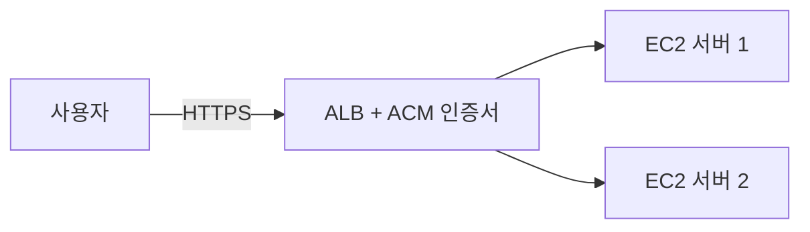

# ⚖️ELB와 Nginx, Certbot 비교하기

AWS에서 HTTPS를 적용하는 대표적인 방법은 두 가지다.

- ALB와 ACM을 사용하는 방법
- EC2에 Nginx와 Certbot을 설치하는 방법

두 방법 모두 HTTPS를 만들 수 있지만, 비용과 관리 방식이 다르다.

## 두 방식의 구조

### ALB와 ACM 사용

### Nginx와 Certbot 사용

## 구성 요소 이해하기

| 구성 요소 | 역할 |
| --- | --- |
| ALB | 사용자 요청을 받고 여러 EC2 서버로 분산하는 AWS 관리형 로드 밸런서 |
| ACM | AWS에서 TLS 인증서를 발급하고 관리하는 서비스 |
| Nginx | EC2에 설치하는 웹 서버이자 리버스 프록시 |
| Certbot | Let's Encrypt 인증서를 발급하고 갱신하는 도구 |

## 비교

| 항목 | ALB + ACM | Nginx + Certbot |
| --- | --- | --- |
| HTTPS 적용 위치 | ALB | EC2 내부의 Nginx |
| 인증서 관리 | ACM이 관리 | 서버에서 Certbot 설정을 관리 |
| 인증서 갱신 | DNS 검증 레코드 유지 시 자동 갱신 지원 | 자동 갱신 설정과 동작 확인 필요 |
| 트래픽 분산 | 여러 EC2에 분산 가능 | 기본적으로 한 EC2에서 처리 |
| 서버 장애 대응 | 헬스 체크로 비정상 서버 제외 가능 | 단일 EC2 장애 시 서비스 영향 |
| 비용 | ALB 사용 비용 발생 | ALB 비용은 없음 |
| 운영 난이도 | AWS 리소스 설정 필요 | Linux, Nginx, 인증서 관리 필요 |

> Nginx와 Certbot은 ALB 비용을 줄일 수 있지만, EC2·도메인·데이터 전송 등의 비용까지 모두 없어지는 것은 아니다.

## ALB와 ACM이 잘 맞는 경우

다음 상황이라면 ALB와 ACM 구성이 잘 맞는다.

- EC2 서버를 여러 대 운영하는 경우
- 트래픽을 여러 서버에 분산해야 하는 경우
- 서버 상태를 확인하고 비정상 서버를 자동으로 제외하고 싶은 경우
- 인증서를 AWS에서 편하게 관리하고 싶은 경우
- 실제 서비스처럼 확장 가능한 구조를 연습하고 싶은 경우

이번 학습에서 사용하는 방식도 ALB와 ACM을 이용하는 방식이다.

## Nginx와 Certbot이 잘 맞는 경우

다음 상황에서는 Nginx와 Certbot 구성이 적합할 수 있다.

- 단일 EC2에서 개인 프로젝트를 운영하는 경우
- ALB 비용이 부담되는 경우
- Nginx 리버스 프록시 설정을 직접 학습하고 싶은 경우
- 서버 내부에서 웹 서버와 인증서를 직접 관리해 보고 싶은 경우

## 둘 중 하나만 사용할 수 있을까?

아니다. ALB를 사용하면서 EC2 내부에 Nginx를 함께 사용할 수도 있다.

이 구조에서 ALB는 HTTPS 처리와 트래픽 분산을 담당하고, Nginx는 애플리케이션 앞에서 리버스 프록시나 정적 파일 제공 같은 역할을 할 수 있다.

## 선택 기준

| 상황 | 추천 방식 |
| --- | --- |
| 단일 EC2 개인 프로젝트 | Nginx + Certbot |
| 비용을 최소화한 실습 | Nginx + Certbot |
| 여러 EC2 서버 운영 | ALB + ACM |
| AWS 기반의 확장 가능한 서비스 | ALB + ACM |
| 인증서와 트래픽 분산을 함께 관리 | ALB + ACM |

## 핵심 정리

- ALB와 ACM은 HTTPS, 인증서 관리, 트래픽 분산을 AWS에서 처리한다.
- Nginx와 Certbot은 EC2 한 대에서도 HTTPS를 구성할 수 있다.
- Nginx와 Certbot은 ALB 비용을 줄일 수 있지만 서버 관리 책임이 커진다.
- 여러 서버를 운영하거나 확장성을 고려한다면 ALB와 ACM이 적합하다.
- 두 방식은 경쟁 관계만이 아니라 함께 사용할 수도 있다.
