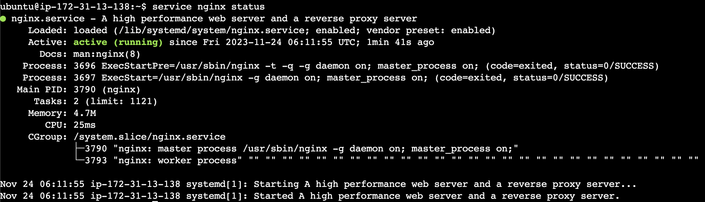
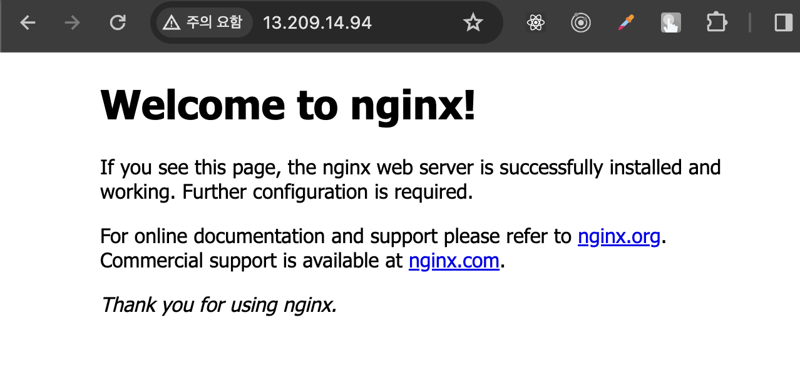
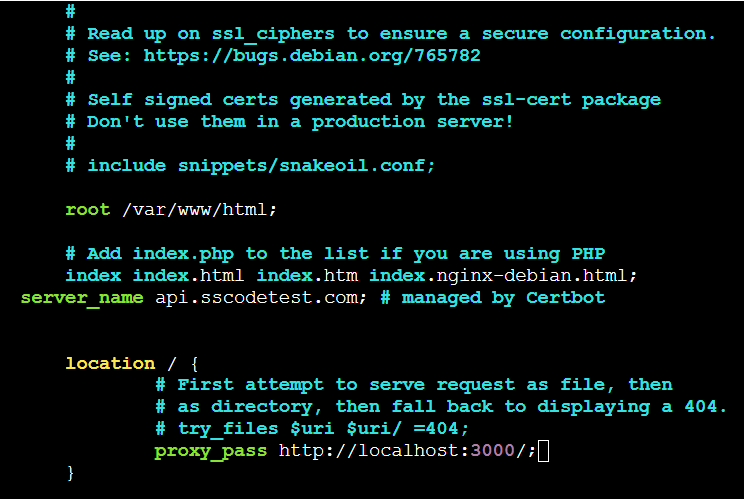
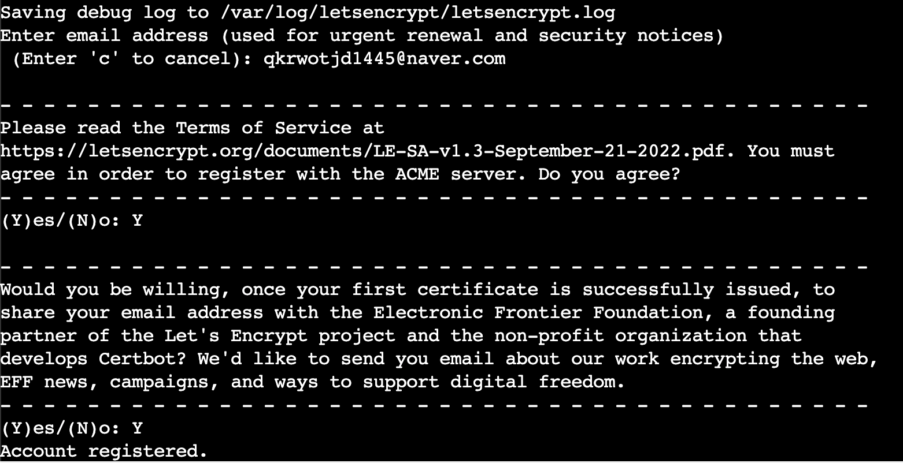
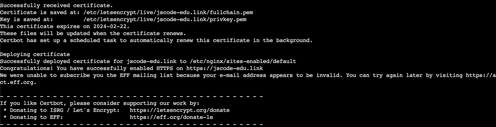
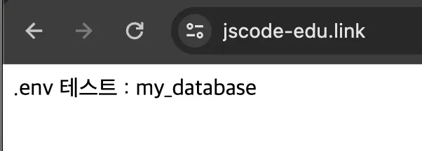
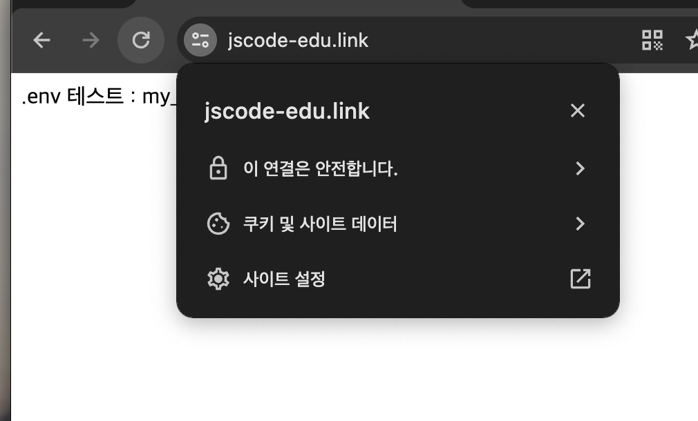

# 🛠️Nginx와 Certbot으로 HTTPS 연결하기

ALB와 ACM을 사용하지 않고, EC2 한 대에서 Nginx와 Certbot으로 HTTPS를 적용하는 방법을 정리한다.

Nginx는 외부 요청을 받고 Express 서버로 전달하는 리버스 프록시 역할을 한다. Certbot은 Let's Encrypt 인증서를 발급하고 Nginx에 HTTPS 설정을 적용한다.

## 전체 구조


## 시작 전 확인

- 이 문서는 **ALB를 사용하지 않는 단일 EC2 구성**을 기준으로 한다.
- 도메인의 A 레코드는 EC2의 탄력적 IP 주소를 가리켜야 한다.
- EC2 보안 그룹에서 `HTTP 80`, `HTTPS 443` 포트를 허용해야 한다.
- Express 서버는 `3000` 포트에서 실행한다고 가정한다.
- Certbot 인증서 발급 전에 도메인으로 HTTP 접속이 가능해야 한다.

> 같은 도메인을 ALB와 EC2에 동시에 연결하지 않는다. 이 방식은 ALB + ACM 방식의 대안이다.

## 1. Express 서버 포트 확인하기

Nginx가 외부 요청을 `80`, `443` 포트에서 받고, Express 서버는 내부 `3000` 포트에서 실행하도록 구성한다.

```javascript
const express = require('express');

const app = express();
const port = 3000;

app.get('/', (req, res) => {
  res.send('Hello World!');
});

app.listen(port, () => {
  console.log(`Server is running on port ${port}`);
});
```

Express 서버가 실행 중인지 EC2 내부에서 확인한다.

```bash
curl http://127.0.0.1:3000
```

> `3000` 포트는 Nginx가 같은 서버 내부에서 접근하므로, 실제 운영 환경에서는 인터넷 전체에 열 필요가 없다.

## 2. Nginx 설치하기

Ubuntu 기준으로 Nginx를 설치한다.

```bash
sudo apt update
sudo apt install -y nginx

sudo systemctl enable --now nginx
sudo systemctl status nginx
```



Nginx 상태가 `active (running)`이면 정상적으로 실행 중인 것이다.

## 3. Nginx HTTP 접속 확인하기

브라우저에서 EC2의 탄력적 IP 주소로 HTTP 접속한다.

```text
http://<EC2-탄력적-IP>
```

Nginx 기본 화면이 보이면 `80` 포트와 Nginx 연결이 정상이다.



> 아직 인증서를 발급하지 않았으므로 `https://<EC2-탄력적-IP>`가 아니라 `http://<EC2-탄력적-IP>`로 접속한다.

## 4. Nginx 리버스 프록시 설정하기

Nginx가 받은 요청을 Express 서버의 `3000` 포트로 전달하도록 설정한다.

```bash
sudo vi /etc/nginx/sites-available/default
```

설정 파일의 `server` 블록을 아래처럼 수정한다.

```nginx
server {
    listen 80;
    server_name api.example.com;

    location / {
        proxy_pass http://127.0.0.1:3000;
        proxy_http_version 1.1;

        proxy_set_header Host $host;
        proxy_set_header X-Real-IP $remote_addr;
        proxy_set_header X-Forwarded-For $proxy_add_x_forwarded_for;
        proxy_set_header X-Forwarded-Proto $scheme;
    }
}
```

- `server_name`에는 실제 도메인 주소를 입력한다.
- `proxy_pass`는 Nginx가 요청을 전달할 Express 서버 주소다.
- `127.0.0.1:3000`은 같은 EC2에서 실행 중인 Express 서버를 의미한다.



설정 문법을 확인하고 Nginx를 다시 읽어 들인다.

```bash
sudo nginx -t
sudo systemctl reload nginx
```

이제 도메인으로 HTTP 접속했을 때 Express 서버 응답이 보이는지 확인한다.

```text
http://api.example.com
```

## 5. Certbot 설치하기

Certbot을 설치한다.

```bash
sudo snap install --classic certbot
sudo ln -s /snap/bin/certbot /usr/bin/certbot
```

이미 연결 파일이 존재한다는 메시지가 나오면 다음 명령으로 덮어쓸 수 있다.

```bash
sudo ln -sf /snap/bin/certbot /usr/bin/certbot
```

## 6. 인증서 발급과 HTTPS 설정하기

아래 명령에서 실제 도메인 주소를 입력한다.

```bash
sudo certbot --nginx -d api.example.com
```



Certbot 실행 중 이메일 주소와 약관 동의 여부를 입력한다.

HTTP 요청을 HTTPS로 자동 전환할지 묻는 화면에서는 리디렉션 옵션을 선택한다.



Certbot은 인증서 발급 후 Nginx 설정에 HTTPS `443` 리스너와 HTTP → HTTPS 리디렉션 설정을 추가한다.

## 7. HTTPS와 리디렉션 확인하기

도메인에 HTTPS로 접속한다.

```text
https://api.example.com
```



HTTP 주소로 접속했을 때 HTTPS 주소로 자동 전환되는지도 확인한다.

```text
http://api.example.com
```



## 8. 인증서 자동 갱신 확인하기

Let's Encrypt 인증서는 유효 기간이 짧기 때문에 갱신이 필요하다.

Certbot이 갱신 가능한지 테스트한다.

```bash
sudo certbot renew --dry-run
```

테스트가 성공하면 자동 갱신 설정이 정상적으로 동작할 가능성이 높다. 실제 운영 환경에서는 갱신 작업이 주기적으로 실행되는지 함께 확인한다.

## 문제가 생겼을 때

| 증상 | 확인할 내용 |
| --- | --- |
| Certbot 인증 실패 | 도메인이 EC2 탄력적 IP를 가리키는지, `80` 포트가 열려 있는지 확인 |
| `502 Bad Gateway` | Express 서버가 `3000` 포트에서 실행 중인지 확인 |
| Nginx 설정 오류 | `sudo nginx -t` 결과를 확인 |
| HTTPS 접속 불가 | 보안 그룹의 `443` 포트 허용 여부 확인 |
| 인증서 갱신 실패 | `sudo certbot renew --dry-run`으로 원인 확인 |

## 핵심 정리

- Nginx는 외부 요청을 받고 Express 서버로 전달하는 리버스 프록시다.
- Certbot은 Let's Encrypt 인증서를 발급하고 HTTPS 설정을 도와준다.
- Certbot을 실행하기 전에 도메인이 EC2를 가리키고 HTTP 접속이 가능해야 한다.
- Express 서버의 `3000` 포트는 외부가 아닌 Nginx가 내부에서 연결한다.
- 인증서 발급 후 HTTPS 접속과 HTTP → HTTPS 리디렉션을 확인한다.
