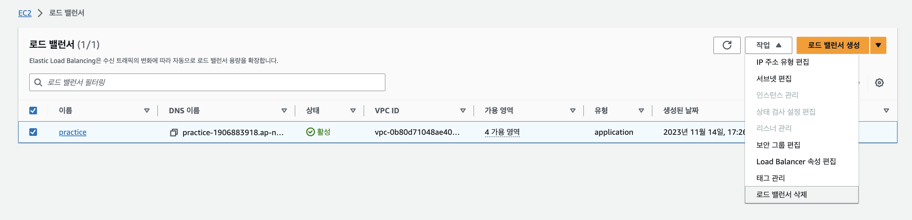

# 🧹ELB 리소스 정리하기

ELB 실습을 마친 뒤 사용하지 않는 리소스를 정리해 불필요한 비용이 발생하지 않도록 한다.

특히 ALB는 생성된 상태로 유지되는 동안 비용이 발생할 수 있으므로, 실습을 끝냈다면 반드시 삭제 여부를 확인한다.

## 삭제 전 확인

아래 중 하나라도 해당한다면 바로 삭제하지 않는다.

- 현재 도메인으로 서비스에 접속해야 하는 경우
- 다른 사용자가 해당 ALB 또는 EC2를 사용하는 경우
- 포트폴리오 시연을 위해 서비스를 유지해야 하는 경우
- Route 53, ACM, EC2 등 연결된 리소스를 다시 확인하지 않은 경우

> ALB를 삭제하면 도메인으로 접속하던 서비스가 즉시 중단된다.

## 정리 대상

| 리소스 | 비용 또는 영향 | 정리 기준 |
| --- | --- | --- |
| Application Load Balancer | 생성 상태로 유지하면 비용 발생 가능 | 실습 종료 후 삭제 |
| EC2 인스턴스 | 실행 중이면 인스턴스 비용 발생 | 더 이상 사용하지 않으면 종료 |
| EBS 볼륨 | EC2 종료 후에도 남아 있을 수 있음 | 불필요한 볼륨 삭제 |
| 탄력적 IP | 연결되지 않으면 비용 발생 가능 | 사용하지 않으면 해제 |
| 대상 그룹 | 일반적으로 별도 비용은 없지만 연결 정보가 남음 | ALB 삭제 후 정리 |
| 보안 그룹 | 별도 비용은 없지만 설정이 남음 | 다른 리소스에서 사용하지 않을 때 삭제 |
| ACM 인증서 | 사용하지 않는 인증서가 남을 수 있음 | 다시 사용하지 않을 때 삭제 |
| Route 53 호스팅 영역 | 유지 시 비용 발생 가능 | 도메인을 더 이상 사용하지 않으면 삭제 |

## 1. 도메인 연결 상태 확인하기

먼저 Route 53 레코드가 ALB를 가리키는지 확인한다.

실습을 완전히 종료한다면 ALB를 삭제하기 전에 Route 53 레코드를 삭제하거나, 더 이상 서비스가 제공되지 않는다는 점을 확인한다.

ALB를 먼저 삭제하면 도메인은 존재하지만 연결 대상이 없어져 접속 오류가 발생한다.

## 2. 로드 밸런서 삭제하기

AWS 콘솔에서 `EC2` → `로드 밸런서`로 이동한다.

실습에 사용한 ALB를 선택한 뒤 `삭제`를 선택한다.

삭제할 로드 밸런서 이름을 다시 확인한 뒤 삭제를 완료한다.

> ALB 삭제는 되돌릴 수 없다. 리스너, 규칙, 연결된 대상 그룹 이름을 기록해 두면 나중에 다시 구성하기 쉽다.

## 3. 대상 그룹 확인 및 정리하기

ALB를 삭제한 뒤 `대상 그룹` 목록으로 이동한다.

실습용 대상 그룹이 더 이상 필요 없다면 삭제한다.

대상 그룹 자체는 일반적으로 별도 비용이 발생하지 않지만, 사용하지 않는 리소스를 남겨두면 나중에 어떤 서버가 연결되어 있었는지 혼동할 수 있다.

## 4. EC2 인스턴스 정리하기

ALB에 연결했던 EC2 인스턴스도 더 이상 사용하지 않는다면 정리한다.

| 선택 | 결과 |
| --- | --- |
| 중지(Stop) | 인스턴스 실행은 멈추지만 EBS 볼륨 등 일부 비용은 계속 발생할 수 있음 |
| 종료(Terminate) | 인스턴스를 삭제함. 다시 시작할 수 없음 |

실습을 완전히 끝냈다면 보통 `종료(Terminate)`를 선택한다.

EC2 종료와 탄력적 IP, EBS 볼륨 정리는 아래 문서를 참고한다.

- [EC2 리소스 정리](../01-EC2-백엔드-API-서버-배포/99-리소스-정리.md)

## 5. Route 53과 ACM 확인하기

도메인을 더 이상 사용하지 않는다면 Route 53 호스팅 영역과 자동 갱신 설정을 함께 확인한다.

ACM 인증서도 다시 사용할 계획이 없다면 삭제할 수 있다. 단, 인증서를 유지할 계획이라면 DNS 검증용 CNAME 레코드를 삭제하지 않는다.

- [Route 53 리소스 정리](../02-Route53-도메인-연결/99-리소스-정리.md)

## 최종 점검 목록

- [ ] 실습용 ALB를 삭제했다.
- [ ] 불필요한 대상 그룹을 삭제했다.
- [ ] 사용하지 않는 EC2를 중지 또는 종료했다.
- [ ] 연결되지 않은 탄력적 IP와 남은 EBS 볼륨을 확인했다.
- [ ] 불필요한 보안 그룹을 확인했다.
- [ ] 사용하지 않는 Route 53 호스팅 영역과 도메인 자동 갱신 설정을 확인했다.
- [ ] AWS Billing에서 예상하지 못한 비용이 없는지 확인했다.

## 핵심 정리

- ALB는 사용하지 않으면 삭제해야 한다.
- ALB를 삭제하면 도메인을 통한 서비스 접속도 중단된다.
- EC2는 중지와 종료의 비용 영향이 다르다.
- 대상 그룹, 보안 그룹, ACM, Route 53도 함께 점검한다.
- 리소스 정리 후 AWS Billing에서 비용을 확인하는 습관을 만든다.
