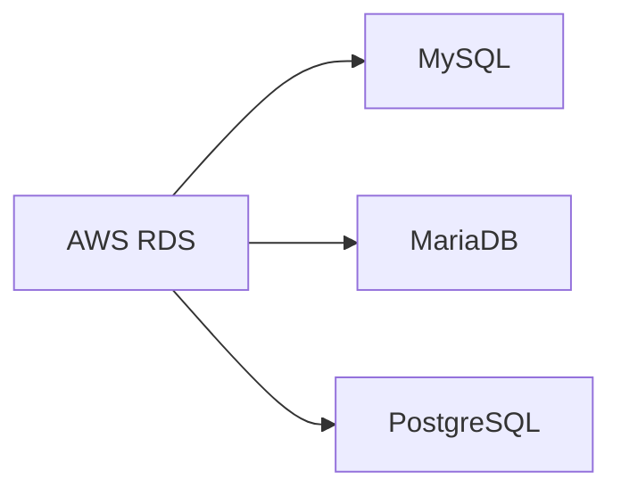
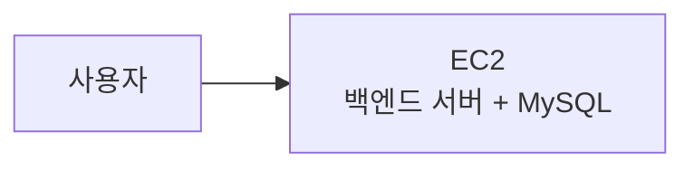

# 🗄️RDS란?

RDS(Relational Database Service)는 AWS에서 관계형 데이터베이스를 생성하고 운영할 수 있게 해주는 관리형 서비스다.

MySQL, MariaDB, PostgreSQL 같은 데이터베이스 엔진을 직접 서버에 설치하고 관리하는 대신, AWS가 데이터베이스 운영에 필요한 여러 기능을 제공한다.

## 관계형 데이터베이스란?

관계형 데이터베이스는 데이터를 표 형태로 저장하고, 테이블 사이의 관계를 이용해 데이터를 관리하는 방식이다.

예를 들어 쇼핑몰 서비스에는 아래처럼 여러 테이블이 있을 수 있다.

| 테이블 | 저장하는 데이터 |
| --- | --- |
| 사용자 | 회원 정보 |
| 상품 | 상품 이름, 가격, 재고 |
| 주문 | 주문한 사용자와 상품 정보 |

백엔드 서버는 데이터베이스에 연결해 회원가입, 로그인, 게시글 작성, 주문 생성 같은 데이터를 저장하고 조회한다.

## RDS와 데이터베이스 엔진의 차이

RDS는 데이터베이스 자체의 이름이 아니다.

RDS는 AWS에서 데이터베이스를 편하게 운영하도록 돕는 서비스이고, 그 안에서 MySQL 같은 데이터베이스 엔진을 선택해 사용한다.

## 왜 RDS를 사용할까?

로컬 개발 환경에서는 내 컴퓨터에 설치한 MySQL과 백엔드 서버를 연결해 사용할 수 있다.

하지만 백엔드 서버를 EC2에 배포하면, 내 컴퓨터의 데이터베이스를 서비스용으로 계속 사용할 수 없다. 서비스 환경에서 접근할 수 있는 데이터베이스가 별도로 필요하다.

RDS를 사용하면 EC2 백엔드 서버와 같은 AWS 환경에서 데이터베이스를 운영할 수 있다.

## RDS가 제공하는 기능

RDS는 데이터베이스 운영에 필요한 기능을 제공한다.

| 기능 | 설명 |
| --- | --- |
| 자동 백업 | 설정한 기간 동안 백업을 자동으로 생성한다. |
| 모니터링 | CPU, 연결 수, 저장 공간 등을 확인할 수 있다. |
| 소프트웨어 관리 | 데이터베이스 엔진의 일부 관리 작업을 AWS가 지원한다. |
| 다중 AZ 구성 | 장애 상황에 대비해 다른 가용 영역에 대기 환경을 구성할 수 있다. |
| 스냅샷 | 특정 시점의 데이터베이스 상태를 저장할 수 있다. |

RDS를 사용해도 데이터베이스 설계, 테이블 생성, 계정과 권한 관리 같은 작업은 개발자가 해야 한다.

## EC2에 데이터베이스를 직접 설치하는 방법

데이터베이스를 RDS가 아닌 EC2에 직접 설치할 수도 있다.

이 방법은 RDS 비용을 줄일 수 있어 개인 프로젝트나 단순 실습에서 사용할 수 있다.

하지만 백엔드 서버와 데이터베이스가 같은 EC2에 있으면 EC2 장애가 발생했을 때 두 기능이 함께 영향을 받는다.

## EC2와 RDS를 분리하는 방법

실제 서비스에서는 백엔드 서버와 데이터베이스를 분리하는 구조를 많이 사용한다.

이 구조의 장점은 역할을 분리할 수 있다는 점이다.

| 구분 | EC2 | RDS |
| --- | --- | --- |
| 역할 | 백엔드 애플리케이션 실행 | 데이터 저장과 조회 |
| 장애 영향 | 애플리케이션 장애에 집중 | 데이터베이스 장애에 집중 |
| 확장 방향 | 서버 인스턴스 확장 | DB 인스턴스와 저장 공간 확장 |
| 관리 대상 | 애플리케이션, 운영체제 | 데이터베이스 엔진과 데이터 |

역할을 분리한다고 모든 장애가 자동으로 해결되는 것은 아니다. 다만 장애 원인을 구분하고, 데이터베이스를 더 안정적으로 관리하기 쉬워진다.

## 어떤 방식을 선택할까?

| 상황 | 선택 예시 |
| --- | --- |
| 간단한 개인 프로젝트와 비용 절약 | EC2에 데이터베이스 직접 설치 |
| 데이터 백업과 모니터링이 필요한 서비스 | RDS 사용 |
| 백엔드 서버와 DB를 분리하고 싶은 경우 | RDS 사용 |
| 여러 가용 영역을 활용한 장애 대응이 필요한 경우 | RDS 사용 |

## 핵심 정리

- RDS는 AWS의 관리형 관계형 데이터베이스 서비스다.
- RDS 안에서 MySQL, MariaDB 같은 데이터베이스 엔진을 선택해 사용한다.
- 서비스용 백엔드 서버에는 외부에서 접근 가능한 데이터베이스 환경이 필요하다.
- EC2에 DB를 직접 설치하면 비용을 줄일 수 있지만, 서버와 DB 장애가 함께 발생할 수 있다.
- RDS는 백업, 모니터링, 스냅샷 같은 데이터베이스 운영 기능을 제공한다.
- 다음 문서에서는 RDS를 사용하는 아키텍처를 살펴본다.
