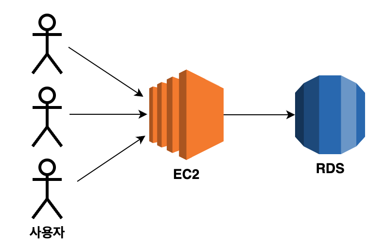
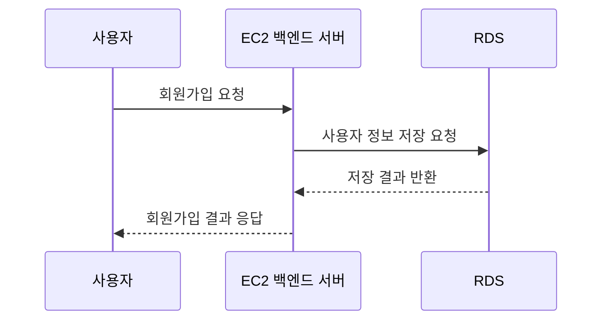
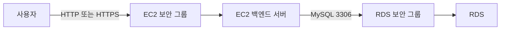

# 🏛️RDS를 활용한 아키텍처 구성

RDS를 사용하면 백엔드 서버와 데이터베이스를 별도의 AWS 리소스로 분리할 수 있다.

백엔드 서버는 EC2에서 실행하고, 데이터는 RDS에 저장한다.



## 전체 구조


ELB를 함께 사용한다면 사용자의 요청은 ELB를 거쳐 EC2에 도착한다.


## 각 리소스의 역할

| 리소스 | 역할 |
| --- | --- |
| ELB | 사용자 요청을 받아 EC2 서버에 전달한다. |
| EC2 | 백엔드 애플리케이션을 실행하고, 데이터베이스에 요청한다. |
| RDS | 애플리케이션이 사용하는 데이터를 저장하고 조회한다. |

사용자는 RDS에 직접 요청하지 않는다. 사용자의 요청은 백엔드 서버가 처리하고, 필요한 데이터만 RDS에서 조회하거나 저장한다.

## 요청 처리 흐름

회원가입 요청을 예시로 보면 아래와 같이 동작한다.



1. 사용자가 백엔드 API에 요청한다.
2. EC2의 백엔드 서버가 요청을 처리한다.
3. 백엔드 서버가 RDS에 SQL을 실행한다.
4. RDS가 조회 또는 저장 결과를 반환한다.
5. 백엔드 서버가 사용자에게 응답한다.

## RDS 엔드포인트

RDS는 데이터베이스에 접속할 수 있는 엔드포인트를 제공한다.

```text
my-database.abc123.ap-northeast-2.rds.amazonaws.com
```

백엔드 서버는 이 엔드포인트, 포트 번호, 데이터베이스 이름, 계정 정보를 사용해 RDS에 연결한다.

```text
DB_HOST=<RDS 엔드포인트>
DB_PORT=3306
DB_NAME=<데이터베이스 이름>
DB_USER=<데이터베이스 사용자 이름>
DB_PASSWORD=<데이터베이스 비밀번호>
```

> RDS 엔드포인트는 백엔드 애플리케이션의 환경 변수로 관리한다. 비밀번호를 GitHub에 올리지 않는다.

## 보안 그룹 요청 흐름

RDS는 외부 사용자에게 직접 공개하는 서비스가 아니다.

EC2의 백엔드 서버만 RDS에 접근하도록 보안 그룹을 설정한다.



RDS 보안 그룹의 인바운드 규칙에는 IP 주소 대신 EC2 보안 그룹을 소스로 지정할 수 있다.

이렇게 설정하면 해당 EC2 보안 그룹이 연결된 서버만 RDS에 접근할 수 있다.

## 공개 접근 설정

RDS 생성 화면에는 `퍼블릭 액세스` 설정이 있다.

| 설정 | 의미 |
| --- | --- |
| 예 | 인터넷을 통해 RDS 엔드포인트에 접근할 수 있는 경로를 만들 수 있다. |
| 아니오 | VPC 내부의 리소스만 RDS에 접근하도록 구성한다. |

실제 서비스에서는 보통 RDS를 인터넷에 직접 공개하지 않는다.

개발 환경에서 DBeaver 같은 도구로 로컬 컴퓨터에서 접속해야 한다면, 필요한 기간에만 제한적으로 접근을 허용하고 접속이 끝나면 다시 차단하는 방식이 안전하다.

## EC2와 RDS를 분리하는 이유

| 구분 | EC2에 DB 직접 설치 | EC2와 RDS 분리 |
| --- | --- | --- |
| 서버 역할 | 애플리케이션과 DB를 함께 실행 | 역할을 분리 |
| 장애 영향 | EC2 장애가 DB에도 영향 | 애플리케이션과 DB를 분리해 관리 |
| 백업과 모니터링 | 직접 구성 필요 | RDS 기능 활용 가능 |
| 접근 제어 | 서버 내부 설정 중심 | 보안 그룹으로 EC2와 RDS 연결 제어 |

## 핵심 정리

- EC2는 백엔드 애플리케이션을 실행하고, RDS는 데이터를 저장한다.
- 사용자는 RDS가 아니라 백엔드 서버를 통해 데이터에 접근한다.
- 백엔드 서버는 RDS 엔드포인트와 계정 정보로 데이터베이스에 연결한다.
- RDS는 외부에 직접 공개하지 않고, EC2 보안 그룹만 접근하도록 설정하는 것이 좋다.
- 다음 문서에서는 RDS 인스턴스를 생성한다.
