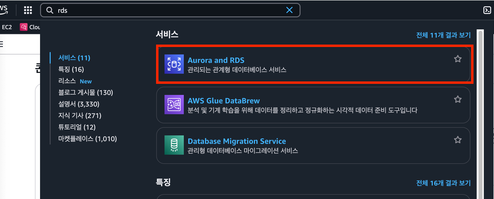
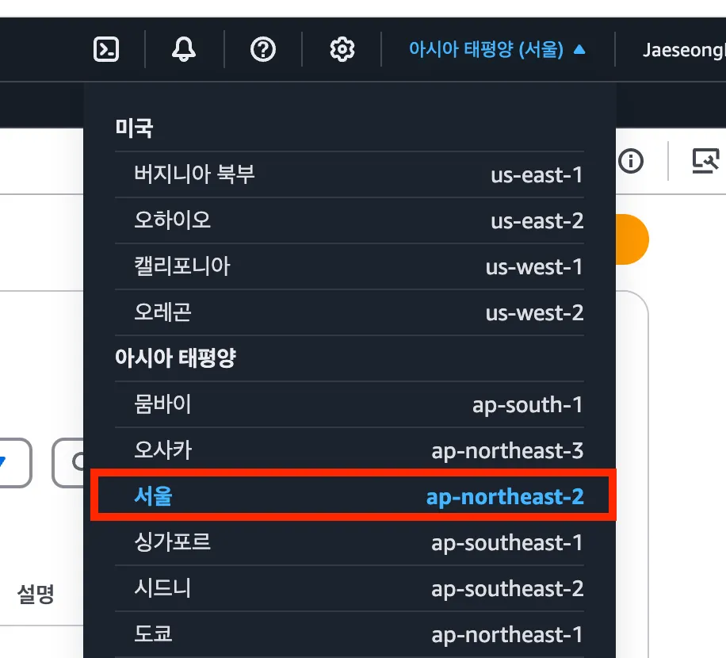
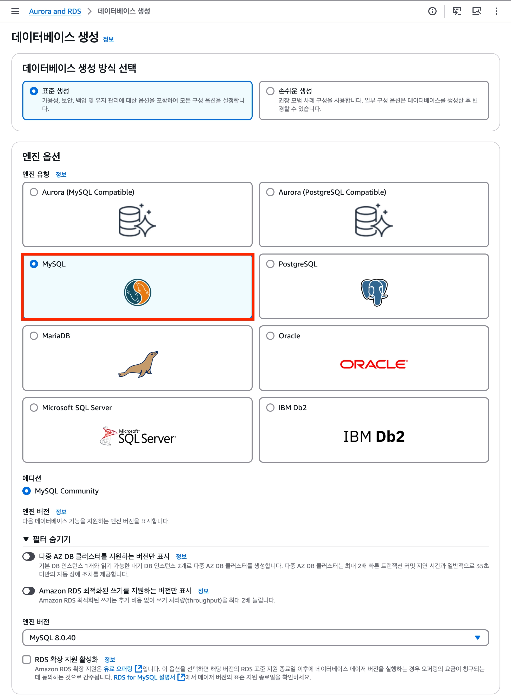
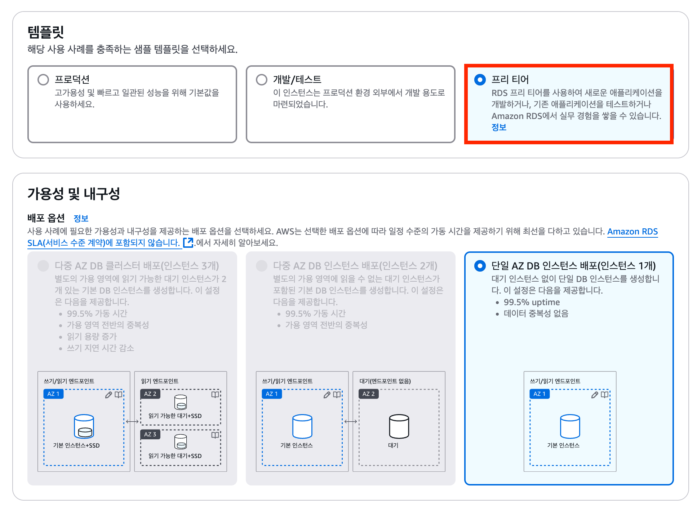
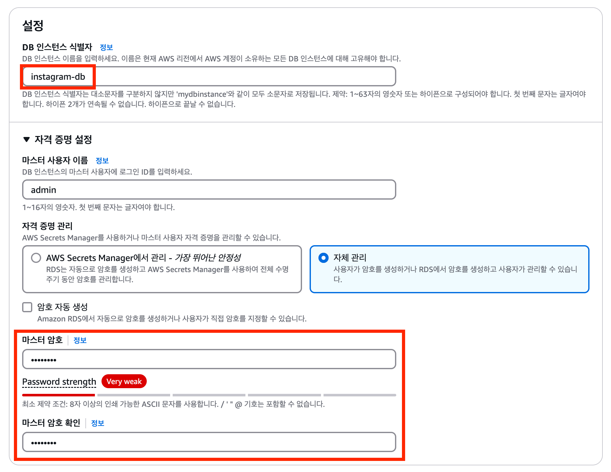
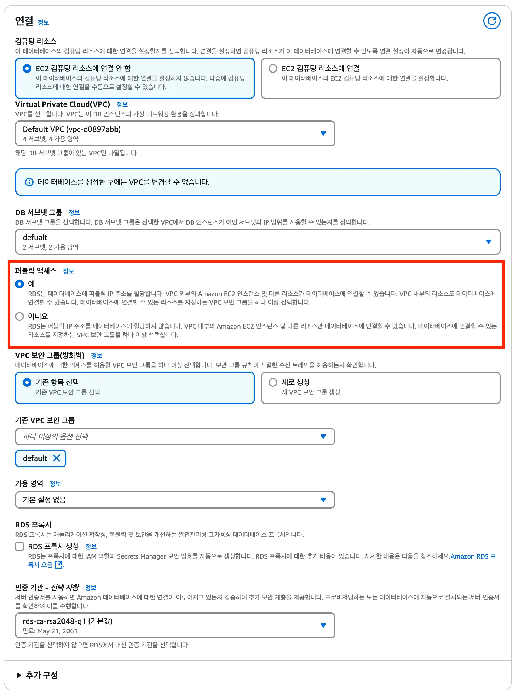
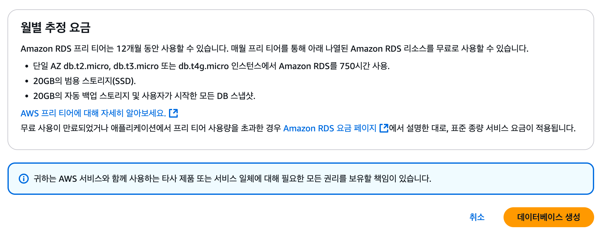

# 🛠️RDS 데이터베이스 생성하기

AWS RDS에서 MySQL 데이터베이스를 생성하는 과정을 정리한다.

이번 실습에서는 학습과 개발 환경에서 사용할 RDS 인스턴스를 만든다. 다음 문서에서 보안 그룹을 설정하고 EC2 서버와 연결한다.

## 시작 전 확인

- RDS는 실행 중인 시간과 스토리지 사용량 등에 따라 비용이 발생할 수 있다.
- 프리 티어를 선택해도 계정 상태, 사용량, 추가 옵션에 따라 비용이 발생할 수 있다.
- 마스터 사용자 이름과 암호는 데이터베이스 접속에 필요하므로 안전한 곳에 기록한다.
- 암호나 RDS 엔드포인트를 GitHub에 올리지 않는다.

## 1. RDS 콘솔 접속하기

AWS 콘솔 검색창에서 `RDS`를 검색한 뒤 서비스 페이지로 이동한다.



## 2. 리전 확인하기

RDS는 EC2 서버와 같은 리전에 생성하는 것이 좋다.

예를 들어 EC2가 서울 리전에 있다면 RDS도 서울 리전으로 생성한다. 서로 다른 리전에 있으면 연결 구조가 복잡해지고 네트워크 비용이나 지연 시간이 발생할 수 있다.



## 3. 데이터베이스 엔진 선택하기

`데이터베이스 생성`을 선택한 뒤 데이터베이스 엔진을 고른다.

이번 실습에서는 MySQL을 사용한다.

| 항목 | 선택 |
| --- | --- |
| 데이터베이스 생성 방식 | 표준 생성 |
| 엔진 유형 | MySQL |
| 엔진 버전 | 기본 선택값 또는 실습 환경에 맞는 버전 |



> 이후 Express와 Spring Boot 서버에서 MySQL 드라이버를 사용해 RDS에 연결한다.

## 4. 템플릿 선택하기

학습용 환경이라면 `프리 티어` 템플릿을 선택한다.



프리 티어는 무료 사용량이 적용될 수 있는 기본 구성이다. 하지만 모든 RDS 사용이 항상 무료라는 뜻은 아니다.

생성 전 화면의 예상 비용을 확인하고, 실습이 끝나면 인스턴스를 삭제해야 한다.

## 5. 데이터베이스 이름과 계정 설정하기

설정 영역에서 DB 인스턴스 식별자와 마스터 계정을 입력한다.

| 항목 | 설명 | 예시 |
| --- | --- | --- |
| DB 인스턴스 식별자 | AWS 콘솔에서 RDS를 구분하는 이름 | `my-service-rds` |
| 마스터 사용자 이름 | 데이터베이스 관리자 계정 | `admin` |
| 마스터 암호 | 관리자 계정의 비밀번호 | 직접 설정 |



마스터 사용자 이름과 암호는 애플리케이션이 RDS에 접속할 때 사용한다.

```text
DB_USERNAME=admin
DB_PASSWORD=비밀번호
```

> 실제 비밀번호는 `.env` 같은 환경 변수 파일로 관리하고 GitHub에 올리지 않는다.

## 6. 인스턴스 구성과 스토리지 설정하기

학습용 RDS라면 인스턴스 구성과 스토리지는 기본값을 우선 사용한다.

| 항목 | 의미 |
| --- | --- |
| DB 인스턴스 클래스 | 데이터베이스 서버의 CPU와 메모리 사양 |
| 스토리지 | 데이터가 저장되는 디스크 공간 |
| 스토리지 자동 조정 | 저장 공간이 부족할 때 자동으로 확장하는 옵션 |

서비스 규모가 커질수록 사양과 스토리지 비용도 함께 증가한다. 지금은 작은 규모로 시작하고, 성능 문제가 확인되었을 때 조정하는 것이 좋다.

## 7. 연결 설정하기

연결 설정에서 VPC를 확인하고 퍼블릭 액세스를 설정한다.

이번 실습에서는 로컬 컴퓨터에서도 데이터베이스에 접근할 수 있도록 `퍼블릭 액세스: 예`를 선택한다.



퍼블릭 액세스를 `예`로 선택했다고 해서 누구나 데이터베이스에 접속할 수 있는 것은 아니다. 실제 접속 가능 여부는 보안 그룹의 인바운드 규칙으로 제어한다.

다음 문서에서 EC2 서버만 RDS의 MySQL 포트에 접근하도록 보안 그룹을 설정한다.

> 운영 환경에서는 일반적으로 퍼블릭 액세스를 `아니오`로 두고, 같은 VPC 내부의 EC2 또는 애플리케이션 서버만 접근하도록 구성한다.

## 8. 생성 전 비용 확인하기

페이지 아래의 예상 월별 비용을 확인한다.



비용 확인 후 `데이터베이스 생성`을 선택한다. 생성에는 몇 분 정도 걸릴 수 있다.

생성이 완료되면 RDS 목록에서 상태가 `사용 가능`인지 확인한다.

## 생성 후 확인할 값

RDS가 생성되면 상세 화면에서 다음 정보를 확인할 수 있다.

| 항목 | 사용하는 곳 |
| --- | --- |
| 엔드포인트 | 애플리케이션의 DB 호스트 주소 |
| 포트 | MySQL 기본 포트는 `3306` |
| DB 인스턴스 식별자 | AWS 콘솔에서 RDS를 구분할 때 사용 |
| 상태 | `사용 가능`이 된 후 연결 가능 |

엔드포인트는 이후 서버 환경 변수에 다음처럼 사용한다.

```text
DB_HOST=my-service-rds.abcdefg.ap-northeast-2.rds.amazonaws.com
DB_PORT=3306
```

## 다음 단계

다음 문서에서는 RDS 보안 그룹을 설정한다.

EC2 서버의 보안 그룹만 RDS에 접근하도록 허용해, 불필요한 외부 접근을 막는다.
