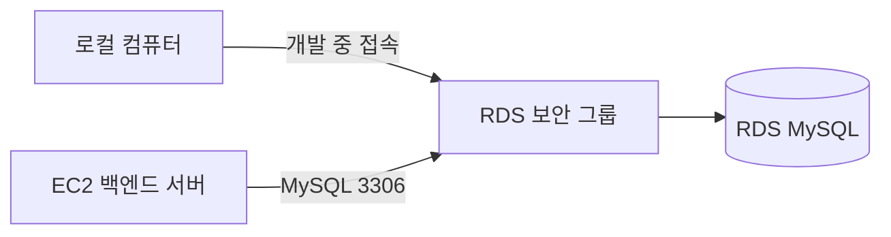
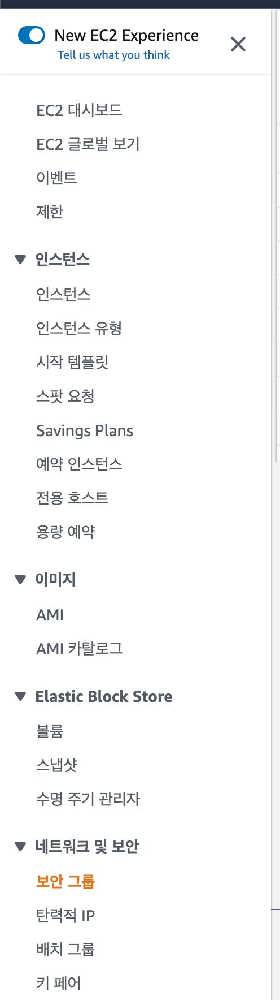
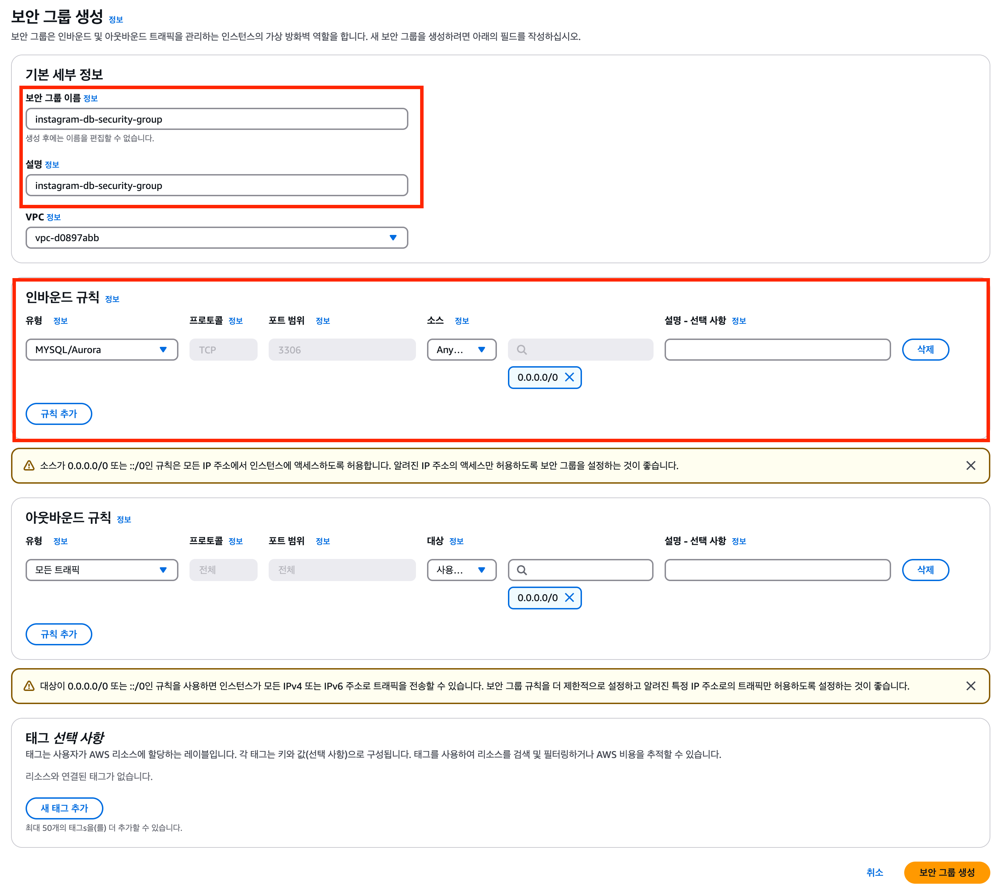
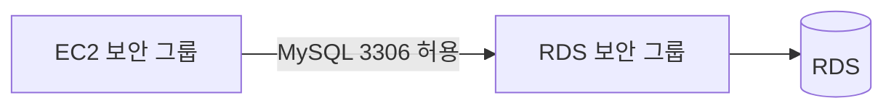
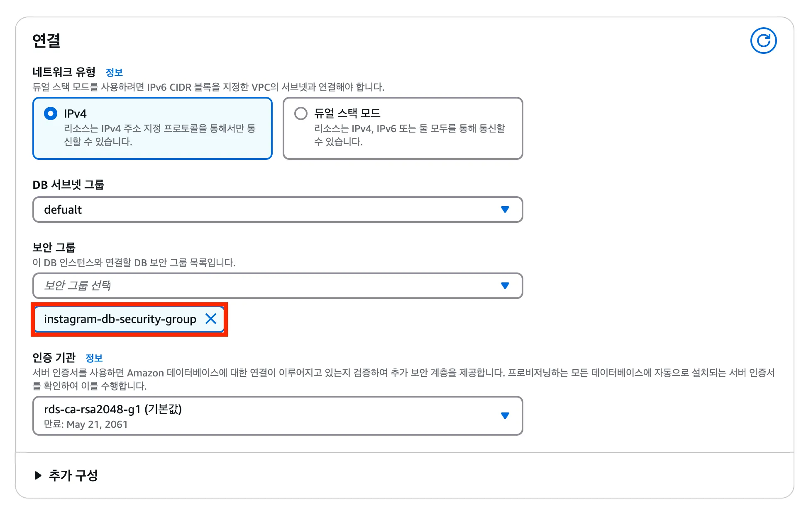

# 🔒RDS 보안 그룹 설정하기

RDS 데이터베이스에 접근할 수 있는 대상을 보안 그룹으로 제한하는 과정을 정리한다.

RDS를 생성했다고 해서 EC2나 로컬 컴퓨터가 자동으로 접속할 수 있는 것은 아니다. MySQL 포트 `3306`에 접근할 수 있도록 보안 그룹 규칙을 설정해야 한다.

## 보안 그룹이란?

보안 그룹(Security Group)은 AWS 리소스의 네트워크 접근을 제어하는 가상 방화벽이다.

RDS 보안 그룹에는 다음을 설정한다.

- 누가 RDS에 들어올 수 있는지: 인바운드 규칙
- RDS가 외부로 나갈 수 있는지: 아웃바운드 규칙

## 1. 보안 그룹 메뉴로 이동하기

AWS 콘솔에서 `EC2` 서비스로 이동한 뒤, 왼쪽 메뉴의 `보안 그룹`을 선택한다.

보안 그룹은 RDS 콘솔뿐 아니라 EC2 콘솔에서도 만들고 관리할 수 있다.

## 2. RDS용 보안 그룹 만들기

`보안 그룹 생성`을 선택하고 아래처럼 입력한다.

| 항목 | 예시 | 설명 |
| --- | --- | --- |
| 보안 그룹 이름 | `rds-mysql-sg` | RDS MySQL용 보안 그룹이라는 의미가 드러나는 이름 |
| 설명 | `RDS MySQL access` | 보안 그룹의 용도 |
| VPC | EC2와 RDS가 사용하는 VPC | 같은 VPC를 선택해야 연결 가능 |

## 3. 인바운드 규칙 설정하기

MySQL은 기본적으로 `3306` 포트를 사용한다.

RDS에 MySQL 연결을 허용하려면 인바운드 규칙에 `MySQL/Aurora`를 추가한다.

| 유형 | 프로토콜 | 포트 | 소스 | 사용 목적 |
| --- | --- | --- | --- | --- |
| MySQL/Aurora | TCP | 3306 | EC2 보안 그룹 | EC2 백엔드 서버 연결 |
| MySQL/Aurora | TCP | 3306 | 내 IP | 로컬 컴퓨터에서 직접 접속할 때만 사용 |

### EC2 보안 그룹을 소스로 지정하는 이유

운영 환경에서는 IP 주소 대신 EC2의 보안 그룹을 소스로 지정하는 방법이 안전하다.

EC2 인스턴스의 IP 주소가 변경되어도, 해당 보안 그룹이 연결된 서버는 계속 RDS에 접근할 수 있기 때문이다.

> `0.0.0.0/0`은 모든 IP 주소의 접근을 허용한다. MySQL 포트에 이 값을 사용하면 데이터베이스가 외부 공격에 노출될 수 있으므로 사용하지 않는다.

## 4. 아웃바운드 규칙 확인하기

기본 보안 그룹은 보통 모든 아웃바운드 트래픽을 허용한다.

이번 실습에서는 기본값을 유지한다. 인바운드 규칙이 RDS 접근 제어에서 더 중요한 역할을 한다.

## 5. 생성한 보안 그룹을 RDS에 연결하기

이제 RDS 콘솔에서 만든 보안 그룹을 데이터베이스에 연결한다.

1. RDS 콘솔에서 생성한 DB 인스턴스를 선택한다.
2. `수정`을 선택한다.
3. 연결 영역의 보안 그룹에서 기존 보안 그룹을 확인한다.
4. `rds-mysql-sg`를 추가한다.
5. 변경 사항을 적용한다.

설정 변경 후 RDS 상태가 다시 `사용 가능`이 될 때까지 기다린다.

## 설정 후 확인하기

다음 두 가지를 확인한다.

- RDS와 EC2가 같은 VPC에 있는가?
- RDS 보안 그룹 인바운드 규칙에서 EC2 보안 그룹의 `3306` 포트 접근을 허용했는가?

로컬에서 DB 도구로 접속해야 한다면, 일시적으로 현재 내 IP만 `3306` 포트에 추가한다. 작업이 끝난 뒤에는 해당 규칙을 삭제하는 것이 좋다.

## 다음 단계

다음 문서에서는 파라미터 그룹을 생성하고 MySQL의 문자 인코딩 설정을 변경한다.
