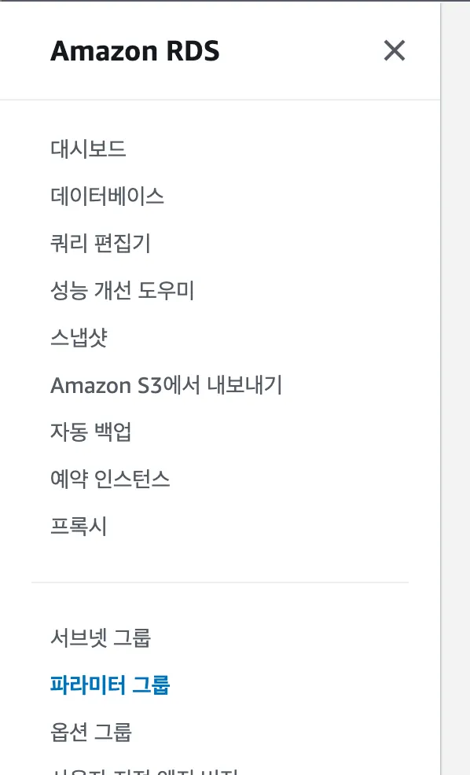
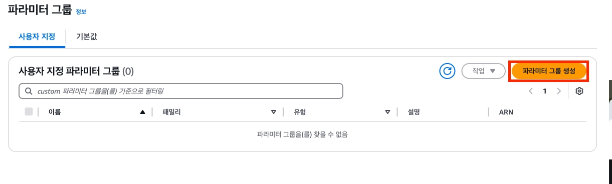
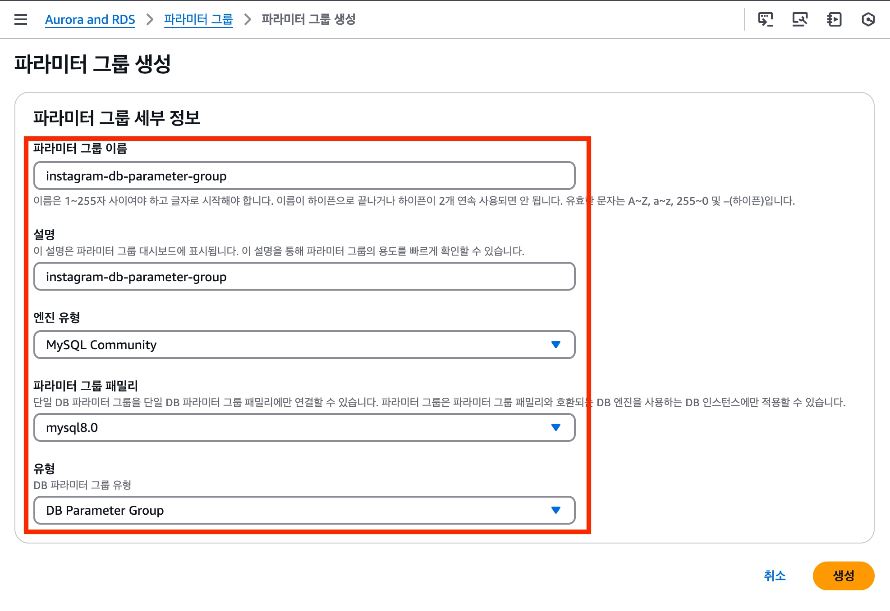
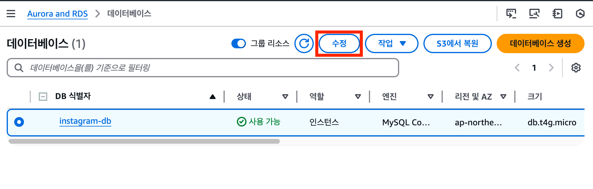
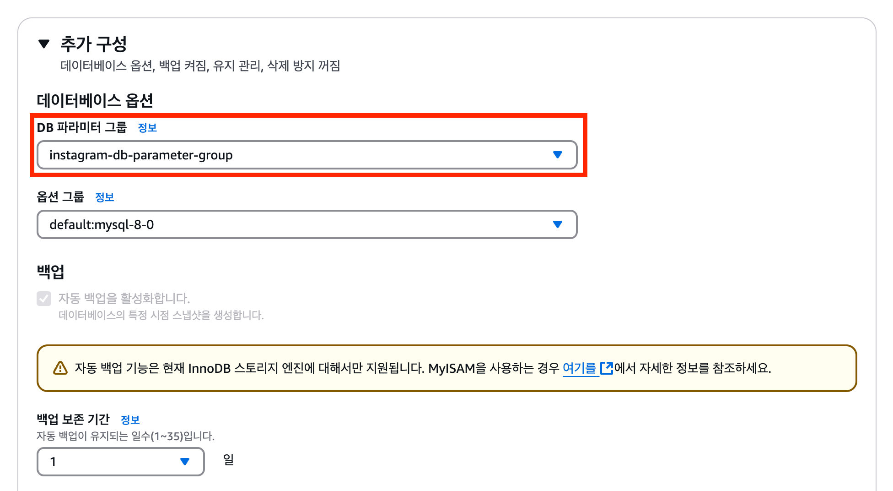

# ⚙️RDS 파라미터 그룹 설정하기

RDS의 MySQL 설정값을 관리하기 위해 파라미터 그룹을 생성하고 연결하는 과정을 정리한다.

이번 실습에서는 한글과 이모지를 저장할 수 있도록 문자 인코딩을 `utf8mb4`로 설정하고, 데이터베이스 시간대를 `Asia/Seoul`로 변경한다.

## 파라미터 그룹이란?

파라미터 그룹(Parameter Group)은 RDS 데이터베이스 엔진의 설정값을 모아 관리하는 기능이다.

MySQL을 직접 설치했다면 설정 파일을 수정하지만, RDS에서는 파라미터 그룹을 통해 설정한다.

| 설정 예시 | 의미 |
| --- | --- |
| 문자 인코딩 | 한글, 이모지 등 텍스트를 저장하는 방식 |
| Collation | 문자열을 비교하고 정렬하는 방식 |
| Time zone | 데이터베이스가 사용하는 기준 시간대 |

## 왜 `utf8mb4`를 사용할까?

`utf8mb4`는 한글뿐 아니라 이모지도 저장할 수 있는 문자 인코딩이다.

```text
안녕하세요 👋
```

기존 MySQL의 `utf8`은 이모지처럼 4바이트 문자가 저장되지 않을 수 있다. 서비스에서 닉네임, 댓글, 게시글 등을 저장한다면 처음부터 `utf8mb4`를 사용하는 편이 안전하다.

## 1. 파라미터 그룹 메뉴로 이동하기

RDS 콘솔 왼쪽 메뉴에서 `파라미터 그룹`을 선택한다.



기본 파라미터 그룹은 직접 수정할 수 없으므로, 새 사용자 지정 파라미터 그룹을 만들어야 한다.

## 2. 사용자 지정 파라미터 그룹 생성하기

`파라미터 그룹 생성`을 선택한 뒤 아래 항목을 설정한다.

| 항목 | 설정 방법 |
| --- | --- |
| 파라미터 그룹 패밀리 | 현재 RDS의 MySQL 엔진 버전과 같은 계열 선택 |
| 그룹 이름 | 예: `mysql-utf8mb4-parameter-group` |
| 설명 | 예: `MySQL utf8mb4 and Asia Seoul settings` |



> 파라미터 그룹 패밀리가 현재 RDS 엔진 버전과 맞지 않으면 RDS 인스턴스에 연결할 수 없다.

## 3. 문자 인코딩 설정하기

생성한 파라미터 그룹을 선택하고 `편집`에서 아래 값을 변경한다.

| 파라미터 | 값 |
| --- | --- |
| `character_set_client` | `utf8mb4` |
| `character_set_connection` | `utf8mb4` |
| `character_set_database` | `utf8mb4` |
| `character_set_filesystem` | `utf8mb4` |
| `character_set_results` | `utf8mb4` |
| `character_set_server` | `utf8mb4` |



### Collation 설정하기

문자열 비교와 정렬 방식도 `utf8mb4`에 맞게 변경한다.

| 파라미터 | 값 |
| --- | --- |
| `collation_connection` | `utf8mb4_unicode_ci` |
| `collation_server` | `utf8mb4_unicode_ci` |

`utf8mb4_unicode_ci`에서 `ci`는 대소문자를 구분하지 않는 비교 방식이라는 뜻이다.

## 4. 시간대 설정하기

`time_zone` 파라미터를 아래처럼 변경한다.

```text
Asia/Seoul
```

서버와 데이터베이스의 시간대가 다르면 생성일, 수정일, 예약 작업 시간이 예상과 다르게 저장될 수 있다.

## 5. RDS에 파라미터 그룹 연결하기

파라미터 그룹을 만들었다고 바로 적용되지는 않는다. RDS 인스턴스에 직접 연결해야 한다.

1. RDS 콘솔에서 DB 인스턴스를 선택한다.
2. `수정`을 선택한다.
3. `DB 파라미터 그룹` 항목에서 방금 만든 그룹을 선택한다.
4. 변경 사항을 적용한다.



## 6. RDS 재부팅하기

일부 파라미터는 RDS를 재부팅해야 적용된다.

RDS 인스턴스를 선택한 뒤 `작업` → `재부팅`을 선택한다.



> 재부팅 중에는 데이터베이스 연결이 잠시 끊긴다. 운영 환경에서는 서비스 영향 시간을 고려해 작업해야 한다.

## 설정 후 확인할 것

| 확인 항목 | 기대 값 |
| --- | --- |
| DB 파라미터 그룹 | 생성한 사용자 지정 그룹 |
| `character_set_server` | `utf8mb4` |
| `collation_server` | `utf8mb4_unicode_ci` |
| `time_zone` | `Asia/Seoul` |
| RDS 상태 | `사용 가능` |

## 다음 단계

다음 문서에서는 RDS 엔드포인트와 마스터 계정을 사용해 데이터베이스에 직접 접속한다.
