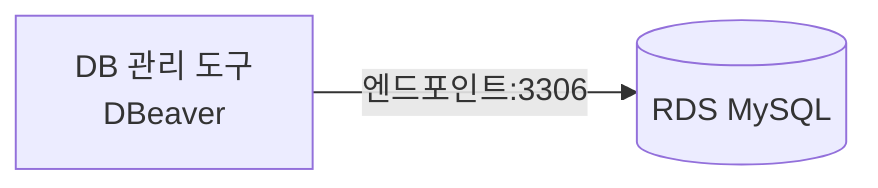
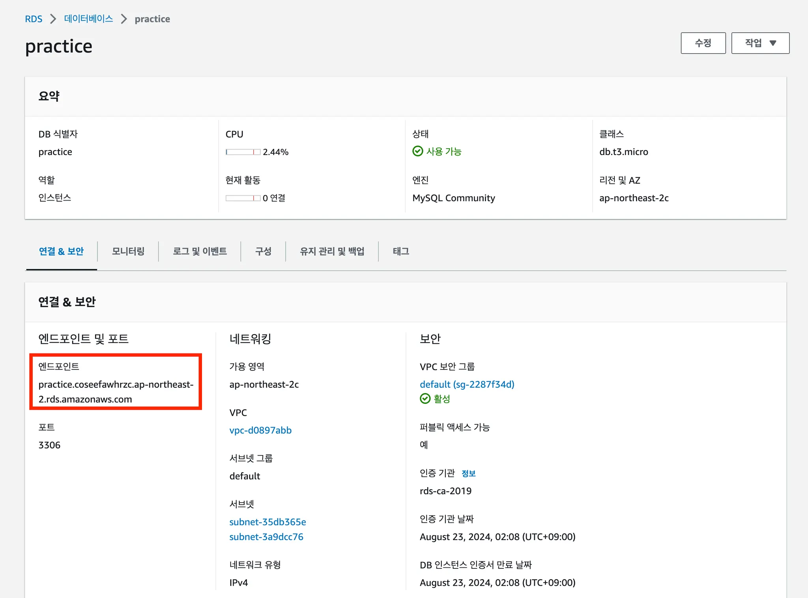
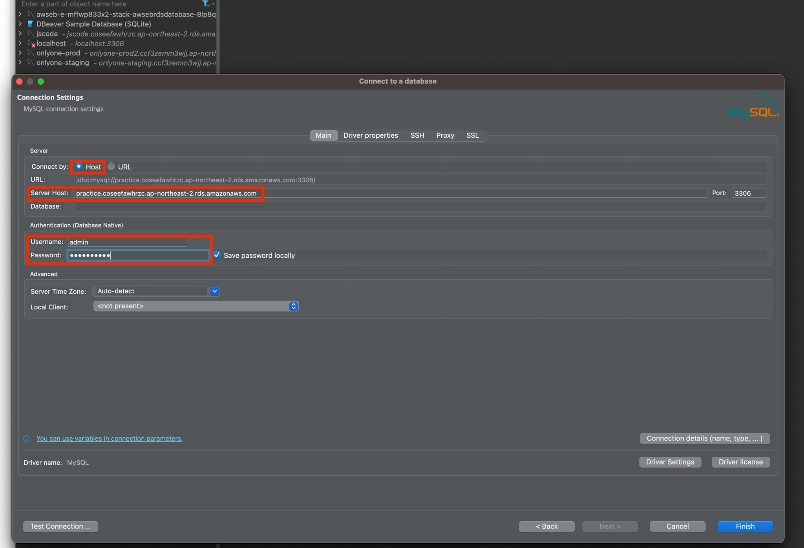
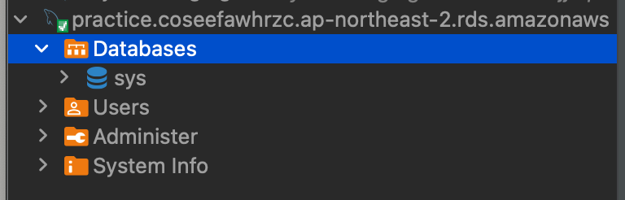
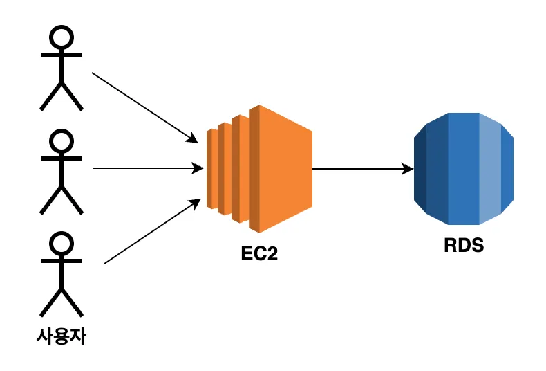

# 🔌RDS 데이터베이스에 접속하기

DBeaver를 사용해 생성한 RDS MySQL 데이터베이스에 직접 접속하는 과정을 정리한다.

DB 관리 도구는 DBeaver 외에도 MySQL Workbench, DataGrip 등을 사용할 수 있다. 어떤 도구를 사용하더라도 RDS 접속에 필요한 정보는 같다.

## 접속 전에 확인할 것

RDS에 접속하려면 아래 정보가 필요하다.

| 항목 | 확인 위치 | 설명 |
| --- | --- | --- |
| 엔드포인트 | RDS 인스턴스 상세 화면 | RDS 서버 주소 |
| 포트 | RDS 인스턴스 상세 화면 | MySQL 기본 포트는 `3306` |
| 사용자 이름 | RDS 생성 시 설정 | 마스터 사용자 이름 |
| 비밀번호 | RDS 생성 시 설정 | 마스터 암호 |
| 보안 그룹 | RDS 보안 그룹 설정 | 현재 내 IP 또는 EC2 보안 그룹의 `3306` 허용 여부 |

## 엔드포인트란?

엔드포인트(Endpoint)는 특정 리소스에 접속하기 위한 주소다.

RDS의 엔드포인트는 데이터베이스 서버의 주소 역할을 한다.



RDS 인스턴스의 상세 화면에서 다음과 같은 형식의 엔드포인트를 확인할 수 있다.

```text
my-service-rds.abcdefg.ap-northeast-2.rds.amazonaws.com
```

> 엔드포인트는 공개되어도 비밀번호와 같지는 않지만, 불필요하게 외부에 공유하지 않는 것이 좋다.

## 1. DBeaver에서 새 연결 만들기

DBeaver를 실행한 뒤 새 데이터베이스 연결을 만든다.

1. `새 데이터베이스 연결`을 선택한다.
2. 데이터베이스 종류에서 `MySQL`을 선택한다.
3. 연결 정보를 입력하는 화면으로 이동한다.



## 2. RDS 접속 정보 입력하기

RDS 생성 시 확인한 정보를 DBeaver에 입력한다.

| DBeaver 항목 | 입력할 값 |
| --- | --- |
| Server Host | RDS 엔드포인트 |
| Port | `3306` |
| Username | 마스터 사용자 이름 |
| Password | 마스터 암호 |
| Database | 처음 연결할 때는 비워 둘 수 있음 |



입력을 마쳤다면 `Test Connection`으로 연결을 테스트한다.

정상 연결되면 `Connected` 또는 성공 메시지가 표시된다.

## 3. RDS 연결 확인하기

연결에 성공하면 DBeaver 왼쪽 목록에 RDS 연결이 표시된다.



이제 SQL을 실행하거나 데이터베이스와 테이블을 확인할 수 있다.

## 4. 데이터베이스 생성하기

RDS 인스턴스 자체는 데이터베이스 서버다. 실제 서비스 데이터를 저장할 데이터베이스는 별도로 생성할 수 있다.

예를 들어 `instagram` 데이터베이스를 만든다면 아래 SQL을 실행한다.

```sql
CREATE DATABASE instagram
  CHARACTER SET utf8mb4
  COLLATE utf8mb4_unicode_ci;
```

생성 후 새로고침하면 데이터베이스 목록에서 `instagram`을 확인할 수 있다.

## 연결이 안 될 때 확인할 것

| 증상 | 확인할 내용 |
| --- | --- |
| Connection timed out | RDS 보안 그룹에서 현재 내 IP의 `3306` 포트를 허용했는지 확인 |
| Access denied | 마스터 사용자 이름과 암호를 다시 확인 |
| Unknown host | 엔드포인트를 정확히 복사했는지 확인 |
| 연결은 되지만 한글·이모지가 깨짐 | 파라미터 그룹의 `utf8mb4` 설정과 재부팅 여부 확인 |
| RDS 상태가 변경 중 | 상태가 `사용 가능`이 될 때까지 기다리기 |

## 보안 주의 사항

- 마스터 암호를 GitHub, Notion 공개 페이지, 스크린샷에 올리지 않는다.
- 로컬 접속을 위해 추가한 `내 IP` 규칙은 필요 없으면 삭제한다.
- 운영 환경에서는 로컬 접속보다 EC2 보안 그룹을 통한 내부 접속을 우선 사용한다.



## 다음 단계

다음 문서에서는 Express 서버의 환경 변수에 RDS 접속 정보를 설정하고, Sequelize를 통해 RDS MySQL에 연결한다.
