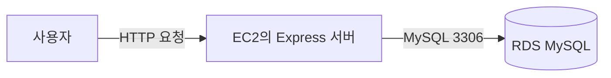
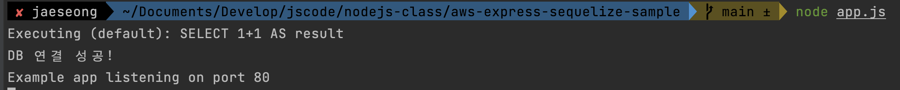

# 🚀Express 서버에 RDS 연결하기

EC2에 배포한 Express 서버를 RDS MySQL 데이터베이스에 연결하는 과정을 정리한다.

이번 실습에서는 Sequelize를 사용하는 예제 프로젝트에 RDS 접속 정보를 환경 변수로 전달한다.

## 연결 구조



EC2가 RDS에 연결하려면 다음 조건이 모두 충족되어야 한다.

- RDS 보안 그룹이 EC2 보안 그룹의 `3306` 포트 접근을 허용해야 한다.
- Express 환경 변수에 올바른 RDS 접속 정보가 있어야 한다.
- RDS 상태가 `사용 가능`이어야 한다.

## 1. EC2에서 예제 프로젝트 내려받기

EC2에 SSH로 접속한 뒤 예제 프로젝트를 내려받는다.

```bash
git clone https://github.com/JSCODE-EDU/rds-express-sequelize-sample.git
cd rds-express-sequelize-sample
npm install
```

프로젝트에는 Express와 Sequelize를 사용해 MySQL에 연결하는 코드가 포함되어 있다.

## 2. 환경 변수 설정하기

RDS 접속 정보는 `.env` 파일에 저장한다.

```text
DATABASE_NAME=instagram
DATABASE_USERNAME=admin
DATABASE_PASSWORD=RDS_마스터_암호
DATABASE_HOST=RDS_엔드포인트
DATABASE_PORT=3306
```

예를 들어 `DATABASE_HOST`에는 아래와 같은 RDS 엔드포인트를 입력한다.

```text
my-service-rds.abcdefg.ap-northeast-2.rds.amazonaws.com
```

## `.env` 파일을 GitHub에 올리지 않는 이유

`.env`에는 데이터베이스 비밀번호처럼 외부에 공개되면 안 되는 정보가 담긴다.

프로젝트의 `.gitignore`에 아래 내용을 추가한다.

```gitignore
.env
.env.*
!.env.example
```

다른 사람이 참고할 수 있도록 값이 비어 있는 `.env.example` 파일은 올려도 된다.

```text
DATABASE_NAME=
DATABASE_USERNAME=
DATABASE_PASSWORD=
DATABASE_HOST=
DATABASE_PORT=3306
```

## 3. Express 서버 실행하기

환경 변수를 설정한 뒤 서버를 실행한다.

```bash
node app.js
```

서버 로그에 데이터베이스 연결 성공 메시지가 표시되면 RDS 연결이 완료된 것이다.



## 연결이 안 될 때 확인할 것

| 증상 | 확인할 내용 |
| --- | --- |
| Connection timed out | RDS 보안 그룹에서 EC2 보안 그룹의 `3306` 포트를 허용했는지 확인 |
| Access denied | 마스터 사용자 이름과 암호 확인 |
| Unknown database | `DATABASE_NAME`에 입력한 데이터베이스가 실제로 존재하는지 확인 |
| getaddrinfo ENOTFOUND | RDS 엔드포인트에 오타가 없는지 확인 |
| 서버 실행은 되지만 DB 오류 발생 | `.env` 파일이 프로젝트 루트에 있는지 확인 |

## 다음 단계

다음 문서에서는 Spring Boot 서버를 RDS MySQL에 연결한다.
