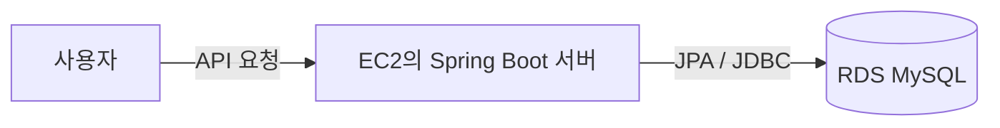
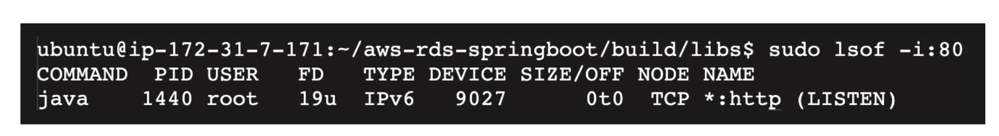
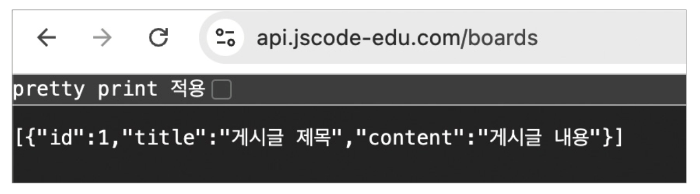

# 🌱Spring Boot 서버에 RDS 연결하기

EC2에 배포한 Spring Boot 서버를 RDS MySQL 데이터베이스에 연결하는 과정을 정리한다.

Spring Boot에서는 `application.yml`의 데이터 소스 설정을 통해 RDS 접속 정보를 전달한다.

## 연결 구조



## 1. EC2에서 예제 프로젝트 내려받기

EC2에 접속한 뒤 예제 프로젝트를 내려받는다.

```bash
git clone https://github.com/JSCODE-BOOK/aws-rds-springboot.git
cd aws-rds-springboot
```

## 2. RDS 접속 정보 설정하기

`src/main/resources/application.yml`에서 데이터 소스 설정을 확인한다.

```yaml
server:
  port: 80

spring:
  datasource:
    url: jdbc:mysql://RDS_엔드포인트:3306/instagram
    username: RDS_마스터_사용자_이름
    password: RDS_마스터_암호
    driver-class-name: com.mysql.cj.jdbc.Driver

  jpa:
    hibernate:
      ddl-auto: update
    show-sql: true
```

| 항목 | 설명 |
| --- | --- |
| `url` | RDS 엔드포인트, 포트, 데이터베이스 이름 |
| `username` | RDS 생성 시 설정한 마스터 사용자 이름 |
| `password` | RDS 생성 시 설정한 마스터 암호 |
| `driver-class-name` | MySQL 드라이버 |
| `ddl-auto` | JPA 엔티티를 기준으로 테이블 구조를 관리하는 설정 |

> `ddl-auto: update`는 실습에서 편리하지만, 운영 환경에서는 예상하지 못한 테이블 변경을 만들 수 있다. 운영 환경에서는 신중하게 사용한다.

## 비밀번호를 코드에 직접 적지 않는 방법

공개 GitHub 저장소에 실제 RDS 암호가 담긴 `application.yml`을 올리면 안 된다.

환경 변수를 사용하는 방식으로 작성하면 더 안전하다.

```yaml
spring:
  datasource:
    url: jdbc:mysql://${DB_HOST}:${DB_PORT:3306}/${DB_NAME}
    username: ${DB_USERNAME}
    password: ${DB_PASSWORD}
    driver-class-name: com.mysql.cj.jdbc.Driver
```

EC2에서 서버를 실행하기 전 환경 변수를 설정한다.

```bash
export DB_HOST=RDS_엔드포인트
export DB_PORT=3306
export DB_NAME=instagram
export DB_USERNAME=RDS_마스터_사용자_이름
export DB_PASSWORD='RDS_마스터_암호'
```

## 3. Spring Boot 프로젝트 빌드하기

프로젝트 루트에서 Gradle 빌드를 실행한다.

```bash
./gradlew clean build -x test
```

빌드가 끝나면 `build/libs` 폴더에 JAR 파일이 생성된다.

## 4. 서버 실행하기

80번 포트를 이미 사용 중인 프로세스가 있는지 확인한다.

```bash
sudo lsof -i :80
```

기존 프로세스가 있다면 PID를 확인한 뒤 종료한다.

```bash
sudo kill PID
```

JAR 파일을 백그라운드에서 실행한다.

```bash
cd build/libs
sudo nohup java -jar aws-rds-springboot-0.0.1-SNAPSHOT.jar &
```

실행 후 다시 포트를 확인한다.

```bash
sudo lsof -i :80
```



> 80번 포트는 관리자 권한이 필요하다. 실제 서비스에서는 애플리케이션을 `8080` 같은 포트로 실행하고, Nginx 또는 ELB가 80·443 포트를 처리하는 구성이 일반적이다.

## 5. API로 RDS 연결 확인하기

예제 프로젝트의 `GET /boards` API는 RDS에서 게시글 데이터를 조회한다.

브라우저 또는 API 도구에서 아래 주소로 요청한다.

```text
http://도메인주소/boards
```

게시글 목록이 JSON 형태로 반환되면 Spring Boot 서버와 RDS가 정상적으로 연결된 것이다.



## 연결이 안 될 때 확인할 것

| 증상 | 확인할 내용 |
| --- | --- |
| `Communications link failure` | RDS 보안 그룹에서 EC2 보안 그룹의 `3306` 포트 접근 허용 여부 |
| `Access denied` | 사용자 이름과 비밀번호 확인 |
| `Unknown database` | JDBC URL의 데이터베이스 이름 확인 |
| 서버가 실행되지 않음 | `java -version`, 빌드 결과 JAR 파일명, 포트 사용 여부 확인 |
| API 응답이 500 오류 | EC2 서버 로그와 RDS 연결 설정 확인 |

## 다음 단계

실습을 마쳤다면 RDS 인스턴스와 관련 리소스를 정리해 불필요한 비용이 발생하지 않도록 한다.
