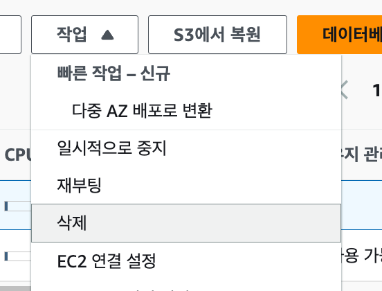
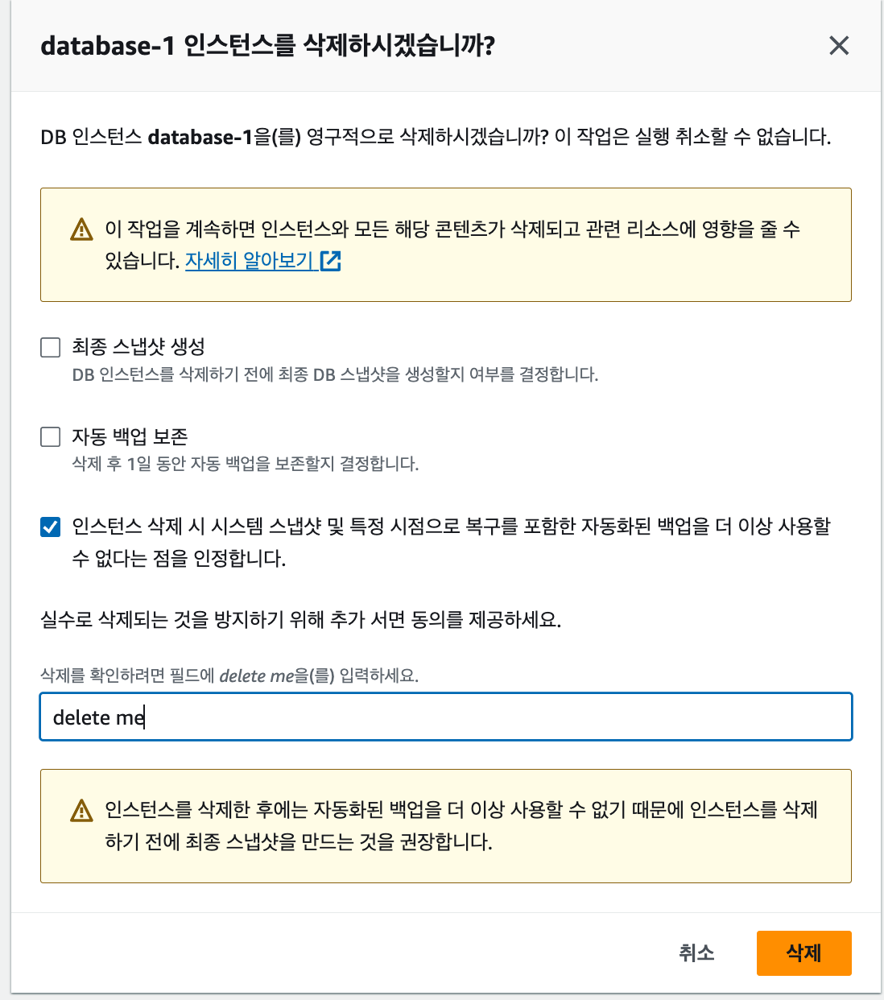

# 🧹RDS 실습 리소스 정리하기

RDS는 인스턴스가 실행되는 동안 비용이 발생할 수 있다.

실습을 끝냈고 더 이상 데이터베이스가 필요하지 않다면 RDS 인스턴스를 삭제한다. 삭제 전에는 EC2의 Express 또는 Spring Boot 서버가 더 이상 해당 RDS를 사용하지 않는지 확인한다.

## 삭제 전 확인할 것

- 필요한 데이터가 남아 있는지 확인한다.
- Express 또는 Spring Boot 서버의 실행을 중지한다.
- RDS 엔드포인트를 사용하는 서비스가 없는지 확인한다.
- 스냅샷이 필요한지 결정한다.

## 1. RDS 인스턴스 삭제 시작하기

RDS 콘솔에서 삭제할 DB 인스턴스를 선택한다.

`작업` → `삭제`를 선택한다.

## 2. 최종 스냅샷과 자동 백업 선택하기

RDS를 삭제할 때 데이터 보존 여부를 선택한다.

| 항목 | 선택 기준 |
| --- | --- |
| 최종 스냅샷 생성 | 나중에 데이터를 복구해야 한다면 선택 |
| 자동 백업 보존 | 백업을 계속 유지해야 한다면 선택 |
| 최종 스냅샷 생성 안 함 | 학습용 데이터이고 복구할 필요가 없다면 선택 |
| 자동 백업 보존 안 함 | 학습 종료 후 비용을 최소화하려면 선택 |

> 스냅샷과 자동 백업을 보관하면 RDS 인스턴스를 삭제한 뒤에도 스토리지 비용이 발생할 수 있다.

삭제 확인 문구를 입력하고 인스턴스 삭제를 완료한다.

## 3. 삭제 완료 확인하기

RDS 목록에서 인스턴스 상태가 `삭제 중`으로 바뀐 뒤 목록에서 사라지는지 확인한다.

삭제에는 시간이 걸릴 수 있다. 상태가 바로 사라지지 않아도 잠시 기다린다.

## 함께 확인할 리소스

| 리소스 | 확인 내용 |
| --- | --- |
| 수동 스냅샷 | 학습용이라면 불필요한 스냅샷 삭제 |
| 자동 백업 | 보존 옵션을 선택했다면 만료 정책 확인 |
| 보안 그룹 | 다른 RDS에서 사용하지 않는 그룹인지 확인 후 삭제 |
| 파라미터 그룹 | 다른 RDS에서 사용하지 않는 사용자 지정 그룹인지 확인 후 삭제 |
| EC2 서버 | RDS 연결용 실습 서버라면 중지 또는 종료 여부 확인 |
| 환경 변수 | 폐기한 RDS의 엔드포인트와 계정 정보 제거 |

## 주의 사항

- RDS 인스턴스 삭제는 되돌릴 수 없다.
- 스냅샷을 삭제하면 해당 시점의 데이터를 복구할 수 없다.
- 보안 그룹과 파라미터 그룹은 다른 RDS 인스턴스에서 사용 중일 수 있으므로, 연결 대상을 먼저 확인한다.

## 실습 종료 체크리스트

- [ ] RDS 인스턴스를 삭제했다.
- [ ] 불필요한 최종 스냅샷과 자동 백업을 확인했다.
- [ ] RDS용 보안 그룹의 사용 여부를 확인했다.
- [ ] RDS용 파라미터 그룹의 사용 여부를 확인했다.
- [ ] 서버 환경 변수에서 폐기한 RDS 정보를 제거했다.
