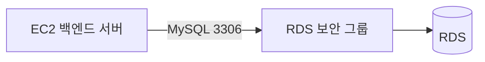

# 🕰️RDS 보안 그룹 설정: 이전 AWS UI

> 이 문서는 이전 AWS 콘솔 화면을 사용하던 시기의 참고용 기록이다.  
> 실제 실습은 [RDS 보안 그룹 설정하기](../04-보안-그룹-설정.md)를 따른다.

이전 AWS UI에서도 RDS 보안 그룹 설정의 목적은 같다.

## 핵심 설정

| 항목 | 설정 |
| --- | --- |
| 인바운드 유형 | MySQL/Aurora |
| 프로토콜 | TCP |
| 포트 | `3306` |
| 권장 소스 | EC2 보안 그룹 |
| 로컬 접속 시 소스 | 현재 내 IP |
| 피해야 할 소스 | `0.0.0.0/0` |

이전 UI에서는 메뉴 위치나 버튼 이름이 다를 수 있지만, RDS에 연결할 보안 그룹을 생성한 뒤 DB 인스턴스에 연결하는 과정은 같다.

## 주의 사항

- `0.0.0.0/0`으로 MySQL 포트를 열지 않는다.
- EC2의 보안 그룹을 소스로 지정하면 EC2 IP가 바뀌어도 연결 규칙을 유지할 수 있다.
- 로컬 접속을 위해 추가한 내 IP 규칙은 작업 후 삭제한다.
