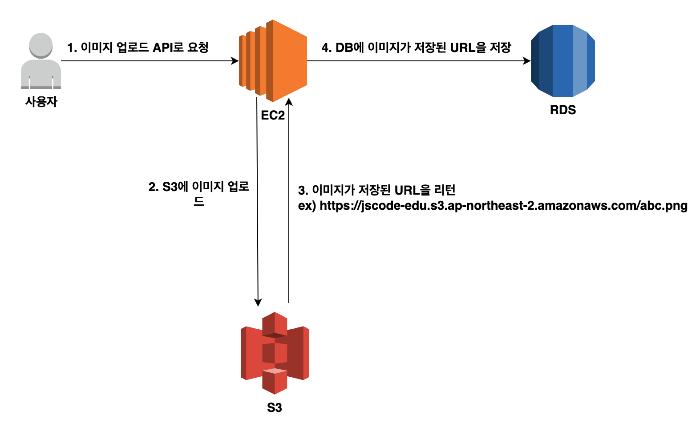
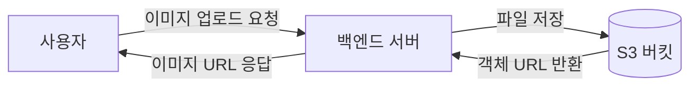
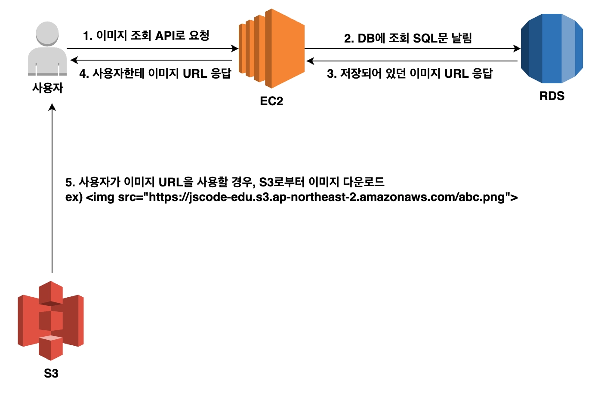
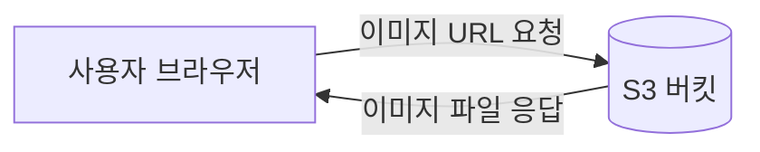

# 🏗️S3를 활용한 아키텍처 구성

S3는 백엔드 서버가 업로드받은 파일을 저장하고, 사용자가 파일을 조회할 수 있도록 돕는다.

## 이미지 업로드 과정

1. 사용자가 이미지 파일을 선택해 백엔드 서버에 요청한다.
2. 백엔드 서버가 파일을 S3 버킷에 저장한다.
3. S3에 저장된 객체의 URL 또는 객체 키를 데이터베이스에 저장한다.
4. 백엔드 서버가 이미지 주소를 사용자에게 반환한다.

## 이미지 조회 과정

이미지를 조회할 때 매번 백엔드 서버를 거치지 않고 S3에서 직접 파일을 받을 수 있다. 따라서 백엔드 서버의 부담을 줄일 수 있다.

## 공개 객체와 비공개 객체

| 방식 | 사용 예시 |
| --- | --- |
| 공개 객체 | 상품 이미지, 서비스 소개 이미지 |
| 비공개 객체 | 개인 문서, 결제 영수증, 회원 전용 파일 |
| Presigned URL | 일정 시간만 접근을 허용해야 하는 파일 |

실습에서는 이미지를 브라우저에서 확인하기 위해 공개 읽기 권한을 사용할 수 있다. 실제 서비스에서는 모든 파일을 공개하지 않고, 필요한 파일만 제한적으로 공개하는 편이 안전하다.

## 다음 단계

다음 문서에서는 파일을 저장할 S3 버킷을 생성하고, 필요한 경우 객체 조회 권한을 설정한다.
