# 🛠️S3 버킷 생성하기

이미지 파일을 저장할 S3 버킷을 생성하고, 공개 이미지 조회를 위한 권한을 설정하는 과정을 정리한다.

## 시작 전 확인

- 버킷 이름은 AWS 전체에서 중복될 수 없다.
- 버킷을 만들 리전은 EC2 서버와 같은 리전으로 선택한다.
- 기본적으로 객체는 비공개 상태를 유지한다.
- 모든 파일을 공개하지 말고, 공개가 필요한 이미지 경로만 제한한다.

## 1. S3 콘솔에서 버킷 생성 시작하기

AWS 콘솔에서 `S3`를 검색한 뒤 `버킷 만들기`를 선택한다.

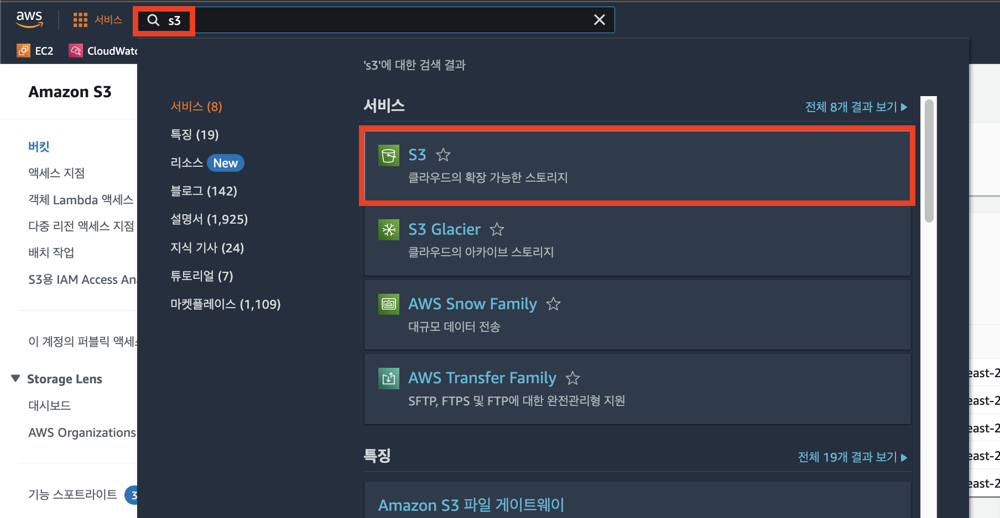

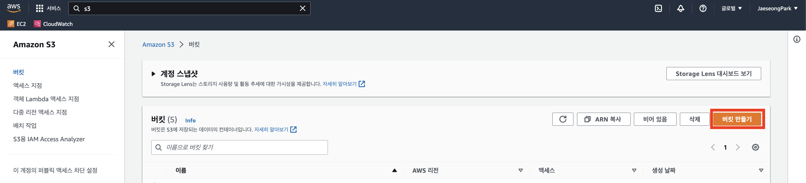

## 2. 버킷 이름과 리전 설정하기

버킷 이름은 서비스와 용도를 알 수 있게 작성한다.

```text
my-service-image-bucket
```

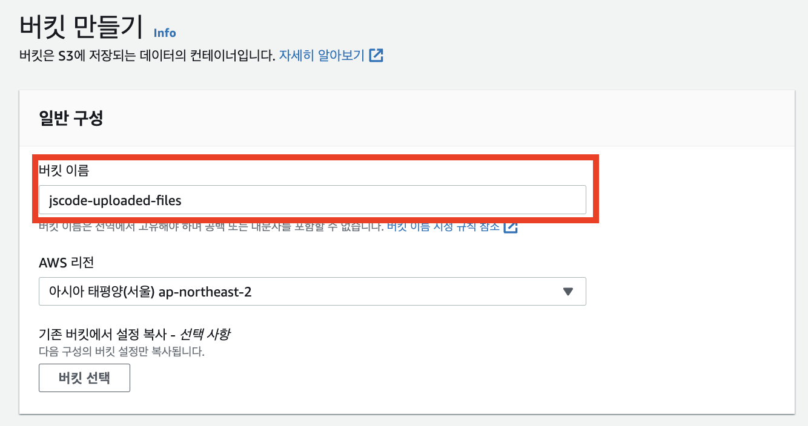

| 항목 | 권장 설정 |
| --- | --- |
| 버킷 이름 | 소문자, 숫자, 하이픈 사용 |
| AWS 리전 | EC2와 같은 리전 |
| 객체 소유권 | ACL 비활성화 상태 유지 |
| 버킷 버전 관리 | 실습에서는 기본값 사용 가능 |

## 3. 기본 보안 설정 확인하기

객체 소유권은 기본값을 유지한다.

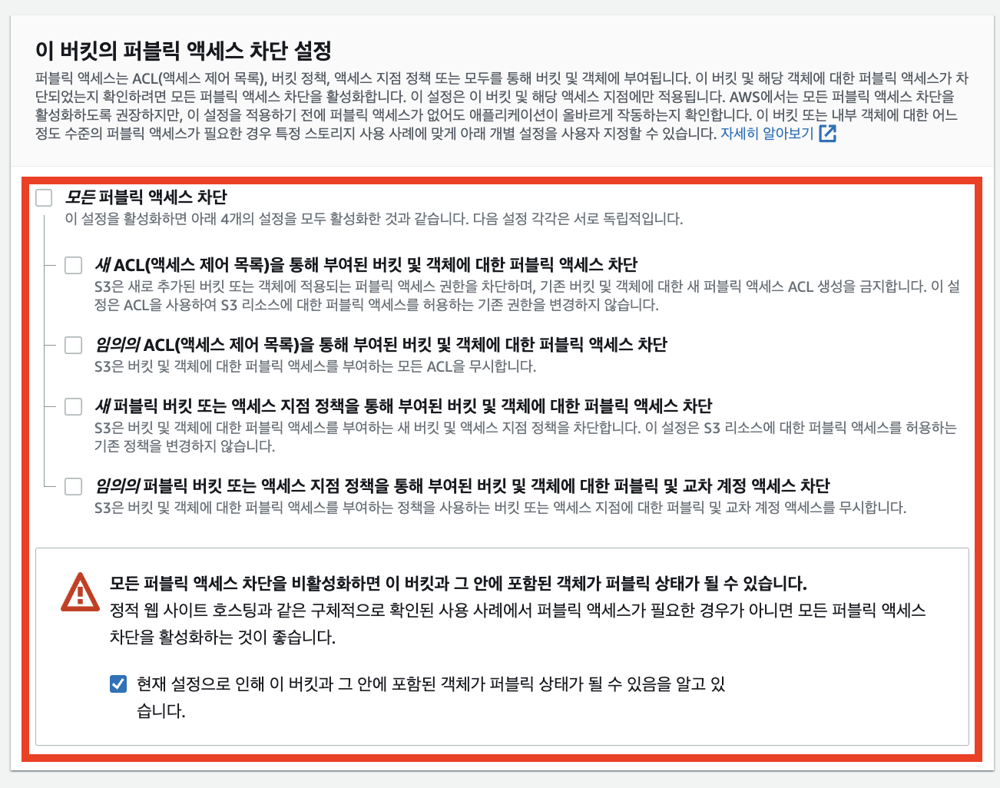

S3는 기본적으로 퍼블릭 액세스를 차단한다.

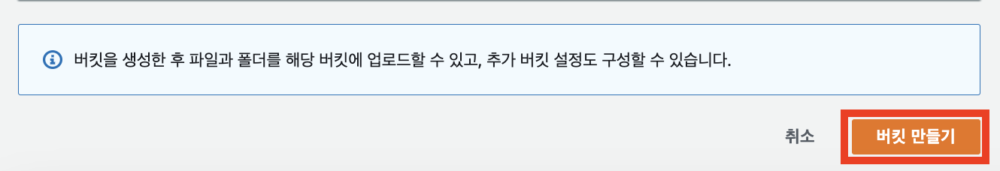

이번 실습처럼 브라우저에서 이미지를 직접 조회해야 한다면 이후 버킷 정책을 추가할 수 있다. 다만 실제 서비스에서는 공개 범위를 최소화해야 한다.

나머지 설정을 확인한 뒤 버킷을 생성한다.

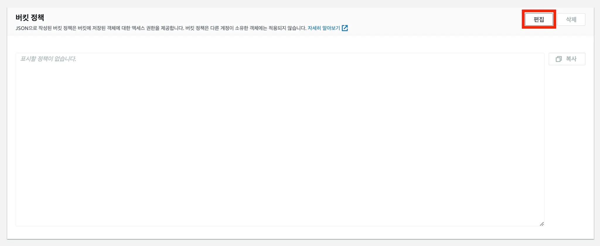

## 4. 버킷 정책으로 공개 이미지 경로 설정하기

버킷을 선택한 뒤 `권한` 탭으로 이동한다.

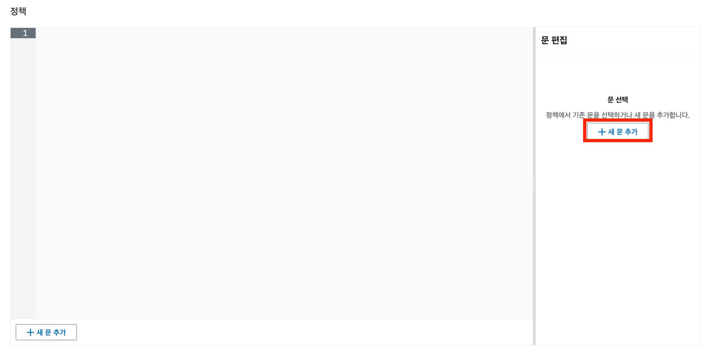

`버킷 정책` 영역에서 정책 편집을 시작한다.

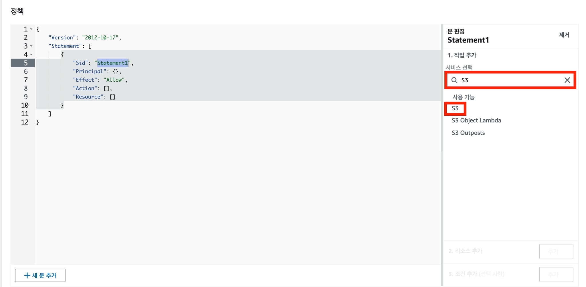

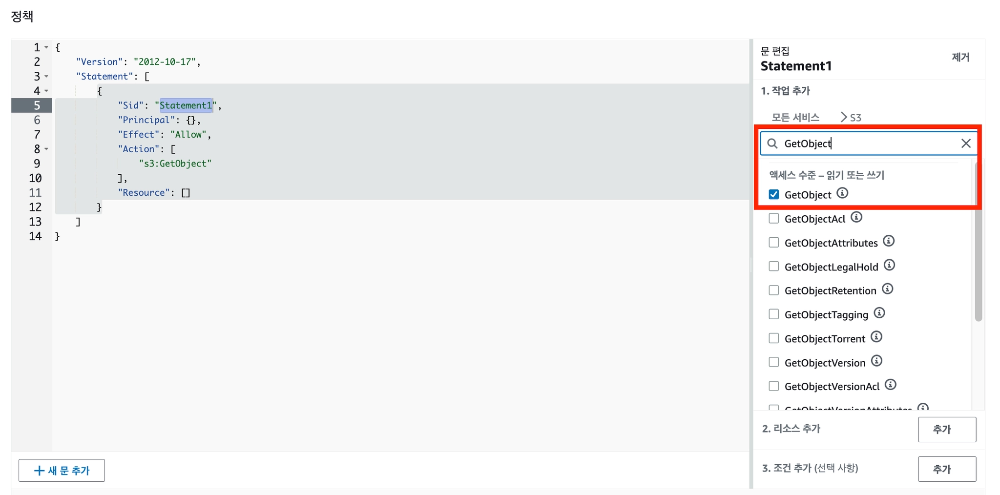

예를 들어 `public/` 경로의 객체만 누구나 조회할 수 있도록 설정할 수 있다.

```json
{
  "Version": "2012-10-17",
  "Statement": [
    {
      "Sid": "AllowPublicReadForPublicPrefix",
      "Effect": "Allow",
      "Principal": "*",
      "Action": "s3:GetObject",
      "Resource": "arn:aws:s3:::버킷이름/public/*"
    }
  ]
}
```

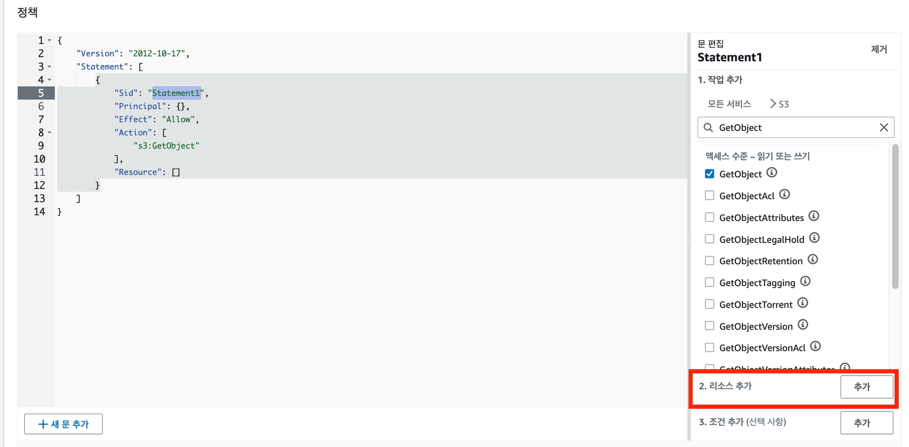

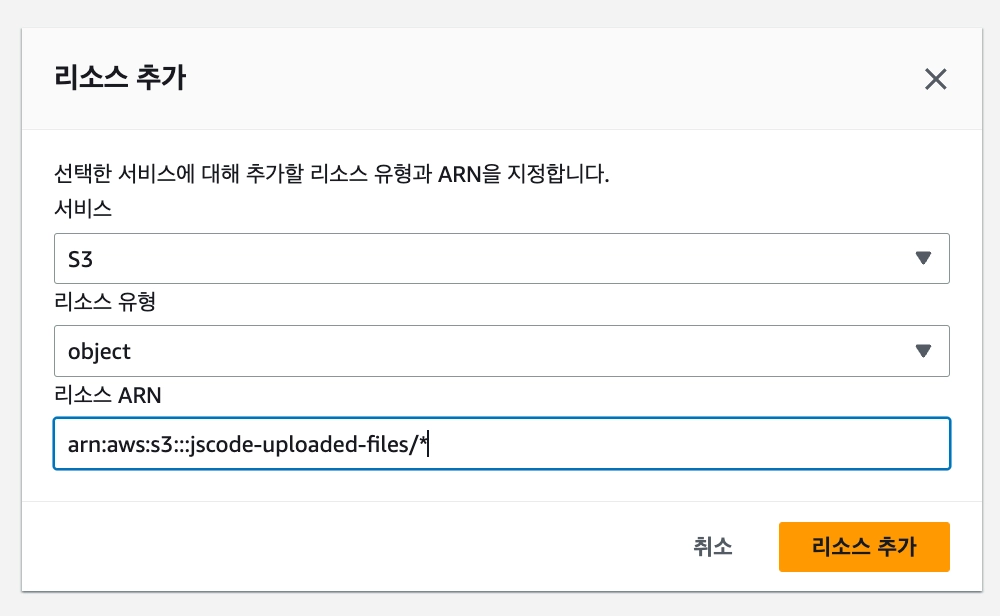

> 강의처럼 모든 객체를 공개할 수도 있지만, 실제 서비스에서는 `public/*`처럼 공개할 경로를 제한하는 편이 좋다.

## 5. 객체 URL 확인하기

파일을 업로드한 뒤 객체 상세 화면의 URL로 브라우저에서 이미지를 확인한다.

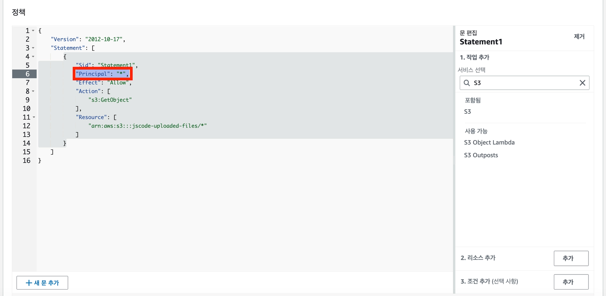

## 다음 단계

다음 문서에서는 백엔드 서버가 S3에 파일을 업로드할 수 있도록 IAM 사용자와 액세스 키를 설정한다.
