# 🔑IAM 액세스 키 발급하기

백엔드 서버가 S3 버킷에 파일을 업로드할 수 있도록 IAM 사용자에게 권한을 부여하고 액세스 키를 발급하는 과정을 정리한다.

## IAM이 필요한 이유

AWS 리소스는 기본적으로 아무나 접근할 수 없다.

백엔드 서버가 S3에 파일을 업로드하려면 AWS가 해당 서버의 권한을 확인해야 한다. IAM은 AWS 리소스에 대한 사용자와 권한을 관리하는 서비스다.

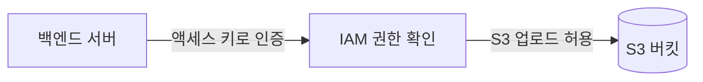

## 시작 전 주의 사항

- 액세스 키는 비밀번호와 같은 민감한 정보다.
- 비밀 액세스 키는 생성 직후 한 번만 확인할 수 있다.
- 액세스 키와 비밀 액세스 키를 GitHub에 올리지 않는다.
- 실제 EC2 운영 환경에서는 액세스 키보다 IAM 역할(Role)을 사용하는 편이 더 안전하다.

## 1. IAM 사용자 메뉴로 이동하기

AWS 콘솔에서 `IAM`을 검색해 접속한다.

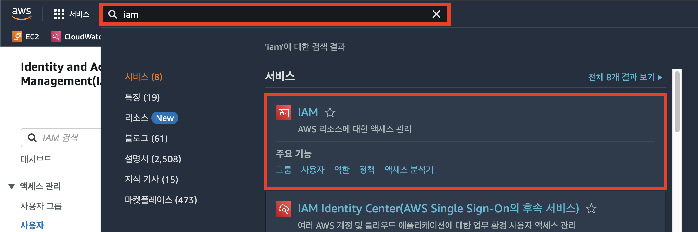

왼쪽 메뉴에서 `사용자`를 선택한다.

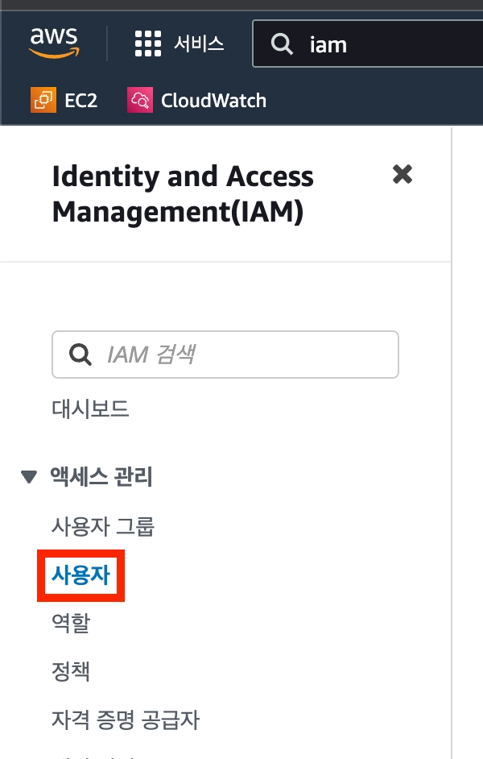

## 2. S3 업로드용 사용자 만들기

`사용자 생성`을 선택한다.

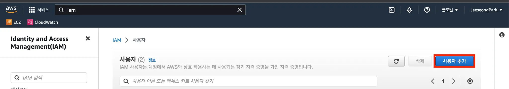

사용자 이름은 역할이 드러나도록 작성한다.

```text
s3-upload-user
```

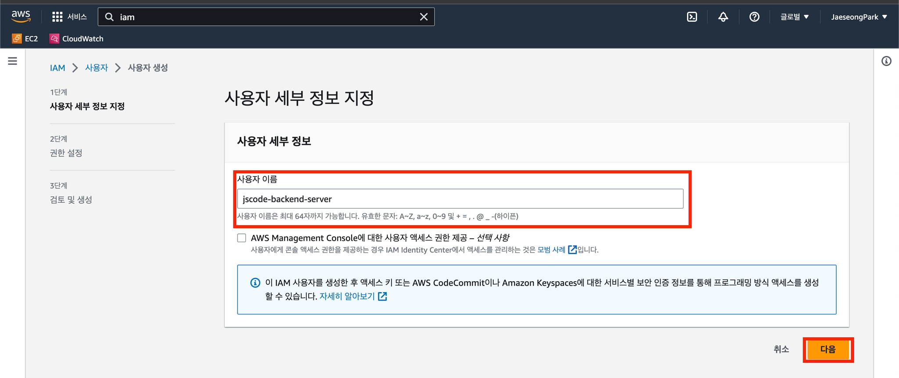

## 3. S3 권한 추가하기

권한 설정에서 `직접 정책 연결`을 선택한다.

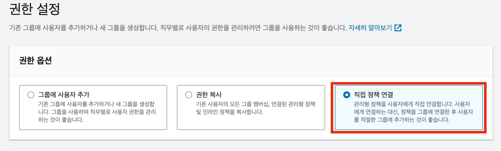

학습 환경에서는 `AmazonS3FullAccess` 정책을 사용할 수 있다.

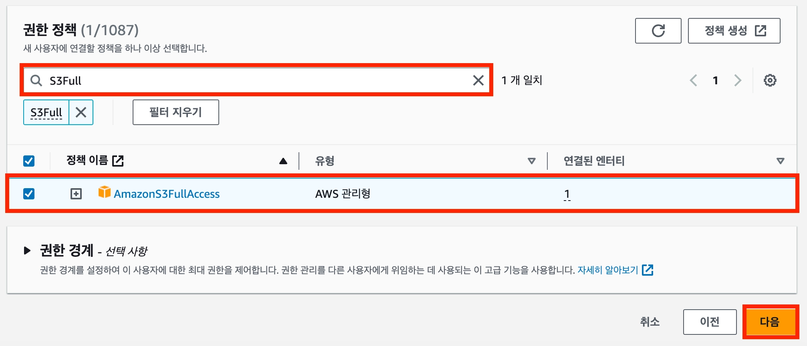

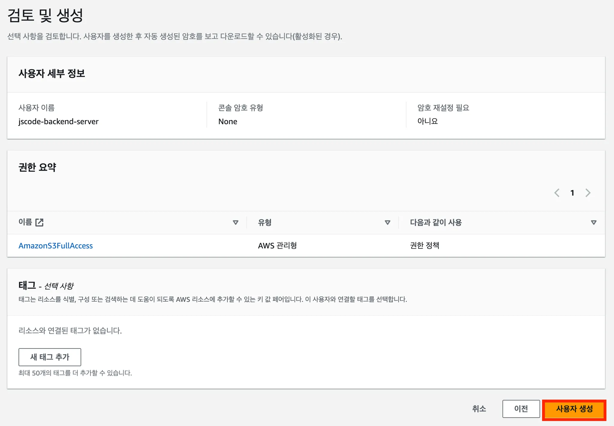

> `AmazonS3FullAccess`는 계정의 모든 S3 버킷에 접근할 수 있는 넓은 권한이다. 실제 서비스에서는 특정 버킷의 필요한 작업만 허용하는 정책을 사용하는 것이 좋다.

## 4. 액세스 키 만들기

생성한 사용자를 선택하고 `보안 자격 증명` 탭으로 이동한다.

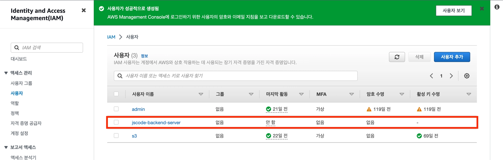

`액세스 키 생성`을 선택한다.

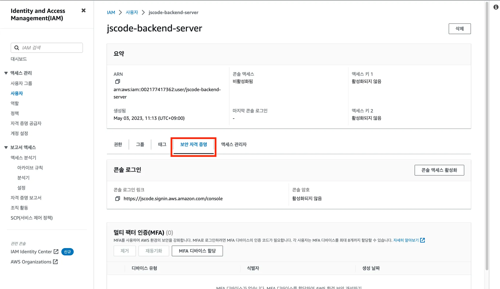

CLI 또는 로컬 코드에서 사용하는 상황을 선택하고 안내 사항을 확인한다.

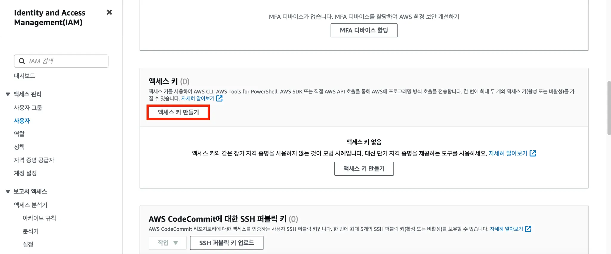

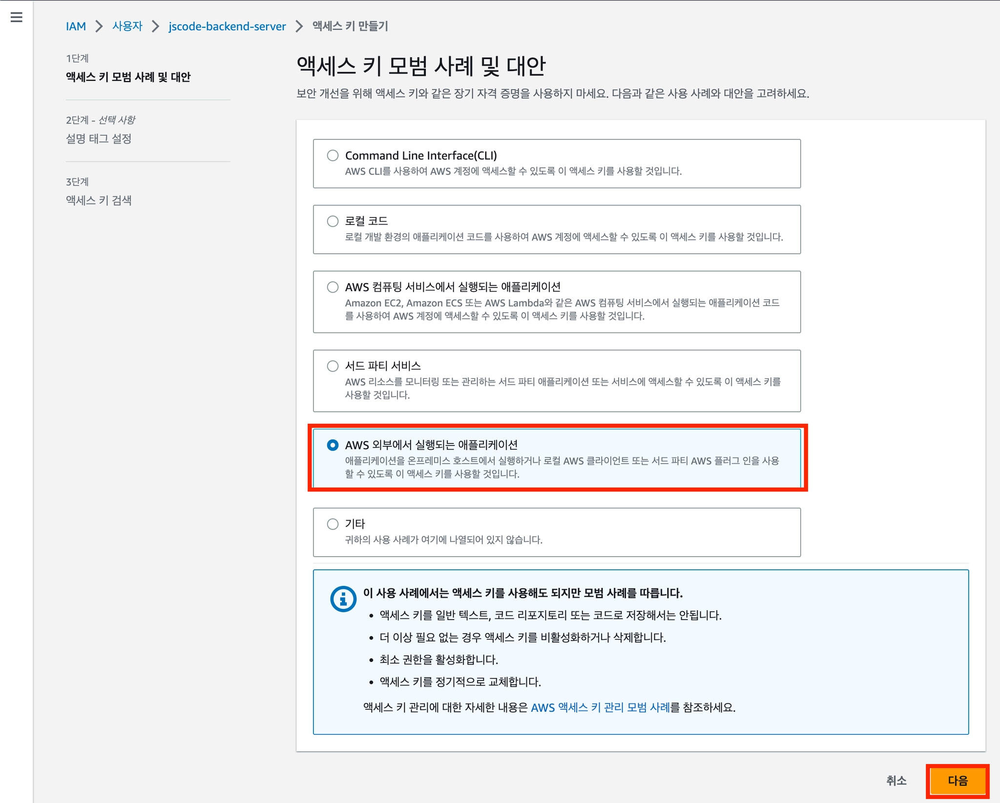

액세스 키를 생성한다.

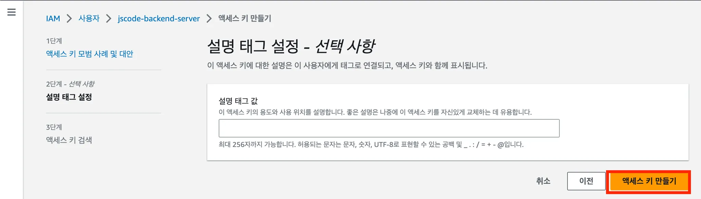

## 5. 액세스 키 안전하게 보관하기

발급된 값은 환경 변수 파일에만 저장한다.

```text
AWS_ACCESS_KEY=발급받은_액세스_키
AWS_SECRET_ACCESS_KEY=발급받은_비밀_액세스_키
```

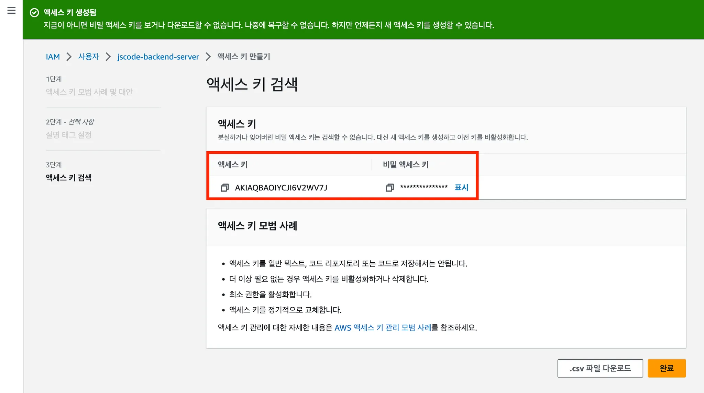

`.env` 파일은 반드시 `.gitignore`에 추가한다.

```gitignore
.env
.env.*
!.env.example
```

## 다음 단계

다음 문서에서는 Express 서버에서 액세스 키를 이용해 S3에 이미지를 업로드한다.
