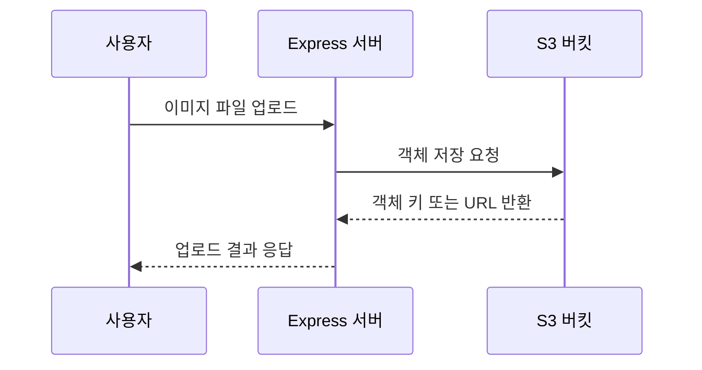
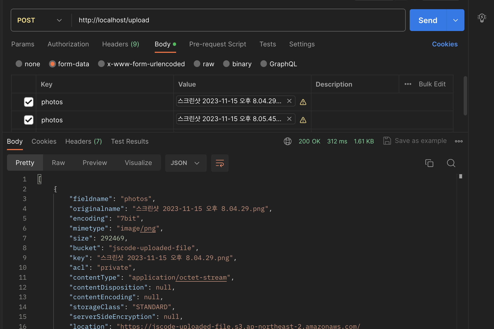
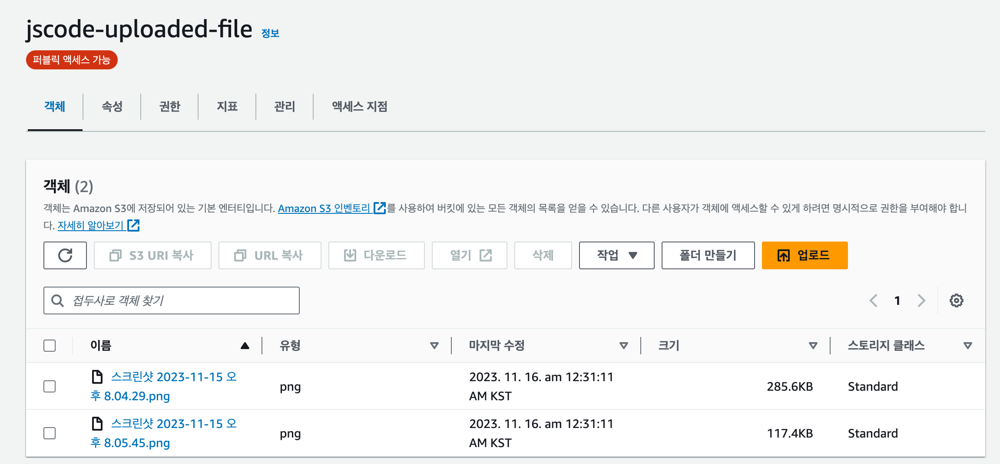
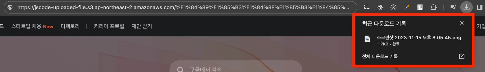

# 🚀Express 서버에서 S3에 이미지 업로드하기

Express 서버가 사용자가 업로드한 이미지를 S3 버킷에 저장하고, 이미지 URL을 반환하는 과정을 정리한다.

## 1. 예제 프로젝트 내려받기

EC2에서 예제 프로젝트를 내려받고 의존성을 설치한다.

```bash
git clone https://github.com/JSCODE-EDU/s3-express-sample.git
cd s3-express-sample
npm install
```

## 2. 환경 변수 설정하기

프로젝트 루트에 `.env` 파일을 만들고 IAM 액세스 키와 버킷 정보를 입력한다.

```text
AWS_ACCESS_KEY=발급받은_액세스_키
AWS_SECRET_ACCESS_KEY=발급받은_비밀_액세스_키
AWS_S3_BUCKET=생성한_버킷_이름
AWS_REGION=ap-northeast-2
```

`.env`는 GitHub에 올리지 않는다.

## 3. 이미지 업로드 흐름



Express 서버는 보통 `multipart/form-data` 형식으로 이미지를 받고, AWS SDK를 통해 S3에 업로드한다.

업로드할 때는 같은 파일 이름이 덮어써지지 않도록 UUID나 날짜를 포함한 객체 키를 사용하는 편이 좋다.

```text
images/2026/08/uuid-profile.png
```

## 4. 서버 실행과 업로드 확인

서버를 실행한다.

```bash
node app.js
```



이미지를 업로드한 뒤 S3 버킷의 객체 목록에 파일이 생성되었는지 확인한다.



## 5. 업로드한 이미지 조회하기

공개 읽기가 허용된 객체라면 S3 객체 URL을 브라우저에서 열어 이미지를 확인할 수 있다.



```html

```

## 연결이 안 될 때 확인할 것

| 증상 | 확인할 내용 |
| --- | --- |
| `AccessDenied` | IAM 사용자 정책과 버킷 정책 확인 |
| `NoSuchBucket` | 버킷 이름과 리전 확인 |
| 이미지가 S3에 없음 | 서버 로그와 업로드 API 요청 형식 확인 |
| 이미지 URL 접속 실패 | 객체 공개 정책 또는 Presigned URL 여부 확인 |
| 키가 GitHub에 노출됨 | 키를 즉시 비활성화하고 새 키 발급 |

## 다음 단계

다음 문서에서는 Spring Boot 서버에서 같은 방식으로 S3 이미지 업로드를 구현한다.
