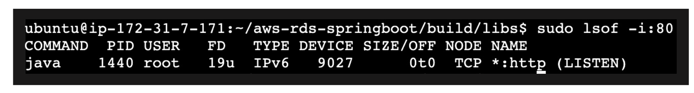
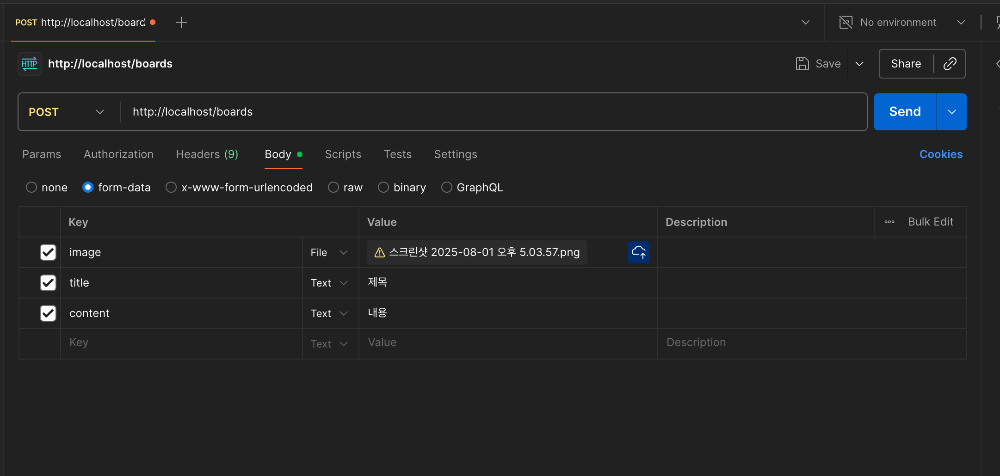
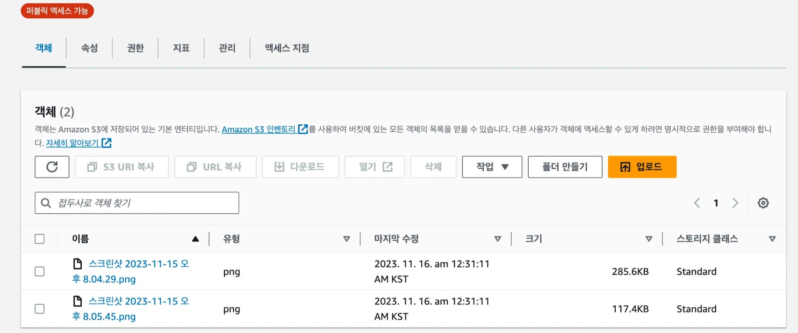
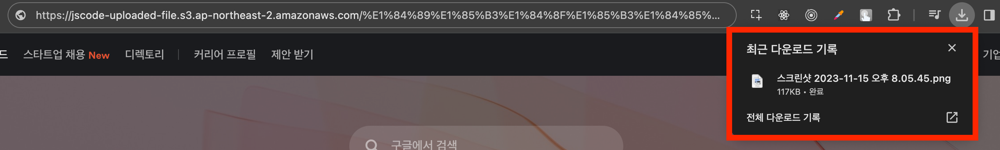

# 🌱Spring Boot 서버에서 S3에 이미지 업로드하기

Spring Boot 서버에서 사용자가 업로드한 이미지를 S3 버킷에 저장하는 과정을 정리한다.

## 1. 예제 프로젝트 내려받기

EC2에서 예제 프로젝트를 내려받는다.

```bash
git clone https://github.com/JSCODE-BOOK/aws-s3-springboot.git
cd aws-s3-springboot
```

## 2. RDS와 S3 환경 변수 설정하기

`application.yml`에 비밀 값을 직접 적지 않고 환경 변수를 사용한다.

```yaml
spring:
  datasource:
    url: jdbc:mysql://${DB_HOST}:${DB_PORT:3306}/${DB_NAME}
    username: ${DB_USERNAME}
    password: ${DB_PASSWORD}

  cloud:
    aws:
      credentials:
        access-key: ${AWS_ACCESS_KEY}
        secret-key: ${AWS_SECRET_ACCESS_KEY}
      s3:
        bucket: ${AWS_S3_BUCKET}
      region:
        static: ap-northeast-2
```

EC2에서 필요한 환경 변수를 설정한다.

```bash
export DB_HOST=RDS_엔드포인트
export DB_NAME=instagram
export DB_USERNAME=RDS_마스터_사용자_이름
export DB_PASSWORD='RDS_마스터_암호'

export AWS_ACCESS_KEY=IAM_액세스_키
export AWS_SECRET_ACCESS_KEY='IAM_비밀_액세스_키'
export AWS_S3_BUCKET=S3_버킷_이름
```

## 3. 서버 빌드와 실행

80번 포트를 사용 중인 프로세스가 있는지 확인한다.

```bash
sudo lsof -i :80
```

프로젝트를 빌드하고 실행한다.

```bash
./gradlew clean build -x test
cd build/libs
sudo nohup java -jar aws-s3-springboot-0.0.1-SNAPSHOT.jar &
```



## 4. 이미지 업로드 확인하기

이미지 업로드 API를 호출한 뒤 S3 버킷의 객체 목록을 확인한다.



API 응답에 업로드된 이미지 URL 또는 객체 키가 포함되는지 확인한다.



브라우저에서 객체 URL을 열어 이미지가 보이는지 확인한다.



## 주의 사항

- `application.yml`에 실제 액세스 키와 비밀 키를 저장하지 않는다.
- `ddl-auto: create`는 서버가 재시작될 때 테이블을 다시 만들 수 있으므로 실습 외 환경에서는 사용하지 않는다.
- 운영 환경에서는 EC2 IAM 역할, AWS Secrets Manager, Parameter Store 등을 사용해 자격 증명을 관리한다.

## 다음 단계

실습이 끝났다면 버킷의 객체와 버킷을 정리해 불필요한 파일 저장 비용을 막는다.
