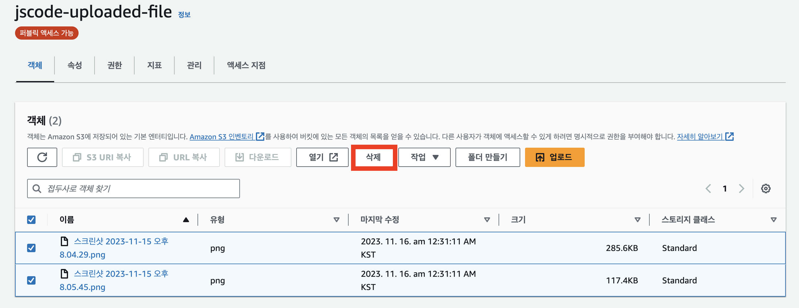
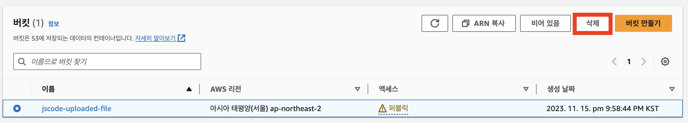

# 🧹S3 실습 리소스 정리하기

S3는 버킷을 비워도 버킷 자체는 남아 있을 수 있다.

실습이 끝나고 버킷이 더 이상 필요 없다면 객체를 먼저 모두 삭제한 뒤 버킷을 삭제한다.

## 삭제 전 확인

- 서비스에서 해당 이미지 URL을 더 이상 사용하지 않는지 확인한다.
- 보관해야 하는 파일은 로컬 또는 다른 버킷에 백업한다.
- 버전 관리가 켜져 있다면 이전 버전과 삭제 마커도 확인한다.

## 1. 버킷 안의 객체 전체 삭제하기

S3 콘솔에서 버킷을 선택하고 객체 목록으로 이동한다.

`삭제`를 선택해 버킷 안의 객체를 모두 삭제한다.

> 객체가 하나라도 남아 있으면 버킷을 삭제할 수 없다.

## 2. 버킷 삭제하기

객체가 모두 삭제된 것을 확인한 뒤 버킷 목록으로 이동한다.

삭제할 버킷을 선택하고 `삭제`를 진행한다.

삭제 확인 화면에 버킷 이름을 정확하게 입력한 뒤 삭제한다.

## 함께 정리할 항목

| 리소스 | 확인할 내용 |
| --- | --- |
| IAM 액세스 키 | 실습용 키를 비활성화하거나 삭제 |
| IAM 사용자 | 다른 용도가 없다면 삭제 |
| 버킷 정책 | 버킷 삭제 시 함께 제거됨 |
| 애플리케이션 환경 변수 | 폐기한 액세스 키와 버킷 이름 제거 |
| 데이터베이스 이미지 URL | 필요하면 이미지 URL 데이터도 정리 |

## 실습 종료 체크리스트

- [ ] 버킷 안의 객체를 모두 삭제했다.
- [ ] S3 버킷을 삭제했다.
- [ ] 실습용 IAM 액세스 키를 삭제하거나 비활성화했다.
- [ ] GitHub에 액세스 키가 노출되지 않았는지 확인했다.
- [ ] EC2 환경 변수와 `.env`에서 폐기한 키를 제거했다.
