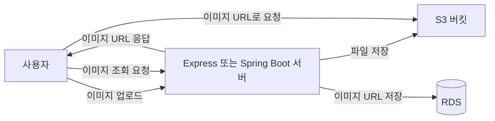

# 🪣S3로 파일과 이미지 업로드하기

백엔드 서버에서 업로드된 이미지와 파일을 AWS S3에 저장하고, 저장된 파일을 사용자에게 제공하는 과정을 정리한다.

## 이 섹션에서 배우는 것

- S3가 무엇이고 왜 사용하는지 이해하기
- S3 버킷 생성하기
- IAM에서 S3 접근용 액세스 키 발급하기
- Express 서버에 이미지 업로드 기능 구현하기
- Spring Boot 서버에 이미지 업로드 기능 구현하기
- 실습 후 비용이 발생하지 않도록 리소스 정리하기

## 먼저 알아야 할 핵심 개념

### 1) S3란?

S3(Simple Storage Service)는 AWS에서 제공하는 파일 저장 서비스다.

사진, 동영상, 문서 같은 파일을 저장할 수 있다. 구글 드라이브나 iCloud처럼 파일을 저장하는 서비스라고 생각하면 이해하기 쉽다.

### 2) 버킷과 객체란?

S3에서 파일을 보관하는 공간을 버킷(Bucket)이라고 한다.

버킷 안에 저장되는 각각의 파일을 객체(Object)라고 한다.

예를 들어 이미지 파일을 업로드하면, 이미지는 특정 S3 버킷 안의 객체로 저장된다.

### 3) 왜 S3를 사용할까?

이미지 파일을 EC2 서버 내부에 저장할 수도 있다.

하지만 서비스가 운영될수록 EC2 내부에 파일이 계속 쌓이고, 서버를 교체하거나 확장할 때 파일을 관리하기 어려워진다.

S3는 파일 저장과 다운로드에 특화되어 있기 때문에 이미지, 문서, 동영상 같은 파일을 별도로 관리하기 좋다.

### 4) 파일 업로드와 다운로드 흐름

사용자가 이미지를 업로드하면 백엔드 서버가 파일을 받아 S3에 저장한다.

백엔드 서버는 저장된 파일의 URL 또는 파일 경로를 데이터베이스에 저장할 수 있다. 이후 사용자가 이미지를 조회하면 저장된 URL을 통해 S3에 있는 파일을 불러온다.

### 5) IAM 액세스 키란?

백엔드 서버가 S3에 파일을 업로드하거나 조회하려면 AWS 권한이 필요하다.

IAM에서 발급한 액세스 키를 사용하면 애플리케이션이 AWS 서비스에 접근할 수 있다. 액세스 키는 비밀번호와 같으므로 절대 GitHub에 올리면 안 된다.

## 학습 순서

1. [S3란?](./01-S3란.md)
2. [S3 아키텍처](./02-S3-아키텍처.md)
3. [S3 버킷 생성](./03-S3-버킷-생성.md)
4. [IAM 액세스 키 발급](./04-IAM-액세스-키-발급.md)
5. [Express 이미지 업로드](./05-Express-이미지-업로드.md)
6. [Spring Boot 이미지 업로드](./06-Spring-Boot-이미지-업로드.md)
7. [실습 후 리소스 정리](./99-리소스-정리.md)

## 학습 후 할 수 있는 것

- S3 버킷과 객체의 개념을 설명할 수 있다.
- S3 버킷을 생성하고 파일을 저장할 수 있다.
- IAM 권한을 설정해 백엔드 서버에서 S3에 접근할 수 있다.
- Express 또는 Spring Boot 서버에 이미지 업로드 기능을 구현할 수 있다.
- 업로드된 이미지의 URL을 서비스에서 사용할 수 있다.

## 주의 사항

- AWS 액세스 키와 시크릿 키는 절대 GitHub에 올리지 않는다.
- 액세스 키는 `.env` 파일로 관리하고 `.gitignore`에 추가한다.
- S3 버킷을 공개하면 누구나 파일에 접근할 수 있으므로 공개 범위를 확인한다.
- 저장된 파일과 데이터 전송량에 따라 비용이 발생할 수 있다.
- 버킷을 삭제하려면 버킷 안의 객체를 먼저 삭제해야 한다.
