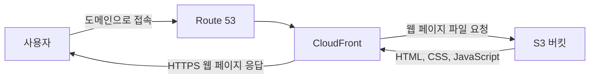

# 🚀S3와 CloudFront로 웹 페이지 배포하기

S3에 정적 웹 페이지를 업로드하고, CloudFront와 도메인을 연결해 HTTPS로 제공하는 과정을 정리한다.

## 이 섹션에서 배우는 것

- S3의 정적 웹 사이트 호스팅 기능 이해하기
- CloudFront와 CDN의 역할 이해하기
- S3 버킷에 웹 페이지 파일 업로드하기
- CloudFront 배포 생성하기
- 도메인 연결과 HTTPS 적용하기
- 실습 후 비용이 발생하지 않도록 리소스 정리하기

## 먼저 알아야 할 핵심 개념

### 1) S3의 정적 웹 사이트 호스팅이란?

S3는 파일 저장 서비스이지만, HTML, CSS, JavaScript 파일을 저장해 정적 웹 페이지를 제공하는 기능도 지원한다.

백엔드 서버 없이 동작하는 소개 페이지, 포트폴리오, 문서 사이트 같은 정적 웹 페이지를 배포할 때 사용할 수 있다.

### 2) CloudFront란?

CloudFront는 파일과 동영상 같은 콘텐츠를 사용자에게 빠르게 전달하는 AWS의 CDN(Content Delivery Network) 서비스다.

전 세계 여러 지역에 콘텐츠의 복사본을 저장해 두고, 사용자는 가장 가까운 위치의 서버에서 콘텐츠를 전달받는다.

### 3) 왜 S3와 CloudFront를 함께 사용할까?

S3만으로도 정적 웹 페이지를 배포할 수 있다.

하지만 CloudFront를 함께 사용하면 콘텐츠를 더 빠르게 제공할 수 있고, 도메인에 HTTPS를 적용할 수 있다. 또한 S3를 사용자에게 직접 노출하지 않고 CloudFront를 통해 웹 페이지를 제공할 수 있다.

### 4) 웹 페이지 배포 흐름

사용자는 도메인 주소로 웹 페이지에 접속한다.

Route 53은 도메인 요청을 CloudFront로 연결하고, CloudFront는 S3에 저장된 웹 페이지 파일을 사용자에게 전달한다.

## 학습 순서

1. S3와 CloudFront의 역할 이해하기
2. S3와 CloudFront를 활용한 아키텍처 확인하기
3. 정적 웹 페이지 배포용 S3 버킷 설정하기
4. S3에 웹 페이지 파일 업로드하고 웹 호스팅 설정하기
5. CloudFront 배포 생성하기
6. 도메인 연결과 HTTPS 적용하기
7. 실습 후 S3와 CloudFront 리소스 정리하기

## 학습 후 할 수 있는 것

- S3를 이용해 정적 웹 페이지를 배포할 수 있다.
- CloudFront가 CDN으로 동작하는 이유를 설명할 수 있다.
- CloudFront를 S3 버킷과 연결할 수 있다.
- 도메인에 HTTPS를 적용한 정적 웹 페이지를 제공할 수 있다.
- 파일 수정 후 캐시로 인해 이전 화면이 보일 수 있음을 이해할 수 있다.

## 주의 사항

- S3 버킷과 CloudFront 사용량에 따라 비용이 발생할 수 있다.
- CloudFront 캐시 때문에 파일을 수정해도 바로 반영되지 않을 수 있다.
- 버킷 정책과 CloudFront 접근 설정을 확인해 웹 페이지 파일이 불필요하게 공개되지 않도록 한다.
- 실습이 끝나면 CloudFront 배포와 S3 버킷을 함께 정리한다.
