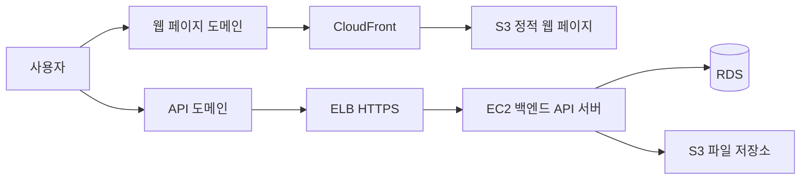

# 💯최종 미션: 마지막 관문!

지금까지 학습한 내용을 바탕으로 강의를 다시 보지 않고 AWS 인프라를 처음부터 스스로 구축하는 미션이다.

## 이 미션에서 해야 할 것

- 백엔드 API 서버를 AWS에 배포하기
- RDS와 연동되는 기능 구현하기
- S3 이미지 또는 파일 업로드 기능 구현하기
- 도메인과 HTTPS 적용하기
- 정적 웹 페이지를 S3와 CloudFront로 배포하기
- 배포 환경에서 프론트엔드와 백엔드가 통신하는지 확인하기

## 먼저 알아야 할 핵심 개념

### 1) 강의를 보지 않고 다시 구축하기

강의를 보며 따라 하는 것과, 스스로 다시 구현하는 것은 다르다.

이 미션의 목표는 강의 자료와 내가 작성한 학습 노트만 참고해 인프라를 처음부터 끝까지 다시 구성하는 것이다.

### 2) 기록의 중요성

인프라를 구축할 때 모든 설정값과 과정을 외우기는 어렵다.

따라서 나중에 다시 꺼내 볼 수 있도록 설정 이유, 실습 순서, 오류 해결 과정을 문서로 정리해 두는 것이 중요하다.

## 기본 요구 사항

### 1) 백엔드 서버 배포하기

- [ ] 백엔드 프로젝트를 만들고 GitHub Repository에 업로드한다.
- [ ] `.env`, `application.yml` 등 민감한 값이 포함된 파일을 `.gitignore`에 추가한다.
- [ ] JPA, MyBatis, TypeORM, Sequelize 등을 활용해 데이터베이스와 연동되는 기능을 구현한다.
- [ ] S3를 활용한 파일 업로드 기능을 구현한다.
- [ ] 데이터베이스는 RDS를 사용한다.
- [ ] 백엔드 서버를 EC2에 배포한다.
- [ ] 도메인을 적용한다.
- [ ] ELB를 활용해 HTTPS를 적용한다.

### 2) 웹 페이지 배포하기

- [ ] 간단한 웹 페이지를 만들고 GitHub Repository에 업로드한다.
- [ ] S3와 CloudFront를 활용해 웹 페이지를 배포한다.
- [ ] 도메인을 적용한다.
- [ ] HTTPS를 적용한다.

## 심화 요구 사항

- [ ] 프론트엔드 코드에 백엔드 API 서버와 통신하는 로직을 구현한다.
- [ ] 배포 환경에서 프론트엔드와 백엔드 API가 실제로 정상 통신하는지 확인한다.

## 미션 진행 순서

1. 백엔드 프로젝트와 웹 페이지 프로젝트를 준비한다.
2. RDS를 생성하고 백엔드 서버에 연결한다.
3. S3 파일 업로드 기능을 구현한다.
4. 백엔드 서버를 EC2에 배포한다.
5. Route 53, ELB, ACM을 활용해 백엔드 API에 도메인과 HTTPS를 적용한다.
6. 정적 웹 페이지를 S3와 CloudFront로 배포한다.
7. 웹 페이지에 도메인과 HTTPS를 적용한다.
8. 프론트엔드와 백엔드 API가 배포 환경에서 통신하는지 확인한다.
9. 사용하지 않는 AWS 리소스를 정리한다.

## 전체 서비스 흐름

## 미션 완료 후 할 수 있는 것

- AWS 서비스를 연결해 하나의 웹 서비스를 배포할 수 있다.
- 프론트엔드와 백엔드의 배포 구조를 설명할 수 있다.
- 배포 환경의 보안 설정과 비용 관리 항목을 점검할 수 있다.
- 다음 프로젝트에서 참고할 수 있는 인프라 구축 문서를 만들 수 있다.

## 주의 사항

- AWS 액세스 키, 데이터베이스 비밀번호, `.pem` 파일은 절대 GitHub에 올리지 않는다.
- 민감한 설정값은 환경 변수로 관리한다.
- RDS와 S3의 공개 범위는 필요한 수준으로만 설정한다.
- 미션이 끝나면 EC2, ELB, RDS, S3, CloudFront의 비용 발생 여부를 확인한다.
