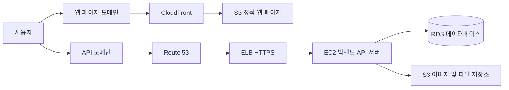

# ☁️AWS 인프라 학습 기록

백엔드 API 서버와 정적 웹 페이지를 AWS에 배포하는 과정을 학습하고 정리한 문서다.

EC2를 시작으로 도메인, HTTPS, 데이터베이스, 파일 저장소, CDN을 연결해 하나의 웹 서비스 인프라를 구성한다.

## 이 저장소에서 배우는 것

- EC2에 백엔드 API 서버 배포하기
- Route 53으로 도메인 연결하기
- ELB와 ACM으로 HTTPS 적용하기
- RDS에 데이터베이스 연결하기
- S3에 이미지와 파일 업로드하기
- S3와 CloudFront로 정적 웹 페이지 배포하기
- AWS 서비스 사용 후 비용과 보안 점검하기

## 전체 서비스 흐름

## 학습 로드맵

1. [💬 중요 단어](./00-중요-단어.md)
2. [🖥️ EC2로 백엔드 API 서버 배포하기](./01-EC2-백엔드-API-서버-배포/)
3. [🌐 Route 53으로 도메인 연결하기](./02-Route53-도메인-연결/)
4. [🔒 ELB로 HTTPS 연결하기](./03-ELB-HTTPS-연결/)
5. [🗄️ RDS로 데이터베이스 연결하기](./04-RDS-데이터베이스-연결/)
6. [🪣 S3로 파일과 이미지 업로드하기](./05-S3-파일-이미지-업로드/)
7. [🚀 S3와 CloudFront로 웹 페이지 배포하기](./06-S3-CloudFront-웹-페이지-배포/)
8. [💯 AWS 배포 최종 미션](./07-최종-미션/)
9. [💸 AWS 비용 발생 여부 확인하기](./08-마무리/)

## 최종 목표

다음과 같은 웹 서비스 인프라를 스스로 구축하는 것이 목표다.

- 백엔드 API 서버를 EC2에 배포한다.
- RDS를 백엔드 서버와 연결한다.
- S3를 활용해 파일 업로드 기능을 구현한다.
- Route 53, ELB, ACM으로 도메인과 HTTPS를 적용한다.
- S3와 CloudFront로 정적 웹 페이지를 배포한다.
- 배포 환경에서 프론트엔드와 백엔드 API가 정상 통신하는지 확인한다.

자세한 요구 사항은 [최종 미션](./07-최종-미션/)에서 확인할 수 있다.

## 작성 원칙

- 개념 설명과 실습 과정을 분리해 기록한다.
- 설정 방법뿐 아니라 설정 이유와 확인 방법도 함께 정리한다.
- 실습 중 발생한 오류와 해결 방법을 기록한다.
- 나중에 강의를 다시 보지 않고도 인프라를 다시 구축할 수 있는 문서를 목표로 한다.

## 보안과 비용 관리

- AWS 액세스 키, 데이터베이스 비밀번호, `.pem` 파일은 GitHub에 올리지 않는다.
- 민감한 값은 환경 변수로 관리하고 `.gitignore`에 추가한다.
- 사용하지 않는 EC2, ELB, RDS, S3, CloudFront 리소스는 정리한다.
- 실습 후 AWS Billing and Cost Management에서 비용 발생 여부를 확인한다.
