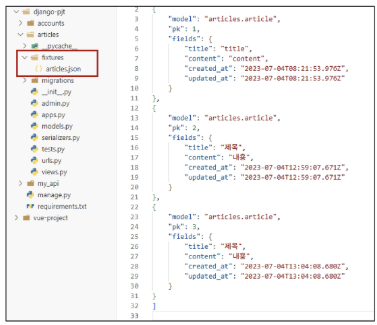
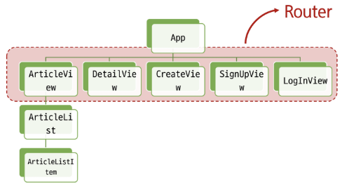
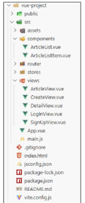
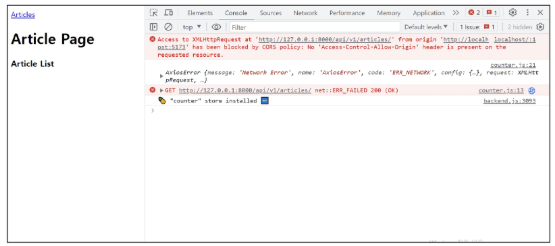
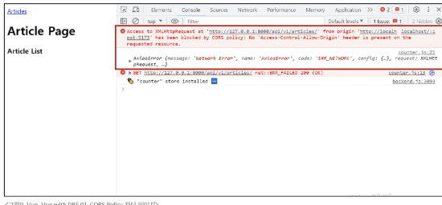
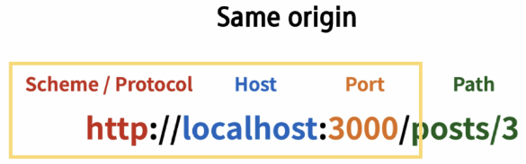
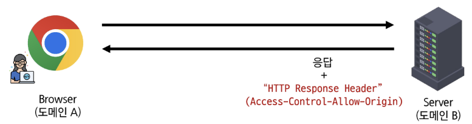
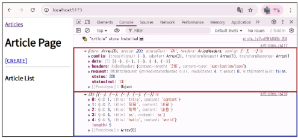
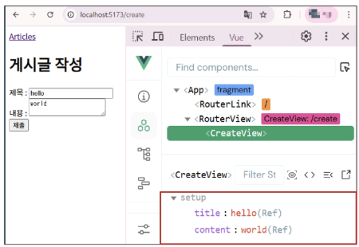

# 📘 목차 (Table of Contents)

### 프로젝트 개요
- DRF 프로젝트 안내
- Vue 프로젝트 안내

### 메인 페이지 구현
- 게시글 목록 출력
- DRF와의 요청과 응답

### CORS Policy
- CORS Headers 설정

### 게시글 생성/조회 구현
- 전체 게시글 조회
- 단일 게시글 조회
- 게시글 작성


---


# 📌 학습 목표
✓ CORS 정책을 이해하고 Django 서버에 허용 출처를 설정한다.

✓ Pinia action 내에서 Axios로 DRF API에 데이터를 요청한다.

✓ Pinia store의 데이터를 컴포넌트에서 렌더링 할 수 있다.

✓ RouterLink를 사용해 동적 경로의 상세 페이지로 이동한다.

✓ useRoute로 ID를 얻어 DRF로부터 단일 데이터를 조회한다.

✓ v-model을 사용해 게시글 생성을 위한 form을 작성한다.

✓ Axios POST 요청으로 DRF 서버에 새로운 데이터를 생성한다.


---


# ✅ 프로젝트 개요

## 🔵 앞으로 수업에서 진행할 프로젝트
1. Vue와 DRF 간 기본적인 요청과 응답
2. Vue와 DRF에서의 인증 시스템
3. User 커스터마이징

> 💡 **DRF(Django REST Framework)** : 장고(Django)로 API 서버를 쉽게 만들도록 도와주는 도구


---


# ✅ DRF 프로젝트 안내


## 🔵 DRF 프로젝트 안내
- 스켈레톤 프로젝트 django-pjt 제공
- 외부 패키지 및 라이브러리는 requirements.txt에 작성되어 있음

    ➤ DRF 프로젝트는 제공된 스켈레톤 코드의 **"주석을 해제"** 하며 진행합니다.


## 🔵 Skeleton code 살펴보기 (1/11)
- Model 클래스 확인
```python
# articles/models.py

class Article(models.Model):
    # user = models.ForeignKey(
    #     settings.AUTH_USER_MODEL, on_delete=models.CASCADE
    # )
    title = models.CharField(max_length=100)
    content = models.TextField()
    created_at = models.DateTimeField(auto_now_add=True)
    updated_at = models.DateTimeField(auto_now=True)
```
```python
# accounts/models.py

class User(AbstractUser):
    pass
```


## 🔵 Skeleton code 살펴보기 (2/11)
- URL 확인
```python
# my_api/urls.py

urlpatterns = [
    path('admin/', admin.site.urls),
    path('api/v1/', include('articles.urls')),
    # path('accounts/', include('dj_rest_auth.urls')),
    # path('accounts/signup/', include('dj_rest_auth.registration.urls')),
]
```
```python
# articles/urls.py

urlpatterns = [
    path('articles/', views.article_list),
    path('articles/<int:article_pk>/', views.article_detail),
]
```


## 🔵 Skeleton code 살펴보기 (3/11)
- Serializers 확인
```python
# articles/serializers.py

class ArticleListSerializer(serializers.ModelSerializer):
    class Meta:
        model = Article
        fields = ('id', 'title', 'content')

class ArticleSerializer(serializers.ModelSerializer):
    class Meta:
        model = Article
        fields = '__all__'
        # read_only_fields = ('user',)
```


## 🔵 Skeleton code 살펴보기 (4/11)
- views.py의 import 부분 확인
```python
# articles/views.py

from rest_framework.response import Response
from rest_framework.decorators import api_view
from rest_framework import status

# permission Decorators
# from rest_framework.decorators import permission_classes
# from rest_framework.permissions import IsAuthenticated

from django.shortcuts import get_object_or_404, get_list_or_404

from .serializers import ArticleListSerializer, ArticleSerializer
from .models import Article
```

> **get_object_or_404** : 조건 ok => 모델 인스턴스 반환/ 조건 x => 404 에러

> **get_list_or_404** : 조건 ok => 모델의 모든 데이터 가져옴/ 데이터가 하나도 없으면 404에러


## 🔵 Skeleton code 살펴보기 (5/11)
- View 함수 확인
```python
# articles/views.py

@api_view(['GET', 'POST'])
# @permission_classes([IsAuthenticated])
def article_list(request):
    if request.method == 'GET':
        articles = get_list_or_404(Article)
        serializer = ArticleListSerializer(articles, many=True)
        return Response(serializer.data)

    elif request.method == 'POST':
        serializer = ArticleSerializer(data=request.data)
        if serializer.is_valid(raise_exception=True):
            serializer.save()
            # serializer.save(user=request.user)
        return Response(serializer.data, status=status.HTTP_201_CREATED)
```
```python
# articles/views.py

@api_view(['GET'])
def article_detail(request, article_pk):
    article = get_object_or_404(Article, pk=article_pk)

    if request.method == 'GET':
        serializer = ArticleSerializer(article)
        print(serializer.data)
        return Response(serializer.data)
```


## 🔵 Skeleton code 살펴보기 (6/11)
- settings.py 확인 (1/2)
```python
# my_api/settings.py

INSTALLED_APPS = [
    'articles',
    'accounts',
    'rest_framework',
    # 'rest_framework.authtoken',
    # 'dj_rest_auth',
    # 'corsheaders',
    # 'django.contrib.sites',
    # 'allauth',
    # 'allauth.account',
    # 'allauth.socialaccount',
    # 'dj_rest_auth.registration',
    'django.contrib.admin',
    'django.contrib.auth',
    'django.contrib.contenttypes',
    'django.contrib.sessions',
    'django.contrib.messages',
    'django.contrib.staticfiles',
]
```
```python
# my_api/settings.py

# REST_FRAMEWORK = {
#     # Authentication
#     'DEFAULT_AUTHENTICATION_CLASSES': [
#         'rest_framework.authentication.TokenAuthentication',
#     ],
#     # permission
#     'DEFAULT_PERMISSION_CLASSES': [
#         'rest_framework.permissions.AllowAny',
#     ],
# }
```


## 🔵 Skeleton code 살펴보기 (7/11)
- settings.py 확인 (2/2)
```python
# my_api/settings.py

MIDDLEWARE = [
    'django.middleware.security.SecurityMiddleware',
    'django.contrib.sessions.middleware.SessionMiddleware',
    # 'corsheaders.middleware.CorsMiddleware',
    'django.middleware.common.CommonMiddleware',
    'django.middleware.csrf.CsrfViewMiddleware',
    'django.contrib.auth.middleware.AuthenticationMiddleware',
    'django.contrib.messages.middleware.MessageMiddleware',
    'django.middleware.clickjacking.XFrameOptionsMiddleware',
    # 'allauth.account.middleware.AccountMiddleware',
]

# CORS_ALLOWED_ORIGINS = [
#     'http://127.0.0.1:5173',
#     'http://localhost:5173',
# ]
```


## 🔵 Skeleton code 살펴보기 (8/11)
- Fixtures 확인

    


## 🔵 Skeleton code 살펴보기 (9/11)
- 가상 환경 생성 및 활성화
```shell
$ python -m venv venv
$ source venv/Scripts/activate
```

- 패키지 설치
```shell
$ pip install -r requirements.txt
```


## 🔵 Skeleton code 살펴보기 (10/11)
- Migration 진행
```powershell
$ python manage.py makemigrations
$ python manage.py migrate
```

- Fixtures 데이터 로드
```shell
$ python manage.py loaddata articles.json
```


## 🔵 Skeleton code 살펴보기 (11/11)
- Django 서버 실행 후 전체 게시글 조회 요청하기 (http://127.0.0.1:8000/api/v1/articles/)
```shell
$ python manage.py runserver
```


---


# ✅ Vue 프로젝트 안내


## 🔵 Vue 프로젝트 안내 (1/2)
- 스켈레톤 프로젝트 vue-pjt 제공
- Vite를 사용해 Pinia 및 Vue Router가 추가되어 있음
- pinia-plugin-persistedstate가 설치 및 등록되어있음
- Vue 프로젝트는 제공된 스켈레톤 코드 위에 **“직접 코드를 작성”**하며 진행합니다.


## 🔵 Vue 프로젝트 안내 (2/2)
- Vue 컴포넌트와 프로젝트 구조 확인

       


## 🔵 Skeleton code 살펴보기 (1/8)
- App 컴포넌트 확인
```js
<!-- App.vue -->

<template>
  <header>
    <nav>
    </nav>
  </header>
  <RouterView />
</template>

<script setup>
  import { RouterView } from 'vue-router'
</script>

<style scoped>
</style>
```


## 🔵 Skeleton code 살펴보기 (2/8)
- route에 등록된 컴포넌트 (Article, Create, Detail, LogIn, SignUp)
```js
<!-- views/~~.vue -->
<template>
  <div>
  </div>
</template>

<script setup>

</script>

<style>

</style>
```


## 🔵 Skeleton code 살펴보기 (3/8)
- ArticleList 컴포넌트
```js
<!-- components/ArticleList.vue -->

<template>
  <div>
    <h3>Article List</h3>
    <ArticleListItem />
  </div>
</template>

<script setup>
  import ArticleListItem from '@/components/ArticleListItem.vue'
</script>
```


## 🔵 Skeleton code 살펴보기 (4/8)
- ArticleListItem 컴포넌트
```js
<!-- components/ArticleList.vue -->

<template>
  <div>
  </div>
</template>

<script setup>
</script>
```


## 🔵 Skeleton code 살펴보기 (5/8)
- router/index.js 확인
```js
// router/index.js

import { createRouter, createWebHistory } from 'vue-router'
// import ArticleView from '@/views/ArticleView.vue'
// import DetailView from '@/views/DetailView.vue'
// import CreateView from '@/views/CreateView.vue'
// import SignUpView from '@/views/SignUpView.vue'
// import LogInView from '@/views/LogInView.vue'

const router = createRouter({
  history: createWebHistory(import.meta.env.BASE_URL),
  routes: [
    // {
    //   path: '/',
    //   name: 'ArticleView',
    //   component: ArticleView
    // },
    …
  ]
})
```


## 🔵 Skeleton code 살펴보기 (6/8)
- store 확인
```js
// store/articles.js

import { ref, computed } from 'vue'
import { defineStore } from 'pinia'

export const useArticleStore = defineStore('article', () => {
  return { }
}, { persist: true })
```


## 🔵 Skeleton code 살펴보기 (7/8)
- main.js 현황
```js
// src/main.js

import piniaPluginPersistedstate from 'pinia-plugin-persistedstate'
import { createApp } from 'vue'
import { createPinia } from 'pinia'
import App from './App.vue'
import router from './router'

const app = createApp(App)
const pinia = createPinia()

pinia.use(piniaPluginPersistedstate)
// app.use(createPinia())
app.use(pinia)
app.use(router)

app.mount('#app')
```


## 🔵 Skeleton code 살펴보기 (8/8)
- 패키지 설치
```shell
$ npm install
```

- 서버 실행
```shell
$ npm run dev
```


---


# ✅ 메인 페이지 구현


## 🔵 시작하기 전에..
- 완벽한 프로젝트를 만드는 것이 목표가 아닙니다.
- 프론트엔드와 백엔드 프레임워크 간의 요청과 응답, 그리고 그 과정에서 마주치는 새로운 개념과 문제를 해결하며 **하나의 웹 애플리케이션을 완성하는 과정**에 집중해 주세요.


---


# ✅ 게시글 목록 출력


## 🔵 게시글 목록 출력 (1/6)
- 게시글을 출력하는 컴포넌트를 연결하는 ArticleView의 route 관련 코드 주석 해제하기
```js
// router/index.js
import ArticleView from '@/views/ArticleView.vue'  ⭐

const router = createRouter({
  history: createWebHistory(import.meta.env.BASE_URL),
  routes: [
⭐ {
      path: '/',
      name: 'ArticleView',
      component: ArticleView
    }, ⭐
  ]
})
```


## 🔵 게시글 목록 출력 (2/6)
- App 컴포넌트에 ArticleView 컴포넌트로 이동하는 RouterLink 작성
```js
<!-- App.vue -->

<template>
  <header>
    <nav>
      <RouterLink :to="{ name: 'ArticleView' }">Articles</RouterLink>  ⭐
    </nav>
  </header>
  <RouterView />
</template>

<script setup>
import { RouterView, RouterLink } from 'vue-router'
</script>
```


## 🔵 게시글 목록 출력 (3/6)
- 게시글 목록을 담당하는 ArticleList 컴포넌트를 ArticleView 컴포넌트에 등록하기
```js
<!-- views/ArticleView.vue -->

<template>
  <div>
    <h1>Article Page</h1>
    <ArticleList />  ⭐
  </div>
</template>

<script setup>
import ArticleList from '@/components/ArticleList.vue'  ⭐
</script>
```


## 🔵 게시글 목록 출력 (4/6)
- store에 임시 데이터 articles 배열 작성하기
```js
// store/articles.js

export const useArticleStore = defineStore('article', () => {
  const articles = ref([  ⭐
    { id: 1, title: 'Article 1', content: 'Content of article 1' },
    { id: 2, title: 'Article 2', content: 'Content of article 2' }
  ])

  return { articles }
}, { persist: true })
```


## 🔵 게시글 목록 출력 (5/6)
- ArticleList 컴포넌트에서 게시글 목록 출력
- store의 articles 데이터 참조
- v-for로 하위 컴포넌트에 article 단일 객체를 props로 전달

```js
<!-- components/ArticleList.vue -->

<template>
  <div>
    <h3>Article List</h3>  
    <ArticleListItem  ⭐
      v-for="article in store.articles"
      :key="article.id"
      :article="article"
    />
  </div>
</template>

<script setup>
import { useArticleStore } from '@/stores/articles'  ⭐
import ArticleListItem from '@/components/ArticleListItem.vue'

const store = useArticleStore()  ⭐
</script>
```


## 🔵 게시글 목록 출력 (6/6)
- ArticleListItem 컴포넌트는 내려 받은 props를 정의
- 메인 페이지에서 게시글 목록 출력 확인
```js
<!-- components/ArticleListItem.vue -->

<template>
  <div>
    <h5>{{ article.id }}</h5>
    <p>{{ article.title }}</p>
    <p>{{ article.content }}</p>
    <hr>
  </div>
</template>

<script setup>
defineProps({
  article: Object
})
</script>
```


---


# ✅ DRF와의 요청과 응답


## 🔵 DRF로부터 응답 데이터 받기
- 이전에 임시 데이터를 작성했던 부분을 DRF 서버에 요청하고, 데이터를 응답 받아 store에 저장 후 출력하기
```js
// store/articles.js

export const useArticleStore = defineStore('article', () => {
  const articles = ref([
    { id: 1, title: 'Article 1', content: 'Content of article 1' },
    { id: 2, title: 'Article 2', content: 'Content of article 2' }
  ])

  return { articles }
}, { persist: true })
```


## 🔵 DRF와의 요청과 응답 (1/6)
- DRF 서버로의 AJAX 요청을 위한 axios 설치 및 관련 코드 작성
```shell
$ npm install axios
```
※ Vue 서버 종료 → 설치 → 서버 재실행
```js
// store/articles.js

import { ref, computed } from 'vue'
import { defineStore } from 'pinia'
import axios from 'axios'  ⭐

export const useArticleStore = defineStore('article', () => {
    const articles = ref([])  ⭐
    const API_URL = 'http://127.0.0.1:8000'  ⭐
}, { persist: true })
```
> **Axios** : Promise 기반의 HTTP 클라이언트 라이브러리

> **Promise** : JavaScript에서 비동기 작업의 결과를 나타내는 객체


## 🔵 DRF와의 요청과 응답 (2/6)
- DRF 서버로 요청을 보내고 응답 데이터를 처리하는 getArticles 함수 작성
```js
// store/articles.js

import …

export const useArticleStore = defineStore('article', () => {
    const articles = ref([])
    const API_URL = 'http://127.0.0.1:8000'

    const getArticles = function () {
        axios({
            method: 'get',
            url: `${API_URL}/api/v1/articles/`
        })
            .then(res => {
                console.log(res)
                console.log(res.data)
            })
            .catch(err => console.log(err))
    }

    return { articles, API_URL, getArticles }
}, { persist: true })
```


## 🔵 DRF와의 요청과 응답 (3/6)
- ArticleView 컴포넌트가 마운트 될 때 getArticles 함수가 실행되도록 함
    
    → 해당 컴포넌트가 렌더링 될 때 항상 최신 게시글 목록을 불러오기 위함
```js
<!-- views/ArticleView.vue -->

<script setup>
import { onMounted } from 'vue'
import { useArticleStore } from '@/stores/articles'
import { RouterLink } from 'vue-router'
import ArticleList from '@/components/ArticleList.vue'

const store = useArticleStore()

onMounted(() => {
    store.getArticles()
})
</script>
```


## 🔵 DRF와의 요청과 응답 (4/6)
- Vue와 DRF 서버를 모두 실행한 후 응답 데이터 확인

    

    ➤ 에러 발생


## 🔵 DRF와의 요청과 응답 (5/6)
- 그런데 DRF 서버 측에서는 문제 없이 응답했음 (200 OK)

    ➤ 서버는 응답했으나 브라우저 측에서 거절한 것


## 🔵 DRF와의 요청과 응답 (6/6)
- 브라우저가 거절한 이유

    ➤ ‘localhost:5173’에서 ‘127.0.0.1:8000/api/v1/articles/’의 XMLHttpRequest에 대한 접근이 **CORS policy**에 의해 차단

    


---


# ✅ CORS Policy


## 🔵 웹 브라우저의 동일 출처 정책과 보안
- 기본적으로 웹 브라우저는 같은 출처에서만 요청하는 것을 허용
- 다른 출처로의 요청은 보안상의 이유로 차단
- 이는 **SOP(동일 출처 정책)**에 의해 다른 출처의 리소스와 상호작용 하는 것이 기본적으로 제한 됨


## 🔵 SOP 이란?
- Same-origin policy
- 동일 출처 정책

- 동일 출처 정책(SOP)은 '같은 출처에서만 리소스를 자유롭게 공유할 수 있다'는 웹 브라우저의 가장 기본적인 보안 규칙입니다.
- 이 정책은 한 출처에서 실행된 스크립트가 다른 출처의 데이터를 마음대로 읽어오지 못하도록 막아, 악의적인 사이트가 나의 개인 정보를 탈취하는 것을 방지합니다.


## 🔵 SOP(Same-origin policy)
- 어떤 출처(Origin)에서 불러온 문서나 스크립트가 다른 출처에서 가져온 리소스와 상호 작용하는 것을 제한하는 보안 방식

➤ “다른 곳에서 가져온 자료는 일단 막는다.”

➤ 웹 애플리케이션의 도메인이 다른 도메인의 리소스에 접근하는 것을 제어하여 사용자의 개인 정보와 데이터의 보안을 보호하고, 잠재적인 보안 위협을 방지

➤ 잠재적으로 해로울 수 있는 문서를 분리함으로써 공격받을 수 있는 경로를 줄임

https://developer.mozilla.org/en-US/docs/Web/Security/Same-origin_policy


## 🔵 Origin (출처) (1/2)
- URL의 **Protocol, Host, Port**를 모두 포함하여 “출처”라고 부름
- Same Origin 예시
    - 아래 세 영역이 일치하는 경우에만 동일 출처(Same-origin) 로 인정

    


## 🔵 Origin (출처) (2/2)
- Same Origin 예시
    - http://localhost:3000/articles/3/ 을 기준으로 동일 출처 여부를 비교

    | URL                                                                      | 결과 | 이유          |
    | ------------------------------------------------------------------------ | -- | ----------- |
    | [http://localhost:3000/articles/](http://localhost:3000/articles/)       | 성공 | Path만 다름    |
    | [http://localhost:3000/comments/3/](http://localhost:3000/comments/3/)   | 성공 | Path만 다름    |
    | [https://localhost:3000/articles/3/](https://localhost:3000/articles/3/) | 실패 | Protocol 다름 |
    | [http://localhost:80/articles/3/](http://localhost:80/articles/3/)       | 실패 | Port 다름     |
    | [http://yahuua:3000/articles/3/](http://yahuua:3000/articles/3/)         | 실패 | Host 다름     |


## 🔵 CORS Policy의 등장
- 기본적으로 웹 브라우저는 같은 출처에서만 요청하는 것을 허용
- 다른 출처로의 요청은 보안상의 이유로 차단
- 이는 SOP에 의해 다른 출처의 리소스와 상호작용 하는 것이 기본적으로 제한 됨

- 하지만 현대 웹 애플리케이션은 다양한 출처로부터 리소스를 요청하는 경우가 많기 때문에 CORS 정책이 필요하게 되었음

➤ **CORS**는 웹 서버가 리소스에 대한 서로 다른 출처 간 접근을 허용하도록 선택할 수 있는 기능을 제공


## 🔵 CORS 이란?
- Cross-Origin Resource Sharing
- **교차 출처 리소스 공유**

- CORS는 다른 출처의 자원 공유를 허용하기 위해 서버가 발급하는 '허가증'과 같은 정책입니다.
서버는 자신의 응답에 "이 출처에서 온 요청은 내 데이터를 읽어가도 좋아"라고 브라우저에게 알려줍니다.
- 이를 통해 동일 출처 정책(SOP)을 안전하게 우회하고, 서로 다른 서버간의 통신을 가능하게 만듭니다.


## 🔵 CORS(Cross-Origin Resource Sharing)
- 특정 출처에서 실행 중인 웹 애플리케이션이 **다른 출처의 자원에 접근할 수 있는 권한을 부여**하도록 브라우저에 알려주는 체제

➤ 만약 다른 출처의 리소스를 가져오기 위해서는 이를 제공하는 서버가 브라우저에게 다른 출처지만 접근해도 된다는 사실을 알려야 함

➤ **“CORS policy** (교차 출처 리소스 공유 정책)”


## 🔵 CORS Policy (Cross-Origin Resource Sharing Policy)
- 다른 출처에서 온 리소스를 공유하는 것에 대한 정책
- **서버에서 설정**되며, 브라우저가 해당 정책을 확인하여 요청이 허용되는지 여부를 결정

➤ 다른 출처의 리소스를 불러오려면 그 다른 출처에서 올바른 **CORS header를 포함한 응답을 반환**해야 함

https://developer.mozilla.org/ko/docs/Web/HTTP/CORS


## 🔵 CORS 적용 방법
- Server(도메인 B)
    - HTTP Header에 "Access-Control-Allow-Origin: 도메인A" 가 포함되면, 이제 도메인 A에서의 요청은 서버의 자원에 접근 할 수 있음
- Browser(도메인 A)
    - Server(도메인 B)에 등록됐기 때문에 안전하게 Server(도메인 B)의 데이터를 사용할 수 있음

    


## 🔵 CORS policy 정리
- 웹 애플리케이션이 다른 도메인에 있는 리소스에 안전하게 접근할 수 있도록 허용 또는 차단하는 보안 메커니즘
- 서버가 약속된 CORS Header를 포함하여 응답한다면, 브라우저는 해당 요청을 허용

➤ **서버에서 CORS Header**를 만들어야 한다.

https://developer.mozilla.org/ko/docs/Web/HTTP/CORS


---


# ✅ CORS Headers 설정


## 🔵 Django에서 CORS Headers 설정하기 (1/4)
- Django에서는 **django-cors-headers** 라이브러리 활용

    ➤ 손쉽게 응답 객체에 CORS header를 추가해주는 라이브러리

- 설치 (requirements.txt로 인해 사전에 설치되어 있음)
```shell
$ pip install django-cors-headers
```
https://github.com/adamchainz/django-cors-headers


## 🔵 Django에서 CORS Headers 설정하기 (2/4)
- **django-cors-headers** 관련 코드 주석 해제 및 CORS를 허용할 Vue 프로젝트의 Domain 등록

```ini
# settings.py

INSTALLED_APPS = [
    …
    'corsheaders',
    …
]

MIDDLEWARE = [
    …
    'corsheaders.middleware.CorsMiddleware',
    'django.middleware.common.CommonMiddleware',
    …
]
```
```ini
# settings.py

CORS_ALLOWED_ORIGINS = [
    'http://127.0.0.1:5173',
    'http://localhost:5173',
]
```


## 🔵 Django에서 CORS Headers 설정하기 (3/4)
- 메인 페이지에서 DRF 응답 데이터 재확인

```js
/ store/articles.js

import …

export const useArticleStore = defineStore('article', () => {
    const articles = ref([])
    const API_URL = 'http://127.0.0.1:8000'

    const getArticles = function () {
        axios({
            method: 'get',
            url: `${API_URL}/api/v1/articles/`
        })
        .then(res => {  ⭐ // 빨
            console.log(res)  ⭐ // 파
            console.log(res.data)
        })
        .catch(err => console.log(err))
    }
    return { articles, API_URL, getArticles }
    }, { persist: true })
```




## 🔵 Django에서 CORS Headers 설정하기 (4/4)
- 응답 객체에서 'Access-Control-Allow-Origin' Header 확인
    - 개발자도구 - Network - Fetch/XHR


---


# 게시글 생성/조회 구현

# ✅ 전체 게시글 조회


## 🔵 전체 게시글 목록 저장 및 출력 (1/2)
- 응답 받은 데이터에서 각 게시글의 데이터 구성 확인 (id, title, content)


## 🔵 전체 게시글 목록 저장 및 출력 (2/2)
- store에 게시글 목록 데이터 저장 후 store에 저장된 게시글 목록 출력 확인
    - pinia-plugin-persistedstate에 의해 브라우저 Local Storage에 저장됨

```js
/ store/articles.js

import …

export const useArticleStore = defineStore('article', () => {
    const articles = ref([])
    const API_URL = 'http://127.0.0.1:8000'

    const getArticles = function () {
        axios({
            method: 'get',
            url: `${API_URL}/api/v1/articles/`
        })
        .then(res => {
            articles.value = res.data  ⭐
        })
        .catch(err => console.log(err))
    }
    return { articles, API_URL, getArticles }
}, { persist: true })
```


---


# ✅ 단일 게시글 조회

## 🔵 단일 게시글 데이터 출력 (1/5)
- DetailVue 관련 route 주석 해제
```js
// router/index.js

import DetailView from '@/views/DetailView.vue'

const router = createRouter({
    history: createWebHistory(import.meta.env.BASE_URL),
    routes: [{
        path: '/',
        name: 'ArticleView',
        component: ArticleView
    },
    {
        path: '/articles/:id',
        name: 'DetailView',
        component: DetailView
    },
    … ]
})
```


## 🔵 단일 게시글 데이터 출력 (2/5)
- ArticleListItem에 DetailView 컴포넌트로 가기 위한 RouterLink 작성

```js
<!-- components/ArticleListItem.vue -->

<template>
  <div>
    <h5>{{ article.id }}</h5>
    <p>{{ article.title }}</p>
    <p>{{ article.content }}</p>
    <RouterLink :to="{ name: 'DetailView', params: { id: article.id } }">
      [DETAIL]
    </RouterLink>
    <hr>
  </div>
</template>

<script setup>
import { RouterLink } from 'vue-router'
…
</script>
```


## 🔵 단일 게시글 데이터 출력 (3/5)
- DetailView가 마운트 될 때, 특정 게시글을 조회하는 AJAX 요청을 보낸 후 응답 데이터 확인

http://localhost:5173/articles/1/

```js
 // views/DetailView.vue

 import axios from 'axios'
 import { onMounted, ref } from 'vue'
 import { useRoute } from 'vue-router'
 import { useArticleStore } from '@/stores/articles'

 const store = useArticleStore()
 const route = useRoute()

 onMounted(() => {
   axios({
     method: 'get',
     url: `${store.API_URL}/api/v1/articles/${route.params.id}/`,
   })
   .then((res) => {
     console.log(res.data)
   })
   .catch(err => console.log(err))
 })
```


## 🔵 단일 게시글 데이터 출력 (4/5)
- 응답 데이터 저장 후 출력

```js
<!-- views/DetailView.vue -->

<template>
  <div>
    <h1>Detail</h1>
    <div v-if="article">
      <p>글 번호 : {{ article.id }}</p>
      <p>제목 : {{ article.title }}</p>
      <p>내용 : {{ article.content }}</p>
      <p>작성시간 : {{ article.created_at }}</p>
      <p>수정시간 : {{ article.updated_at }}</p>
    </div>
  </div>
</template>
```
```js
// views/DetailView.vue

import axios from 'axios'
import { onMounted, ref } from 'vue'
import { useRoute } from 'vue-router'
import { useArticleStore } from '@/stores/articles'

const store = useArticleStore()
const route = useRoute()
const article = ref(null)

onMounted(() => {
  axios({
    method: 'get',
    url: `${store.API_URL}/api/v1/articles/${route.params.id}/`,
  })
    .then((res) => {
      article.value = res.data
    })
    .catch(err => console.log(err))
})
```


## 🔵 단일 게시글 데이터 출력 (5/5)
• 결과 확인


---


# ✅ 게시글 작성

## 🔵 게시글 작성 (1/7)
- CreateView 관련 route 주석 해제
```js
// router/index.js

import CreateView from '@/views/CreateView.vue'

const router = createRouter({
  history: createWebHistory(import.meta.env.BASE_URL),
  routes: [
    …,
    {
      path: '/create',
      name: 'CreateView',
      component: CreateView
    }
  ]
})
```


## 🔵 게시글 작성 (2/7)
- ArticleView에 CreateView 컴포넌트로 가기 위한 RouterLink 작성

```html
<script setup>
import { onMounted } from 'vue'
import { useArticleStore } from '@/stores/articles'
import { RouterLink } from 'vue-router'

import ArticleList from '@/components/ArticleList.vue'
</script>
```

```html
<template>
  <div>
    <h1>Article Page</h1>
    <RouterLink :to="{ name: 'CreateView' }">
      [CREATE]
    </RouterLink>
    <hr>
    <ArticleList />
  </div>
</template>
```


## 🔵 게시글 작성 (3/7)
- v-model을 사용해 사용자 입력 데이터를 양방향 바인딩
- v-model의 trim 수식어를 사용해 사용자 입력 데이터의 공백을 제거

```html
<template>
  <div>
    <h1>게시글 작성</h1>
    <form @submit.prevent="createArticle">
      <label for="title">제목 : </label>
      <input type="text" id="title" v-model.trim="title"><br>
      <label for="content">내용 : </label>
      <textarea id="content" v-model.trim="content"></textarea><br>
      <input type="submit">
    </form>
  </div>
</template>
```
```js
<script setup>
import { ref } from 'vue'

const title = ref(null)
const content = ref(null)
</script>
```


## 🔵 게시글 작성 (4/7)
- 양방향 바인딩 데이터 입력 확인

    


## 🔵 게시글 작성 (5/7)
- 게시글 생성 요청을 담당하는 createArticle 함수 작성
- 게시글 생성이 성공하면, ArticleView 컴포넌트로 이동시킴

```js
// views/CreateView.vue

import axios from 'axios'
import { useArticleStore } from '@/stores/articles'
import { useRouter } from 'vue-router'

const store = useArticleStore()
const router = useRouter()
```
```js
// views/CreateView.vue

const createArticle = function () {
  axios({
    method: 'post',
    url: `${store.API_URL}/api/v1/articles/`,
    data: {
      title: title.value,
      content: content.value
    },
  })
    .then(() => {
      router.push({name: 'ArticleView'})
    })
    .catch(err => console.log(err))
}
```


## 🔵 게시글 작성 (6/7)
- submit 이벤트가 발생하면 createArticle 함수를 호출
- v-on의 prevent 수식어를 사용해 submit 이벤트의 기본 동작 취소

```html
<template>
  <div>
    <h1>게시글 작성</h1>
    <form @submit.prevent="createArticle">
      <label for="title">제목 : </label>
      <input type="text" id="title" v-model.trim="title"><br>
      <label for="content">내용 : </label>
      <textarea id="content" v-model.trim="content"></textarea><br>
      <input type="submit">
    </form>
  </div>
</template>
```


## 🔵 게시글 작성 (7/7)
- 게시글 생성 결과 및 DB 확인


---


# 📚 총 정리

## 🔑 핵심 키워드
| 개념 | 설명 | 예시 |
| :--- | :--- | :--- |
| CORS | 다른 출처의 리소스 공유를 허용 | Django corsheaders 설정 |
| SOP | 동일 출처의 리소스만 요청 허용 | 다른 도메인의 API 요청 차단 |
| JsonResponse | Django에서 JSON 형식으로 응답 | return JsonResponse(data) |
| data-* 속성 | HTML에 사용자 지정 데이터를 저장 | `<div data-user-id="1">` |
| CSRF 토큰 전송 | Axios 요청 헤더에 토큰을 포함 | headers: {'X-CSRFToken': token} |
| Pinia action | Axios로 DRF 서버에 데이터 요청 | store.getArticles() |
| 동적 세그먼트 | useRoute로 URL 파라미터 조회 | route.params.id |


## 📝 요약 및 정리

### 동일 출처 정책 (SOP, Same-Origin Policy)
- 웹 브라우저의 기본 보안 정책
- 한 출처(Origin)에서 로드된 문서나 스크립트가 다른 출처의 리소스와 상호작용하는 것을 제한

- 여기서 '출처'는 프로토콜, 호스트, 포트 번호의 조합을 의미

### CORS(Cross-Origin Resource Sharing)
- SOP 제한을 완화하기 위한 정책으로 서버가 특정 출처의 요청을 허용하도록 설정
- 서버가 자신의 응답 헤더에 Access-Control-Allow-Origin 같은 정보를 포함하여 브라우저에게 다른 출처의 요청을 허용한다고 알리는 정책

### 전체 게시글 조회
- ArticleView가 마운트될 때 getArticles 액션을 호출하여 모든 게시글 데이터를 받아오기
- ArticleList 컴포넌트는 store의 articles 배열을 v-for로 순회
- 각 게시글 데이터를 ArticleListItem 자식 컴포넌트에 props로 전달하여 화면에 목록을 출력

### 단일 게시글 조회
- 동적 라우팅
    - router/index.js에 /articles/:id와 같은 동적 경로를 설정

- 페이지 이동
    - ArticleListItem에서 각 게시글의 고유 id를 포함한 RouterLink를 만들어 상세 페이지 이동 링크 생성

- 데이터 조회
    - DetailView 컴포넌트가 마운트되면, useRoute()를 사용해 URL의 id 파라미터 값을 가져오기
    - 이 id를 이용해 DRF 서버에 특정 게시글 하나에 대한 데이터를 요청하고 받아와 화면에 렌더링

### 게시글 작성
- 폼 작성
    - CreateView 컴포넌트에서 v-model을 사용해 `<input>`과 `<textarea>`의 값을 반응형 변수와 양방향 바인딩

- 데이터 전송
    - form을 제출(@submit.prevent)하면 createArticle 함수가 호출
    - 이 함수는 axios를 사용해 title과 content 데이터를 담아 DRF 서버에 POST 요청 보내기

- 페이지 이동
    - 게시글 생성이 성공하면, useRouter()의 push 메서드를 사용해 사용자를 게시글 목록 페이지로 이동시키기


---


### '게시글 목록 보기' 버튼을 클릭하면, 데이터는 어떤 과정을 거쳐 화면에 나타날까요?

1. Vue에서 시작해 **Axios**를 통해 DRF 서버로 전달됩니다.

2. 이때 **CORS** 라는 보안 확인 절차를 거칩니다.

3. DRF는 요청받은 데이터를 처리 후 **JSON** 형태로 응답합니다.

4. **Pinia**가 응답받은 데이터를 중앙 저장소(store)에 저장하고, 컴포넌트는 이 데이터를 화면에 렌더링합니다.

- 각 과정을 직접 구현하며, 과정에 필요한 기술을 학습했습니다.
- 지금까지 배워온 프론트엔드(Vue)와 백엔드(Django)를 연결하여, 하나의 완전한 웹 어플리케이션을 만들었습니다.