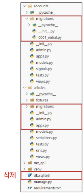
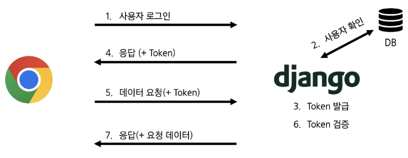
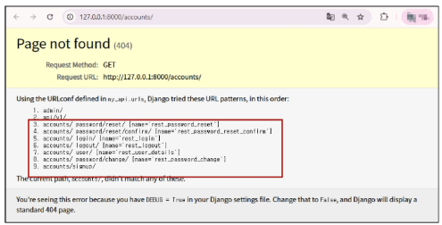
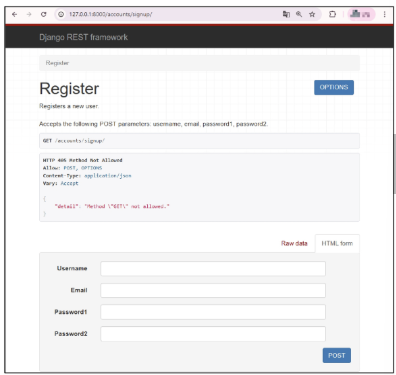
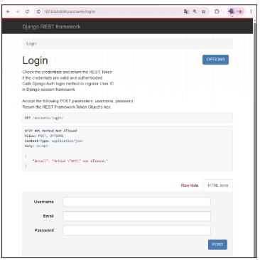
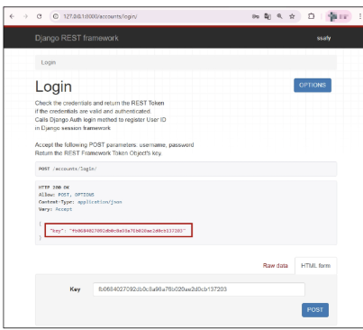
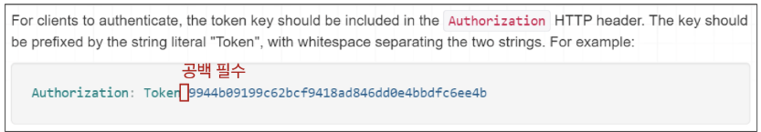

# 📚 목차 (Table of Contents)
### 인증 with DRF
- 인증
- 인증 정책 설정
- Token 인증 설정
- Dj-Rest-Auth 라이브러리
- Token 발급 및 활용

### 권한 with DRF
- 권한 정책 설정
- IsAuthenticated 설정


---


# 학습 목표 (page_0004.png)
✓ DRF의 토큰 기반 인증 시스템의 동작 방식을 이해한다.

✓ dj-rest-auth를 사용하여 인증 관련 API 엔드포인트를 구성한다.

✓ 로그인 API 요청을 통해 DRF로부터 인증 토큰을 발급받는다.

✓ 발급받은 토큰을 Authorization 헤더에 담아 요청을 보낸다.

✓ DRF의 권한(Permission) 개념과 401, 403 에러를 이해한다.

✓ @permission_classes로 특정 view에 대한 접근 권한을 설정한다.

✓ 게시글 등 데이터를 생성할 때 현재 인증된 사용자와 연결한다.


---


# ✅ 인증 with DRF


## 🔵 사전 준비 (1/4)
- **인증 로직 진행**을 위해 User 모델 관련 코드 활성화
- user ForeignKey 주석 해제

```python
# articles/models.py
class Article(models.Model):
    user = models.ForeignKey(
        settings.AUTH_USER_MODEL, on_delete=models.CASCADE
    )
    title = models.CharField(max_length=100)
    content = models.TextField()
    created_at = models.DateTimeField(auto_now_add=True)
    updated_at = models.DateTimeField(auto_now=True)
```


## 🔵 사전 준비 (2/4)
- serializers의 read_only_fields 주석 해제

> **read_only_fields** : 사용자가 수정하면 안 되는 필드

```Python
# articles/serializers.py
class ArticleSerializer(serializers.ModelSerializer):
    class Meta:
        model = Article
        fields = '__all__'
        read_only_fields = ('user',)
```


## 🔵 사전 준비 (3/4)
- article_list 함수에서 게시글 생성 시 user 정보도 저장될 수 있도록 주석 해제

```Python
# articles/views.py
@api_view(['GET', 'POST'])
# @permission_classes([IsAuthenticated])
def article_list(request):
    ...
    elif request.method == 'POST':
        serializer = ArticleSerializer(data=request.data)
        if serializer.is_valid(raise_exception=True):
            # serializer.save()
            serializer.save(user=request.user)
            return Response(serializer.data, status=status.HTTP_201_CREATED)
```


## 🔵 사전 준비 (4/4)
1. DB 초기화
    - db.sqlite3 삭제
    - migrations 파일 삭제

2. Migration 과정 재진행
3. fixtures의 articles.json은 user 정보가 없으므로 loaddata 불가능

    


---


# ✅ 인증


## 🔵 (복습) 인증의 필요성
- 클라이언트와 서버 간의 상태 정보를 유지하기 위해서 쿠키와 세션을 사용
- 하지만 클라이언트와 서버는 사용자를 식별하지 못하고 있는 상태
- 그래서 사용자를 식별하기 위해서 필요한 과정이 바로 **'인증(Authentication)'**
- 다양한 인증이 존재
    - 아이디와 비밀번호
    - 소셜 로그인(OAuth)
    - 생체인증

=> Django에서는 사용자 인증과 관련된 가장 중요하고 기본적인 뼈대를 제공
**(Django Authentication System)**


## 🔵 DRF에서의 인증
- 인증은 항상 view 함수 시작 시 다른 코드의 진행이 허용되기 전에 실행됨
    - 수신 요청을 해당 요청의 사용자 또는 해당 요청이 서명된 토큰(token)과 같은 자격 증명 자료와 연결

- 이후 인증이 완료된 해당 자격 증명을 사용 권한 및 제한 정책을 확인하고, 요청을 허용해야 하는 지를 결정

> **권한(permissions)** : 요청에 대한 접근 허용 또는 거부 여부를 결정

### 💡 TIP
- 인증 자체로는 들어오는 요청을 허용하거나 거부할 수 없으며, 단순히 요청에 사용된 **자격 증명만 식별한다는 점**에 유의하세요.

https://www.django-rest-framework.org/api-guide/authentication/


## 🔵 승인되지 않은 응답 및 금지된 응답
- 인증되지 않은 요청이 권한을 거부하는 경우 해당되는 두 가지 오류 코드를 응답

### 1. HTTP 401 Unauthorized
- "요청에 **유효한 인증 자격 증명**(Authentication Credentials)이 없어 **사용자를 식별할 수 없음**"을 의미 (누구인지를 증명할 자료가 없음)
    - 예) "누군지 모르겠어. 너 로그인 안 했어."

### 2. HTTP 403 Forbidden (Permission Denied)
- 서버에 요청이 전달되었지만, **권한 때문에 거절**되었다는 것을 의미
- 401과 다른 점은 **서버는 클라이언트가 누구인지 알고 있음**
    - 예) "누군지 알아. 근데 너한테 이 행동을 허락할 수 없어."

---


# ✅ 인증 정책 설정


## 🔵 인증 정책 설정 방법 2가지
1. 전역 설정
    - 로그인 해야지만 요청 처리한다.

2. View 함수 별 설정
    - 특정 기능별로 설정


## 🔵 1. 전역 설정
- **프로젝트 전체에 적용되는 기본 인증 방식을 정의**
- DEFAULT_AUTHENTICATION_CLASSES를 사용
- 기본 값: **SessionAuthentication**(쿠키, 세션)과 **BasicAuthentication**(아이디, 비밀번호 -> 서버에 전달)
- 사용 예시 (DRF 공식 문서 참고)

```Python
# settings.py 에서 설정

REST_FRAMEWORK = {
    'DEFAULT_AUTHENTICATION_CLASSES': [
        'rest_framework.authentication.BasicAuthentication',
        'rest_framework.authentication.TokenAuthentication',
    ],
}
```


## 🔵 2. View 함수 별 설정
- **authentication_classes 데코레이터를 사용**
- 개별 view에 지정하여 재정의
- 사용 예시 (DRF 공식 문서 참고)

> **데코레이터** : 기존 함수를 감싸, 특별한 기능을 추가하는 함수

```Python
from rest_framework.decorators import authentication_classes
from rest_framework.authentication import TokenAuthentication, BasicAuthentication

@api_view(['GET', 'POST'])
# 1. 토큰 정보 확인 -> 없으면 -> 2. 아이디, 비번 확인
@authentication_classes([TokenAuthentication, BasicAuthentication])  ⭐
def article_list(request):
    pass
```


## 🔵 DRF가 제공하는 인증 체계
### 1. BasicAuthentication
- 요청마다 사용자 이름(ID)과 비밀번호(PW)를 Base64로 인코딩하여 Authorization 헤더에 담아 보내는 방식

### 2. TokenAuthentication (✅)
- 로그인 시 발급받은 고유한 토큰(Token)을 Authorization 헤더에 담아 요청함으로써 사용자를 인증하는 방식
    - 토큰(문자열)을 view에서 저장(pinia) -> 요청할 때마다 헤더에 담아 보냄
    - **front, back 분리할 때 많이 사용**

### 3. SessionAuthentication
- 장고의 기본 세션 시스템을 활용, 브라우저가 보내는 sessionid 쿠키를 통해 사용자를 인증하는 방식
    - django에서 같은 origin으로 소통할 때 사용

### 4. RemoteUserAuthentication
- 웹 서버 등 외부 시스템이 이미 처리한 인증 결과를 신뢰하고, 전달받은 사용자 이름으로 사용자를 인증하는 방식 **(통합 로그인)**


## 🔵 TokenAuthentication
- **token 기반 HTTP 인증 체계**
- 로그인 시 발급받은 고유한 토큰을 Authorization 헤더에 담아 요청함으로써 사용자를 인증하는 방식
- 기본 데스크톱 및 모바일 클라이언트와 같은 클라이언트-서버 설정에 적합


    => 서버가 인증된 사용자에게 토큰을 발급하고 사용자는 매 요청마다 발급받은 토큰을 요청과 함께 보내 인증 과정을 거침

> **token** : 인증 후 발급되는 사용자의 신원이나 권한을 증명하는 값


---


# ✅ Token 인증 설정


## 🔵 TokenAuthentication 적용 과정
1. 인증 클래스 설정

2. INSTALLED_APPS 추가

3. Migrate 진행


## 🔵 1. 인증 클래스 설정
- TokenAuthentication 활성화 코드 주석 해제

▶️ 전역 인증 정책을 Token 방식으로 설정

```Python
# my_api/settings.py
REST_FRAMEWORK = {
    # Authentication
    'DEFAULT_AUTHENTICATION_CLASSES': [
        'rest_framework.authentication.TokenAuthentication',
    ],
}
```


## 🔵 2. INSTALLED_APPS 추가 
- rest_framework.authtoken 주석 해제

```Python
# my_api/settings.py
INSTALLED_APPS = [
    'articles',
    'accounts',
    'rest_framework',
    'rest_framework.authtoken',
]
```


## 🔵 3. Migrate 진행
```bash
$ python manage.py migrate
```

**▶️ 토큰 정보 저장 !!**


## 🔵 토큰 인증 방식 과정 정리



---


# ✅ Dj-Rest-Auth 라이브러리


## 🔵 Dj-Rest-Auth
- 회원가입, 로그인/로그아웃, 비밀번호 재설정, 소셜 로그인 등 **다양한 인증 관련 기능을 API 엔드포인트로 제공하는 라이브러리**
- dj-rest-auth는 django.contrib.auth를 대체하는 것이 아니라, 그 위에 만들어져 기능을 확장

▶️ **인증 기능을 RESTful API로 제공**

https://dj-rest-auth.readthedocs.io/en/latest/


## 🔵 Dj-Rest-Auth 설치 및 적용 (1/2)
- 설치 (사전에 설치되어 있음)

```Bash
$ pip install dj-rest-auth
```

- 추가 App 주석 해제

```Python
# my_api/settings.py
INSTALLED_APPS = [
    'articles',
    'accounts',
    'rest_framework',
    'rest_framework.authtoken',
    'dj_rest_auth',  ⭐
    ...
]
```


## 🔵 Dj-Rest-Auth 설치 및 적용 (2/2)
- 추가 URL 주석 해제

```Python
# my_api/urls.py
urlpatterns = [
    path('admin/', admin.site.urls),
    path('api/v1/', include('articles.urls')),
    path('accounts/', include('dj_rest_auth.urls')),  ⭐
    # path('accounts/signup/', include('dj_rest_auth.registration.urls')),
]
```


## 🔵 Dj-Rest-Auth의 Registration(등록) 기능 추가 설정 (1/4)
- 이전에 설치한 dj-rest-auth는 API 인터페이스를 제공하는 역할을 담당하며, **실제 로직 실행**을 담당할 라이브러리를 추가로 설치

- 패키지 추가 설치 (사전에 설치되어 있음)

```Bash
$ pip install dj-rest-auth[with_social]
```


## 🔵 Dj-Rest-Auth의 Registration(등록) 기능 추가 설정 (2/4)
- 추가 App 주석 해제

```Python
# my_api/settings.py
INSTALLED_APPS = [
    ...
    'django.contrib.sites',
    'allauth',
    'allauth.account',
    'allauth.socialaccount',
    'dj_rest_auth.registration',
    ...
]

SITE_ID = 1
```

### TIP
- SITE_ID
    - 사이트의 주소 정보를 찾는 데 사용하며, DB의 Site 테이블에서 설정한 ID 값에 매치되는 주소를 사용
    - INSTALLED_APPS 목록의 **'django.contrib.sites'**가 django_site 테이블을 자동으로 생성


## 🔵 Dj-Rest-Auth의 Registration(등록) 기능 추가 설정 (3/4)
- 관련 설정 코드 주석 해제

```Python
# my_api/settings.py
MIDDLEWARE = [
    ...,
    'allauth.account.middleware.AccountMiddleware', 
]
```


## 🔵 Dj-Rest-Auth의 Registration(등록) 기능 추가 설정 (4/4)
- 추가 URL 주석 해제 후 Migrate 진행

```Python
# my_api/urls.py
urlpatterns = [
    path('admin/', admin.site.urls),
    path('api/v1/', include('articles.urls')),
    path('accounts/', include('dj_rest_auth.urls')),
    path('accounts/signup/', include('dj_rest_auth.registration.urls')), ⭐
]
```

- ### 바로 migrate 하면 에러남! => allauth 추가 후 migrate 진행!!
```python
# my_api/settings.py
MIDDLEWARE = [
    ...,
    'allauth.account.middleware.AccountMiddleware', ⭐
]
```

```Bash
$ python manage.py migrate
```


---


# ✅ Token 발급 및 활용


## 🔵 Token 발급 (1/4)
- 회원 가입 및 로그인을 진행하여 토큰 발급 테스트하기
- 라이브러리 설치로 인해 추가된 URL 목록 확인
    - http://127.0.0.1:8000/accounts/

    


## 🔵 Token 발급 (2/4)
- 회원 가입 진행 (DRF 페이지 하단 회원 가입 form 사용)
    - http://127.0.0.1:8000/accounts/signup/

    


## 🔵 Token 발급 (3/4)
- 로그인 진행 (DRF 페이지 하단 로그인 form 사용)
    - http://127.0.0.1:8000/accounts/login/

    


## 🔵 Token 발급 (4/4)
- 로그인 성공 후 DRF로부터 발급 받은 Token 확인

▶️ **이제 이 Token을 Vue에서 별도로 저장하여 매 요청마다 함께 보내야 함**




## 🔵 Token 활용 (1/2)
- 게시글 작성 과정을 통해 Token 사용 방법 익히기
- Postman을 활용해 게시글 작성 요청하기
    - http://127.0.0.1:8000/api/v1/articles/
    - Body에 게시글 제목 및 내용 입력


## 🔵 Token 활용 (2/2)
- Headers에 발급받은 Token 작성 후 요청 성공 확인
    - Key: **"Authorization"**
    - Value: **"Token 토큰 값"**


## 🔵 클라이언트가 Token으로 인증 받는 방법
1. **"Authorization"** HTTP Header에 포함
2. 키 앞에는 문자열 **"Token"**이 와야 하며 **"공백"으로 두 문자열을 구분해야 함**

    


## 🔵 Token 데이터 확인
- Django DB 확인
- **발급 받은 Token을 인증이 필요한 요청마다 함께 보내야 함**


---


# ✅ 권한 정책 설정


## 🔵 권한 정책 설정
1. 전역 설정

2. View 함수 별 설정


## 🔵 1. 전역 설정
- 프로젝트 전체에 적용되는 기본 권한 방식을 정의
- DEFAULT_PERMISSION_CLASSES를 사용
- 기본 값: rest_framework.permissions.AllowAny
- 사용 예시 (DRF 공식 문서 참고)

```Python
REST_FRAMEWORK = {
    'DEFAULT_PERMISSION_CLASSES': [
        'rest_framework.permissions.IsAuthenticated',
    ],
}
```


## 🔵 2. View 함수 별 설정
- permission_classes 데코레이터를 사용
- 개별 view에 지정하여 재정의
- 사용 예시 (DRF 공식 문서 참고)

```Python
from rest_framework.decorators import permission_classes
from rest_framework.permissions import IsAuthenticated

@api_view(['GET', 'POST'])
@permission_classes([IsAuthenticated])
def article_list(request):
    pass
```


## 🔵 DRF가 제공하는 권한 정책
### 1. **IsAuthenticated**
- 인증된(로그인한) 사용자만 접근을 허용

### 2. IsAdminUser
- 스태프 권한(is_staff=True)을 가진 관리자 사용자만 접근을 허용

### 3. IsAuthenticatedOrReadOnly
- 인증된 사용자는 모든 요청(읽기/쓰기)을 허용하고, 비인증 사용자는 읽기 전용 요청만 허용

### 4. **AllowAny**
- 아무런 제한 없이 모든 사용자의 접근을 허용

### 5. ...


## 🔵 1. IsAuthenticated
### 개념
- **인증된 사용자만 접근을 허용**하는 권한 클래스
- 인증되지 않은 사용자의 모든 요청을 거부

### 특징
- request.user가 존재하고 인증된 상태인지 확인
- 보호해야 할 중요한 데이터나 리소스에 적합 (예: 회원 전용 페이지, 결제, 프로필 수정 등)


## 🔵 2. IsAdminUser
### 개념
- **관리자(is_staff=True) 권한을 가진 사용자만 접근을 허용**하는 권한 클래스
- 일반 사용자와 비인증 사용자의 모든 요청을 거부

### 특징
- request.user.is_staff 속성 값이 True인지 확인하여 권한을 검사
- 회원 목록 조회, 데이터 통계 등 사이트 관리자에게만 노출되어야 하는 민감한 API에 적합


## 🔵 3. IsAuthenticatedOrReadOnly
### 개념
- **비인증 사용자는 읽기만 허용하고, 인증된 사용자는 모든 요청(읽기/쓰기)을 허용**하는 권한 클래스

### 특징
- 요청 메서드가 **GET, HEAD, OPTIONS(정보 요청 메서드)와 같은 안전한 메서드일 경우 무조건 허용**하고, **그 외 메서드(POST, PUT 등)는 사용자의 인증 여부를 확인**
- 게시글 목록처럼 누구나 볼 수 있지만, 글 작성이나 수정은 회원만 가능한 API에 주로 적용


## 🔵 4. AllowAny
### 개념
- **모든 요청을 무조건 허용**하는 권한 클래스
- 인증된 사용자든, 인증되지 않은 사용자든 상관없이 모두에게 접근을 허용

### 특징
- 권한 검사(Authorization) 로직을 전혀 수행하지 않음
- API 엔드포인트를 완전히 공개하고 싶을 때 사용
- 보안이 필요한 리소스에는 부적합하므로, 회원가입, 로그인 또는 공개 게시글 조회 등 공개 API에 주로 적용


---


# ✅ IsAuthenticated 설정


## 🔵 IsAuthenticated 권한 설정
- DEFAULT_PERMISSION_CLASSES 주석 해제

=> 기본적으로 모든 View 함수에 대한 접근을 허용(AllowAny)

```Python
# my_api/settings.py
REST_FRAMEWORK = {
    # Authentication
    'DEFAULT_AUTHENTICATION_CLASSES': [
        'rest_framework.authentication.TokenAuthentication',
    ],
    
    # permission  ⭐
    'DEFAULT_PERMISSION_CLASSES': [
        'rest_framework.permissions.AllowAny',
    ],
}
```


## 🔵 권한 활용하기 (1/4)
- 만약 관리자만 전체 게시글 조회가 가능한 권한이 설정되었을 때, 인증된 일반 사용자가 조회 요청을 할 경우 어떻게 응답 확인하기
- 테스트를 위해 임시로 관리자 관련 권한 클래스 **IsAdminUser로 변경**

```Python
# articles/views.py
from rest_framework.permissions import IsAuthenticated, IsAdminUser ⭐

@api_view(['GET', 'POST'])
@permission_classes([IsAuthenticated])  ⭐
def article_list(request):
    pass
```


## 🔵 권한 활용하기 (2/4)
- 전체 게시글 조회 요청
    - http://127.0.0.1:8000/api/v1/articles/
- 403 Forbidden / 401 Unauthorized(Token 비활성화 후) 응답 확인


## 🔵 권한 활용하기 (3/4)
- IsAdminUser 삭제 후 IsAuthenticated 권한으로 복구

```Python
# articles/views.py
from rest_framework.permissions import IsAuthenticated ⭐

@api_view(['GET', 'POST'])
@permission_classes([IsAuthenticated]) ⭐
def article_list(request):
    pass
```


## 🔵 권한 활용하기 (4/4)
- 정상 작동하던 게시글 전체 조회가 작동하지 않음
    - 401 status code 확인
- 게시글 조회 요청 시 인증에 필요한 수단(token)을 보내지 않고 있으므로 게시글 조회가 불가능해진 것

=> 이후 token을 포함시켜 게시글 조회하는 과정 진행 예정


---


# 📚 총 정리

## 🔑 핵심 키워드
| 개념 | 설명 | 예시 |
| :--- | :--- | :--- |
| 인증 (Authentication) | 요청 사용자의 자격 증명을 식별 | 401: 인증 실패 (자격 증명 없음) |
| 권한 (Permission) | 인증된 사용자의 요청 허용/거부 결정 | 403: 권한 없음 (접근 거부) |
| 토큰 인증 | 발급된 토큰으로 사용자 인증 | rest_framework.authtoken |
| dj-rest-auth | DRF 인증 기능 제공 라이브러리 | 로그인, 회원가입 API 엔드포인트 제공 |
| Authorization 헤더 | 인증 토큰을 담아 서버에 전송 | Authorization: Token <key> |
| @permission_classes | View 함수에 특정 권한을 설정 | @permission_classes([IsAuthenticated]) |
| IsAuthenticated | 인증된 사용자만 접근을 허용 | 비인증 사용자 요청은 401 반환 |


---


## 📝 요약 및 정리

### 인증 (Authentication)
- 요청을 보낸 사용자가 누구인지 식별하는 과정이며, 인증 자체는 접근을 허용하거나 거부하지 않음

### 권한 (Permission)
- 인증된 사용자가 특정 요청을 보낼 자격이 있는지 결정하는 과정

### HTTP 응답 코드
- 401 Unauthorized
    - 유효한 인증 정보가 없어 요청이 실패했음을 의미(로그인되지 않은 상태)

- 403 Forbidden
    - 인증은 성공했지만, 해당 요청에 권한이 없음을 의미

### DRF 토큰 기반 인증
- 사용자가 로그인하면, 서버는 고유한 토큰(Token)을 발급
- 클라이언트(Vue)는 이 토큰을 저장
- 이후 서버에 데이터를 요청할 때마다, 헤더의 Authorization 필드에 Token `<key>` 형식으로 토큰을 담아 보냄
- 서버는 이 토큰을 검증하여 사용자를 식별하고 인증

### dj-rest-auth 라이브러리
- DRF에서 회원가입, 로그인 등 인증 관련 API 엔드포인트를 쉽게 구현할 수 있도록 도와주는 라이브러리
- settings.py에서 DEFAULT_AUTHENTICATION_CLASSES를 TokenAuthentication으로 설정하여 프로젝트 전반에 토큰 인증을 적용

### DRF 권한 설정
- 전역 설정
    - settings.py의 DEFAULT_PERMISSION_CLASSES에서 프로젝트의 기본 권한을 설정
- View별 설정
    - @permission_classes 데코레이터를 사용하여 특정 View 함수에만 다른 권한을 적용
- 주요 권한 클래스
    - **IsAuthenticated** : 인증된 사용자에게만 접근을 허용
    - **IsAuthenticatedOrReadOnly** : 비인증 사용자에게는 읽기만 허용하고, 인증된 사용자에게는 모든 작업을 허용
    - **AllowAny** : 모든 사용자에게 접근을 허용


---


### 사용자 인증을 구현할 때, 프론트엔드(Vue)와 백엔드(DRF)는 각각 어떤 역할을 나눠 맡아야 할까요?

- 백엔드에서의 인증 과정을 이해하고, dj-rest-auth를 활용했습니다.

```Python
# '인증된 사용자만 통과'라는 규칙을 설정
@api_view(['POST'])
@permission_classes([IsAuthenticated])
def article_create(request):
    pass
```