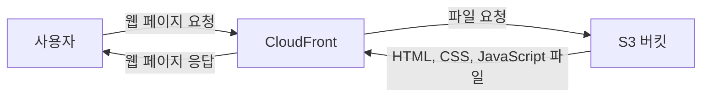

# 🚀S3와 CloudFront로 웹 페이지 배포하기

정적 웹 페이지를 S3에 저장하고, CloudFront를 통해 사용자에게 빠르고 안정적으로 제공하는 과정을 정리한다.

## 이 섹션에서 배우는 것

- 정적 웹 페이지가 무엇인지 이해하기
- S3에 정적 웹 페이지 파일 업로드하기
- S3를 웹 호스팅 용도로 설정하기
- CloudFront 배포 생성하기
- CloudFront를 통해 S3의 웹 페이지 제공하기
- 캐시 무효화 방법 이해하기
- 실습 후 비용이 발생하지 않도록 리소스 정리하기

## 먼저 알아야 할 핵심 개념

### 1) 정적 웹 페이지란?

정적 웹 페이지는 HTML, CSS, JavaScript 파일처럼 요청할 때마다 서버에서 별도의 처리를 하지 않아도 제공할 수 있는 웹 페이지다.

소개 페이지, 포트폴리오, 문서 사이트처럼 복잡한 서버 기능이 필요하지 않은 웹 페이지를 배포할 때 주로 사용한다.

### 2) S3로 웹 페이지를 배포하는 이유

S3는 이미지와 문서뿐 아니라 HTML, CSS, JavaScript 파일도 저장할 수 있다.

정적 웹 페이지 파일을 S3에 업로드하면 별도의 EC2 서버를 운영하지 않고도 웹 페이지를 제공할 수 있다.

### 3) CloudFront란?

CloudFront는 AWS의 CDN(Content Delivery Network) 서비스다.

사용자와 가까운 위치의 서버에서 파일을 제공해 웹 페이지의 로딩 속도를 높여 준다. 또한 S3를 외부에 직접 노출하지 않고 CloudFront를 통해 파일을 제공하도록 구성할 수 있다.

### 4) S3와 CloudFront의 역할

S3는 웹 페이지를 구성하는 파일을 저장한다.

CloudFront는 S3에 저장된 파일을 사용자에게 전달한다. 사용자는 S3가 아니라 CloudFront에 연결된 주소로 웹 페이지에 접속한다.

### 5) 캐시란?

CloudFront는 S3에서 가져온 파일을 일정 시간 저장해 둔다. 이를 캐시라고 한다.

웹 페이지 파일을 수정한 뒤에도 이전 화면이 보인다면, CloudFront에 저장된 캐시가 남아 있을 수 있다. 이때 캐시 무효화 작업을 통해 최신 파일을 다시 불러오도록 설정할 수 있다.

## 학습 순서

1. 정적 웹 페이지 파일 준비하기
2. S3 버킷 생성하기
3. S3에 웹 페이지 파일 업로드하기
4. S3 웹 호스팅 설정하기
5. CloudFront 배포 생성하기
6. CloudFront로 웹 페이지 접속하기
7. 수정된 파일을 반영하기 위해 캐시 무효화하기
8. 실습 후 리소스 정리하기

## 학습 후 할 수 있는 것

- 정적 웹 페이지와 백엔드 서버의 차이를 설명할 수 있다.
- S3에 HTML, CSS, JavaScript 파일을 업로드할 수 있다.
- CloudFront 배포를 생성하고 S3와 연결할 수 있다.
- CloudFront 주소로 정적 웹 페이지에 접속할 수 있다.
- 캐시 때문에 이전 파일이 보일 때 해결 방법을 이해할 수 있다.

## 주의 사항

- S3 버킷을 공개하면 저장된 파일이 외부에 노출될 수 있으므로 접근 정책을 확인한다.
- CloudFront 캐시 때문에 파일을 수정해도 바로 반영되지 않을 수 있다.
- S3 저장 공간, 데이터 전송, CloudFront 사용량에 따라 비용이 발생할 수 있다.
- 실습 후 사용하지 않는 S3 버킷과 CloudFront 배포를 정리한다.
