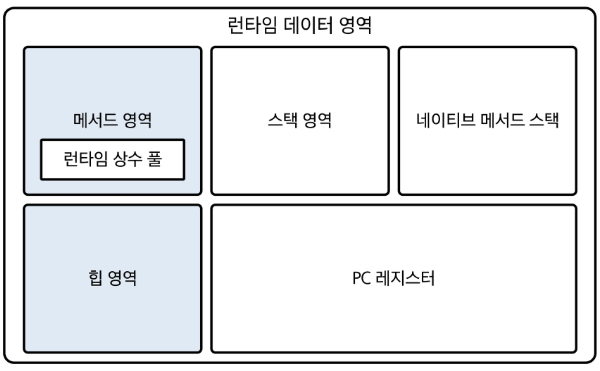
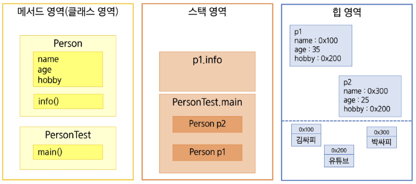
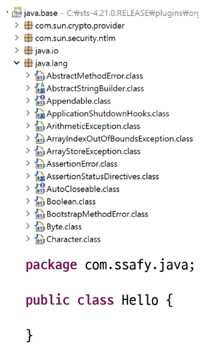
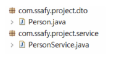
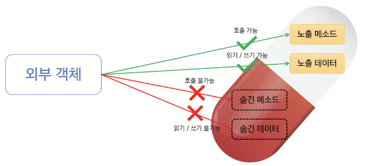
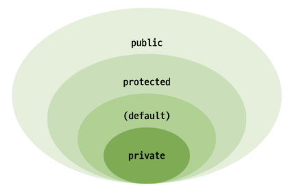
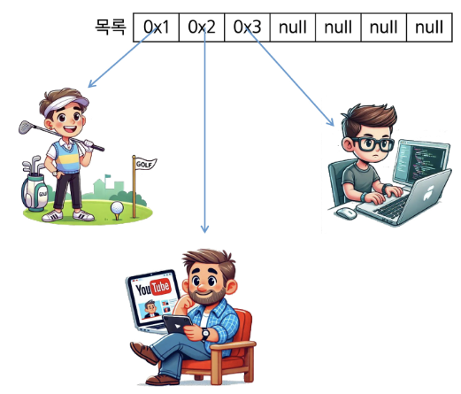

# 📚 목차

### 객체배열 관리

- JVM 메모리구조
- static 키워드
- Package & import
- 접근제한자
- 객체배열 관리


---


# 🎯 학습 목표
✔ JVM 런타임 메모리 구조를 그림으로 설명하고, 각 영역에 저장되는 데이터를 구분할 수 있다.

✔ static 키워드를 사용한 변수, 메서드, 블록의 특징을 설명할 수 있다.

✔ package, import에 대해 설명할 수 있다.

✔ 접근 제한자의 범위와 패키지·상속 관계에서의 가시성을 설명하고, 캡슐화를 위해 
적절히 사용할 수 있다.

✔ 객체배열을 활용하여 데이터를 관리할 수 있다.

✔ 싱글턴 패턴을 이해하고 사용할 수 있다.


---


# ✅ JVM 메모리 구조


## 🔵 JVM(Java Virtual Machine)
- 자바 프로그램이 실행되는 환경 제공
- 메모리를 체계적으로 관리하기 위해 여러 영역으로 나뉘어져 있음
    - 메서드 영역(Method Area)
    - 힙 영역(Heap Area)
    - 스택 영역(Stack Area)
    - PC 레지스터(PC Register)
    - 네이티브 메서드 스택(Native Method Stack)

- GC(Garbage Collection): JVM은 가비지 컬렉터를 통해 자동으로 메모리를 관리, 사용되지 않는 객체를 메모리에서 해제


## 🔵 JVM(Java Virtual Machine) 메모리 구조


※ JVM 버전에 따라 달라질 수 있다.


## 🔵 메서드 영역(Method Area)

- 클래스 정보를 저장하는 영역
- 정적 변수, 상수, 메서드, 등이 저장됨
- 일부 JVM에 따라 GC가 관리 해주는 경우도 있음
- 모든 스레드가 공유
- 클래스 로더(Class Loader)에 의해 클래스가 로드 될 때 저장되는 공간
    
    → 회사의 매뉴얼(설계도) / 지침


## 🔵 힙 영역(Heap Area)
- 객체 인스턴스를 저장하는 공간
- GC가 관리하는 영역 (사용되지 않는 객체를 자동으로 삭제)
- 인스턴스 변수, 배열 등이 해당 영역에 저장
- 어플리케이션이 사용할 수 있는 가장 큰 메모리
- 모든 스레드가 공유
- 문자열 상수 풀 관리 (Java 7+)
    
    → 프로젝트 자료 같은 것들


## 🔵 스택 영역(Stack Area)
- 지역 변수, 메서드 호출 시 사용되는 값, 연산 결과 등 저장
- 메서드 호출 시 스택 프레임이 생성되며, 끝나면 스택 프레임 제거
- 접시를 쌓듯 쌓이는 형태
- 스레드 마다 생성

    → 작업 중인 문서 or 책상 (곧 치워질 예정)


## 🔵 PC 레지스터(Program Counter Register)
- 현재 실행 중인 메모리의 주소를 저장하는 영역
- 프로그램 실행 흐름을 제어하는 데 사용
- 스레드 마다 생성

    → 지금 하고 있는 작업 위치


## 🔵 네이티브 메서드 스택(Native Method Stack)
- 네이티브 언어(C, C++ 등)로 작성된 메서드 호출 시 사용하는 메모리 영역
- 스레드 마다 생성

    → 외주 업체와 협업


## 🔵 객체 생성과 메모리 할당
```JAVA
Person p1 = new Person();
p1.name = "김싸피";
p1.age = 35;
p1.hobby = "유튜브";
p1.info();

Person p2 = new Person();
p2.name = "박싸피";
p2.age = 25;
p2.hobby = "유튜브";
```



---


# ✅ static 키워드


## 🔵 static
- 클래스 수준에서 공유되는 멤버(필드, 메서드, 중첩 클래스)를 정의하는 데 사용
- static 키워드를 작성하면 객체(인스턴스)와 무관하게 클래스 자체에 속함
- 특정 객체에 속하지 않고 모든 객체가 동일한 static 멤버를 참조
- 클래스의 이름을 통해 직접 호출 가능
- JVM 메서드 영역에 저장


## 🔵 static 필드 (클래스 변수)
- 정적 필드는 클래스 수준에서 공유되는 변수
- 객체마다 값이 다른 인스턴스 필드와는 달리 모든 인스턴스가 공유
- 클래스 이름을 통해 호출 하는 것을 권장

```java
public class Person {
    static int pCount;

    String name;
    int age;
    String hobby;
}
```
```java
public class PersonTest {
    public static void main(String[] args) {
        Person p = new Person();
        p.name = "Kim";

        Person.pCount++;

        p.pCount++; // 오류는 나지 않지만 경고
    }
}
```
```cpp
The static field Person.pCount should be accessed in a static way
```


## 🔵 static 메서드
- 정적 메서드는 클래스 이름을 통해 직접 호출할 수 있는 메서드
- 객체와 무관하게 동작, 전역적인 작업에 적합 (보통 알고리즘 문제 풀 때 사용)


## 🔵 static 블록 (초기화 블록)
- 정적 블록은 클래스 로드 시 한 번만 실행되는 초기화 블록
- 정적 필드 초기화에 사용

```java
class Counter {
    // static 변수
    public static int sCount;

    // non-static 변수
    public int iCount;

    // 초기화 블록
    static {
        sCount = 10;
    }
}
```


## 🔵 static 주의 사항
- static 영역에서는 non-static 영역을 직접 접근할 수 없음
```java
public class Main {

    String str = "문장";

    public static void main(String[] args) {
        System.out.println(str);
    }
}
```

- non-static 영역에서는 static 영역에 대한 접근이 가능
```java
public class Main {

    static String str = "문장";

    public void print() {
        System.out.println(str);
    }
}
```

---


# ✅ 접근 제한자


## 🔵 패키지(Package)
- 클래스와 인터페이스를 묶는 디렉토리(폴더) 구조
- 클래스 이름 충돌 방지(패키지 명까지 해서 네임스페이스 제공)
- 클래스 파일 첫 번째 줄에 package 키워드를 사용하여 선언 (생략 시 default package)
- .(dot)을 이용하여 패키지를 구분 (계층 구조)
- 일반적으로 소속이나 회사의 도메인 역순으로 작성

    


## 🔵 임포트(import)
- 다른 패키지에 있는 클래스를 사용하기 위해서는 import 과정이 필요
- 패키지와 달리 여러 번 선언 가능

    

```java
package com.ssafy.project.service;

import com.ssafy.project.dto.Person;

public class PersonService {
    Person p;
}
```
- 단일 import → import [풀 패키지명]
- 전체 import → import [패키지명].* (**하위 패키지까지 import 되지는 않음**)
- 자바에서는 클래스가 실제로 사용되는 시점에 메모리에 로드
    
    → import 많다고 느려지지 않음
- java.lang.* 기본적으로 import 되어 있는 패키지

※ ctrl + shift + o (자동 import 단축키) → 동일한 클래스명이 여러 개 수동선택 필요


## 🔵 static import
- static member를 import 하여 이름만으로 접근이 가능함.
```java
import static java.lang.Math.PI;

public class StaticImportTest {
    public static void main(String[] args) {
        System.out.println(Math.PI);   //정석
        System.out.println(PI);        //static import
    }
}
```
- Content Assist에 등록하여 사용 가능 (간단한 import 가능)


## 🔵 일반적인 클래스 레이아웃

```java
package com.ssafy.java;              // package 선언부

import java.sql.*;                   // import 선언부

public class Person {                // class 선언부

    static int personCount;           // class 변수

    String name;                      // 멤버 변수
    int age;
    String hobby;

    static {                           // 초기화 블록
        personCount = 10;
    }

    public Person(String name, int age, String hobby) {   // 생성자
        this.name = name;
        this.age = age;
        this.hobby = hobby;
    }

    public String info() {             // 멤버 메서드
        return "제 이름은" + name + "입니다.";
    }
}
```


---


# ✅ 접근 제한자 (Access Modifier)


## 🔵 캡슐화(Encapsulation)
- 필드와 메서드를 하나의 단위로 묶고, 외부로부터 데이터를 숨기며 안전하게 보호하는 것
- 정보 은닉 → 내부 데이터를 외부에서 직접 접근하지 못하게 하고 특정 메서드를 통해서만 접근하도록 제한




## 🔵 접근 제한자
- 클래스, 메서드, 변수 등에 대한 접근 범위를 지정
- 캡슐화와 정보은닉을 가능하게 함
- 접근 제한자는 하나만 작성이 가능


## 🔵 접근 제한자 종류
- **public** : 모든 위치에서 접근 가능
- **protected** : 같은 패키지 또는 패키지가 달라도 상속 관계에서 접근 가능
- **default(package-private)** : 같은 패키지안에서만 접근 가능
- **private** : 같은 클래스 내부에서만 접근 가능

    


## 🔵 클래스와 접근 제한자
- 최상위 클래스 (외부 클래스) : public 또는 default 만 사용 가능
- 중첩 클래스 (내부 클래스) : 4가지 종류 모두 사용 가능

| 수식어       | 클래스 내부 | 동일 패키지 | (다른 패키지내의) 하위 클래스 | 다른 패키지 |
| --------- | ------ | ------ | ----------------- | ------ |
| private   | O      |        |                   |        |
| (default) | O      | O      |                   |        |
| protected | O      | O      | O                 |        |
| public    | O      | O      | O                 | O      |


## 🔵 접근자(Getter) / 설정자(Setter)
- 캡슐화를 구현하는데 사용되는 메서드
- Getter : private 필드 값을 외부에서 읽을 수 있게 함
- Setter : private 필드 값을 외부에서 수정할 수 있게 함
    
    → 직접 접근이 아닌 안전하게 읽고 쓰는 방식 제공
- 접두사 get / set을 이용하여 메서드 작성

```java
public class Person {
    private String name;
    private int age;

    public String getName() {
        return name;
    }

    public void setName(String name) {
        this.name = name;
    }

    public int getAge() {
        return age;
    }

    public void setAge(int age) {
        this.age = age;
    }
}
```


---


# ✅ 객체 배열 관리


## 🔵 객체배열 관리
- 여러 객체를 하나의 배열로 묶어 관리하는 방식
- 객체 배열의 요소는 객체 참조 값을 저장
- 기본 값은 null로 초기화
- 객체를 추가, 조회, 수정, 삭제할 수 있음 (CRUD)
- 싱글턴 패턴을 사용하여 관리할 수 있음




## 🔵 싱글턴 패턴(Singleton Pattern)
- 객체를 하나만 생성하도록 보장하는 디자인 패턴
- 객체의 유일성 보장 → 하나의 인스턴스만 생성 (전역적으로 동일한 객체 공유)
- 생성자를 private으로 만들어 클래스 내부에서만 생성 가능
- 정적 메서드를 통해 전역적으로 접근 가능
```java
public class Manager {

    private static Manager manager = new Manager();

    private Manager() { }

    public static Manager getManager() {
        return manager;
    }
}
```


