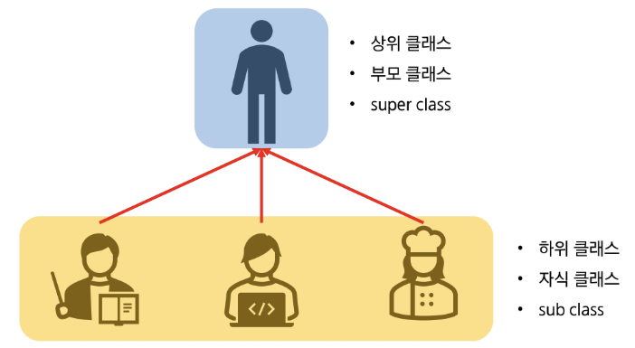
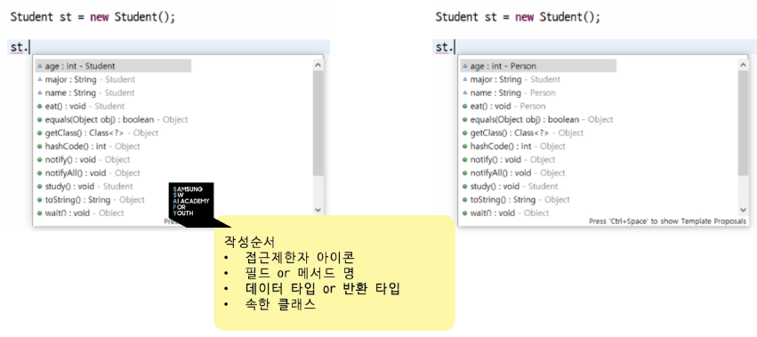
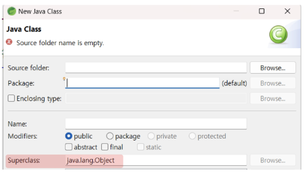
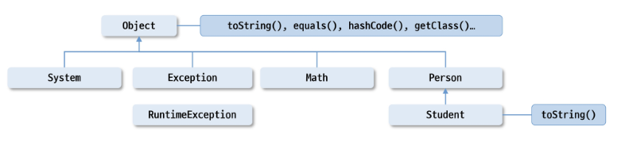
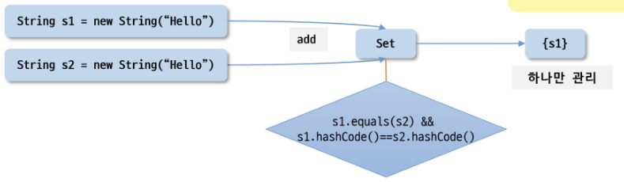
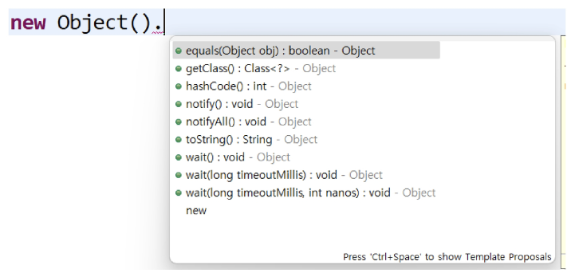

# 📚 목차

### 상속
- 상속
- Object 클래스
- final 키워드


---


# 🎯 학습 목표
✔ 상속의 개념과 목적을 이해하고, extends 키워드를 사용하여 클래스를 확장할 수 있다.

✔ 부모 클래스와 자식 클래스 간의 관계를 통해 필드와 메서드가 어떻게 상속·재정의 되는지 설명할 수 있다.

✔ 메서드 재정의와 super 키워드를 활용하여 부모 클래스의 멤버에 접근하거나 생성자를 호출할 수 있다.

✔ Object 클래스를 이해하고 주요 메서드를 활용할 수 있다.

✔ final 키워드를 클래스, 메서드, 변수에 적용하여 사용하고, 각각의 의미를 설명하고 사용할 수 있다.


---


# ✅ 상속


## 🔵 상위 클래스의 속성과 메서드를 물려받아 확장하여 새로운 자식 클래스를 정의하는 것



## 🔵 사람과 학생
```java
public class Person {
    String name;
    int age;

    public void eat() {
        System.out.println("음식을 먹는다.");
    }
}
```
```java
public class Student {
    String name;
    int age;
    String major;

    public void eat() {
        System.out.println("음식을 먹는다.");
    }

    public void study() {
        System.out.println("공부를 한다.");
    }
}
```


## 🔵 사람과 학생


```java
public class Person {
    String name;
    int age;

    public void eat() {
        System.out.println("음식을 먹는다.");
    }
}
```
```java
public class Student extends Person {
    String major;

    public void study() {
        System.out.println("공부를 한다.");
    }
}
```


## 🔵 틀린 그림 찾기



## 🔵 상속의 특징
- 코드 재사용성 : 상위 클래스에 정의된 필드, 메서드 사용 가능 / 공통된 기능을 상위 클래스에 정의
- 상위 클래스의 생성자와 초기화 블록은 상속하지 않음
- extends 키워드 사용
- 상속을 명시하지 않으면 기본적으로 Object 클래스를 상속 받고 있음

    

※ 공통된 기능을 상위 클래스에 정의 -> 상위 클래스 변경 시 모든 하위 클래스 적용


## 🔵 상속의 특징
- 다중 상속 불가 : 클래스 상속에서 다중 상속을 허용하지 않음
- 인터페이스를 사용하여 다중 상속과 비슷한 효과를 구현할 수 있음


## 🔵 상속의 특징 (is - a 관계)
- A는 B이다(A is a B) 라는 상속을 통한 관계
- 상위 클래스는 하위 클래스의 공통된 특성과 행동을 정의하며, 하위 클래스는 이를 확장하거나 구체화
- 일반화와 전문화가 필요한 경우 사용
```java
class Animal {
    void eat() {
        System.out.println("밥을 먹는다. 냠냠");
    }
}

class Dog extends Animal {
    void bark() {
        System.out.println("왕왕!");
    }
}

public class Main {
    public static void main(String[] args) {
        Dog dog = new Dog();
        dog.eat();   // Animal 클래스의 메서드 호출
        dog.bark();  // Dog 클래스의 메서드 호출
    }
}
```


## 🔵 포함관계 (has - a 관계)
- A는 B를 가지고 있다.(A has a B)라는 포함을 통한 관계
- 한 클래스가 다른 클래스의 객체를 속성으로 포함하여 구현
- 구성 요소를 나타낼 때 사용
- 두 클래스는 독립적

```java
class Engine {
    void start() {
        System.out.println("시동을 건다");
    }
}

class Car {
    private Engine engine;   // Car has an Engine

    Car() {
        this.engine = new Engine();
    }

    void drive() {
        engine.start();   // 포함된 엔진의 메서드 호출
        System.out.println("자동차를 운전한다. 부릉부릉");
    }
}

public class Main {
    public static void main(String[] args) {
        Car car = new Car();
        car.drive();
    }
}
```


## 🔵 is-a 관계와 has-a 관계 비교
| 특징     | IS-A 관계                    | HAS-A 관계                  |
| ------ | -------------------------- | ------------------------- |
| 구현 방식  | 상속                         | 포함                        |
| 의미     | A는 B이다.                    | A는 B를 가지고 있다.             |
| 클래스 관계 | 상위 클래스와 하위 클래스             | 한 클래스가 다른 클래스의 객체를 포함     |
| 재사용성   | 하위 클래스가 상위 클래스의 특성과 행동을 상속 | 포함된 객체의 기능을 사용하여 동작 확장 가능 |
| 독립성    | 두 클래스는 강하게 결합              | 포함된 클래스는 독립적으로 설계 가능      |
| 예시     | 강아지는 동물이다.                 | 자동차는 엔진을 가지고 있다.          |


## 🔵 상속의 특징
- 접근 제한자 (public, protected, default, private)에 따라 상위 클래스의 멤버에 대한 접근 범위가 결정됨
- 공통된 기능이 정의되어 있는 상위 클래스만 수정하면 하위 클래스는 모두 적용 (유지보수성)


## 🔵 super 키워드
- 상위 클래스의 멤버(필드, 메서드, 생성자)를 참조하는데 사용
- this 키워드가 현재 클래스의 멤버를 참조하는데 사용하는 것처럼, super 는 상위 클래스와 관련된 작업을 수행할 때 사용


## 🔵 super 키워드 (상위 클래스 필드 참조)
- 하위 클래스에서 상위 클래스와 동일한 이름의 필드가 있을 경우,
super를 사용하여 필드를 참조

```java
class Parent {
    String name = "Parent Name";
}

class Child extends Parent {
    String name = "Child Name";

    void printNames() {
        System.out.println(name);        // 하위 클래스의 name 필드
        System.out.println(super.name);  // 상위 클래스의 name 필드
    }
}

public class Main {
    public static void main(String[] args) {
        Child child = new Child();
        child.printNames();
    }
}
```


## 🔵 super 키워드 (상위 클래스 메서드 호출)
- 하위 클래스에서 상위 클래스의 메서드를 호출하여 기능을 유지하거나 확장할 수 있음

```java
class Parent {
    void eat() {
        System.out.print("냠냠");
    }
}

class Child extends Parent {
    void eat() {
        super.eat(); // 상위 클래스의 메서드 호출
        System.out.print("쩝쩝");
    }
}

public class Main {
    public static void main(String[] args) {
        Child child = new Child();
        child.eat();
    }
}
```


## 🔵 super 키워드 (상위 클래스 생성자 호출)
- 하위 클래스의 생성자에서 super()를 사용하여 상위 클래스의 생성자를 명시적으로 호출할 수 있음
- super()는 반드시 생성자의 첫 번째 줄에 위치
- 명시적으로 작성하지 않으면 컴파일러는 기본 생성자를 호출

- this()와 같이 사용할 수 없음

```java
public class Person {
    String name;
    int age;

    public Person(String name, int age) {
        this.name = name;
        this.age = age;
    }

    public void eat() {
        System.out.println("음식을 먹는다.");
    }
}

public class Student extends Person {
    String major;

    public Student(String name, int age, String major) {
        super(name, age);
        this.major = major;
    }

    public void study() {
        System.out.println("공부를 한다.");
    }
}
```


## 🔵 메서드 재정의(Overriding)
- 메서드 이름, 매개 변수, 반환 타입이 상위 클래스와 동일해야함
- 접근 제한자는 상위 클래스의 메서드보다 더 넓은 범위로만 변경 가능
- 조상보다 더 큰 예외를 던질 수 없음
- @Override 어노테이션 사용을 권장
- 메서드 오버로딩(Overloading)과 다른 개념


### 어노테이션(Annotation)
- 사전적 의미 : 주석
- 컴파일러, JVM, 프레임워크 등이 보는 주석
- 소스코드에 메타 데이터를 삽입하는 형태

```java
public class Person {
    String name;
    int age;

    public void eat() {
        System.out.println("음식을 먹는다.");
    }
}

public class Student extends Person {
    String major;

    public Student(String name, int age, String major) {
        super(name, age);
        this.major = major;
    }

    public void study() {
        super.eat();
        System.out.println("공부를 한다.");
    }

    @Override
    public void eat() {
        System.out.println("지식을 먹는다.");
    }
}
```


---


# ✅ Object

## 🔵 Object 클래스
- 자바의 가장 최상위 클래스로 모든 클래스의 조상
- 모든 클래스는 직접적으로나 간접적으로 Object를 상속 받음
- Object의 멤버는 모든 클래스의 멤버

    


## 🔵 toString() 메서드
- 객체를 문자열로 변경하는 메서드
```java
public String toString() {
    return getClass().getName() + "@" + Integer.toHexString(hashCode());
}
```

- 정작 궁금한 내용은 해시코드 + 클래스 이름이 아닌 내용이 궁금
```java
@Override
public String toString() {
    return "Student [name=" + name + ", age=" + age + ", major=" + major + "]";
}
```


## 🔵 equals() 메서드
- 두 객체가 동일한지 비교하는 메서드
```java
public boolean equals(Object obj) {
    return (this == obj);
}
```

- 두 개의 레퍼런스 변수가 같은 객체를 가리키고 있는가?
```java
Object obj1 = new Object();
Object obj2 = new Object();
Object obj3 = obj2;

System.out.printf("obj1 == obj2: %b\n", obj1==obj2);
System.out.printf("obj1 equals obj2: %b\n", obj1.equals(obj2));

System.out.printf("obj2 == obj3: %b\n", obj2==obj3);
System.out.printf("obj2 equals obj3: %b\n", obj2.equals(obj3));
```

> **==** : 비교 연산자로 두 객체의 주소 값 비교


## 🔵 equals() 메서드
- 우리가 비교할 것은 정말 객체의 주소 값인가?
- 두 객체의 내용을 비교할 수 있도록 equals 메서드 재정의
```java
private static void testString() {
    String s1 = new String("Hello");
    String s2 = new String("Hello");
    System.out.println((s1 == s2) + " : " + s1.equals(s2));
}
```

- 객체의 주소 비교 : == 활용
- 객체의 내용 비교 : equals 재정의
```java
class Person {
    String name;

    Person(String name) {
        this.name = name;
    }

    @Override
    public boolean equals(Object obj) {
        if (this == obj) return true;
        if (obj == null || getClass() != obj.getClass())
            return false;
        Person person = (Person) obj;
        return name.equals(person.name);
    }
}
```


## 🔵 hashCode() 메서드
- HashSet, HashMap 등에서 객체의 동일성을 확인하기 위해 사용

    

- equals 메서드를 재정의 할 때는 반드시 hashCode()도 재정의 할 것
- 미리 작성된 String이나 Number 등에서 재정의 된 hashCode() 활용 권장

### ※ hashcode : 객체를 식별하는 정수형 값
- 객체를 빠르게 검색하거나 비교할 때 사용
- 기본적으로 메모리 주소 기반으로 생성하지만 재정의 가능


## 🔵 getClass() 메서드
- 객체의 런타임 클래스 정보를 반환
```java
public class Main {
    public static void main(String[] args) {
        String str = "Hello";
        System.out.println(str.getClass()); // class java.lang.String
    }
}
```


## 🔵 기타 메서드
- clone()
- finalize()
- wait() / notify()

    


---


# ✅ final 키워드


## 🔵 final
- 변경 불가능성을 나타내는 키워드
- 컴파일 타임 안정성을 높이는데 사용
- 변수 : 값의 고정성
- 메서드 : 재정의 방지
- 클래스 : 상속 불가능
- 과도한 사용은 코드의 유연성을 감소 시킴


## 🔵 final 변수
- 값이 변경되지 않는 상수를 선언할 때 사용
- **선언과 동시에 초기화** 혹은 **생성자를 통한 초기화**를 해야함
- 참조 변수에 final을 사용하면 참조를 바꿀 수는 없지만 객체의 내부 상태는 변경 가능

```java
final String[] names = new String[5];

// 아래의 작업 가능
names[0] = "YangSSAFY";
names[1] = "HongSSAFY";
names[2] = "ParkSSAFY";

// 아래의 작업 불가능
names = new String[5];
```


## 🔵 final 메서드
- 재정의(Overriding) 금지 → 하위 클래스에서 재정의할 수 없음
- 상위 클래스에서 중요한 동작을 변경되지 않도록 보호할 때 사용
```java
class Parent {
    final void eat() {
        System.out.println("음식을 먹는다.");
    }
}

class Child extends Parent {
    void eat() { } // 컴파일 오류: final 메서드는 재정의 불가
}
```


## 🔵 final 클래스
- 상속할 수 없는 클래스 정의
- 클래스 자체를 확장할 필요가 없거나, 보안을 강화해야 하는 경우 사용
- String 클래스는 final 로 선언 되어 있음
```java
public final class String
    implements java.io.Serializable, Comparable<String>, CharSequence,
               Constable, ConstantDesc {
}
```