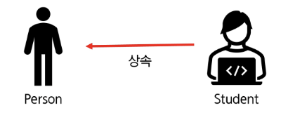
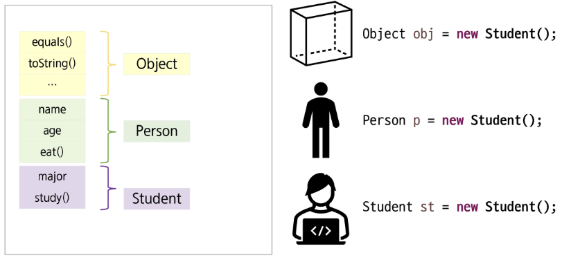
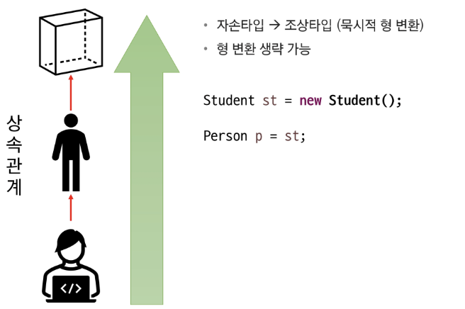
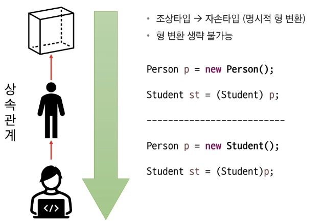
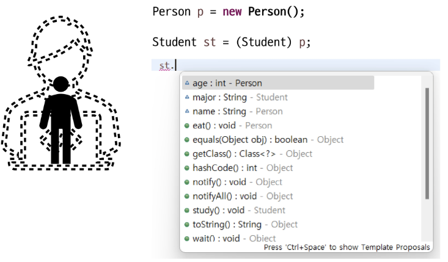
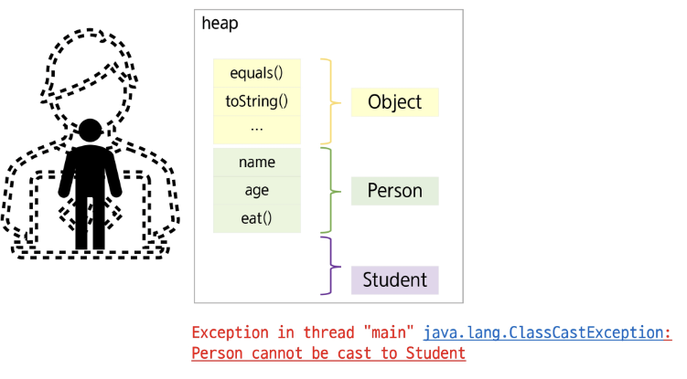
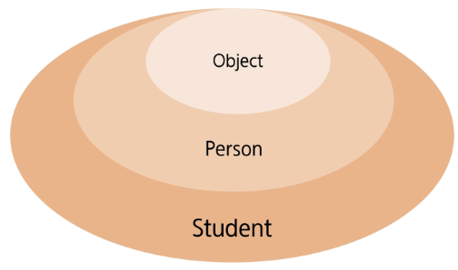
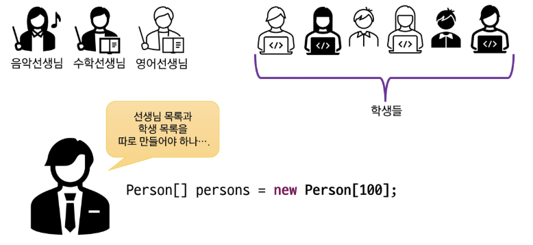
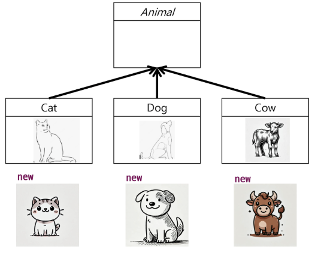
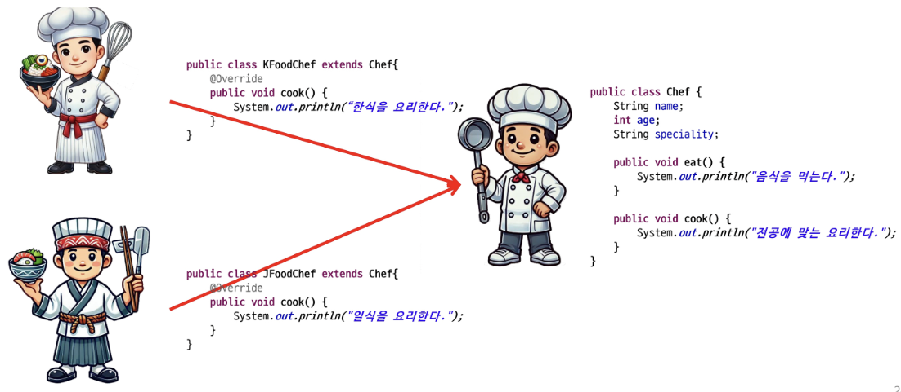

# 📚 목차
### 다형성 & 추상클래스
- 다형성
- 추상 클래스


---


# 🎯 학습 목표
✔ 다형성의 원리와 목적을 이해하고 설명할 수 있다.

✔ 업캐스팅·다운캐스팅을 적용해 부모 타입 참조로 자식 객체를 다루고, instanceof 검사로 타입 안정성을 확보할 수 있다.

✔ 동적 바인딩 과정을 설명하고, 오버라이딩된 메서드가 호출되는 흐름을 디버깅할 수 있다.

✔ 추상클래스를 선언·확장하여 공통 로직과 추상 메서드를 분리 설계할 수 있다.


---


# ✅ 다형성


## ◾ 다형성(Polymorphism)

실제 하나의 객체를 다양한 타입의 참조로 사용할 수 있음

다양한 유형의 여러 객체를 하나의 공통된 타입으로 참조할 수 있음

상속 관계에 있을 때 조상클래스 타입으로 자손 클래스의 객체를 참조할 수 있음

다양한 타입으로 참조하더라도 참조만 바뀔 뿐 실제 객체 자체(객체의 행위)는 변함이 없음


## ◾ 다형성의 장점

코드의 유연성 → 상위 클래스 또는 인터페이스 타입으로 다룰 수 있음

코드 재사용성 → 공통 동작을 상위클래스 또는 인터페이스에 정의하여 중복 코드를 제거

확장성 → 새로운 클래스 추가 시 기존 코드 없이도 쉽게 확장 가능

유지보수성 → 변경 사항이 상위 클래스나 인터페이스를 수정하면 되므로 용이


## ◾ 다형성의 모습

```java
public class Person {
    String name;
    int age;

    Person() {}

    Person(String name) {
        this.name = name;
    }

    public void eat() {
        System.out.println("음식을 먹는다.");
    }
}

public class Student extends Person{
    String major;
    public void study() {
        System.out.println("공부를 한다.");
    }
}
```


## ◾ 다형성의 특징
- 상속 관계에 있을 때 조상 클래스 타입으로 자손 클래스 객체 참조 가능


| 참조타입 변수    | 인스턴스 생성                         | O / X |
| ---------- | ------------------------------- | ----- |
| Person p   | `new Student("박싸피", 20, "수학");` |       |
| Student st | `new Student("이싸피", 25, "철학");` |       |
| Object ob  | `new Person("최싸피", 33);`        |       |
| Student st | `new Person("정싸피", 27);`        |       |


## ◾ JVM 메모리 (힙 영역)
```java
= new Student();
```



## ◾ 참조변수의 형 변환

---

---

---



## ◾ instanceof 연산자
- 참조변수가 참조하고 있는 인스턴스의 타입을 확인 하기 위해서 사용
- 결과를 boolean 으로 반환
- true 가 반환이 되면 해당 타입으로 형 변환 가능

```java
Person person = new Person();

if (person instanceof Student) {
    Student student = (Student)person;
    student.study();
}
java
코드 복사
// Java 16+ (패턴매칭 방법)
if(person instanceof Student student) {
    student.study();
}
```



## ◾ 참조 변수와 인스턴스 멤버의 관계
```java
class Parent {
    String x = "parent";

    public String method() {
        return "parent method!!!!";
    }
}

class Child extends Parent{
    String x = "child";

    @Override
    public String method() {
        return "child method!!!!";
    }
}

public class BindingTest {
    public static void main(String[] args) {
        Parent p = new Child();
        Child c = new Child();

        System.out.println(p.x);
        System.out.println(p.method());

        System.out.println(c.x);
        System.out.println(c.method());
    }
}
```


## ◾ 참조 변수와 인스턴스 멤버의 관계
- 상속관계에서 멤버변수가 중복이 되면 참조 변수 타입에 따라 연결이 달라짐

- 메서드가 중복될 때(오버라이딩), 참조 변수의 타입에 상관없이 항상 실제 인스턴스의 자식 클래스 메서드가 호출
→ **동적 바인딩**

- static 메서드는 참조변수 타입의 영향을 받기 때문에 이를 방지하고자 클래스 이름으로 메서드 호출(권장)


## ◾ 다형성의 활용 - 다른 타입의 객체를 다루는 배열



## ◾ 다형성의 활용 - 매개변수의 다형성
- 사람의 정보를 출력하려면…
```java
public String info(Teacher t) { /*내용 생략*/ }
public String info(Student st) { /*내용 생략*/ }
                ...

                 ⬇

public String info(Person p) { /*내용 생략*/ }

public void println(Object x) {
    String s = String.valueOf(x);
    synchronized (this) {
        print(s);
        newLine();
    }
}
```


---


# ✅ 추상 클래스

## ◾ 생각해보자



## ◾ 추상 클래스 정의
```java
public class KFoodChef {
    String name;
    int age;
    String speciality;

    public void eat() {
        System.out.println("음식을 먹는다.");
    }

    public void cook() {
        System.out.println("한식을 요리한다.");
    }
}
```
```java
public class JFoodChef {
    String name;
    int age;
    String speciality;

    public void eat() {
        System.out.println("음식을 먹는다.");
    }

    public void cook() {
        System.out.println("일식을 요리한다.");
    }
}
```


## ◾ 추상 클래스 정의

```java
public class KFoodChef extends Chef{
    @Override
    public void cook() {
        System.out.println("한식을 요리한다.");
    }
}
```

```java
public class JFoodChef extends Chef{
    @Override
    public void cook() {
        System.out.println("일식을 요리한다.");
    }
}
```

```java
public class Chef {
    String name;
    int age;
    String speciality;

    public void eat() {
        System.out.println("음식을 먹는다.");
    }

    public void cook() {
        System.out.println("전공에 맞는 요리한다.");
    }
}
```


## ◾ 추상 클래스 정의
```java
public class Chef {
    String name;
    int age;
    String speciality;

    public void eat() {
        System.out.println("음식을 먹는다.");
    }

    public void cook() {
        System.out.println("전공에 맞는 요리한다.");
    }
}

public class KFoodChef extends Chef{
    @Override
    public void cook() {
        System.out.println("한식을 요리한다.");
    }
}

public class JFoodChef extends Chef{
    @Override
    public void cook() {
        System.out.println("일식을 요리한다.");
    }
}

// main
public class ChefTest {
    public static void main(String[] args) {
        Chef[] chefs = new Chef[2];

        chefs[0] = new KFoodChef();
        chefs[1] = new JFoodChef();

        for(Chef chef : chefs) {
            chef.eat();
            chef.cook();
        }
    }
}
```

Console
```
코드 복사
음식을 먹는다.
한식을 요리한다.
음식을 먹는다.
일식을 요리한다.
```


## ◾ 추상 클래스 정의
- 한식요리사, 일식요리사 모두 cook 메서드를 가지고 있음
- 조상 클래스 Chef에 선언하고 각 자손 클래스에서 override 예정
- 사용되지 않는 Chef 클래스에 cook() 메서드가 필요한가?
```java
public class Chef {
    String name;
    int age;
    String speciality;

    public void eat() {
        System.out.println("음식을 먹는다.");
    }

    public void cook() {
        System.out.println("전공에 맞는 요리한다.");
    }
}
```
### 쓰이지 않는 코드를 지운다면?

```java
for(Chef chef : chefs) {
    chef.eat();
    //Chef의 cook 메서드를 제거 했을 때.
    if (chef instanceof KFoodChef) {
        KFoodChef k = (KFoodChef)chef;
        k.cook();
    } else if (chef instanceof JFoodChef) {
        ((JFoodChef) chef).cook();
    }
}
```

Console
```
코드 복사
음식을 먹는다.
한식을 요리한다.
음식을 먹는다.
일식을 요리한다.
```


## ◾ 추상 클래스 정의
- cook() 메서드는 자손 클래스에서 반드시 재정의해서 사용되기 때문에 조상의 구현이 무의미
- 메서드의 선언부만 남기고 구현부는 ;(세미콜론)으로 대체
- 구현부가 없으므로 abstract 키워드를 메서드 선언부에 추가
- 객체를 생성할 수 없는 클래스라는 의미로 클래스 선언부에 abstract를 추가

```java
public abstract class Chef {
    String name;
    int age;
    String speciality;

    public void eat() {
        System.out.println("음식을 먹는다.");
    }

    public abstract void cook();
}
```


## ◾ 추상 클래스 특징
- abstract 클래스는 상속 전용의 클래스
- 클래스에 구현부가 없는 메서드가 있으므로 **객체를 생성할 수 없음**
- 상위 클래스 타입으로 자식을 참조할 수는 있음

```java
//생성할 수 없음
Chef chef1 = new Chef();
//참조는 문제없음
Chef chef2 = new KFoodChef();
```

- 조상 클래스에서 상속 받은 abstract 메서드를 재정의 하지 않은 경우
    
    → 클래스 내부에 abstract 메서드가 있으므로 자식 클래스는 abstract 클래스 필수
- 다중 상속 불가


## ◾ 추상 클래스 사용 목적
- 공통적인 설계 강제 → 미완성의 메서드를 제공함으로써 구현을 강제 시킴
- 코드 재사용성 향상
- 일관성 유지 → 추상 메서드를 통해 하위 클래스가 동일한 동작을 가지도록 보장
- 다형성 지원 → 유연한 설계 가능


## ◾ 클래스와 추상클래스 비교

| 구분     | 클래스                                | 추상 클래스                                                                                                   |
| ------ | ---------------------------------- | -------------------------------------------------------------------------------------------------------- |
| 정의     | 구체적인 객체(인스턴스)를 생성할 수 있는 클래스        | 추상 메서드를 포함할 수 있는 클래스<br>객체(인스턴스) 생성이 불가능한 클래스<br>추상적 개념이어서 구체적인 객체 생성이 논리적으로 맞지 않는 클래스, 객체 생성이 필요 없는 클래스 |
| 객체 생성  | 가능                                 | 불가                                                                                                       |
| 추상 메서드 | 포함 불가                              | 추상 메서드를 포함할 수 있음<br>(추상 메서드 없어도 추상 클래스 생성 가능 – 객체 생성을 못하도록 강제)                                           |
| 상속     | 다른 클래스에 의해 상속될 수 있음                | 다른 클래스에 의해 상속되어 추상 메서드가 구현되어야만 객체 생성 가능(세부 구현 강제)<br>만약 하위 클래스가 추상 메서드를 모두 구현하지 않으면 하위 클래스도 추상 클래스       |
| 키워드    | class 키워드 사용                       | abstract class 키워드 사용                                                                                    |
| 목적     | 완전한 클래스를 정의하여, 해당 클래스로 객체를 생성하기 위함 | 객체 생성 방지,<br>공통된 기본 기능을 정의(코드 중복 제거),<br>하위 클래스에서 세부 구현을 강제                                              |
| 타입     | 타입으로 사용 가능                         | 타입으로 사용 가능                                                                                               |
