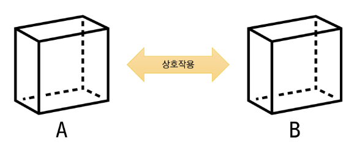
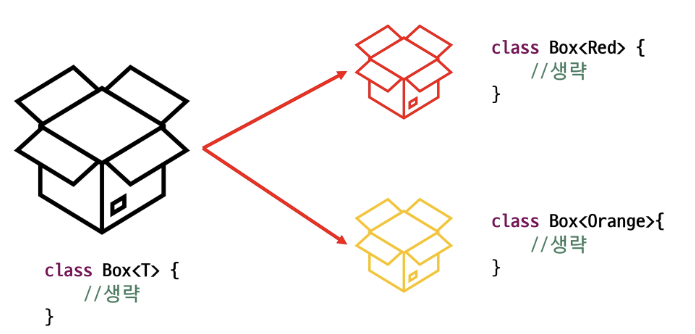

# 📚 목차
### 인터페이스 & 제네릭
- 인터페이스
- 제네릭


---


# 🎯 학습 목표
✔ 인터페이스의 역할과 목적을 설명하고, implements 키워드를 사용해 하나 이상의 인터페이스를 구현할 수 있다.

✔ 추상 메서드, default 메서드, static 메서드가 인터페이스에서 갖는 의미와 사용 시점을 구분하여 설계할 수 있다

✔ 다중 상속 문제 해결을 위한 인터페이스 우선순위 규칙을 이해하고 적용할 수 있다.

✔ 제네릭 타입의 개념을 이해하고, 제네릭 클래스·인터페이스·메서드를 사용할 수 있다.

✔ 타입 파라미터 제한과 와일드카드를 이용해 제네릭 API를 유연하면서도 안전하게 설계할 수 있다.


---


# ✅ 인터페이스

## ◾ 인터페이스(Interface)
- 다양한 분야에서 사용되는 용어
- 두 객체(시스템, 장치, 프로그램 등)간의 상호작용 방식을 정의하는 경계


---
- 두 객체가 서로 이해할 수 있는 언어와 규칙을 정의
- 복잡한 내부 동작을 숨기고, 사용자가 단순한 방식으로 접근하도록 도움
- 표준을 정하여 다른 구성 요소들이 같은 규칙을 따르도록 함
---
- 완벽히 추상화된 설계도
- 클래스와 유사하게 작성되지만 class 대신 interface 키워드 사용
- 기본적으로 모든 메서드가 추상 메서드 (Java 8 부터 default 메서드와 static 메서드 추가)
- 인터페이스 내에 선언된 메서드는 **public abstract**가 기본으로 생략 가능
- 인터페이스 내에 정의된 변수는 자동으로 **public static final**로 간주되며 생략 가능

```java
public interface 인터페이스이름 {
    public static final 타입 상수이름1 = 10;
    타입 상수이름 상수이름2 = 10;

    public abstract 반환형 메서드이름1([매개변수들]);
    반환형 메서드이름2([매개변수들]);
}
```


## ◾ 인터페이스의 구현
- 인터페이스는 인스턴스를 생성할 수 없음
- 클래스가 인터페이스를 구현할 경우 implements 키워드를 사용
- 클래스는 여러 개의 인터페이스를 다중 구현 가능
- 클래스는 인터페이스의 추상메서드를 모두 구현(재정의)해야 객체 생성 가능
    
    → 모두 구현하지 않으면 추상 클래스로 변경해야 함

```java
interface Shape {}

class Circle extends Shape {}   // X

class Circle implements Shape {}  // O
```


## ◾ 인터페이스의 다중 구현
```java
interface Swimmable {
    void swim();
}

interface Flyable {
    void fly();
}

class Duck implements Flyable, Swimmable {
    @Override
    public void fly() {
        System.out.println("오리 날다~!");
    }

    @Override
    public void swim() {
        System.out.println("오리 수영~!");
    }
}
```


## ◾ 인터페이스 상속
- extends 키워드를 이용하여 상속
- 클래스와 달리 인터페이스는 다중 상속이 가능 → 메서드 구현부가 없음

```java
interface Movable {
    public abstract void move();
}

interface Cookable {
    public abstract void cook();
}

interface Chef extends Movable, Cookable {
}

class Robot implements Chef {

    @Override
    public void move() { // 생략 }

    @Override
    public void cook() { // 생략 }
}
```


## ◾ default 메서드 (Java 8+)
- 인터페이스에 구현부가 있는 메서드를 작성할 수 있음
- 메서드 앞에 default 라는 키워드를 작성 해야함
- public 접근제한자를 사용해야 하며 public은 생략 가능
- 클래스에서 인터페이스의 default 메서드를 재정의할 수 있음

```java
public interface MyInterface {
    void abstractMethod();

    default void defaultMethod() {
        System.out.println("This is a default method.");
    }
}
```

- 개발 도중 interface를 추가해야 하는 상황에서 default 메서드를 통해 문제 상황을 줄일 수 있음
    
    → 구현체에서 구현할 필요가 없음

### 💡 default method 충돌 해결
- 여러 인터페이스의 디폴트 메서드 간의 충돌
    - 구현 클래스에서 오버라이딩
- 디폴트 메서드와 조상 클래스의 메서드 간의 충돌
    - 자동으로 조상 클래스 상속


## ◾ 정적(static) 메서드 (Java 8+)
- 인터페이스 내에 선언된 static 메서드는 클래스의 static 메서드와 사용 방법이 동일함
- 인터페이스 이름으로 메서드에 접근하여 사용
- 특정 인터페이스에 관련된 유틸리티 메서드나 헬퍼 메서드를 제공할 수 있음
- static 메서드는 인터페이스를 구현한 클래스에서 상속되거나 재정의할 수 없음

```java
public interface MyInterface {

    static void staticMethod() {
        System.out.println("This is a static method in the interface.");
    }
}
```


## ◾ private 메서드 (Java 9+)
- 인터페이스 내부에서만 사용되는 헬퍼 메서드
- 디폴트 메서드, 정적 메서드에서 반복되는 로직 분리 후 작성
- 외부에서 접근하지 못하도록 숨김
- 재사용성 증가
- static 키워드를 사용할 수 있음

```java
interface Calculator {
    default void calculate(int a, int b) {
        int sum = add(a, b);
    }

    private int add(int a, int b) {
        return a + b;
    }
}
```


## ◾ 인터페이스와 다형성
- 인터페이스를 구현한 클래스로 만든 객체는 해당 인터페이스 타입으로 참조할 수 있음
- **동적 바인딩** : 런타임 시점에서는 실제 객체의 메서드가 호출

```java
interface Chef {
    void cook();
}

class KFoodChef implements Chef {

    @Override
    public void cook() {
        System.out.println("한식을 요리한다.");
    }
}

public static void main(String[] args) {
    Chef chef = new KFoodChef();
}
```


## ◾ 인터페이스의 필요성
| 인터페이스 특징               | 내용                                                 |
| ---------------------- | -------------------------------------------------- |
| 표준화 처리 가능              | 여러 클래스들이 동일한 인터페이스를 구현하여 일관된 방식으로 동작 처리            |
| 개발 기간 단축 가능            | 시스템 구조를 먼저 설계하고, 각 부분을 독립적으로 개발하여 개발 기간 단축         |
| 서로 관계가 없는 클래스 간의 관계 형성 | 관련이 없는 클래스들이 동일한 인터페이스를 구현하여 공통된 동작 공유             |
| 간접적인 클래스 사용으로 모듈 교체 용이 | 구체적인 클래스에 의존하지 않고 인터페이스를 통해 클래스 사용, 모듈 교체 용이       |
| 독립적 프로그래밍 가능           | 각 클래스가 독립적으로 개발 및 테스트 가능, 코드 재사용성과 유지보수성 향상        |
| 다형성 지원                 | 같은 인터페이스를 구현하는 객체들을 일관되게 처리하여 코드 유연성과 확장성 증가       |
| 설계의 유연성 제공             | 클래스 간의 강한 결합을 피하여 설계의 유연성 증가, 시스템 변경 및 확장 시 영향 최소화 |


## ◾ 클래스와 인터페이스 비교
|       | 클래스                                      | 인터페이스                                                                                                     |
| ----- | ---------------------------------------- | --------------------------------------------------------------------------------------------------------- |
| 특징    | class 키워드를 사용하여 정의<br>필드와 메서드, 생성자로 이루어짐 | interface 키워드를 사용하여 정의<br>static 상수와 추상메서드(메서드 선언부)로 이루어짐<br>public static final 생략<br>public abstract 생략 |
| 관계    | 인터페이스를 구현함                               | 클래스에 의해 구현됨                                                                                               |
| 멤버 변수 | 선언 가능                                    | 상수만 가능                                                                                                    |
| 다중 상속 | 클래스는 하나의 클래스만 상속 가능                      | 인터페이스는 여러 개의 인터페이스 상속 가능<br>(구현부가 없으므로 헷갈리지 않음)                                                           |
| 다중 구현 | 클래스는 여러 개의 인터페이스를 다중으로 구현(implements) 가능 |                                                                                                           |
| 인스턴스  | 생성 가능                                    | 생성 불가                                                                                                     |
| 타입    | 타입으로 사용 가능                               | 타입으로 사용 가능                                                                                                |
## ◾ 추상클래스와 인터페이스 비교
|        | 추상 클래스                                                                                  | 인터페이스                                                                                                                   |
| ------ | --------------------------------------------------------------------------------------- | ----------------------------------------------------------------------------------------------------------------------- |
| 객체생성   | 불가                                                                                      | 불가                                                                                                                      |
| 일반 메서드 | 가능                                                                                      | 불가                                                                                                                      |
| 일반 필드  | 가능                                                                                      | 불가(static 상수만 가능)                                                                                                       |
| 메서드    | abstract를 붙여야만 추상 메서드                                                                   | 모든 메서드는 추상 메서드                                                                                                          |
| 사용     | - 추상적인 클래스의 성격을 가질 때<br>(일부 메서드만 미완성인 설계도)<br>- 서로 유사한 클래스 사이에 코드를 공유하고 싶을 때            | - 서로 관련 없는 클래스 사이에 공통으로 적용되는 인터페이스를 구현하기를 원할 때, ex) Comparable, Serializable<br>- 객체(클래스)의 어떤 기능을 구현하고 있다는 약속의 성격이 있을 때 |
| 공통점    | - 특정 기능의 구현을 강제하고 싶을 때<br>- 다형성 가능<br>- 보다 추상화된 설계도에 의존하는 코드를 작성하고 싶을 때<br>- 타입으로 사용 가능 |                                                                                                                         |


---


# ✅ 제네릭


## ◾ 생각해보자


## ◾ 제네릭 (만능 상자)
```java
public class GlassJar {
    private Object content;

    public void setContent(Object content) {
        this.content = content;
    }

    public Object getContent() {
        return content;
    }
}
```
```
넣을 때 Good
꺼낼 때 Bad
```


## ◾ 제네릭 (타입 상자)
```java
public class GlassJar<T> {
    private T content;

    public void setContent(T content) {
        this.content = content;
    }

    public T getContent() {
        return content;
    }
}
```


## ◾ 제네릭
- 다양한 데이터 타입을 처리할 수 있는 클래스, 인터페이스, 메서드를 작성하는 기법

- 컴파일 시점에서 데이터 타입을 지정할 수 있음 → 타입 안정성 제공

- 하나의 코드로 여러 타입에 대해 동작하게 설계 가능 → 코드 재사용성 증가

- 데이터 타입을 지정하였으므로 불필요한 타입 캐스팅을 제거할 수 있음


## ◾ 제네릭 클래스
- 클래스 정의 시 타입 매개변수를 사용하여 다양한 타입을 처리할 수 있는 클래스

- 타입 매개변수는 `<T>` 안에 적는다




## ◾ 제네릭 클래스 선언
- 클래스 또는 인터페이스 선언 시 <> 에 타입 파라미터 표시
```java
public class ClassName<T> {}
public interface InterfaceName<T> {}
```

- 타입 파라미터 → 특별한 의미의 알파벳 보다는 단순히 임의의 참조형 타입을 말함
    - T : reference Type
    - E : Element
    - K : Key
    - V : Value


## ◾ 제네릭 클래스 객체 생성
- 변수와 생성 쪽의 타입은 반드시 일치해야 함 (상속관계에 있어도 마찬가지)
```java
Box<Student> box = new Box<Student>();   // O
Box<Person> box = new Box<Student>();    // X
```

- 추정이 가능한 경우 타입 생략 가능 (생성자 쪽 생략 가능 Java 7+)
```java
Box<Student> box = new Box<>();
```
- 제네릭 타입을 지정하지 않고 생성이 가능하지만 권장 X (자동으로 T는 Object)


## ◾ 제네릭 클래스 실습
- Object를 속성으로 사용 → 모든 객체 수용가능
```java
class Box {
    private Object obj;

    public Object getObj() {
        return obj;
    }

    public void setObj(Object obj) {
        this.obj = obj;
    }
}
```
```java
public class BoxTest {

    public static void main(String[] args) {
        Box box = new Box();
        box.setObj("Hello");
        box.setObj(new Person());

        Object obj = box.getObj();

        if (obj instanceof Person) {
            Person p = (Person) obj;
            System.out.println("사람");
        } else if (obj instanceof String) {
            String str = (String) obj;
            System.out.println("문자열");
        } else {
            System.out.println("알수 없음");
        }
    }
}
```


## ◾ 제네릭 클래스 실습
- 지정 타입을 속성으로 사용 → 타입 선언 시 결정
```java
class Box<T> {
    private T obj;

    public T getObj() {
        return obj;
    }

    public void setObj(T obj) {
        this.obj = obj;
    }
}
```
```java
public class BoxTest {

    public static void main(String[] args) {
        Box<Person> box1 = new Box<>();
        box1.setObj(new Person());
        Person p = box1.getObj();
        System.out.println("사람");

        Box<String> box2 = new Box<>();
        box2.setObj("Hi");
        String str = box2.getObj();
        System.out.println("문자열");
    }
}
```


## ◾ 제네릭 메서드
- 타입 파라미터를 사용하는 메서드
- 클래스의 타입 파라미터와는 별개로, 메서드 레벨에서 제네릭 타입을 정의하고 사용할 수 있음
- 제네릭 메서드는 메서드의 매개변수나 반환 타입을 타입 파라미터로 지정하여 다양한 타입을 처리
- 제네릭 메서드를 정의하려면 메서드의 반환 타입 앞에 타입 파라미터를 선언

```java
public <T> void printClassName(T item) {
    System.out.println("Item type: " + item.getClass().getName());
}
```

- 메서드를 호출할 때는 타입 파라미터를 생략 가능(컴파일러가 추론)할 수도 있지만 명시할 수도 있음
- 명시할 때는 메서드명 앞 .(dot)연산자 사이에 <타입>을 표시
```java
integerBox.printClassName("Test String");
integerBox.<Double>printClassName(12.5);
```


## ◾ 한정된 타입 매개변수
- 제네릭 클래스를 정의할 때
- 모든 종류의 타입에 대해서 작성하는 것이 아니라 특정한 종류의 타입에 대해서만 작성하고 싶은 경우
- 구체적인 타입의 제한이 필요할 때 extends 키워드를 사용할 수 있음
- 타입 파라미터를 한정할 때는 하한 경계(super)의 사용이 불가하며, 상한 경계(extends)만 사용 가능

```java
class Box<T extends Person> {
    private T obj;

    public T getObj() { return obj; }

    public void setObj(T obj) { this.obj = obj; }
}
```

- 클래스가 아닌 인터페이스로 제한할 경우도 extends 키워드 사용
- 클래스와 함께 인터페이스 제약 조건을 이용할 경우 & 로 연결


## ◾ 와일드 카드
- 제네릭 클래스 인스턴스 변수의 참조 타입을 작성할 때
- 와일드 카드로서 문자 ?를 사용
- 불특정 타입을 나타내기 위해 사용하는 특수한 타입 매개변수
- 제네릭 클래스에 다형성 적용 가능

| 종류           | 표현                         | 설명                    |
| ------------ | -------------------------- | --------------------- |
| 제한없는 와일드 카드  | `GenericType<?>`           | 타입에 제한이 없음            |
| 상한 경계 와일드 카드 | `GenericType<? extends T>` | T와 T를 상속받은 타입들만 사용 가능 |
| 하한 경계 와일드 카드 | `GenericType<? super T>`   | T와 T의 조상 타입만 사용 가능    |
