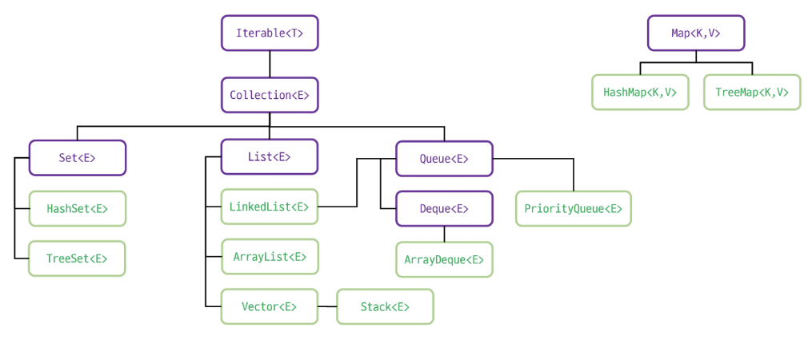
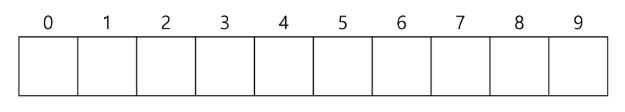
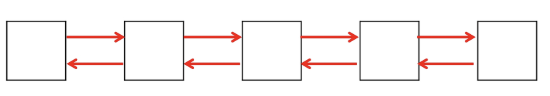

# 📚 목차
### 컬렉션 프레임워크1
- 컬렉션 프레임워크
- List 계열
- Set 계열

---

# 🎯 학습 목표
✔ 컬렉션 프레임워크의 구조와 핵심 인터페이스를 이해하고, 자료구조 선택 기준을 설명할 수 있다.

✔ List 계열의 특징을 비교하여 상황에 맞게 선택·사용할 수 있다.

✔ Set 계열의 특징을 비교하여 상황에 맞게 선택·사용할 수 있다.

---

# ✅ 컬렉션 프레임워크

## ◾ 자료 구조(Data Structure)
- 데이터에 효율적으로 접근하기 위해 선택되는 데이터의 조직 및 저장 형식
- 데이터 값들의 모음, 이들 간의 관계, 데이터에 적용될 수 있는 연산의 모음 

## ◾ 자료 구조의 분류
- 정적 자료구조(Static Data Structure): 크기가 고정된 자료 구조 (예: 배열)
- 동적 자료 구조 (Dynamic Data Structure): 크기가 변할 수 있는 자료 구조 (예: 리스트, 스택, 큐)

## ◾ 료 구조의 선택 기준
- 데이터 접근 속도
- 메모리 사용 효율성
- 삽입 및 삭제의 효율성
- 순서 유지 여부
- 중복 데이터 허용 여부

## ◾ 컬렉션 프레임워크
- 표준화된 데이터 구조와 이를 처리하기 위한 클래스 및 인터페이스의 집합
- 데이터를 동적 크기로 관리하고, 삽입, 삭제, 검색, 정렬 등을 효율적으로 처리할 수 있음
- 제네릭을 지원하여 타입 안정성 보장
- 표준화된 메서드 제공

## ◾ 컬렉션 주요 인터페이스 및 구현 클래스

## ◾ Collection interface
| Modifier and Type      | Method                                | Description                                                                                                                                |
| ---------------------- | ------------------------------------- | ------------------------------------------------------------------------------------------------------------------------------------------ |
| boolean                | add(E e)                              | Ensures that this collection contains the specified element (optional operation).                                                          |
| boolean                | addAll(Collection<? extends E> c)     | Adds all of the elements in the specified collection to this collection (optional operation).                                              |
| void                   | clear()                               | Removes all of the elements from this collection (optional operation).                                                                     |
| boolean                | contains(Object o)                    | Returns true if this collection contains the specified element.                                                                            |
| boolean                | containsAll(Collection<?> c)          | Returns true if this collection contains all of the elements in the specified collection.                                                  |
| boolean                | equals(Object o)                      | Compares the specified object with this collection for equality.                                                                           |
| int                    | hashCode()                            | Returns the hash code value for this collection.                                                                                           |
| boolean                | isEmpty()                             | Returns true if this collection contains no elements.                                                                                      |
| Iterator<E>            | iterator()                            | Returns an iterator over the elements in this collection.                                                                                  |
| default Stream<E>      | parallelStream()                      | Returns a possibly parallel Stream with this collection as its source.                                                                     |
| boolean                | remove(Object o)                      | Removes a single instance of the specified element from this collection, if it is present (optional operation).                            |
| boolean                | removeAll(Collection<?> c)            | Removes all of this collection's elements that are also contained in the specified collection (optional operation).                        |
| default boolean        | removeIf(Predicate<? super E> filter) | Removes all of the elements of this collection that satisfy the given predicate.                                                           |
| boolean                | retainAll(Collection<?> c)            | Retains only the elements in this collection that are contained in the specified collection (optional operation).                          |
| int                    | size()                                | Returns the number of elements in this collection.                                                                                         |
| default Spliterator<E> | spliterator()                         | Creates a Spliterator over the elements in this collection.                                                                                |
| default Stream<E>      | stream()                              | Returns a sequential Stream with this collection as its source.                                                                            |
| Object[]               | toArray()                             | Returns an array containing all of the elements in this collection.                                                                        |
| default <T> T[]        | toArray(IntFunction<T[]> generator)   | Returns an array containing all of the elements in this collection, using the provided generator function to allocate the returned array.  |
| <T> T[]                | toArray(T[] a)                        | Returns an array containing all of the elements in this collection; the runtime type of the returned array is that of the specified array. |

- 아래의 링크를 통해 문서를 확인해보자!

https://docs.oracle.com/en/java/javase/17/docs/api/java.base/java/util/Collection.html

---

# ✅ List 계열

## ◾ List 계열 컬렉션
- 순서가 있는 데이터 집합
- 중복 데이터 허용 (저장된 순서 유지)
- 크기가 고정된 배열과 달리 크기가 동적으로 변함
- 구현 클래스
    - ArrayList
    - LinkedList
    - Vector

https://docs.oracle.com/en/java/javase/17/docs/api/java.base/java/util/List.html

## ◾ ArrayList
- 배열 기반의 구현
- 인덱스를 통한 접근이 빠름
- 데이터 삽입, 삭제가 빈번한 경우 성능 저하 (많은 데이터 이동)
- 데이터의 조회가 많고, 삽입/삭제가 적은 경우 유용

    

## ◾ LinkedList
- 노드 기반의 구현
- 각 노드가 이전 노드와 다음 노드의 참조를 포함
- 데이터 삽입, 삭제가 빠름
- 데이터의 삽입/삭제가 많고 조회가 많이 없는 경우 유용

    

## ◾ List 주요 메서드
| 메서드                 | 내용                  |
| ------------------- | ------------------- |
| add(E e)            | 데이터 추가 (마지막 위치)     |
| add(int index, E e) | 데이터 추가 (index 위치)   |
| get(int index)      | 데이터 반환 (index 위치)   |
| set(int index, E e) | 데이터 수정 (index 위치)   |
| remove(int index)   | 데이터 삭제 (index 위치)   |
| remove(Object o)    | 데이터 삭제 (특정 데이터)     |
| size()              | 컬렉션의 크기를 반환         |
| isEmpty()           | 컬렉션이 비어 있는지 확인      |
| contains(Object o)  | 특정 데이터가 포함되어 있는지 확인 |
| indexOf(Object o)   | 특정 데이터의 첫 번째 위치 반환  |
| clear()             | 컬렉션의 모든 요소 삭제       |

---

# ✅ Set 계열

## ◾ Set 계열 컬렉션
- 중복 데이터 허용하지 않음
- 순서 보장하지 않음
- null 값 허용 (한 개 저장)
- 데이터의 고유성을 보장하기 위해 사용
- 구현 클래스
    - HashSet
    - LinkedHashSet
    - TreeSet

https://docs.oracle.com/en/java/javase/17/docs/api/java.base/java/util/Set.html

## ◾ HashSet
- 데이터의 저장 순서를 유지하지 않음
- HashMap 기반으로 동작 → 빠른 추가, 삭제, 검색이 가능
- null 값 하나 저장할 수 있음

> **Hash** : 데이터를 빠르게 저장하고 검색하기 위해 사용하는 특별한 값 또는 기법
→ 데이터를 고유한 숫자 값으로 변환하는 과정

## ◾ LinkedHashSet
- 데이터의 저장 순서를 유지함
- LinkedHashMap 기반으로 동작 → 빠른 추가, 삭제, 검색이 가능
- 이중 연결 리스트를 이용하여 관리 (약간 더 느림)
- null 값 하나 저장할 수 있음

## ◾ TreeSet
- 데이터가 정렬된 상태로 유지 (기본 오름차순)
- 사용자 정의 정렬이 필요한 경우 Comparator를 사용할 수 있음
- 내부적으로 이진 탐색 트리(레드-블랙 트리 [균형 유지]) 구조를 사용
- null 값 저장 불가

## ◾ Set 주요 메서드
| 메서드                | 내용                         |
| ------------------ | -------------------------- |
| add(E e)           | 데이터 추가 (중복인 경우 추가 X)       |
| remove(Object o)   | 데이터 삭제 (특정 데이터)            |
| size()             | Set의 크기를 반환 (요소 수)         |
| isEmpty()          | Set이 비어 있는지 확인             |
| contains(Object o) | 특정 데이터가 포함되어 있는지 확인        |
| clear()            | 컬렉션의 모든 요소 삭제              |
| iterator()         | Set을 순회할 수 있는 Iterator를 반환 |
