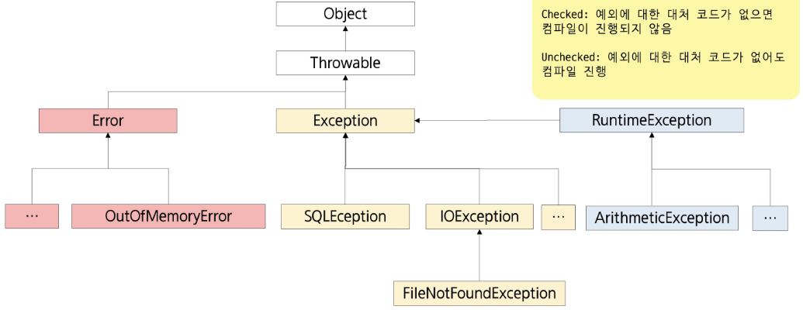

# 📚 목차
### 예외처리
- 예외처리
- throws 활용
- 사용자 정의 예외처리


---


# 🎯 학습 목표
✔ 예외와 오류의 차이를 이해하고, 자바의 Throwable 계층 구조를 설명할 수 있다.

✔ Checked 예외가 컴파일 단계에서 강제되는 이유와, Unchecked 예외가 발생 시점에서 처리되는 특성을 비교하여 설계 의사결정을 내릴 수 있다.

✔ try-catch-finally 구문을 작성하여 예외를 포착·복구할 수 있다.

✔ 다중 예외처리에 대해 이해하고 순서 규칙을 적용할 수 있다.

✔ throws 키워드를 이용해 예외 책임을 전달하고, Stack Trace를 분석해 예외 발생위치를 추적할 수 있다.

✔ 사용자 정의 예외 클래스를 설계하여 도메인 특화 오류 상황을 명확히 표현하고, 예외 메시지 등을 커스터마이징 할 수 있다.


---


# ✅ 예외처리 (Exception Handling)

## ◾ 프로그램의 오류(에러, Error)
- 어떤 원인에 의해 오동작 하거나 비정상적으로 종료되는 경우


## ◾ 발생 시점에 따른 구분
| 에러                          | 내용                                                                                   |
| --------------------------- | ------------------------------------------------------------------------------------ |
| 컴파일 에러 (compile-time error) | 컴파일 도중 컴파일러가 발견하는 오류                                                                 |
| 런타임 에러 (runtime error)      | 컴파일은 성공적으로 진행되었으나, 프로그램 실행 중에 발생하는 오류                                                |
| 논리적 에러 (logical error)      | 컴파일도 되고 프로그램도 실행되었으나, 프로그램이 의도대로 동작하지 않는 오류<br>프로그램이 정상적으로 실행되고 종료되었지만 결과가 예상과 다른 경우 |


## ◾ 에러와 예외
- **에러(Error)** : 발생하면 복구할 수 없는 심각한 오류

    - **An Error is a subclass of Throwable that indicates serious problems that a reasonable application should not try to catch.**
    - 메모리 부족
    - 스택 오버 플로우
    - …

- **예외(Exception)** : 프로그래머가 적절한 코드를 통해 대비할 수 있는 오류
    - **An exception is an event, which occurs during the execution of a program, that disrupts the normal flow of the program's instructions.**
    - 클래스 형 변환 실패
    - 파일 읽기 실패
    - …


## ◾ 예외처리(Exception Handling)
- 예외 발생 시 프로그램의 비 정상 종료를 막고 정상적인 실행 상태를 유지하는 것
- 예외의 감지 및 예외 발생 시 동작할 코드 작성하고, 사용자에게 적절한 메시지 제공


## ◾ 예외 클래스의 계층



## ◾ 예외의 계열
- RuntimeException 클래스들
    - 프로그래머의 실수로 발생하는 계열
    - unchecked exception
    - 대처 코드가 없어도 컴파일 문제 x

- Exception 클래스들
    - 사용자의 실수 등 외적인 요인에 의해 발생하는 계열
    - checked exception
    - 대처 코드가 없으면 컴파일 진행 x


## ◾ 예외 발생 예시
```java
public static void main(String[] args) {
    int[] nums = { 10 };
    System.out.println(nums[2]);
}
```
```cpp
Exception in thread "main"
java.lang.ArrayIndexOutOfBoundsException: 2
```


## ◾ 예외 처리 키워드
### 직접 처리
- `try {}` : 예외가 발생할 가능성이 있는 코드를 포함하는 블록
- `catch (예외매개변수) {}` : 예외가 발생했을 때 실행할 코드 블록
- `finally {}` : 예외 발생 여부와 상관없이 항상 실행되는 코드 블록

### 간접 처리(처리 위임)
- `throws` : 메서드 선언부에 사용되며, 메서드에서 발생 가능한 예외를 호출자에게 전달

### 예외를 직접 발생시킬 때
- `throw` : 예외를 명시적으로 발생시키는 키워드


## ◾ 예외처리 (try ~ catch 구문)
- 프로그램 실행 시 발생할 수 있는 예외에 대한 대비코드 작성
- 프로그램의 비정상적인 종료를 막고, 정상적인 상태를 유지할 수 있도록 함
```java
try {
    // 예외가 발생할 수 있는 코드
} catch (SomeException e) {
    // 예외가 발생했을 때 처리할 코드
}
```
- 중괄호(블록) 생략 불가능
- 중첩 된 예외처리 : 블록 안에 또 다른 try ~ catch 구문이 올 수 있음


## ◾ 예외처리 (try ~ catch 구문)
```java
try {
    // (1) 예외가 발생할 수 있는 코드
    // (2) 정상코드
} catch (SomeException e) {
    // (3) 예외가 발생했을 때 처리할 코드
}
// (4) 일반코드
```


## ◾ 다중 예외처리
- try 블록에서 여러 종류의 예외가 발생할 경우
- 하나의 try 블록에 여러 개의 catch 블록 추가 가능

```java
try {
    // exception이 발생할 만한 코드
} catch (XXException e) {
    // XXException 발생 시 처리 코드
} catch (YYException e) {
    // YYException 발생 시 처리 코드
}
```
```java
try {
    // exception이 발생할 만한 코드
} catch (XXException | YYException e) {

    // 필요시 instanceof를 통해 나누어 작성

    // XXException 발생 시 처리 코드
    // YYException 발생 시 처리 코드
}
```


## ◾ 중 예외처리 유의 사항
- 예외 객체에 해당하는 catch 문장을 찾을 때는 다형성이 적용됨
- 상위 타입의 예외가 먼저 선언되는 경우 뒤에 등장하는 catch 블록은 동작할 기회가 없음
- 상속 관계가 없는 경우는 무관
- 상속 관계에서는 작은 범위(자식)에서 큰 범위(조상)순으로 정의

```java
try {
    // exception이 발생할 만한 코드
} catch (XXException e) {
    // XXException 발생 시 처리 코드
} catch (YYException e) {
    // YYException 발생 시 처리 코드
} catch (Exception e) {
    // Exception 발생 시 처리 코드
}
```
```java
try {
    // exception이 발생할 만한 코드
} catch (Exception e) {
    // Exception 발생 시 처리 코드
} catch (YYException e) {
    // 동작 기회가 없음
} catch (XXException e) {
    // 동작 기회가 없음
}
```


## ◾ Exception 인스턴스의 주요 메서드
- `getMessage()` : 발생된 예외에 대한 구체적인 메시지를 반환
- `printStackTrace()` : 예외 발생 당시의 호출 스택(Call Stack)을 출력

```pgsql
java.lang.ClassNotFoundException: Some Class
    at java.net.URLClassLoader.findClass(Unknown Source)
    at java.lang.ClassLoader.loadClass(Unknown Source)
    at sun.misc.Launcher$AppClassLoader.loadClass(Unknown Source)
    at java.lang.ClassLoader.loadClass(Unknown Source)
    at java.lang.Class.forName0(Native Method)
    at java.lang.Class.forName(Unknown Source)
    at exception.CheckedThrowsTest.method2(CheckedThrowsTest.java:19)
    at exception.CheckedThrowsTest.method1(CheckedThrowsTest.java:15)
    at exception.CheckedThrowsTest.main(CheckedThrowsTest.java:7)
```


## ◾ finally 구문
- finally는 예외 발생 여부와 상관 없이 언제나 실행
```java
try {
    // 예외가 발생할 가능성이 있는 코드
} catch (SomeException e) {
    // 예외 처리 코드
} finally {
    // 예외 상관없이 항상 수행해야 하는 코드
}
```
- 예외 발생시 → try - catch - finally 순으로 코드 실행
- 예외 미발생시 → try - finally 순으로 코드 실행
- 중간에 return 이 있어도 finally 블록 수행 후 반환


## ◾ 자동 자원 반납 구문 (try with resources)
- 자원 등을 반납할 때 finally에서 close()를 통해 반납을 주로 함
- 코드가 지저분해 지고 다른 예외상황을 발생시킬 수 있음
```java
FileInputStream fis = null;
try {
    fis = new FileInputStream("test.txt");
} catch (IOException e) {
    e.printStackTrace();
} finally {
    try {
        if (fis != null)
            fis.close();
    } catch (IOException e) {
        e.printStackTrace();
    }
}
```


## ◾ 자동 자원 반납 구문 (try with resources)
- `try ()` → 괄호 안에 객체를 생성하는 코드를 작성하면, 해당 객체는 close()를 호출하지 않아도 블록을 벗어 나는 순간 close()가 호출됨
- 해당 객체의 클래스가 AutoCloseable 이라는 인터페이스를 구현해야 함
```java
try (FileInputStream fis = new FileInputStream("test.txt")) {
    // 코드생략
} catch (IOException e) {
    e.printStackTrace();
}
```


---


# ✅ throws 활용


## ◾ 메서드에서 예외 던지기
- 메서드 선언부에 throws 키워드를 사용하여 예외 작성
- 예외가 여러 개인 경우 ,(Comma)를 이용하여 나열
- 메서드가 예외를 처리하는 것이 아닌 전달
- 조상 타입의 예외로 처리 가능


## ◾ checked exception 과 throws
```java
public static void main(String[] args) {
    CheckedThrowsTest et = new CheckedThrowsTest();
    try {
        et.method1();
    } catch (ClassNotFoundException e) {
        System.out.printf("exception handling: %s%n", e.getMessage());
    }
    System.out.println("프로그램 종료");
}

public void method1() throws ClassNotFoundException {
    method2();
}

public void method2() throws ClassNotFoundException {
    Class.forName("Some Class");
}
```
### 🚨 ClassNotFoundException 발생


## ◾ runtime exception과 throws
```java
public static void main(String[] args) {
    RuntimeThrowsTest et = new RuntimeThrowsTest();
    try {
        et.method1();
    } catch (ArithmeticException e) {
        System.out.printf("예외 처리: %s%n", e.getMessage());
    }
    System.out.println("프로그램 종료");
}

public void method1() {
    method2();
}

public void method2() {
    int i = 1 / 0;
}
```

### 🚨 ArithmeticException 발생


## ◾ 메서드 재정의와 throws
- 메서드 재정의 시 조상클래스 메서드가 던지는 예외보다 부모 예외를 던질 수 없음

```java
class Parent {
    void methodA() throws IOException { }
    void methodB() throws ClassNotFoundException { }
}

public class Child extends Parent {
    @Override
    void methodA() throws FileNotFoundException { }

    @Override
    void methodB() throws Exception { }
}
```


---


# ✅ 사용자 정의 예외처리


## ◾ 사용자 정의 예외
- 기존에 정의된 예외 이외에 사용자가 직접 정의 예외를 작성할 수 있음
- 대부분 Exception 또는 RuntimeException 클래스를 상속받아 작성
    - checked exception 활용 : 명시적 예외 처리 또는 throws 필요
    
    (코드는 복잡해지지만 처리, 누락 등 오류 발생 가능성은 down)

    - runtime exception 활용 : 묵시적 예외 처리 가능
    
    (코드가 간결해지지만 예외 처리, 누락 가능성 발생)
---
#### 💡 사용자 정의 예외를 사용하면
- 동일한 상황에서 예외 객체 재사용
- 필요한 추가 정보, 기능 활용 가능
- throws 를 이용하여 return을 사용하지 않아도 됨


## ◾ 사용자 정의 예외
- 직접 사용자 정의 예외를 작성하여 실습해보자.
- 과일 판매 시나리오
```java
public class FruitNotFoundException extends Exception {
    public FruitNotFoundException(String name) {
        super(name + "에 해당하는 과일은 없습니다.");
    }
}

public class FruitNotFoundRuntimeException extends RuntimeException {
    public FruitNotFoundRuntimeException(String name) {
        super(name + "그런 과일은 런타임시점에 없습니다.");
    }
}
```