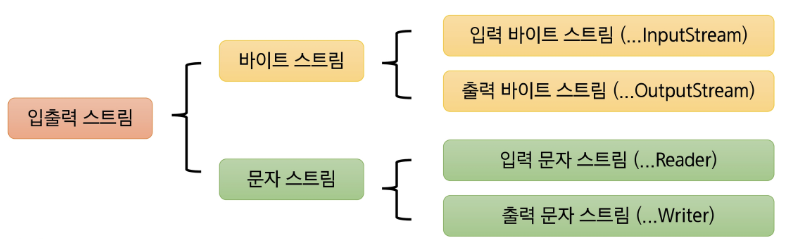
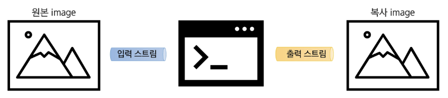
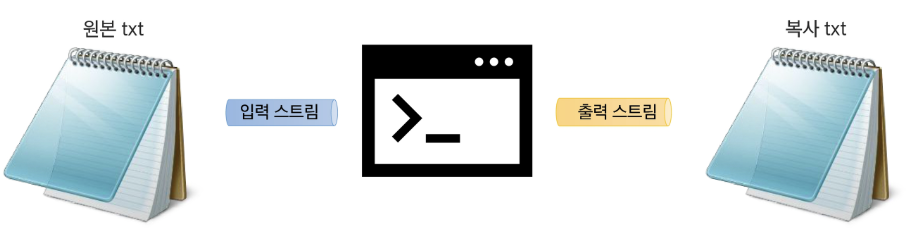
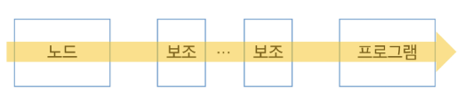
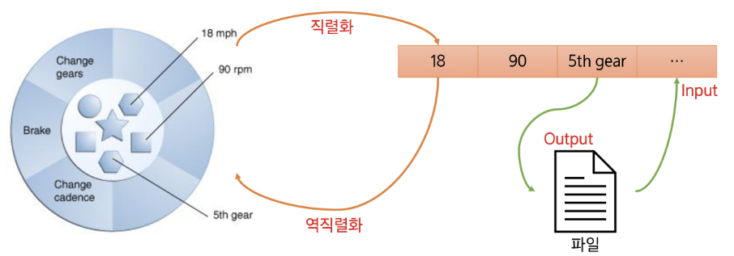

# 📚 목차
### 파일 입출력
- File 클래스
- 입출력과 스트림
- 보조 스트림
- 객체 직렬화


---


# 🎯 학습 목표
✔ Java.io.File 클래스를 사용하여 작업을 수행할 수 있다.

✔ 바이트 스트림과 문자 스트림 계층 구조를 설명하고, 상황에 따라 적절한 스트림을 선택해 파일을 읽고 쓸 수 있다.

✔ 보조 스트림을 이해하고 조합하여 성능과 편의성을 향상할 수 있다.

✔ 객체 직렬화 개념과 목적을 설명하고, Serializable 인터페이스를 활용할 수 있다.


---


# ✅ File 클래스

## ◾ 파일(File) 클래스
- 파일 및 디렉토리를 객체로서 관리
- 특정 파일 또는 디렉토리에 대응하는 객체를 생성
- 파일 및 디렉토리에 대한 정보를 관리하고 조작할 수 있는 다양한 메서드를 제공
- 파일 객체의 생성: 경로를 문자열로 전달, 해당 파일 또는 디렉토리 경로에 대응되는 객체 생성
    ```java
    File file = new File("파일 또는 디렉토리의 경로");
    ```

- 문자열 경로는 상대 경로 또는 절대 경로를 사용

```
- 절대 경로 : 시스템에서 파일이나 폴더가 위치한 전체 경로
- 상대 경로 : 현재 작업 중인 디렉토리 기준으로 산정되는 경로
- OS 별로 파일 구분자가 다를 수 있어 File.separator 사용 권장
```


## ◾ File 클래스의 다양한 메서드
| 메서드 | 설명 |
|------|------|
| `String getName()` | 파일 또는 디렉토리의 이름을 반환 |
| `String getPath()` | 파일 또는 디렉토리의 경로 이름을 반환 |
| `String getAbsolutePath()` | 파일 또는 디렉토리의 절대 경로 이름을 반환 |
| `boolean exists()` | 파일 또는 디렉토리가 존재하는지 여부를 테스트 |
| `boolean isFile()` | 객체가 파일인지 확인 |
| `boolean isDirectory()` | 객체가 디렉토리인지 확인 |
| `boolean mkdir()` | 새로운 디렉토리를 생성 (상위 디렉토리가 존재해야 함) |
| `boolean mkdirs()` | 필요한 상위 디렉토리를 포함하여 새로운 디렉토리 생성 |
| `boolean delete()` | 파일 또는 디렉토리를 삭제 |


---


# ✅ 입출력과 스트림


## ◾ 입출력(I/O, Input/Output)
- 데이터의 입력 (Input) / 출력 (Output)
- 컴퓨터 내부 혹은 외부의 장치와 데이터를 주고 받는 행위


## ◾ 스트림(Stream)
- 데이터를 운반하는데 사용되는 통로 * 물흐름과 같이 단방향으로만 통신 가능
- 하나의 스트림을 이용하여 입력과 출력 처리 불가능
- 데이터의 방향에 따라 입력 스트림, 출력 스트림으로 나뉨


## ◾ 데이터 타입에 따른 스트림의 분류



## ◾ 스트림의 종류
- 데이터의 타입: 바이트, 문자
- 데이터의 방향: 입력, 출력
- 노드의 종류: 표준 입출력, 파일, ...
- 스트림의 성격: 노드 스트림 / 보조 스트림


## ◾ 바이트 스트림 (Byte Stream)
- 바이트 단위로 데이터를 입력받거나 출력하기 위한 스트림 클래스
- 주로 **이진 파일(이미지, 오디오, 비디오, ...)**을 읽고 쓰는 데 사용
- 최상위 추상 클래스: InputStream, OutputStream
- 노드의 종류에 따라 다양한 구체적인 서브 클래스 사용

#### InputStream 클래스 계층 구조:
```
InputStream
 ├─ ByteArrayInputStream
 ├─ FileInputStream
 ├─ FilterInputStream
 │   ├─ BufferedInputStream
 │   ├─ DataInputStream
 │   ├─ PushbackInputStream
 ├─ ObjectInputStream
 ├─ PipedInputStream
```

#### OutputStream 클래스 계층 구조:
```
OutputStream
 ├─ ByteArrayOutputStream
 ├─ FileOutputStream
 ├─ FilterOutputStream
 │   ├─ BufferedOutputStream
 │   ├─ DataOutputStream
 │   ├─ PrintStream
 ├─ ObjectOutputStream
 ├─ PipedOutputStream
```


## ◾ InputStream 클래스
- 모든 바이트 입력 스트림의 최상위 추상 클래스
- 바이트 단위로 데이터를 읽기 위한 여러 메서드를 제공
- 입력 소스 -> 프로그램 방향으로 흐름

| 메서드 | 설명 |
|------|------|
| `int read() throws IOException` | 입력 스트림에서 단일 바이트를 읽음. 읽을 데이터가 없다면 `-1`을 반환 |
| `int read(byte[] b) throws IOException` | 입력 스트림에서 byte 배열 버퍼 `b`만큼 데이터를 읽음. 읽은 바이트 수를 반환 |
| `int read(byte[] b, int off, int len) throws IOException` | 지정된 길이(`len`)만큼 데이터를 읽어 byte 배열의 지정된 위치(`off`)에 저장 |
| `void close() throws IOException` | 스트림을 종료하고 자원을 반납함 |


## ◾ OutputStream 클래스
- 모든 바이트 출력 스트림의 최상위 추상 클래스
- 바이트 단위로 데이터를 출력하기 위한 여러 메서드 제공
- 프로그램 -> 출력 대상 방향으로 흐름

| 메서드 | 설명 |
|------|------|
| `void write(int b) throws IOException` | 출력 스트림에 한 바이트를 씀 |
| `void write(byte[] b) throws IOException` | 출력 스트림에 byte 배열 전체를 씀 |
| `void write(byte[] b, int off, int len) throws IOException` | 지정된 byte 배열의 특정 부분(`off`부터 `len` 길이만큼)을 씀 |
| `void flush() throws IOException` | 출력 스트림에 남아 있는 데이터를 강제로 출력 (버퍼링된 스트림에 유용) |
| `void close() throws IOException` | 스트림을 종료하고 자원을 반납함 |


## ◾ 바이트 스트림 (byte stream) 실습
- 예시) 파일 입출력 바이트 스트림




## ◾ 문자 스트림 (Character Stream)
- 바이트 스트림과는 달리 문자 단위(2byte 유니코드) 단위로 데이터를 처리
- 주로 키보드에서 입력을 받거나 텍스트 파일을 읽고 쓰는 데 사용
- 문자 스트림의 최상위 추상 클래스: Reader, Writer
- FileReader와 FileWriter가 파일에 텍스트를 읽거나 쓸 때는 현재 JVM이 돌아가고 있는 시스템의 기본 문자 인코딩 방식을 사용
- 기본 문자 인코딩 확인: System.getProperty("file.encoding");

#### Reader 클래스 계층 구조:
```
Reader
 ├─ BufferedReader
 ├─ CharArrayReader
 ├─ FilterReader
 │   ├─ PushbackReader
 ├─ InputStreamReader
 ├─ FileReader
 ├─ StringReader
```

#### Writer 클래스 계층 구조:
```
Writer
 ├─ BufferedWriter
 ├─ CharArrayWriter
 ├─ FilterWriter
 │   ├─ PrintWriter
 ├─ OutputStreamWriter
 ├─ FileWriter
 ├─ StringWriter
```


## ◾ Reader 클래스
- 자바의 모든 문자 입력 스트림의 최상위 추상 클래스
- 문자 단위로 데이터를 입력 받기 위한 다양한 메서드 정의

| 메서드 | 설명 |
|------|------|
| `int read() throws IOException` | 입력 스트림에서 단일 문자를 읽음 (읽은 문자가 없으면 `-1` 반환) |
| `int read(char[] cbuf) throws IOException` | 입력 스트림에서 문자 배열 `cbuf`만큼 읽음 |
| `int read(char[] cbuf, int off, int len) throws IOException` | 지정된 길이(`len`)만큼 읽어 문자 배열의 특정 위치(`off`)에 저장 |
| `void close() throws IOException` | 스트림을 종료하고 자원을 반납함 |


## ◾ Writer 클래스
- 자바의 모든 문자 출력 스트림의 최상위 추상 클래스
- 문자 단위로 데이터를 출력하기 위한 다양한 메서드 제공

| 메서드 | 설명 |
|------|------|
| `void write(int c) throws IOException` | 단일 문자를 출력 |
| `void write(char[] cbuf) throws IOException` | 문자 배열을 출력 |
| `void write(char[] cbuf, int off, int len) throws IOException` | 배열의 특정 부분(`off`부터 `len`만큼)을 출력 |
| `void write(String str) throws IOException` | 문자열을 출력 |
| `void flush() throws IOException` | 출력 스트림에 남아 있는 데이터를 강제로 출력 |
| `void close() throws IOException` | 스트림을 종료하고 자원을 반납함 |


## ◾ 문자 스트림 (Character Stream) 실습
- 예시) 파일 입출력 문자 스트림

    


---


# ✅ 보조 스트림

## ◾ 스트림의 종류: 노드 스트림, 보조 스트림


## ◾ 노드 스트림 (Node Stream)
- 실제 노드에 연결
- 데이터의 실제 입출력을 담당


## ◾ 보조 스트림 (Filter Stream)
- 실제 노드에 연결되지 않음
- 다른 스트림을 감싸서 추가적인 기능(ex: 버퍼링, 데이터 형식 변환, 객체 직렬화)을 제공
- 여러 보조 스트림을 체인 형태로 연결하여 다양한 기능을 조합할 수 있음
- 노드 스트림 없이 단독으로 사용할 수 없음
- 보조 스트림의 close()를 호출하면 노드 스트림의 close()까지 호출됨




## ◾ 보조 스트림의 종류

| 입력 | 출력 | 설명 |
|------|------|------|
| `FilterInputStream` | `FilterOutputStream` | 바이트 보조 스트림의 기본 클래스<br>하위 클래스: `BufferedInputStream`, `DataInputStream` 등 |
| `BufferedInputStream` | `BufferedOutputStream` | 버퍼를 이용한 입출력 성능 향상 |
| `BufferedReader` | `BufferedWriter` | 버퍼를 이용한 입출력 성능 향상 |
| `ObjectInputStream` | `ObjectOutputStream` | 데이터를 객체 단위로 읽고 쓰는 스트림<br>객체를 직렬화된 형식으로 읽고 씀 |
| `DataInputStream` | `DataOutputStream` | `int`, `float`과 같은 기본형 데이터를 읽고 쓰는 스트림 |
| `InputStreamReader` | `OutputStreamWriter` | 바이트 스트림을 문자 스트림으로 변환 |
| `...` | `...` | `...` |


---


# ✅ 객체 직렬화


## ◾ 직렬화 (Serialization)
- 객체의 상태를 바이트 스트림으로 변환하여 저장하거나 전송할 수 있도록 하는 과정
- **역직렬화 (Deserialization)**: 직렬화된 바이트 스트림을 다시 객체로 복원하는 절차
- **ObjectOutputStream**: 객체를 바이트 스트림으로 변환하는 스트림
- **ObjectInputStream**: 바이트 스트림을 객체로 복원하는 스트림



## ◾ 직렬화 (Serialization) 가능 클래스 만들기
- 객체가 ObjectOutputStream에 의해 직렬화하기 위해서는 해당 객체의 클래스가 반드시 Serializable 인터페이스를 구현해야 함

- **Serializable 인터페이스**: 메서드를 포함하지 않으며, 직렬화 가능 여부를 표시하는 마커 인터페이스

- 해당 인터페이스를 구현한 클래스를 상속받았다면 구현하지 않아도 됨

- 자손에만 구현했다면 조상 클래스는 직렬화 되지 않음

- 직렬화 과정에서 제외하고 싶은 필드는 transient 키워드를 통해 직렬화 대상에서 제외시킬 수 있음

- **serialVersionUID**: 클래스의 버전 관리를 위해 serialVersionUID를 명시적으로 선언하는 것을 권장

- 클래스의 변경으로 인한 역직렬화 오류를 방지하는 데 사용


## ◾ serialVersionUID
- 직렬화 된 객체를 역직렬화 할 때 직렬화 했을 때와 같은 클래스를 사용해야 함
- 해당 UID를 활용하여 클래스의 변경 여부를 파악
- 작성하지 않으면 컴파일러가 자동으로 생성 (멤버 변경 시 자동 수정 $\to$ 위험)
- 따라서 작성하는 것을 권장

```Java
public class Person implements Serializable{
    private static final long serialVersionUID = 1L; //임시

    private String name;
    private int age;
    ...
}
```
