## 📘 Array1 목차
1. 알고리즘
2. 1차원 배열
3. 버블 정렬(Bubble Sort)


---


## 🎯 학습 목표
- 알고리즘의 정의·특성을 설명하고, 일상 문제를 알고리즘 단계로 표현할 수 있다.
- Big-O 표기법을 이해하고 알고리즘의 성능을 평가할 수 있다.
- 1차원 배열을 이해하고 활용하여 문제를 해결할 수 있다.
- 버블 정렬의 동작 원리를 추적하여 단계별 배열 상태를 시각적으로 설명할 수 있다.
- 버블 정렬의 시간 복잡도를 알고, 코드를 구현할 수 있다.


---


## ✅ 알고리즘

### ◾ 알고리즘
- 문제를 해결하기 위해 수행해야 하는 절차나 방법
- 컴퓨터 과학에서의 알고리즘 → 원하는 결과를 얻기 위해 수행해야 하는 절차


### ◾ APS (Algorithm Problem Solving)
- 프로그래밍을 이용하여 주어진 문제(또는 알고리즘 문제)를 해결하는 과정
- 자료구조, 알고리즘 기법, 등을 익히는 과정
- 온라인 저지 플랫폼(SWEA)를 통해 학습할 수 있음


### ◾ 알고리즘 맛보기 (1 ~ 100 까지의 합을 구하는 문제)
- 알고리즘 1 ( 실제로 더하기 )
    - $$1 + 2 + 3 + 4 + ... + 98 + 99 + 100 = 5050$$

- 알고리즘 2 ( 공식 활용하기 )
    - $$\frac{100 \times (1 + 100)}{2} = 5050$$
    
    => 무엇이 더 좋은 알고리즘일까?


### ◾ 무엇이 좋은 알고리즘 인가?
- **정확성** : 얼마나 정확하게 동작하는가

- **작업량** : 얼마나 적은 연산으로 원하는 결과를 얻어내는가

- **메모리 사용량** : 얼마나 적은 메모리를 사용하는가

- **단순성** : 다른 사람이 이해하기 쉬운가

- **최적성** : 더 이상 개선할 여지없이 최적화되었는가


### ◾ 알고리즘을 표현하는 방법
1. 자연어
- 사람이 사용하는 언어로 표현

2. 순서도

    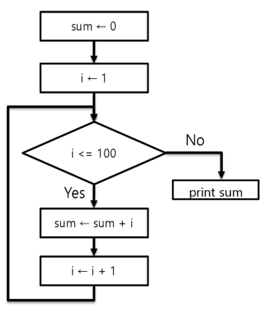

3. 의사코드(pseudocode)

```
INPUT: n (더할 마지막 수)

sum <- 0
FOR i FROM 1 TO n:
  sum <- sum + i

PRINT sum
```

4. Programming Language

```Java
public static int sum(int n) {
  int ans = 0;
  for (int i = 1; i <= n; i++) {
    ans += i;
  }
  return ans;
}
```


### ◾ 알고리즘 성능
- 문제를 해결하기 위해 다양한 알고리즘을 적용해 볼 수 있음 → 성능 분석이 필요!


### ◾ 예제) 1 부터 100까지 합을 구하는 문제
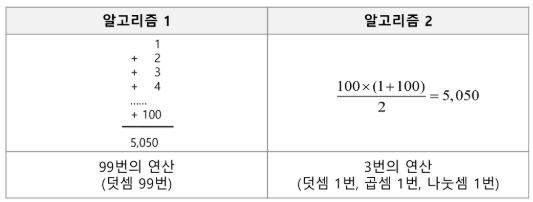


### ◾ 시간 복잡도(Time Complexity)

- 알고리즘이 문제를 해결하기 위해 얼마나 많은 연산(또는 단계)를 수행하는지를 나타내는 척도

- 입력 크기가 커졌을 때 알고리즘의 처리 시간이 어떻게 증가하는지를 파악함으로써 향후 대규모 데이터에 대해서도 효율적으로 동작할지 예측 가능

    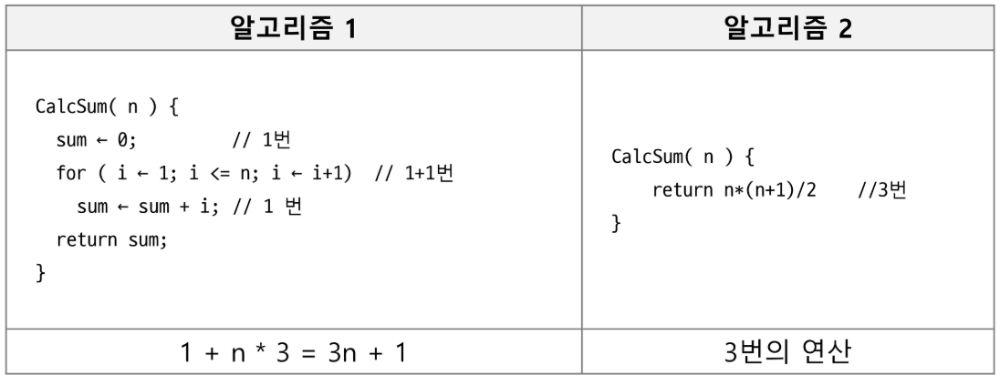


### ◾ 빅-오(O) 표기법
- 시간 복잡도를 표현할 때 주로 사용되는 방법

- 시간 복잡도의 최댓값 (최악의 경우)를 나타냄 

    → 입력 크기 N이 매우 커졌을 때, 연산 횟수가 어느 정도로 증가하는지를 나타내는 방식

- 시간 복잡도 함수 중에서 가장 큰 영향력을 주는 n에 대한 항만을 표시

- 계수(Coefficient)는 생략하여 표시

    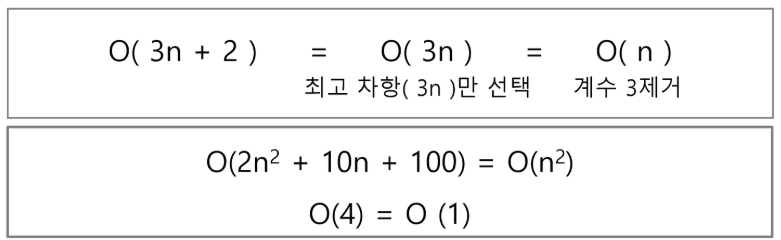


### ◾ 자주 사용되는 빅-오(O) 표기

| 표기        | 이름            | 설명                          | 예 |
|------------|----------------|------------------------------|----|
| **O(1)**       | 상수 시간        | 입력 크기와 관계없이 연산량이 일정 | 배열의 원소 접근 / 사칙연산<br>조건 비교 / 값 할당 |
| **O(log n)**   | 로그 시간        | 연산량이 log n에 비례           | 이진 탐색 |
| **O(n)**       | 선형 시간        | 연산량이 n에 비례               | 1차원 for문 탐색<br>최대 / 최소 찾기<br>일부 정렬 알고리즘 (병합, 힙, 퀵) |
| **O(n log n)** | 선형 로그 시간     | 연산량이 nlog n에 비례          | 우선순위 큐로 구현한 다익스트라 알고리즘 |
| **O(n²)**      | 2차 시간        | 연산량이 n²에 비례              | 2중 for문 탐색<br>일부 정렬 알고리즘 (버블, 선택, 삽입) |
| **O(2ⁿ)**      | 지수 시간        | 연산량이 2ⁿ에 비례              | 부분집합<br>재귀함수로 구현한 피보나치 수열 |
| **O(n!)**      | 팩토리얼 시간     | 연산량이 n!에 비례              | 순열 |
| **O(n³)**      | 3차 시간        | 연산량이 n³에 비례              | 3중 for문 탐색<br>플로이드-워셜 알고리즘 |


### ◾ 다양한 시간 복잡도의 비교
- 요소 수의 증가함에 따라 각기 다른 시간 복잡도의 알고리즘은 아래와 같은 연산 수를 보임

    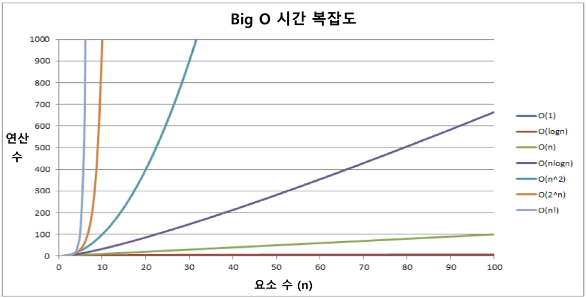


### ◾ 시간 복잡도 별 실제 실행 시간 비교
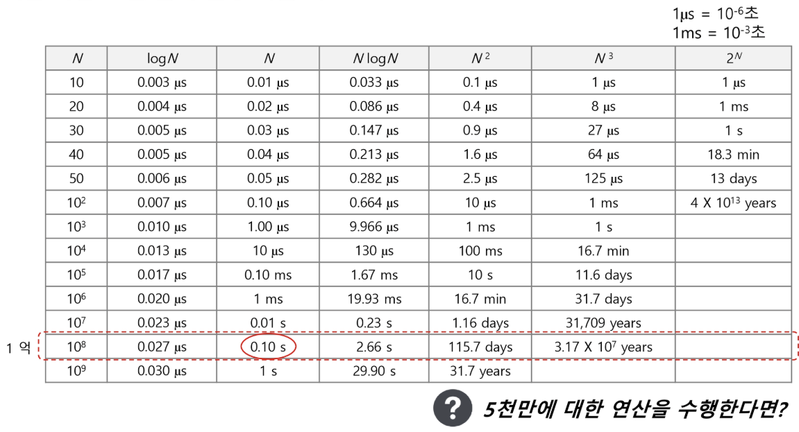


### ◾ SW 문제를 완벽하게 풀기 위한 5단계
1. **지문을 읽는다.** 
    $\rightarrow$ 지문을 읽고 핵심 부분을 파악한다.

2. **문제를 이해한다.**
    $\rightarrow$ 핵심 부분에서 정확히 요구하는 것이 무엇인지 분석한다.

3. **문제를 풀어본다.**
    $\rightarrow$ 노트에 손으로 문제를 풀어본다.

4. **풀이를 코딩한다.**
    $\rightarrow$ 노트로 풀어본 내용을 소스코드로 코딩한다.

5. **디버깅하고 검증한다.**
    $\rightarrow$ 디버깅을 하고 예외가 발생하지 않는지 검증한다.


### ◾ APS 기본 과정
- 자료구조 학습 (배열, 문자열, 스택, 큐, 연결리스트, 트리, 힙)
- 간단한 정렬 기법
- 코딩 체력을 기르는 단계
- 문제풀이와 친해지는 단계

### ◾ APS 응용 과정
- 알고리즘 기법 학습 (부분집합, 조합, 순열, DFS, BFS, $\cdots$)
- 고급 정렬 기법
- 컴퓨팅 사고력을 기르는 단계
- 문제풀이에 익숙해지는 단계


---


## ✅ 1차원 배열

### ◾ 배열(Array)
- 동일한 데이터 타입의 값(0개 이상)들을 저장하기 위한 자료구조

    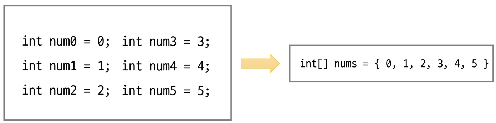


### ◾ 배열의 필요성

- 프로그램 내에서 여러 개의 변수가 필요할 때, 전부 다른 변수명을 이용하여 접근하는 것은 비효율적

- 배열을 사용하면 한 번의 선언을 통해서 여러 개의 데이터를 다룰 수 있음

- 여러 개의 변수를 편하게 사용하는 것이 아닌 다수의 변수로 하기 힘든 작업을 배열을 통해 쉽게 활용할 수 있음


### ◾ 1차원 배열의 선언 필요한 요소 3가지

1. **자료형** : 배열을 이루는 자료형 (기초자료형, 참조자료형 모두 가능)

2. **배열이름** : 프로그램에서 사용할 배열의 이름 (주소 값 저장)

3. **길이** : 배열을 이루는 요소의 값 (배열은 고정된 길이)

    - 자료형[] 배열이름 = new 자료형[길이];
    
    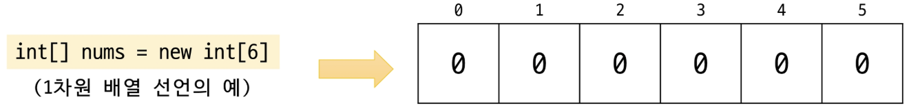


### ◾ 1차원 배열의 요소 접근
- 인덱스의 값은 0부터 시작
- 배열의 길이를 벗어나는 값을 사용할 수 없음(N개의 크기 $\rightarrow$ 0 ~ N-1 활용)

- `nums[0] = 10;`  // 배열 nums의 0번째 원소에 10을 저장
- `nums[idx] = 20;`  // 배열 nums의 idx번째 원소에 20을 저장 (idx = 4)

    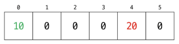


### ◾ 1차원 배열의 순회
- 배열의 요소를 빠짐 없이 탐색하는 방법
    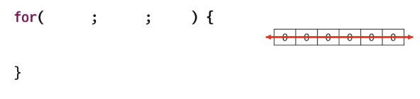


- 특정 인덱스를 기준으로 양쪽으로 이동
    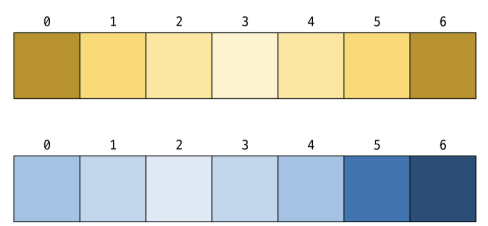


### ◾ Scanner
- 표준 입력(주로 콘솔)으로 부터 데이터를 쉽게 읽어오기 위해 사용되는 클래스
- `import java.util.Scanner;`
- `Scanner sc = new Scanner(System.in);`

| 주요 메서드      | 내용 |
|------------------|------|
| sc.nextInt()     | 정수형(int)을 읽음. |
| sc.next()        | 공백 전까지의 문자열을 읽음. |
| sc.nextLine()    | 개행 문자 포함 한 줄 전체를 문자열로 읽음. (버퍼 문제 발생 가능성 있음) |
| sc.close()       | Scanner를 종료하여 자원을 반환. |


- 익숙해지면 BufferedReader를 사용하기도 함(초보자는 추천 X, 코드가 길어 짐)


### ◾ 1차원 배열의 입력
- 1차원 배열의 길이 N이 주어지고, 다음 줄에는 1차원 배열의 값이 주어진다.

```
7
1342035
```
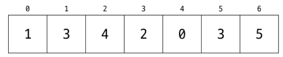


### ◾ 연습 문제 : Gravity

#### [ 문제 ] 
- 상자들이 쌓여 있는 방이 있다. 방이 오른쪽으로 90도 회전하여 상자들이 중력의 영향을 받아 낙하한다고 할 때, 낙차가 가장 큰 상자를 구하여 그 낙차를 리턴 하는 프로그램을 작성하시오.

#### [ 제약사항 ] 
- 중력은 회전이 완료된 후 적용된다. 방의 가로길이는 항상 100이며, 세로 길이도 항상 100이다. 즉, 상자는 최소 0, 최대 100 높이로 쌓을 수 있다.


### ◾ 연습 문제 : Gravity 그림 설명
- 그림 예) 총 26개의 상자가 회전 후, 오른쪽 방 그림의 상태가 된다. A 상자의 낙차가 7로 가장 크므로 7을 반환하면 된다.

- 회전 결과, B상자의 낙차는 6, C상자의 낙차는 1이다.

    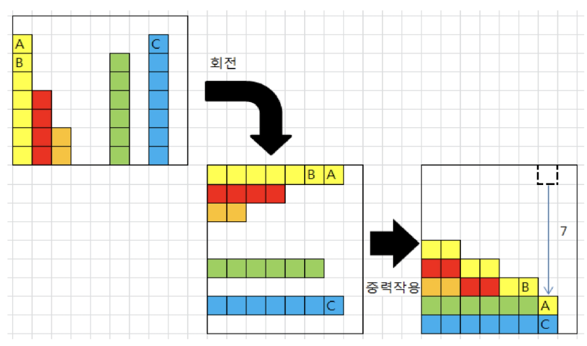


---


## ✅ 버블 정렬

### ◾ 정렬(Sort)
- 데이터(숫자, 문자, 객체 등)들을 일정한 규칙(오름차순, 내림차순 등)에 따라 순서대로 재배열 하는 것
- 다양한 알고리즘에서 선행 작업으로 활용되기도 함 (데이터 처리 속도 향상)
- 자바에서는 Arrays 클래스와 Collections 클래스에서 sort()메서드를 지원함


### ◾ 정렬(Sort)의 종류

- 버블 정렬 (Bubble Sort)

- 선택 정렬 (Selection Sort)

- 카운팅 정렬 (Counting Sort)

- 삽입 정렬 (Insertion Sort)

- 힙 정렬 (Heap Sort)

- 병합 정렬 (Merge Sort)

- 퀵 정렬 (Quick Sort)

- ...


### ◾ 버블 정렬(Bubble Sort)
- 인접한 두 개의 원소를 비교하여, 크기가 순서에 맞지 않는다면 서로 교환(Swap) 하는 과정을 반복하여 정렬하는 알고리즘
- 한 사이클이 끝날 때 마다 가장 큰(또는 작은) 원소가 끝에 위치하게 되는 모습이 거품이 올라오는 것과 유사하다고 하여 ‘버블 정렬’이라고 부름
- 시간 복잡도 : $O(N^2)$


### ◾ 버블 정렬(Bubble Sort) 과정
- 배열의 처음부터 끝까지 인접 원소를 짝지어 비교
- 비교한 두 원소의 <span style="color:red">순서가 잘못</span> 되어 있다면 교환(Swap) $\rightarrow$ 오름차순, 내림차순
- 한 사이클이 끝나면 배열의 마지막 인덱스에 가장 큰(작은) 원소가 위치
- 범위를 줄여 나가며 N-1번 정도 반복 수행하면 정렬 완료

####  Swap 방식
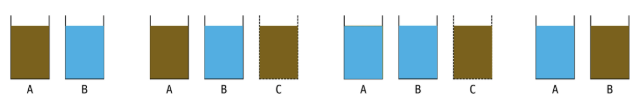


### ◾ 버블 정렬(Bubble Sort) 과정 { 55, 7, 78, 12, 42 } (오름차순)
- 첫 번째 사이클

    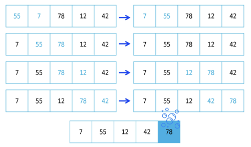

- 두 번째 사이클

    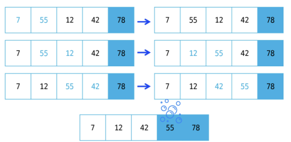

- 세 번째 사이클

    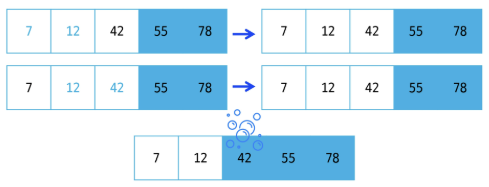

- 네 번째 사이클

    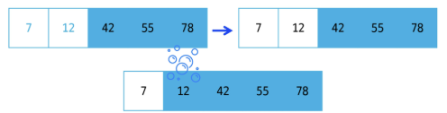

- 다섯 번째 사이클
    - 남은 원소가 하나이므로 이미 정렬된 것으로 볼 수 있음

    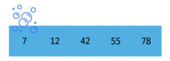


### ◾ 버블 정렬(Bubble Sort) 의사 코드
```java
bubbleSort(array A, n):
    for i in range from 0 to n-2:
        // i번째 패스 (맨 끝 i개는 이미 정렬됨)
        for j in range from 0 to (n-2 - i):
            if A[j] > A[j+1]:
                swap A[j] and A[j+1]
```