# 📚 목차 (Table of Contents)

### 인증 with Vue
- 회원가입
- 로그인
- 요청과 토큰
- 인증 여부 확인

### User Customize
- User Model Field 수정
- RegisterSerializer 수정

### 참고
- 로그아웃
- 기타 기능 구현
- Django Signals
- 환경 변수
- Vue 참고 자료
- 설치한 라이브러리 정리


---


# 🎯 학습 목표

✓ DRF에 로그인 요청 후 Pinia store에 인증 토큰을 저장한다.

✓ Pinia store의 토큰을 Authorization 헤더에 담아 요청한다.

✓ store의 토큰 유무에 따라 computed로 로그인 상태를 관리한다.

✓ Navigation Guard를 사용해 인증 여부에 따라 접근을 제어한다.

✓ dj-rest-auth의 회원가입 Serializer를 커스터마이징한다.

✓ Vue에서 회원가입 form을 만들고 DRF 서버에 데이터를 전송한다.

✓ 로그아웃 요청 후 store의 토큰 정보를 삭제할 수 있다.


---


# ✅ 인증 with Vue

## 🔵 사전 준비
- DB 초기화
    - db.sqlite3 삭제

- Migration 과정 재 진행

- 관리자 계정 생성 후, 게시글 1개 이상 작성
    - 기존 fixtures 데이터는 user 정보가 없으므로 사용 불가능


## 🔵 시작하기 전에 (1/2)
- 정상 작동하던 게시글 전체 조회가 작동하지 않음
    - 401 status code 확인

- 게시글 조회 요청 시 인증에 필요한 수단(token)을 보내지 않고 있으므로 게시글 조회가 불가능해진 것

    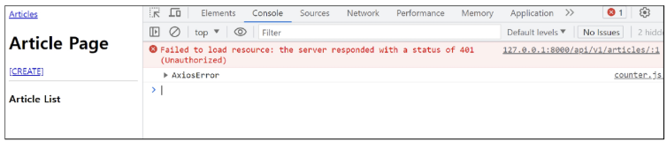


## 🔵 시작하기 전에 (2/2)
- 오늘은 회원가입/로그인 과정에서 token을 발급받아 store에 저장
- 인증이 필요한 요청마다 token을 함께 보내는 과정을 진행
- 401 오류가 해결되고 게시글이 정상적으로 출력되는 모습을 확인하는 것이 목표
    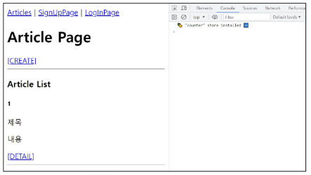


---


# ✅ 회원 가입


## 🔵 회원가입 로직 구현 (1/9)
- SignUpView route 관련 코드 주석 해제
```js
// router/index.js

import SignUpView from '@/views/SignUpView.vue' ⭐

const router = createRouter({
  // ...
  routes: [
    // ...
   { ⭐
      path: '/signup',
      name: 'SignUpView',
      component: SignUpView
    } // ...
  ]
})

export default router
```


## 🔵 회원가입 로직 구현 (2/9)
- App 컴포넌트에 SignUpView 컴포넌트로 이동하는 RouterLink 작성

```html
<!-- App.vue -->

<template>
  <header>
    <nav>
      <RouterLink :to="{ name: 'ArticleView' }">Articles</RouterLink>
      <RouterLink :to="{ name: 'SignUpView' }">SignUpPage</RouterLink>
    </nav>
  </header>
  <RouterView />
</template>
```


## 🔵 회원가입 로직 구현 (3/9)
- 회원가입 form 작성

```html
<!-- views/SignUpView.vue -->

<template>
<div>
  <h1>Sign Up Page</h1>
  <form @submit.prevent="signup">
    <label for="username">username:</label>
    <input type="text" id="username" v-model.trim="username" /> <br>

    <label for="password1">password:</label>
    <input type="password" id="password1" v-model.trim="password1" /> <br>

    <label for="password2">password confirmation:</label>
    <input type="password" id="password2" v-model.trim="password2" /> <br>

    <input type="submit" value="signup">
  </form>
</div>
</template>
```


## 🔵 회원가입 로직 구현 (4/9)
- 사용자 입력 데이터와 바인딩 될 반응형 변수 작성

```html
<!-- views/SignUpView.vue -->

<template>
<div>
  <h1>Sign Up Page</h1>
  <form @submit.prevent="signup">
    <label for="username">username:</label>
    <input type="text" id="username" v-model.trim="username" /> <br> ⭐

    <label for="password1">password:</label>
    <input type="password" id="password1" v-model.trim="password1" /> <br> ⭐

    <label for="password2">password confirmation:</label>
    <input type="password" id="password2" v-model.trim="password2" /> <br> ⭐

    <input type="submit" value="signup">
  </form>
</div>
</template>
```

```js
// views/SignUpView.vue
import { ref } from 'vue'

const username = ref(null) ⭐
const password1 = ref(null) ⭐
const password2 = ref(null) ⭐
```


## 🔵 회원가입 로직 구현 (5/9)
- SignUpView 컴포넌트 출력 확인
    - http://localhost:5173/signup

    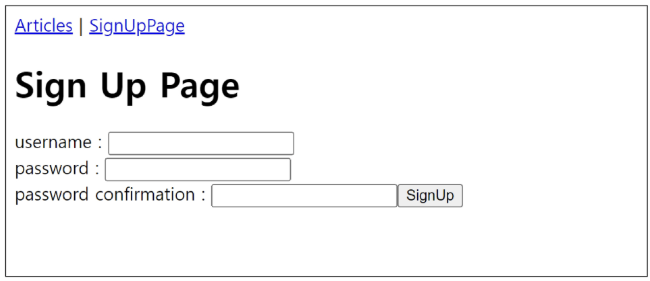


## 🔵 회원가입 로직 구현 (6/9)
- 회원가입 요청을 보내기 위한 signUp 함수가 해야 할 일
    
    1. 사용자 입력 데이터를 받아
    2. 서버로 회원가입 요청을 보냄

```js
// stores/accounts.js

export const useAccountStore = defineStore('account', () => {
  const signUp = function () { ⭐
    ...
  }
  return { signUp }
}, { persist: true })
```


## 🔵 회원가입 로직 구현 (7/9)
- 컴포넌트에 사용자 입력 데이터를 저장 후 store의 signUp 함수를 호출하는 함수 작성

```js
// views/SignUpView.vue
import { useAccountStore } from '@/stores/accounts'

const accountStore = useAccountStore()

const signUp = function () {
  const payload = {
    username: username.value,
    password1: password1.value,
    password2: password2.value,
    age: age.value, // (Optional field in some versions)
  }
  accountStore.signUp(payload)
}
```
```html
<!-- views/SignUpView.vue -->

<template>
  <div>
    <h1>Sign Up Page</h1>
    <form @submit.prevent="signUp"> ⭐
      <label for="username">username: </label>
      ...
    </form>
  </div>
</template>
```


## 🔵 회원가입 로직 구현 (8/9)
- 실제 회원가입 요청을 보내는 store의 signUp 함수 작성
```js
// stores/accounts.js
const signUp = function (payload) {
  const username = payload.username
  const password1 = payload.password1
  const password2 = payload.password2
  // // const { username, password1, password2 } = payload (Destructuring alternative)

  axios({
    method: 'post',
    url: `${API_URL}/accounts/signup/`,
    data: {
      username, password1, password2
    }
  })
  .then(res => {
    console.log('회원가입이 완료되었습니다.')
  })
  .catch(err => console.log(err))
}
```


## 🔵 회원가입 로직 구현 (9/9)
- 회원가입 테스트 후 Django DB 확인
    - 회원가입 성공 메시지가 콘솔에 출력됨 ("회원가입이 완료되었습니다.")
    - Django DB (accounts_user 테이블)에 새로운 사용자 (test2)가 생성되었음을 확인
    
    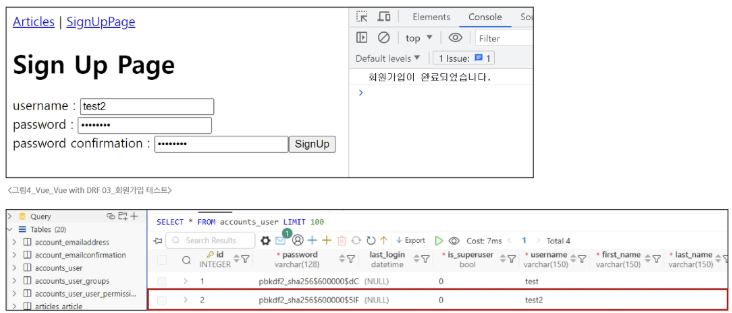


---


# ✅ 로그인


## 🔵 로그인 로직 구현 (1/9)
- LogInView route 관련 코드 주석 해제

```js
// router/index.js

import LogInView from '@/views/LogInView.vue' ⭐

const router = createRouter({
  // ...
  routes: [
    // ...
    { ⭐
      path: '/login',
      name: 'LogInView',
      component: LogInView
    }
  ]
})
```


## 🔵 로그인 로직 구현 (2/9)
- App 컴포넌트에 LogInView 컴포넌트로 이동하는 RouterLink 작성

```HTML
<!-- App.vue -->

<template>
  <header>
    <nav>
      <RouterLink :to="{ name:'ArticleView' }">Articles</RouterLink>
      <RouterLink :to="{ name:'SignUpView' }">SignUpPage</RouterLink>
      <RouterLink :to="{ name:'LogInView' }">LogInPage</RouterLink> ⭐
    </nav>
  </header>
  <RouterView />
</template>
```


## 🔵 로그인 로직 구현 (3/9)
- 로그인 form 작성

```HTML
<!-- views/LoginView.vue -->

<template>
<div>
  <h1>LogIn Page</h1>
  <form @submit.prevent="login">
    <label for="username">username:</label>
    <input type="text" id="username" v-model.trim="username" /> <br>

    <label for="password">password:</label>
    <input type="password" id="password" v-model.trim="password" /> <br>

    <input type="submit" value="LogIn">
  </form>
</div>
</template>
```


## 🔵 로그인 로직 구현 (4/9)
- 사용자 입력 데이터와 바인딩 될 반응형 변수 작성

```HTML
<!-- views/LoginView.vue -->
 
<template>
<div>
  <h1>LogIn Page</h1>
  <form @submit.prevent="login">
    <label for="username">username:</label>
    <input type="text" id="username" v-model.trim="username" /> <br> ⭐

    <label for="password">password:</label>
    <input type="password" id="password" v-model.trim="password" /> <br> ⭐

    <input type="submit" value="LogIn">
  </form>
</div>
</template>
```

```html
<!-- views/LoginView.vue -->

<script setup>
import { ref } from 'vue';
const username = ref(null) ⭐
const password = ref(null) ⭐
</script>
```


## 🔵 로그인 로직 구현 (5/9)
- LogInView 컴포넌트 출력 확인
    - http://localhost:5173/login

    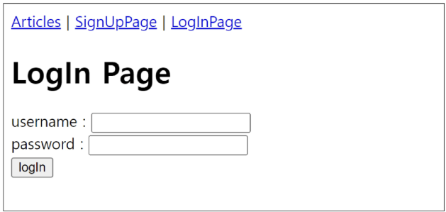


## 🔵 로그인 로직 구현 (6/9)
- 로그인 요청을 보내기 위한 logIn 함수가 해야 할 일

    1. 사용자 입력 데이터를 받아

    2. 서버로 로그인 요청 및 응답 받은 **토큰 저장**

```JavaScript
// stores/accounts.js

export const useAccountStore = defineStore('account', () => {
  const login = function () { // ... }
  return { signUp, logIn } ⭐
}, { persist: true })
```


## 🔵 로그인 로직 구현 (7/9)
- 컴포넌트에 사용자 입력 데이터를 저장 후 store의 logIn 함수를 호출하는 함수 작성

```JavaScript
// views/LogInView.vue

import { useAccountStore } from '@/stores/accounts'

const accountStore = useAccountStore()

const login = () => {
  const payload = {
    username: username.value,
    password: password.value
  }
  accountStore.logIn(payload)
}
```
```html
// views/LogInView.vue

<template>
  <div>
    <h1>LogIn Page</h1>
    <form @submit.prevent="login"> ⭐
    ...
    </form>
  </div>
</template>
```


## 🔵 로그인 로직 구현 (8/9)
- 실제 로그인 요청을 보내는 store의 logIn 함수 작성

```JavaScript
// stores/accounts.js

const logIn = function (payload) {
  const username = payload.username
  const password = payload.password

  axios({
    method: 'post',
    url: `${API_URL}/accounts/login/`,
    data: {
      username, password
    }
  })
  .then(res => {
    console.log('로그인이 완료되었습니다.')
    console.log(res.data)
  })
  .catch(err => console.log(err))
}
```


## 🔵 로그인 로직 구현 (9/9)
- 로그인 후 응답 객체 안에 Django가 발급한 Token이 함께 온 것을 확인

▶️ 이제 **Token을 store에 저장**하여 **인증이 필요한 요청마다 함께 보내기**

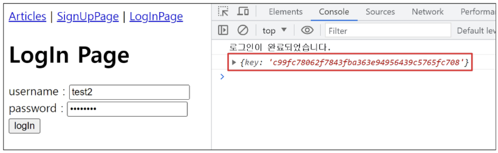


---


# ✅ 요청과 토큰


## 🔵 토큰 저장 로직 구현 (1/2) 
- 반응형 변수 token 선언 및 토큰 저장

```JavaScript

// stores/accounts.js

export const useAccountStore = defineStore('account', () => {
  const token = ref(null) // 반응형 변수 token 선언 ▶⭐

  const logIn = function (payload) {
    // ... axios login request ...
    .then(res => {
      // ... console.log('로그인이 완료되었습니다.')
      token.value = res.data.key // 토큰 저장 ⭐
    })
    .catch(err => console.log(err))
  }
  return { signUp, logIn, token } // token 반환 ⭐
}, { persist: true })
```


## 🔵 토큰 저장 로직 구현 (2/2) 
- 다시 로그인 요청 후 store에 저장된 토큰 확인
    - Pinia 개발자 도구에서 token 값이 성공적으로 저장된 것을 확인

    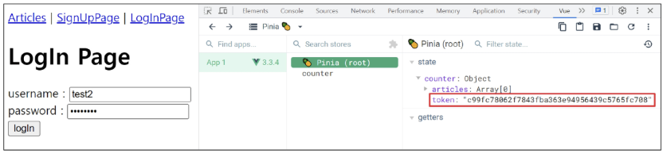


## 🔵 토큰이 필요한 요청 
1. 게시글 전체 목록 조회 시

2. 게시글 작성 시


## 🔵 게시글 전체 목록 조회 with token 
- 게시글 전체 목록 조회 함수(getArticles)에 token 추가 후 게시글 전체 목록 조회하기

```JavaScript
// stores/articles.js

import { useAccountStore } from './accounts'  ⭐

export const useArticleStore = defineStore('article', () => {
  const accountStore = useAccountStore() // account store 사용 ⭐

  const getArticles = function () {
    axios({
      method: 'get',
      url: `${API_URL}/api/v1/articles/`,
      headers: {
        'Authorization': `Token ${accountStore.token}` // token 추가 ⭐
      }
    })
   ...
```
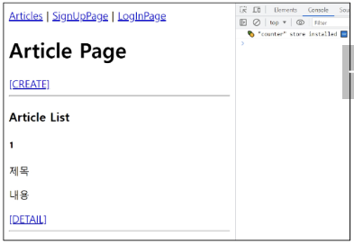


## 🔵 게시글 생성 with token 
- 게시글 생성 요청 함수(createArticle)에 token 추가 후 게시글 생성하기

```JavaScript
// views/CreateView.vue

import { useAccountStore } from '@/stores/accounts' 

const accountStore = useAccountStore() 

const createArticle = function () {
  axios({
    method: 'post',
    url: `${store.API_URL}/api/v1/articles/`,
    data: {
      // ... article data ...
    },
    headers: {
      'Authorization': `Token ${accountStore.token}` // token 추가
    }
  })
  // ...
}
```
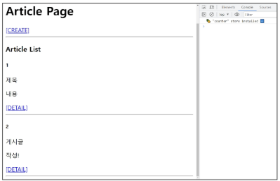


---


# ✅ 인증 여부 확인


## 🔵 사용자의 인증(로그인) 여부에 따른 추가 기능 구현
1. 인증되지 않은 사용자
    
    =>  메인 페이지 접근 제한

2. 인증된 사용자

    => 회원가입 및 로그인 페이지에 접근 제한


## 🔵 인증 상태 여부를 나타낼 속성 값 지정
- token 소유 여부에 따라 로그인 상태를 나타낼 isLogin 변수 작성
- 그리고 **computed**를 활용해 token 값이 변경될 때만 이 상태를 다시 계산하도록 함

> **computed** : 원본 데이터가 바뀔 때만, 값을 알아서 다시 계산해주는 ref

```JavaScript
// stores/accounts.js

export const useAccountStore = defineStore('account', () => {
  // ...

  const isLogin = computed(() => { // isLogin 변수 작성
    return token.value ? true : false
  })

  // ...
  return { signUp, logIn, token, isLogin } // isLogin 반환
}, { persist: true })
```


## 🔵 1. 인증되지 않은 사용자는 메인 페이지 접근 제한 (1/2) 
- **전역 네비게이션 가드 beforeEach**를 활용하여, 인증되지 않은 사용자가 보호된 페이지(예: 메인 페이지)로 이동하려 할 때 로그인 페이지로 리다이렉트

> **beforeEach** : 모든 페이지 이동 직전에 실행

```JavaScript
// router/index.js

import { useAccountStore } from '@/stores/accounts' 

const router = createRouter({ ... })

router.beforeEach((to, from) => {
  const accountStore = useAccountStore()

  if (to.name === 'ArticleView' && !accountStore.isLogin) {
    window.alert('로그인이 필요합니다.')
    return { name: 'LogInView' }
  }
})
```


## 🔵 1. 인증되지 않은 사용자는 메인 페이지 접근 제한 (2/2) 
- 브라우저 local storage에서 token을 삭제 후 메인 페이지 접속 시도
    - 로그인이 필요하다는 Alert 메시지 발생 후 로그인 페이지로 리다이렉트되는 것을 확인 

> **local storage** : 브라우저를 껐다 켜도, 데이터가 사라지지 않는 저장 공간


## 🔵 2. 인증된 사용자는 회원가입과 로그인 페이지에 접근 제한 (1/2) 
- 다른 주소에서 회원가입 또는 로그인 페이지로 이동 시 이미 인증된 사용자라면 메인 페이지로 이동시키기

```JavaScript
// router/index.js

router.beforeEach((to, from) => {
  const accountStore = useAccountStore()

  // 1. 인증되지 않은 사용자는 메인 페이지 접근 제한
  if (to.name === 'ArticleView' && !accountStore.isLogin) {
    window.alert('로그인이 필요합니다.')
    return { name: 'LogInView' }
  }

  // 2. 인증된 사용자는 회원가입/로그인 페이지 접근 제한
  if ((to.name === 'SignUpView' || to.name === 'LogInView') && (accountStore.isLogin)) {
    window.alert('이미 로그인 되어 있습니다.')
    return { name: 'ArticleView' }
  }
})
```


## 🔵 2. 인증된 사용자는 회원가입과 로그인 페이지에 접근 제한 (2/2) 
- 로그인 후 회원가입, 로그인 페이지 접속 시도 시
    - "이미 로그인 되어 있습니다." Alert 메시지 발생 후 메인 페이지로 리다이렉트되는 것을 확인

    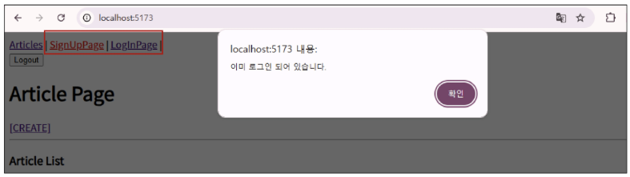


---


# ✅ User Customize

## 🔵 User Customize
- dj-rest-auth를 활용한 회원가입 시 User Model Customize 해보기


## 🔵 사전 준비
- DB 초기화
    - db.sqlite3 삭제


## 🔵 1. User Model에 필드 추가 (1/2)
- 사용자의 나이 정보를 저장할 PositiveIntegerField 추가

> **PositiveIntegerField** : 음수가 될 수 없는 숫자가 저장되는 필드

```Python
# accounts/models.py

from django.db import models
from django.contrib.auth.models import AbstractUser

# Create your models here.
class User(AbstractUser):
    age = models.PositiveIntegerField(null=True, blank=True)
```


## 🔵 1. User Model에 필드 추가 (2/2)
- makemigrations, migrate 작업 진행
```Bash
$ python manage.py makemigrations
Migrations for 'accounts':
  accounts\migrations\0002_user_age.py
    - Add field age to user
```

- age 필드 추가 확인 


## 🔵 2. Vue 회원 가입 기능 수정 (1/2) 
- age 입력을 위한 input과 변수 및 payload data 수정

> **payload data** : 헤더, 메타데이터를 제외한 전송의 목적이 되는 데이터

```HTML
<!-- views/SignView.vue -->

<template>
<div>
  <h1/>Sign Up Page</h1/>
  <form @submit.prevent="signup">
    <label for="age">age: </label>
    <input type="number" id="age" v-model.trim="age" /> <br>

    <input type="submit" value="signup" />
  </form>
</div>
</template>
```
```html
<!-- views/SignView.vue --> 

<script setup>

const age = ref(0) // age 변수 선언
...

const signUp = function () {
  const payload = {
    // ... username, password, password2 ...
    age: age.value, // payload data 수정
  }
  accountStore.signUp(payload)
}
</script>
```


## 🔵 2. Vue 회원 가입 기능 수정 (2/2)
- signUp 함수에 age 정보 추가

```JavaScript
// store/accounts.js
const signUp = function (payload) {
  const age = payload.age
  // // const { username, password1, password2, age } = payload

  axios({
    method: 'post',
    url: `${API_URL}/accounts/signup/`,
    data: {
      username: payload.username, 
      password1: payload.password1, 
      password2: payload.password2,
      age: age, // age 정보 추가
    }
  })
  .then(res => {
    console.log('회원가입이 완료되었습니다.')
  })
  .catch(err => console.log(err))
}
```


## 🔵 회원 가입 성공? (1/2) 
- 회원가입 요청 후, 응답 결과 확인
    - 콘솔에 '회원가입 완료되었습니다.' 메시지 출력.

    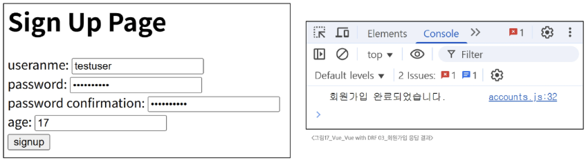


## 🔵 회원 가입 성공? (2/2) 
- 요청 보낸 유저 명으로 잘 생성되었으나, age 정보는 누락되었음
    - Django DB의 accounts_user 테이블에 age 필드 값이 (NULL)로 기록된 것을 확인.

    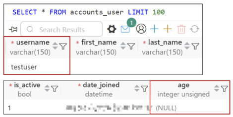


## 🔵 RegisterSerializer 
- dj-rest-auth의 RegisterSerializer의 field 정보 확인
- username, email, password1, password2 필드만 정의되어 있음

```Python

class RegisterSerializer(serializers.Serializer):
    username = serializers.CharField(
        max_length=get_username_max_length(),
        min_length=allauth_account_settings.USERNAME_MIN_LENGTH,
        required=allauth_account_settings.USERNAME_REQUIRED,
    )
    email = serializers.EmailField(required=allauth_account_settings.EMAIL_REQUIRED)
    password1 = serializers.CharField(write_only=True)
    password2 = serializers.CharField(write_only=True)
```


---


# ✅ Customize RegisterSerializer


## 🔵 회원 가입 기능 수정 (1/5) 
- CustomRegisterSerializer에 정의 (RegisterSerializer 상속)
- age 필드 추가 (필요하다면, first_name 등 기본 제공 필드 추가 가능)

```Python
# accounts/serializers.py

from dj_rest_auth.registration.serializers import RegisterSerializer
from rest_framework import serializers

class CustomRegisterSerializer(RegisterSerializer):
    age = serializers.IntegerField()
```


## 🔵 회원 가입 기능 수정 (2/5) 
- 유효성 검사를 위한 get_cleaned_data 함수 구조 확인
- 입력 받은 데이터의 유효성 검사 결과를 객체 형태로 반환해야 함

- 새롭게 추가한 필드도 추가하여 동일하게 동작할 수 있도록 수정

```Python
def get_cleaned_data(self):
    return {
        'username': self.validated_data.get('username', ''),
        'password1': self.validated_data.get('password1', ''),
        'email': self.validated_data.get('email', ''),
    }
```


## 🔵 회원 가입 기능 수정 (3/5) 
- super()를 사용하여, 기존 필드에 대한 유효성 검사 실행 후,
- 추가 필드에 대해 동일한 작업을 진행한 결과를 반영하여 반환

```Python
# accounts/serializers.py

from dj_rest_auth.registration.serializers import RegisterSerializer
from rest_framework import serializers

class CustomRegisterSerializer(RegisterSerializer):
    age = serializers.IntegerField()

    def get_cleaned_data(self):
        data = super().get_cleaned_data()
        data['age'] = self.validated_data.get('age')
        return data
```


## 🔵 회원 가입 기능 수정 (4/5) 
- save 함수도 유효성 검사 함수와 같은 작업을 진행

```Python
# accounts/serializers.py
# (CustomRegisterSerializer 클래스 내부)
from dj_rest_auth.registration.serializers import RegisterSerializer
from rest_framework import serializers

class CustomRegisterSerializer(RegisterSerializer):

    def save(self, request):
        user = super().save(request)
        user.age = self.validated_data.get('age')
        user.save()
        return user
```


## 🔵 회원 가입 기능 수정 (5/5) 
- dj-rest-auth가 CustomRegisterSerializer를 사용하도록 settings.py에 설정
- REST_AUTH_REGISTER_SERIALIZERS 주석 해제

```Python
# settings.py
# ...

REST_AUTH = {
    'REGISTER_SERIALIZER': 'accounts.serializers.CustomRegisterSerializer',
}
```


## 🔵 회원 가입 요청 및 결과 확인 
- 이전과 달리 정상적으로 age 정보가 기입된 것을 확인
    - Vue의 Sign Up Page에서 'testuser2', age: 17로 요청 후,
    - Django DB의 age 필드에 값 17이 정상적으로 저장되었음을 확인.

    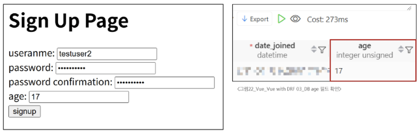


---


# ✅ 로그아웃


## 🔵 로그아웃 구현 (1/2)
- logOut 작성
    - 목표: 토큰을 삭제하고 메인 페이지로 이동

```js
// stores/accounts.js
import { useRouter } from 'vue-router' // vue-router import

export const useAccountStore = defineStore('account', () => {
  const router = useRouter() // router 사용

  const logOut = function () {
    axios({
      method: 'post',
      url: `${API_URL}/accounts/logout/`
    })
    .then(res => {
      token.value = null // 토큰 삭제
      router.push({ name: 'ArticleView' }) // 메인 페이지로 이동
    })
    .catch(err => console.log(err))
  }
  
  return { signUp, logIn, token, isLogin, logOut } // logOut 반환
}, { persist: true })
```


## 🔵 로그아웃 구현 (2/2)
- App 컴포넌트에 로그아웃 form 요소 작성
    - 목표: 로그아웃 버튼 클릭 시 logOut 함수 실행

```HTML
<!-- App.vue -->
<form @submit.prevent="logOut">
  <input type="submit" value="Logout">
</form>
```
```js
// App.vue
<script setup>
import { useAccountStore } from '@/stores/accounts'
const accountStore = useAccountStore()

const logOut = function () {
  accountStore.logOut()
}
</script>
```


---


# ✅ 기타 기능 구현


## 🔵 자연스러운 흐름을 위한 기타 기능 구현
1. 로그인 성공 후 자동으로 메인 페이지로 이동하기

2. 회원가입 성공 후 자동으로 로그인까지 진행하기


## 🔵 1. 로그인 성공 후 자동으로 메인 페이지로 이동하기
- logIn 함수에 메인 페이지로 이동하는 로직 추가

```js
// stores/accounts.js

import { useRouter } from 'vue-router'

export const useAccountStore = defineStore('account', () => {
  const router = useRouter()

  const logIn = function (payload) {
    // ... axios login request ...
    .then(res => {
      token.value = res.data.key
      router.push({ name: 'ArticleView' }) // 메인 페이지 이동 추가
    })
    // ...
  }
  // ...
})
```


## 🔵 2. 회원가입 성공 후 자동으로 로그인까지 진행하기 
- signUp 함수에 logIn 함수를 호출하는 로직 추가

```JavaScript
// stores/accounts.js

const signUp = function (payload) {
  // ... axios signup request ...
  .then(res => {
    // console.log('회원가입이 완료되었습니다.')
    const password = payload.password1 // 비밀번호 저장
    logIn({ username: payload.username, password }) // logIn 함수 호출
  })
  .catch(err => console.log(err))
}
```


---


# ✅ Django Signals


## 🔵 Django Signals
- "이벤트 알림 시스템"
- 애플리케이션 내에서 특정 이벤트가 발생할 때, 다른 부분에 신호를 보내 이벤트가 발생했음을 알릴 수 있음
- 주로 모델의 데이터 변경 또는 저장, 삭제와 같은 작업에 반응하여 추가적인 로직을 실행하고자 할 때 사용
    - 예: 사용자가 새로운 게시글을 작성할 때마다 특정 작업(예: 이메일 알림 보내기)을 수행하려는 경우

```python
# articles/signals.py
from django.db.models.signals import post_save
from django.dispatch import import receiver
from .models import Article

# Article 모델의 post_save 신호를 이 함수가 받도록 설정
@receiver(post_save, sender=Article)
def article_post_save(sender, instance, created, **kwargs):
    # 'created'는 객체가 새로 생성되었을 때 True
    if created:
        print(f"새로운 게시글이 작성되었습니다! (제목: {instance.title})")
```


---


# ✅ 환경 변수


## 🔵 환경 변수(environment variable)
- 애플리케이션의 설정이나 동작을 제어하기 위해 사용되는 변수

- 개발, 테스트 및 프로덕션 환경에서 다르게 설정되어야 하는 설정 값이나 **민감한 정보(ex. API key)를 포함**

- 환경 변수를 사용하여 애플리케이션의 설정을 관리하면, 다양한 환경에서 일관된 동작을 유지하면서 필요에 따라 변수를 쉽게 변경할 수 있음

- **보안적인 이슈를 피하고**, 애플리케이션을 다양한 환경에 대응하기 쉽게 만들어 줌


## 🔵 Vite에서 환경 변수를 사용하는 법
- .env.local 파일 생성 및 API 변수 작성
- 주의사항
    - 변수명은 반드시 VITE_ 접두어를 작성해야 함
    - 변수명과 값 사이에 공백이 없어야 함

```JavaScript
// JavaScript 코드에서 접근
const API_KEY = import.meta.env.VITE_TMDB_API_KEY
```


---


# ✅ Vue 참고 자료


## 🔵 Vue 프로젝트 진행 시 유용한 자료
### Awesome Vue.js
- Vue와 관련하여 엄선된 유용한 자료를 아카이빙 및 관리하는 프로젝트
- https://github.com/vuejs/awesome-vue
- https://awesome-vue.org/

### Vuetify
- Vue를 위한 UI 라이브러리 (ex. 'Bootstrap')
- https://vuetifyjs.com/en/


---


# ✅ 설치한 라이브러리 정리


## 🔵 설치한 라이브러리 정리
### pinia-plugin-persistedstate
- Pinia의 상태를 브라우저의 localStorage에 자동으로 저장해주는 플러그인

### axios
- Vue가 Django 서버와 데이터를 주고받기 위해 사용하는 HTTP 통신 라이브러리

### djangorestframework
- Django로 REST API를 구축하기 위한 핵심 프레임워크

### django-cors-headers
- CORS(교차 출처 리소스 공유) 헤더를 처리해주는 라이브러리

### dj-rest-auth
- Django의 기본 인증 시스템을 기반으로 로그인, 로그아웃, 비밀번호 변경 등의 기능을 API 엔드포인트로 제공

### 'dj-rest-auth[with-social]'
- 기본 dj-rest-auth 기능에 더해 API를 구현하는 데 필요한 django-allauth 라이브러리를 함께 설치


---


# 📚 총 정리

## 🔑 핵심 키워드

| 개념               | 설명                  | 예시                                    |
| ---------------- | ------------------- | ------------------------------------- |
| **토큰 인증**        | 발급된 토큰으로 사용자를 인증    | `Authorization: Token <key>`          |
| **dj-rest-auth** | DRF 인증 기능 제공 라이브러리  | 회원가입, 로그인 API 제공                      |
| **Pinia에 토큰 저장** | 로그인 성공 시 응답 토큰을 저장  | `token.value = res.data.key`          |
| **인증된 요청**       | 요청 헤더에 토큰을 포함하여 전송  | `headers: { Authorization }`          |
| **내비게이션 가드**     | 인증 여부에 따라 페이지 접근 제어 | `router.beforeEach((to, from) => {})` |


---


## 📝 요약 및 정리

### DRF 인증과 Vue 연동
- DRF 서버의 토큰 기반 인증 시스템을 Vue 애플리케이션과 연동하여 회원가입, 로그인, 로그아웃 기능을 구현

- 회원가입
    - Vue에서 회원가입 폼을 만들고 v-model로 사용자 입력 받기
    - 폼을 제출하면 Pinia의 signUp 액션을 호출
    - signUp 액션은 axios를 사용해 DRF의 회원가입 API(/accounts/signup/)로 POST 요청 보내기

- 로그인 및 토큰 관리
    - Vue에서 로그인 폼을 만들고 v-model로 사용자 입력을 받기
    - 폼을 제출하면 Pinia의 logIn 액션을 호출
    - logIn 액션은 axios를 사용해 DRF의 로그인 API(/accounts/login/)로 POST 요청 보내기
    - 요청이 성공하면 DRF 서버는 응답으로 인증 토큰(Token)을 보내주고, Pinia state에 token을 저장하여 로그인 상태를 유지

- 인증된 요청 보내기
    - 게시글 조회처럼 인증이 필요한 API를 요청할 때는, Pinia에 저장된 토큰을 axios 요청 헤더에 포함하기
    - 헤더 형식은 headers: { 'Authorization': 'Token ${token}' } 와 같이 구성


### 인증 여부에 따른 접근 제어
- 로그인 상태 확인
    - Pinia store에 token의 존재 여부에 따라 true 또는 false를 반환하는 computed 속성(isLogin)을 만들어 로그인 상태를 쉽게 확인

- 내비게이션 가드 활용
    - Vue Router의 전역 가드(beforeEach)를 사용하여 페이지 접근을 제어
    - 로그인이 필요한 페이지에 비로그인 사용자가 접근하면 로그인 페이지로 redirection
    - 로그인된 사용자가 회원가입이나 로그인 페이지에 접근하면 메인 페이지로 redirection


### DRF User 모델 커스터마이징
- dj-rest-auth의 기본 회원가입 기능에 age와 같은 추가 필드를 포함시키기 위해 Serializer를 커스터마이징

- Django 모델 수정
    - accounts/models.py의 User 모델에 age 필드를 추가하고 makemigrations 및 migrate 실행

- 커스텀 Serializer 생성
    - dj-rest-auth의 RegisterSerializer를 상속받는 CustomRegisterSerializer를 생성하고 age 필드 추가

    - get_cleaned_data와 save 메서드를 오버라이딩하여 age 데이터를 처리하도록 수정

- Django 설정
    - settings.py에 dj-rest-auth가 이 커스텀 Serializer를 사용하도록 REST_AUTH 설정을 추가

- Vue 폼 수정
    - Vue의 회원가입 폼에도 age를 입력받는 `<input>` 필드를 추가


---


### 난 시간, DRF에 권한 설정을 추가하자 게시글 조회가 401 Unauthorized 오류와 함께 막혔습니다. 어떻게 해결했을까요?

- 인증 과정에서 프론트엔드(Vue)의 역할을 알아봤습니다.

- 로그인을 통해 DRF로부터 토큰을 발급받아 Pinia에 저장했고, 이후 모든 요청 헤더에 토큰을 담아 보내면서 문제를 해결했습니다.

```js
// 1. 로그인 요청 후, 응답받은 토큰을 store에 저장합니다.
export const useAccountStore = defineStore('account', () => {
  const token = ref(null)
  const logIn = function (payload) {
    // ...
    .then(res => {
      token.value = res.data.key
    })
    // ...
  }
  return { signUp, logIn, token }
}, { persist: true })
```

```JavaScript
// 2. 인증이 필요한 요청 시, 저장된 토큰을 헤더에 담아 보냅니다.
axios({
  method: 'get',
  url: API_URL,
  headers: {
    Authorization: `Token ${accountStore.token}`
  }
})
```